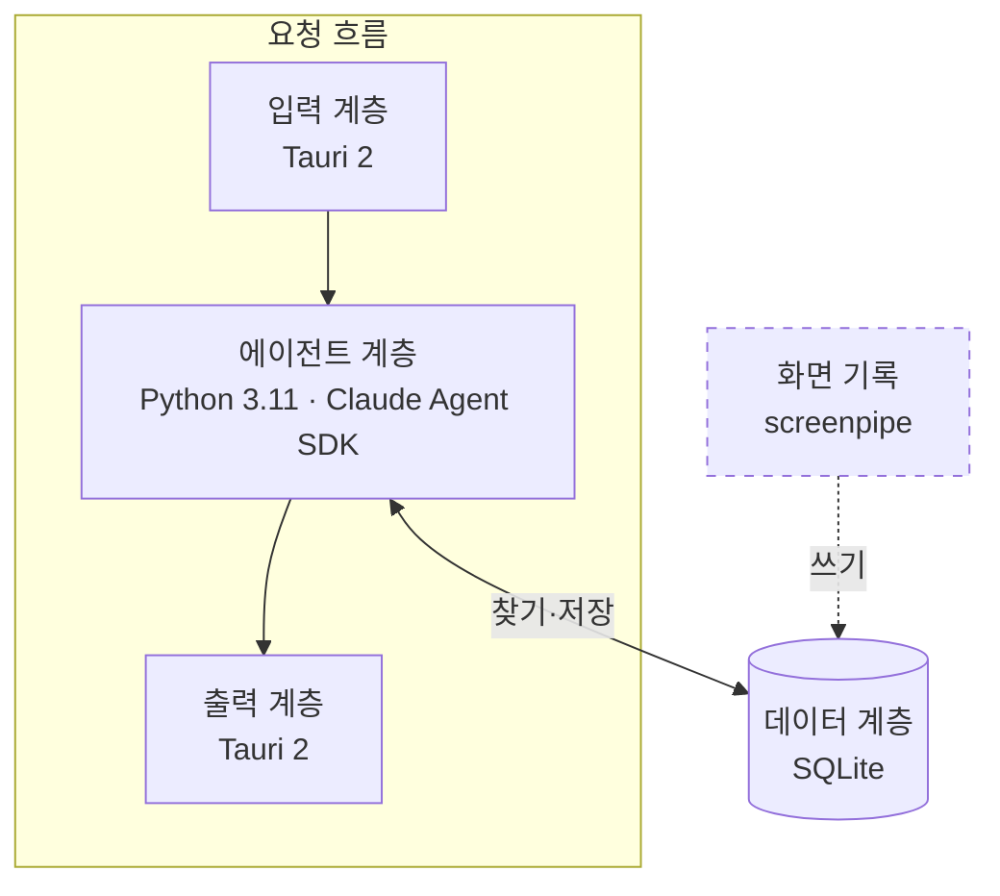
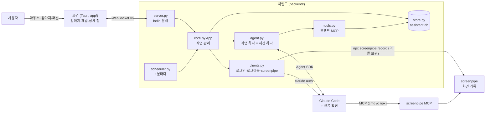
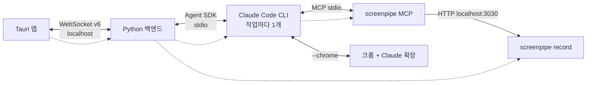
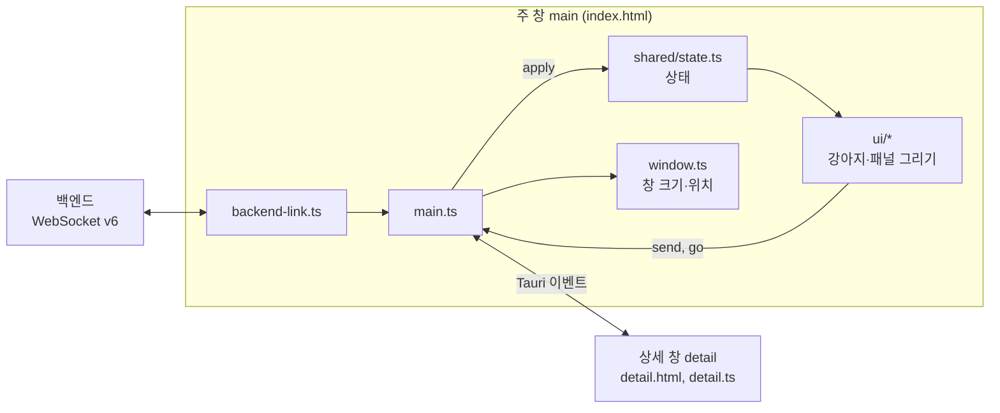

# ARCHITECTURE

TamagotchiChatBot의 구조와 동작 원리다. 지금 코드가 **어떻게 동작하는지**만 적는다.

> 기준: 브랜치 `feat/assistant`. 화면과 백엔드 모두 프로토콜 v6이다. 프로젝트를 조수로 바꾸면서 다마고치 기능을 모두 지웠다 ([0022](docs/decisions/0022-pivot-to-assistant.md)). 백엔드는 [조수 1단계 스펙](docs/superpowers/specs/2026-10-21-assistant-phase1-design.md)대로, 화면은 [화면 계획](docs/superpowers/plans/2026-10-22-assistant-frontend.md)과 [디자인 다이제스트](docs/design/2026-10-21-output-ui/digest.md)대로 다시 만들었다.

## 1. 한눈에 보기

| 계층 | 위치 | 하는 일 | 하지 않는 일 | 근거 |
|---|---|---|---|---|
| 입력 | 프론트 | 사용자 요청을 받아 그대로 넘긴다 | 맥락 모으기 | [0026](docs/decisions/0026-input-layer-passes-request-only.md) |
| 출력 | 프론트 | 진행·질문·결과·실패를 보여 준다 | 컴퓨터에 행동하기 | [0028](docs/decisions/0028-output-layer-is-ui.md) |
| 에이전트 | 백엔드 → Claude Code | 작업을 수행하고, 필요한 맥락을 데이터 계층에서 직접 찾는다 | — | [0029](docs/decisions/0029-claude-code-harness-and-session-per-task.md), [0031](docs/decisions/0031-retrieval-by-agent-tool-search.md) |
| 데이터 | 백엔드 SQLite + screenpipe DB | 작업·대화·스케줄 기록, 화면 기록을 담는다 | — | [0027](docs/decisions/0027-data-layer-ownership.md) |
| 화면 기록 (계층 아님) | screenpipe (백그라운드) | 요청과 상관없이 화면을 기록해 데이터 계층에 쓴다 | 요청 처리 | [0026](docs/decisions/0026-input-layer-passes-request-only.md) |

### 구성 요소로 보기

- 화면(Tauri 앱, `app/`)과 백엔드(`backend/`)는 localhost WebSocket으로 통신한다. 규약은 [프로토콜](docs/backend-protocol.md)이다.
- 백엔드는 화면을 모른다 ([0022](docs/decisions/0022-pivot-to-assistant.md)).
- 작업 하나 = 대화 하나 = Claude Code 세션 하나다 ([0029](docs/decisions/0029-claude-code-harness-and-session-per-task.md), [0030](docs/decisions/0030-io-interface-task-as-conversation.md)). 스케줄도 작업 하나다 ([0032](docs/decisions/0032-schedule-creation.md)). 대화 탭은 출처 `chat`인 작업 하나로, 처음 시작할 때 만들고 그 세션을 계속 이어 쓴다. 작업 목록·알림에는 넣지 않는다 ([0033](docs/decisions/0033-chat-tab-single-session.md)). 대화에서 일을 맡기면 에이전트가 `create_task`로 새 작업을 만들고 대화에 작업 칩 줄을 남긴다.
- 여러 작업이 동시에 돈다. 질문·권한 요청은 대화의 질문 줄이 되고, 사용자의 `say`가 답이 된다.

## 1.1 프로세스와 통신

실제로 뜨는 프로그램과 그 사이의 통신이다. 실선은 통신, 점선은 "띄운다"다.

| 프로세스 | 띄우는 쪽 | 언제 뜨나 | 언제 끄나 | 코드 |
|---|---|---|---|---|
| Tauri 앱 | 사용자 | 앱 실행 | 트레이 → 종료 | `app/src-tauri/src/lib.rs` |
| Python 백엔드 | Tauri 앱 | 접속이 안 되면 띄우고 다시 접속(2초에서 두 배씩 30초까지). 이미 떠 있으면 그대로 | 앱이 끝날 때 `taskkill /T /F`로 트리째 | `src-tauri/src/backend.rs`, `src/backend-link.ts` |
| Claude Code CLI | 백엔드 (Agent SDK) | 작업이 돌 때. 작업 하나에 하나 | 작업이 끝나거나 멈출 때 | `backend/agent.py` |
| screenpipe MCP | Claude Code | Claude Code 세션마다 (`cmd /c npx -y screenpipe-mcp@latest`) | 세션과 함께 | `backend/agent.py` `SCREENPIPE` |
| screenpipe record | 백엔드 | 시작 때 화면 기록 설정이 켜져 있으면. 설정을 켜도 뜬다 | 설정을 끄거나 백엔드가 끝날 때 | `backend/clients.py`, `config.screenpipe_cmd` |
| 크롬 + Claude 확장 | 사용자 | 사용자가 띄운 크롬 | — | — |

| 통신 | 방식 | 근거 |
|---|---|---|
| 앱 ↔ 백엔드 | WebSocket. 포트·토큰은 `backend.json`에서 읽고 `hello`로 인증 | [프로토콜](docs/backend-protocol.md) |
| 백엔드 ↔ Claude Code | Agent SDK (`ClaudeSDKClient`). 질문·권한 요청은 `can_use_tool` 콜백으로 온다 | [스파이크](docs/spikes/2026-10-21-agent-sdk-claude-code.md) |
| Claude Code → 백엔드 도구 | 백엔드 프로세스 안의 MCP 서버 `assistant` (`create_sdk_mcp_server`). 별도 프로세스가 아니다 | [0031](docs/decisions/0031-retrieval-by-agent-tool-search.md), `backend/tools.py` |
| Claude Code ↔ 크롬 | `--chrome` 옵션. 구독 로그인일 때만 켜진다 | [스파이크](docs/spikes/2026-10-21-agent-sdk-claude-code.md) |
| screenpipe MCP → screenpipe | localhost:3030 REST | [비슷한 제품 조사](docs/references/similar-products.md) |

## 2. 화면 (`app/`)

마우스로만 쓴다. 전역 단축키·입력창·키 설정 창은 없다 (스펙 3절, 사용자). 모양과 문구는 [디자인 다이제스트](docs/design/2026-10-21-output-ui/digest.md)를, 다이제스트에 없던 값은 [화면 계획](docs/superpowers/plans/2026-10-22-assistant-frontend.md)의 "정한 값"을 따른다.

| 창 | 파일 | 하는 일 |
|---|---|---|
| 주 창 `main` | `index.html`, `src/main.ts` | 투명·테두리 없음·항상 위·작업 표시줄에 안 보임. 강아지(128x96)와 패널(너비 340px)을 그린다. 백엔드 연결을 들고 상태를 쌓는다 |
| 상세 창 `detail` | `detail.html`, `src/detail.ts` | 작업 하나의 대화를 크게(880x544) 본다. 패널의 "창으로 크게 보기"로 연다. 백엔드에 직접 붙지 않고 주 창과 Tauri 이벤트로 주고받는다(`detail-open`·`detail-data`·`detail-send-failed`를 받고, `detail-say`·`detail-stop`·`detail-seen`·`detail-go`를 보낸다). 닫기를 누르면 숨기기만 한다 |

- **창 크기와 위치** (`src/window.ts`): 패널이 닫히면 창은 강아지 크기, 열리면 패널 + 12px + 강아지 크기다. 늘 주 모니터 작업 영역의 오른쪽 아래(오른쪽 끝 − 20px, 아래 끝)에 붙인다. 패널 높이가 바뀌면(`ResizeObserver`) 다시 맞춘다. 겹친 요청은 차례로 하고 가장 최근 것만 적용한다.
- **강아지**: 누르면 패널을 열고 닫는다. 자세·배지·툴팁(브라우저 기본 `title`)은 상태에서 계산한다. 로그아웃이면 잠자고, 패널을 열면 설정 탭부터 보인다. 연결이 끊기면 앉고, 패널 맨 위에 `백엔드에 연결하는 중…` 띠가 뜬다.
- **패널**: 탭 여섯(알림·대화·작업·스케줄·사용량·설정)과 그 안의 화면(새 작업, 작업 대화, 새 스케줄, 스케줄 대화, 지시서 수정). 그림자는 없다(창 끝에서 잘린다). 목록은 한 쪽 4줄이고 페이저를 늘 보인다.
- **대화 화면** (`src/ui/conversation.ts`): 작업 대화·스케줄 대화·대화 탭·상세 창이 함께 쓴다. 이어진 진행 줄은 칩 하나로 접는다. 에이전트 글은 작은 마크다운(굵게, 인라인 코드, 목록, 줄바꿈)을 DOM으로 그린다(`innerHTML`을 쓰지 않는다). 입력은 늘어나는 textarea, Enter 보내기, Shift+Enter 줄바꿈, 한글 조합 중 Enter는 무시. 질문·제안 카드의 선택지는 보낸 뒤에만 막는다.
- **다시 붙기** (`src/backend-link.ts`): 접속하지 못하거나 끊기면 백엔드를 띄우고(이미 떠 있으면 그대로) 다시 접속한다. 간격은 2초에서 두 배씩 30초까지 늘고 붙으면 2초로 돌아간다(잠정값). 백엔드가 닫은 코드 4001~4003이면 다시 띄우지 않고 로그만 남긴다. 끊기면 백엔드에서 받은 것을 모두 버리고, 다시 붙으면 보던 화면에 필요한 목록을 다시 받는다.
- **트레이**: `종료` 하나. 주 창이 닫혀도(Alt+F4 등) 앱이 끝난다.
- **앱 종료** (`src-tauri/src/backend.rs`): 이 앱이 띄운 백엔드를 `taskkill /PID <pid> /T /F`로 프로세스 트리째 끈다. 백엔드가 띄운 screenpipe·Claude Code가 남지 않게 하려는 것이다. 다른 곳에서 띄운 백엔드는 건드리지 않는다.

| 모듈 | 하는 일 |
|---|---|
| `src/shared/protocol.ts` | 프로토콜 v6 메시지 타입, 해석과 생성 |
| `src/shared/state.ts` | 화면 상태. 백엔드 메시지 쌓기(`apply`), 강아지 자세·배지·툴팁, 다시 붙거나 화면을 열 때 보낼 요청, 배지를 세려고 알림 뒤쪽을 훑는 요청(`followUps`) |
| `src/shared/entries.ts` | 대화 줄을 그릴 항목으로 묶기(진행 줄 접기, 질문·제안 카드, 답한 카드 기억) |
| `src/shared/markdown.ts` | 에이전트 글의 작은 마크다운 해석 |
| `src/shared/forms.ts` | 스케줄 양식 ↔ 규칙, 보내기 키 판정, 시각·남은 시간 글, 사용량 줄 |
| `src/shared/schedules.ts` | 스케줄 목록 행·지시서 줄의 글, 양식 채우기·검사 |
| `src/shared/settings.ts` | 권한 모드 선택지 문구 |
| `src/ui/*.ts`, `src/ui/styles.css` | DOM 그리기: `dog`, `panel`(틀·탭·새 작업), `lists`(알림·작업 목록), `conversation`, `schedule`, `usage`, `settings`, `dom`(작은 도우미) |
| `src-tauri/src/lib.rs` | 트레이(종료), 창 이벤트(상세 창은 숨기기, 주 창은 앱 종료), 앱이 끝날 때 백엔드 끄기 |
| `src-tauri/src/backend.rs` | 접속 정보 파일 읽기, 개발 환경에서 `backend/.venv`의 파이썬으로 백엔드 띄우기, 트리째 끄기 |
| `public/sprites/dog/` | 강아지 스프라이트 시트(프레임 64x48을 2배로 그린다) |

`src/shared/*.ts`는 Vitest로 단위 시험한다(`app/tests/`). 창·실제 백엔드에 기대는 동작은 [화면 수동 확인](docs/manual-checks/frontend.md)으로 본다.

## 3. 백엔드 (`backend/`)

| 파일 | 하는 일 |
|---|---|
| `backend/__main__.py` | 실행 진입점. 이미 떠 있는 백엔드가 있으면 끝낸다. 저장소 → `App` → `startup`(끊긴 작업 닫기, 대화 작업이 없으면 만들기, 화면 기록 설정이 켜져 있으면 screenpipe 띄우기) → 빈 포트에서 WebSocket을 열고 `backend.json`에 포트·토큰을 쓴다 → 스케줄러를 돌린다. 끝날 때 screenpipe를 끄고 `backend.json`을 지운다 |
| `backend/server.py` | 전송 계층. `hello` 인증·버전 확인, 화면 교체, `type`별로 `App` 메서드를 부른다(`ROUTES`). 필드가 빠지거나 타입이 틀리면 버린다. 메서드 오류는 로그만 남기고 연결을 유지한다. `login`·`logout`은 기다리지 않고 따로 돌린다 |
| `backend/core.py` | 작업 관리(`App`). 화면 메시지마다 메서드 하나. 작업마다 Claude Code 세션을 백그라운드로 돌리고, 세션에서 일어난 일을 대화 줄·상태로 저장해 화면에 순서대로 보낸다. 스케줄 실행(`run_schedule`), 대화 작업, 로그아웃, 설정(권한 모드·화면 기록 켜고 끄기), 사용량도 여기서 |
| `backend/agent.py` | Claude Code 세션 하나(`AgentRun`). 실행 옵션(`build_options`: 하네스, 크롬, 켜고 끄는 도구, screenpipe MCP), 질문·권한 요청을 사용자 답으로 기다리기, 덧붙이기, 멈추기 |
| `backend/harness.md` | Claude Code에 붙이는 하네스 문서 (역할, 맥락 찾기, 일하는 방식, 하지 말 것, 말투) |
| `backend/tools.py` | 백엔드 MCP 도구. 작업 기록 찾기·읽기, 제목 붙이기, 스케줄 읽기·만들기·고치기(사용자 확인 뒤 저장), 새 작업 만들기(`create_task`, 대화에 작업 칩을 남긴다) |
| `backend/store.py` | SQLite 저장소. 작업·대화 줄·스케줄·설정(권한 모드, 화면 기록 켬/끔). 검색은 FTS5. 목록 한 쪽은 4줄. 작업 목록·알림 보기는 대화 작업을 뺀다 |
| `backend/schedule_rule.py` | 스케줄 규칙 검사, 다음 실행 시각, 표시 글(`매일 09:00`) |
| `backend/scheduler.py` | 1분마다 때가 된 스케줄을 `App.run_schedule`에 시킨다. 도는 중이거나 앱이 꺼져 놓친 실행은 건너뛴다 |
| `backend/clients.py` | 외부 프로세스. `claude auth status/login/logout`(구독 로그인 확인·로그인·로그아웃), screenpipe 띄우기·끄기(윈도에서는 `taskkill /T`로 트리째) |
| `backend/config.py` | 데이터 폴더·DB·작업 폴더 경로, Claude Code 환경(`ANTHROPIC_API_KEY`를 빈 값으로 덮는다), screenpipe 명령을 읽는 유일한 곳 (CLAUDE.md 3절) |

## 4. 저장과 실행

| 무엇 | 위치 |
|---|---|
| 작업 기록 (작업·대화 줄·스케줄·설정) | `%APPDATA%\TamagotchiChatBot\backend\assistant.db` |
| Claude Code 작업 폴더 (`cwd`) | `%APPDATA%\TamagotchiChatBot\backend\work\` |
| 백엔드 로그 | `%APPDATA%\TamagotchiChatBot\backend\logs\backend.log` (1MB × 4개 돌려 씀). 사용자 글·대화 내용은 쓰지 않는다 |
| 백엔드 접속 정보 | `%APPDATA%\TamagotchiChatBot\backend\backend.json` |
| 화면 기록 (screenpipe) | `%USERPROFILE%\.screenpipe` (screenpipe가 관리) |
| Claude Code 로그인 | Claude Code가 관리 (`claude auth login`, 구독) |

## 5. 문서 지도

| 문서 | 내용 |
|---|---|
| [`docs/vision.md`](docs/vision.md) | 제품 비전. 사용자가 말하거나 확인한 것만 적는다 |
| [`docs/glossary.md`](docs/glossary.md) | 용어집 |
| [`docs/backend-protocol.md`](docs/backend-protocol.md) | 화면 ↔ 백엔드 프로토콜 (v6) |
| [`docs/manual-checks/backend.md`](docs/manual-checks/backend.md) | 백엔드 수동 확인 목록: 실제 Claude Code·screenpipe로만 확인할 수 있는 것 |
| [`docs/manual-checks/frontend.md`](docs/manual-checks/frontend.md) | 화면 수동 확인 목록: 디자인 18개 화면을 실제 앱에서 보기, 한글 입력, 다시 붙기, 상세 창, 앱 종료 뒤 프로세스 |
| [`docs/decisions/`](docs/decisions/) | 결정 기록. 결정 하나에 파일 하나 |
| [`docs/design/`](docs/design/) | 디자인 요청서와 결과. [출력 계층 요청서](docs/design/2026-10-21-output-ui-brief.md), [출력 계층 화면 디자인](docs/design/2026-10-21-output-ui/README.md), [구현 다이제스트](docs/design/2026-10-21-output-ui/digest.md) |
| [`docs/spikes/`](docs/spikes/) | 기술 확인 시험. [Agent SDK로 띄운 Claude Code의 크롬 조작·질문·권한](docs/spikes/2026-10-21-agent-sdk-claude-code.md) |
| [`docs/references/similar-products.md`](docs/references/similar-products.md) | 비슷한 제품 조사: 실행 쪽(UFO², Cowork, 브라우저 에이전트)과 기억 쪽(screenpipe, Recall) |
| [`docs/references/typesafe-jev.md`](docs/references/typesafe-jev.md) | Jev API 요약. Jev를 다시 쓰게 되면 본다 |
| [`docs/superpowers/specs/`](docs/superpowers/specs/) | 설계 스펙. [조수 1단계](docs/superpowers/specs/2026-10-21-assistant-phase1-design.md) |
| [`docs/superpowers/plans/`](docs/superpowers/plans/) | 구현 계획. [1단계 백엔드](docs/superpowers/plans/2026-10-21-assistant-backend.md), [백엔드 추가분: 대화·설정 탭](docs/superpowers/plans/2026-10-21-assistant-backend-chat-settings.md), [화면](docs/superpowers/plans/2026-10-22-assistant-frontend.md) |

다마고치 시절의 스펙·계획·실측·검수 기록은 지웠다. git 기록 `4b8c747`에 있다.

## 6. 결정 기록

| 번호 | 제목 | 상태 |
|---|---|---|
| [0022](docs/decisions/0022-pivot-to-assistant.md) | 다마고치를 접고 브라우저를 조작하는 조수로 바꾼다 | 채택 |
| [0023](docs/decisions/0023-claude-code-first-then-own-agent.md) | 에이전트는 Claude Code로 먼저, 나중에 직접 설계한 에이전트로 | 채택 |
| [0024](docs/decisions/0024-observation-common-plus-enrichment.md) | 지금 상황은 공통 관찰 + 프로그램별 선택적 강화 | 채택 |
| [0025](docs/decisions/0025-own-scheduler.md) | 스케줄 작업은 직접 구현한다 | 채택 |
| [0026](docs/decisions/0026-input-layer-passes-request-only.md) | 입력 계층은 요청만 넘기고, 맥락은 에이전트가 화면 기록에서 찾는다 | 채택 |
| [0027](docs/decisions/0027-data-layer-ownership.md) | 데이터 계층: 데이터마다 저장소·쓰기·읽기·관리 주체 | 채택 |
| [0028](docs/decisions/0028-output-layer-is-ui.md) | 출력 계층은 사용자 인터페이스만, 행동은 백엔드 | 채택 |
| [0029](docs/decisions/0029-claude-code-harness-and-session-per-task.md) | Claude Code는 하네스 문서로 동작 원칙을 받고, 작업 하나에 세션 하나 | 채택 |
| [0030](docs/decisions/0030-io-interface-task-as-conversation.md) | 입출력 인터페이스: 작업 하나를 대화 하나로 | 채택 (백엔드 구현) |
| [0031](docs/decisions/0031-retrieval-by-agent-tool-search.md) | 에이전트는 데이터 계층을 검색 도구로 직접 찾아본다 (의미 검색은 나중에) | 채택 |
| [0032](docs/decisions/0032-schedule-creation.md) | 스케줄은 탭과 에이전트 둘 다로 만들고 확인받는다. 스케줄은 세션 하나라 대화할 수 있다. 에이전트는 자기 작업에 갇히지 않는다 | 채택 |
| [0033](docs/decisions/0033-chat-tab-single-session.md) | 대화 탭은 Claude Code 세션 하나로 그냥 대화한다. 대화로 작업·스케줄을 만들 수 있고, 세션 데이터에서 '대화'로 구분한다 | 채택 |

0001~0021은 다마고치 시절 기록이라 지웠다. 아직 유효한 원칙은 0022에 옮겼고, 원문은 git 기록 `4b8c747`에 있다.
