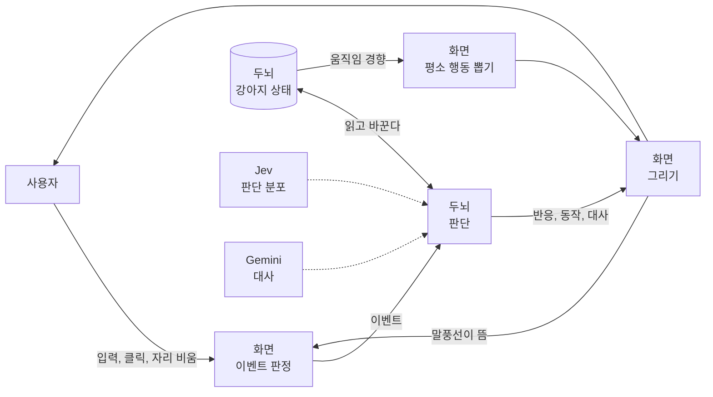
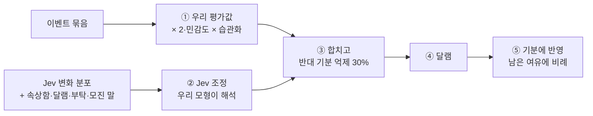
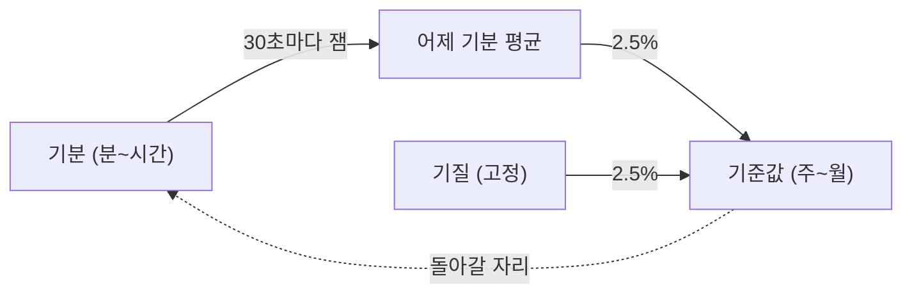
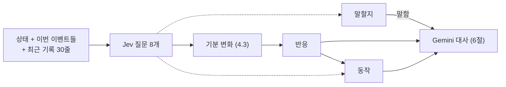
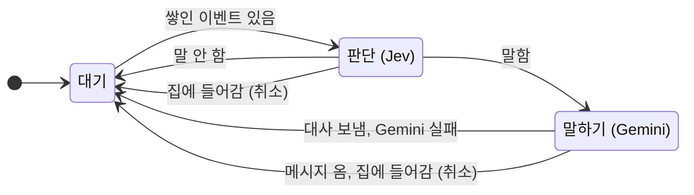
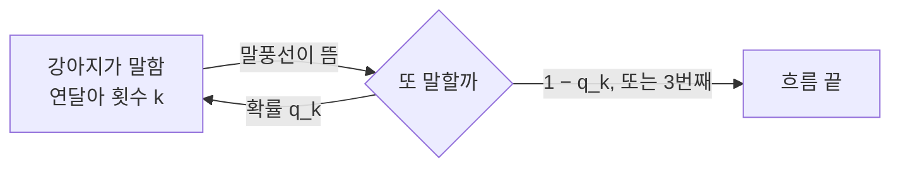
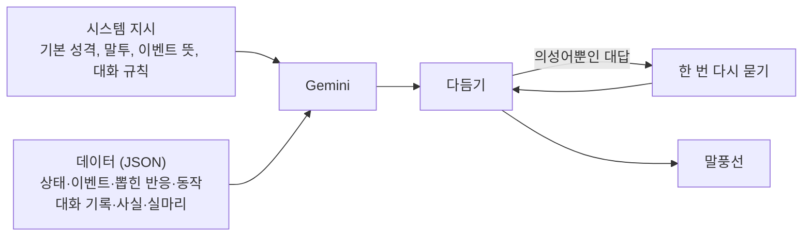
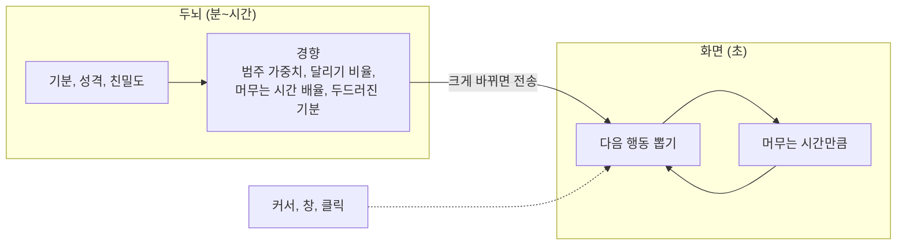
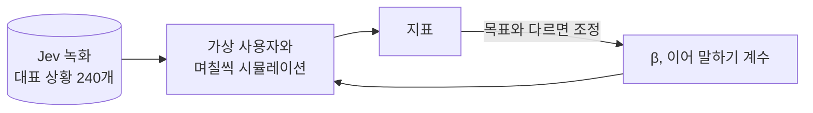
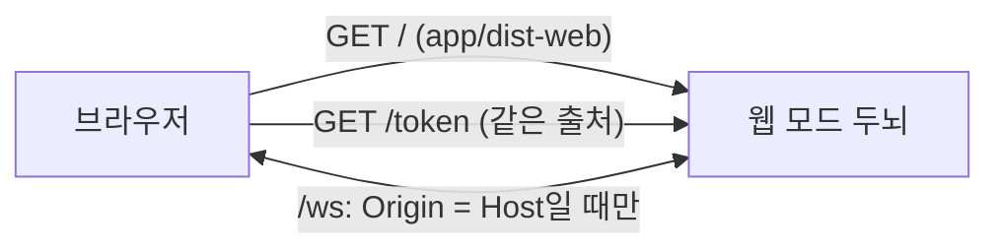

# ARCHITECTURE

TamagotchiChatBot의 구조와 동작 원리다. 지금 코드가 **어떻게 동작하는지**만 적는다. 왜 그렇게 바뀌었는지(검수 회차별 지적과 수정)는 [검수 요약](docs/review/summary.md)과 각 절에 링크한 스펙에 있다.

> 기준: 브랜치 `ralph/review-loop`, 프로토콜 v3. 숫자는 `brain/brain/tuning.py`·`app/src/body/*.ts`의 현재 값이다. 표에 "잠정값"이 없어도 대부분 시뮬레이션·검수로 맞춘 값이고, 근거는 코드 주석에 있다.

## 1. 한눈에 보기



1. **강아지 상태**는 성격(기준값·민감도·변덕), 기분 9개, 친밀도, 습관화다. 두뇌가 갖고 저장한다 (4절).
2. **이벤트가 오면** 두뇌가 Jev에 상황을 묻고, 그 분포와 우리 모형으로 기분을 바꾼 뒤 반응·동작·말할지를 확률로 뽑는다. 말하기로 뽑히면 Gemini가 대사를 쓴다 (5·6절).
3. **이벤트가 없으면** 기분은 성격이 정한 자리로 천천히 돌아간다 (4.2).
4. **평소 움직임**은 두뇌가 기분으로 경향만 정하고, 화면이 그 경향으로 초 단위 행동을 혼자 뽑는다 (7절).

화면(Tauri 앱, `app/`)과 두뇌(파이썬 서비스, `brain/`)는 localhost WebSocket으로 통신한다. 두뇌는 화면을 모르므로 화면만 바꿔 다른 기기로 옮길 수 있다 ([0012](docs/decisions/0012-brain-as-frontend-independent-service.md)). 그 예로 **웹 프로토타입**이 있다: 두뇌의 웹 모드가 브라우저용 화면과 WebSocket을 한 포트에서 함께 낸다 ([0017](docs/decisions/0017-web-prototype-brain-serves-page.md)).

## 2. 원칙

| 원칙 | 뜻 | 근거 |
|---|---|---|
| 두뇌는 화면을 모른다 | 둘은 [프로토콜](docs/brain-protocol.md)로만 이어진다 | [0012](docs/decisions/0012-brain-as-frontend-independent-service.md) |
| 이벤트가 판단의 단위 | Jev는 이벤트가 올 때만 부른다. **언제** 이벤트를 낼지는 화면이 정한다 | [0013](docs/decisions/0013-event-driven-brain-with-event-log.md) |
| 이벤트 기록이 기억 | 대화·찌르기·돌아옴·강아지 반응이 한 줄로 쌓인다 | [0013](docs/decisions/0013-event-driven-brain-with-event-log.md) |
| Jev는 분포, 결정은 확률 모델 | Jev가 준 확률과 우리 모형으로 뽑는다. 같은 상황에서도 가끔 다르게 행동한다 | [0014](docs/decisions/0014-probabilistic-model-with-jev-distributions.md) |
| 뜻이 분명한 일은 우리 모형이 | 찌르기·던지기의 기분, 동작 선택, 이어 말하기는 우리 모형이 정하고 Jev는 조정만 한다. 글 내용처럼 해석이 필요한 것은 Jev가 읽는다 | [0015](docs/decisions/0015-appraisal-prior-mood-change.md), [0016](docs/decisions/0016-action-model-ours-first.md) |
| 대사의 사실은 우리 모형이 | 주인이 곁에 있는지, 주인 말의 뜻, 날짜처럼 LLM이 틀리기 쉬운 것은 두뇌가 사실 문장으로 준다 | [검수 요약](docs/review/summary.md) |
| 빠른 일은 화면, 느린 일은 두뇌 | 초 단위 행동 선택은 화면이, 분 단위 경향은 두뇌가 맡는다 | [스펙 6.5](docs/superpowers/specs/2026-10-15-brain-v2-design.md) |

## 3. 구성 요소

| 구성 요소 | 맡는 일 | 위치 |
|---|---|---|
| 화면 | 강아지 그리기, 입력·클릭·창 감지, 이벤트 판정, 평소 행동 뽑기, 입력창·설정 창 | `app/` (Tauri: Rust + TypeScript) |
| 웹 화면 (프로토타입) | 같은 몸 로직을 브라우저 창 안에서. 창 위 올라앉기·단축키·트레이 없음, 입력줄과 설정 패널은 페이지 안 | `app/web.html`, `app/src/web/` |
| 두뇌 | 강아지 상태, 판단, 기분 시계, 이벤트 기록, API 키 보관 | `brain/` (파이썬, WebSocket 서버) |
| Jev | 상황에 대한 판단 분포(선택지 확률, 예/아니오 확률). 대사는 쓰지 않는다 | TypeSafe System One ([요약](docs/references/typesafe-jev.md)) |
| Gemini | 대사 한마디 | `gemini-3.1-flash-lite` ([0007](docs/decisions/0007-dialogue-llm.md)) |

**프로토콜 v3** ([전체](docs/brain-protocol.md)): 화면 → 두뇌는 `hello`(인증), `event`, `set_key`, `clear_history`, `reset`, `get_state`, `get_log`. 두뇌 → 화면은 `reaction`(반응·동작·대사), `status`(AI 상태), `movement`(움직임 경향), `state`, `log`.

**시간 척도**: 과정마다 빠르기가 크게 다르다. 빠른 과정을 볼 때는 느린 과정을 상수로 봐도 된다. 화면과 두뇌의 분담이 여기에 기댄다.

| 과정 | 빠르기 (평균 성격) | 담당 |
|---|---|---|
| 행동 하나 (걷기, 앉기 등) | 3~20초 | 화면 |
| 이벤트 사이 간격 | 0.6초(타이핑) ~ 30분(조용함) | 화면 |
| 판단 한 번 | Jev ≤ 3초, 말하면 + Gemini ≤ 5초 | 두뇌 |
| 기분이 절반 풀림 | 놀람 36초, 궁금함 5분, 분노 6분, 들뜸 6분, 무서움 9분, 시무룩 21분, 행복 27분, 심심함 33분, 졸림 48분 | 두뇌 |
| 습관화가 절반 풀림 | 1시간 | 두뇌 |
| 친밀도가 절반 식음 | 14일 | 두뇌 |
| 성격이 절반 옮겨 감 | 약 27일 | 두뇌 |

## 4. 강아지 상태

### 4.1 무엇을 갖나

| 값 | 범위 | 어떻게 변하나 |
|---|---|---|
| 기분 9개: 심심함, 졸림, 들뜸, 시무룩, 분노, 궁금함, 놀람, 무서움, 행복 | 0~1 | 돌아갈 자리로 풀리고(4.2), 이벤트에 튄다(4.3) |
| 친밀도 | 0~1 | 0.3으로 식고, 이벤트에 조금씩 변한다 (4.4) |
| 습관화: 찌르기→놀람, 쓰다듬기→행복, 던지기→놀람, 타이핑→궁금함 | 0~1 | 같은 자극이 오면 오르고, 쉬면 풀린다 (4.4) |
| 기준값 (성격) | 0.05~0.95 | 하루 한 번 조금 옮겨 간다 (4.5) |
| 기질 | 0.05~0.95 | 고정 (태어날 때의 기준값) |
| 민감도 (기분마다) | 0.2~0.9 | 고정 |
| 변덕 | 0~1 | 고정 |

- **탄생**: 기준값은 기본 성격("호기심 많고 수다스러운 강아지")을 숫자로 옮긴 평균에서 ±0.1, 민감도는 0.5 ± 0.1, 변덕은 0.5 ± 0.15의 정규분포에서 뽑는다. 처음 기분은 기준값, 친밀도는 0.3이다.
- 탄생 평균: 심심함 0.6, 졸림 0.3, 들뜸 0.4, 시무룩 0.2, 분노 0.1, 궁금함 0.5, 놀람 0.1, 무서움 0.1, 행복 0.4.
- 설정 창 **초기화**는 강아지를 새로 태어나게 하고 기록을 지운다. 키는 남는다.

### 4.2 시간이 흐를 때: 돌아갈 자리로 당겨진다

기분은 고무줄에 매인 공처럼 움직인다. 돌아갈 자리로 늘 당겨지면서 조금씩 흔들린다(평균 회귀 과정, Ornstein–Uhlenbeck).

```text
m ← 자리 + (m − 자리)·e^(−λΔt) + 흔들림            흔들림: 오래 두면 자리 ± 0.03
λ = ln2 / 반감기,  반감기 = 기본 반감기 × (0.5 + 기준값)     기준값이 높은 기분일수록 늦게 풀린다
자리 = 기준값 + 하루 리듬 − 1.5 × (반대 기분이 기준값보다 높은 만큼, 구간 평균)   (자리의 1/4 아래로는 안 내려감)
하루 리듬 = 계수 × 0.5·cos(2π(시각 − 3시)/24)      계수: 졸림 +0.6, 들뜸·심심함 −0.2. 하루 평균 0
```

- 기본 반감기(기준값 0.5일 때): 놀람 1분, 궁금함 5분, 들뜸 7분, 분노 10분, 무서움 15분, 시무룩·행복·심심함 30분, 졸림 1시간.
- **반대 기분 쌍**: 무서움↔행복·들뜸, 분노↔행복, 시무룩↔들뜸·행복, 졸림↔들뜸. 한쪽이 높은 동안 다른 쪽의 자리가 내려가 함께 높게 머물지 않는다.
- 계산은 값을 읽을 때(판단, 30초 기분 시계, 상태 조회) 위 식의 정확한 풀이로 한다. 읽는 간격과 상관없이 같은 결과가 나온다.
- 상세: [시간 모형](docs/superpowers/specs/2026-10-16-time-model-design.md), [기분 갱신 수식](docs/superpowers/specs/2026-10-16-mood-update-math-design.md).

### 4.3 이벤트가 올 때: 우리 평가 + Jev 조정

기분 변화의 뼈대는 **우리가 정한 평가값**이고, Jev는 글 내용처럼 해석이 필요한 부분을 **조정**한다 ([0015](docs/decisions/0015-appraisal-prior-mood-change.md)).



**① 우리 평가값** (평균 강아지 기준, 민감도 0.5면 표의 값 그대로):

| 이벤트 | 평가값 | Jev 무게 |
|---|---|---|
| 찌르기 | 놀람 +0.20, 분노 +0.06 + 0.10·습관화, 궁금함 +0.03·(1 − 습관화), 졸림 −0.12 | 0.3 |
| 던지기 (충격 i) | 무서움 +0.35i, 놀람 +0.10 + 0.15i, 분노 +0.05i, 행복·졸림 −0.10i | 0.3 |
| 쓰다듬기 (3초 기준, 최대 5초) | 행복 +0.12, 들뜸 +0.04 (화나거나 무서운 만큼 줄어듦), 분노·시무룩·무서움 −0.03 | 0.3 |
| 돌아옴 (g = 비운 시간/1시간, 최대 1) | 행복 +0.15, 들뜸 +0.12 + 0.20g, 심심함 −0.10, 시무룩 −0.08, 졸림 −0.30g | 0.3 |
| 집에서 나옴 | 들뜸 +0.08, 행복 +0.06 | 0.3 |
| 조용함 (10분 단위, 최대 3배) | 심심함 +0.04·(1 − f), 졸림 +0.10·f, 시무룩 +0.01 (답을 기다리던 중이면 +0.07, 자리 비움이면 0). f = 혼자 30분 → 2시간에 0 → 1 | 0.1 |
| 메시지 | 궁금함 +0.02, 심심함 −0.04 | **1.0** |
| 타이핑 | 궁금함 +0.04 | 0.8 |
| 강아지 자기 말, 집에 들어감 | 없음 | 0 / 0.3 |

- 같은 기분에 온 충격은 확률의 합처럼 **포화 합산**한다(찌르기 7번이 0.20 × 7이 아니라 약 0.79). 한 묶음 안 같은 자극은 k번째를 1/√k만 센다.
- 습관화는 그 자극의 **대상 기분만** 줄인다(1 − 습관화). 그래서 타이핑이 이어지면 궁금함은 무뎌지고 글 내용의 기분이 드러난다.

**② Jev 조정**: Jev 변화 분포에서 기분마다 `P(d↑) − P(d↓)`를 읽고, 말(메시지·타이핑)이면 다른 질문(5.2)과 함께 우리 모형이 해석한다. 크기는 `0.3 × Jev 무게 × 2·민감도`다.

| 해석 | 규칙 |
|---|---|
| 관계 | 친밀도↑ → 행복 +0.5배, 시무룩 −0.8배 (공감 중이면 × (1 − u)). 친밀도↓ → 서운함 후보 |
| 서운함은 한 번만 | 서운함 = max(Jev 시무룩↑, 공감 0.35u, 0.8·친밀도↓) × (1 − 담백한 부탁). 같은 서운함을 여러 질문이 함께 읽으므로 더하지 않는다 |
| 담백한 부탁 | 조용히 해 달라는 부탁 × (1 − 모진 말). "일 좀 할게"는 서운하지 않고, "저리 가 귀찮아"는 서운하다 |
| 공감 | u = 속상함 × (1 − 달램). u만큼 궁금함이 꺼지고, u ≥ 0.5면 행복이 오르지 않는다 |
| 경계 | 화나거나 무서운 정도 wary = min(1, 2·max(0, max(분노, 무서움) − 0.15)). Jev의 행복·들뜸 ↑와 쓰다듬기의 기쁨이 (1 − wary)배 |
| 사과 | 달램 s만큼 시무룩·분노·무서움의 Jev ↑를 믿지 않는다(× (1 − s)) |

**③** 한쪽 기분이 오른 만큼의 30%를 반대 기분에서 뺀다.

**④ 달램**: 말이고 달램 s > 0이면 시무룩·분노·무서움을 **넘친 만큼**(기분 − 돌아갈 자리)의 0.8·s·f만큼 덜어 준다. f는 시무룩 1, 분노 0.6, 무서움 0.25다. 말은 서운함을 크게, 무서움은 조금 던다(무서움은 쓰다듬기가 더 푼다).

**⑤ 반영**: 오를 때는 신호 × (1 − m), 내릴 때는 신호 × m만큼 움직인다(잡음 ±0.01). 그래서 0과 1에 붙지 않는다. 말로 내리는 부정 기분은 한 번에 넘친 만큼의 min(1, 0.6·(1.5 − 민감도))까지만, 돌아갈 자리 아래로는 내리지 않는다. 예민한 강아지는 몇 번 달래야 풀린다.

- Jev가 실패하거나 키가 틀려도 ①의 평가값으로 기분·반응·동작은 낸다(대사는 없다).
- 숫자 감각: 이벤트가 없으면 기분은 자리 ± 0.03에 머문다. 세게 던지면 무서움 약 +0.3, 찌르면 놀람 약 +0.2, 강한 메시지면 ±0.18 정도 튄다.

### 4.4 친밀도와 습관화

**친밀도**는 0.3을 향해 반감기 14일로 식는다.

```text
Δ친밀도 = (0.02 × Jev 무게 × (P친밀도↑ − P친밀도↓·(1 − 담백한 부탁)) + 평가값) × (1 − 습관화)
평가값: 쓰다듬기 +0.005, 던지기 −0.01·충격
```

**습관화**는 같은 자극에 무뎌진 정도다.

```text
자극이 올 때   h ← h + η(1 − h),   η = 0.3 × (1.5 − 민감도)     민감할수록 천천히 무뎌진다
그 사이        반감기 1시간으로 풀린다
```

민감도 0.5인 강아지를 연달아 5번 찌르면 h ≈ 0.83이고, 그 뒤 놀람 충격은 17%로 줄어든다.

### 4.5 성격(기준값)의 변화

하루가 지나면 기준값이 **어제 기분 평균** 쪽으로 2.5%, **기질** 쪽으로 2.5% 옮겨 간다.



```text
기준값_내일 = 기준값 + 0.025·(어제 평균 − 기준값) + 0.025·(기질 − 기준값)
```

- 이벤트가 기분을 기준값보다 평균 δ만큼 밀어 올리면(어제 평균 ≈ 기준값 + δ) 기준값은 **기질 + δ**로 모인다(반감기 약 27일). 타고난 성격에서 겪은 일만큼만 옮겨 가고, 개성이 경험에 지워지지 않는다.
- 기질 항이 없으면 8주 시뮬레이션에서 모든 강아지가 같은 성격이 됐다 ([시뮬레이션](docs/spikes/2026-10-15-simulation.md)).
- 날짜가 바뀐 뒤 처음 기분을 계산할 때 한 번 갱신한다. 며칠을 건너뛰어도 한 번이다.

### 4.6 상태에서 계산하는 값 (저장하지 않음)

| 값 | 계산 | 쓰는 곳 |
|---|---|---|
| 말수 L | 0.7 × [(친밀도 − 0.5) + Σ(수다 쪽 기분 − 0.5) − Σ(과묵 쪽 기분 − 0.5) + 같은 방향의 기준값 항]. 수다 쪽: 심심함·들뜸·궁금함·행복 / 과묵 쪽: 졸림·시무룩·분노·무서움 | 말할 확률, 이어 말하기 (5.1) |
| 두드러진 기분 | 기준값보다 가장 많이 높은 기분. 0.15 이상 높을 때만, 아니면 `calm` | 평소 모습(7절), 대사 말투(6절) |
| 드러내기 쉬움 | exp(4 × (기준값 − 탄생 평균)). 기준값이 평균보다 0.3 높은 기분은 ×3.3 | 반응 고르기 (5.1) |

## 5. 판단: 이벤트에서 행동까지

### 5.1 파이프라인



| 결정 | 어떻게 정하나 |
|---|---|
| **반응** | 잡음 없는 기분 신호 × 드러내기 쉬움이 가장 큰 기분의 표출. 그 기분의 신호가 0.03 이상이어야 한다. 놀람은 이미 놀란 만큼 덜 드러난다(× max(0, 1 − 3·(놀람 − 기준값))). 무서움이 기준값보다 0.3 넘게 높으면 행복·신남 반응은 막는다. 타이핑 중이면 늘 하나를 낸다(오른 게 없으면 궁금함) |
| **동작** | 아래 점수를 온도로 나눈 softmax에서 뽑는다 |
| **말할지** | 아래 확률로 동전을 던진다 |
| **대사** | 말하기로 뽑혔을 때만 Gemini가 쓴다 (6절) |

반응 어휘(기분 → 반응): 심심함 지루함, 졸림 하품, 들뜸 신남, 시무룩 서운함, 분노 짜증, 궁금함 궁금함, 놀람 놀람, 무서움 무서움, 행복 행복.

**동작** (서기, 앉기, 엎드리기, 잠, 조르기, 짖기, 없음 = 하던 대로):

```text
점수(a) = 기본(a) + 이벤트 사전값(a) + 5·Σ 친화도·(기분 − 기준값) + 2·Σ 친화도·(기준값 − 탄생 평균)
          + 1.5·반응 친화도(a) + w·log(P_Jev(a) + 0.05) + 시킨 동작(a)
P(a) ∝ exp(점수(a) / T),   T = 0.5 + 변덕

w = 0.3 (몸 이벤트),  1.5 × P_시킴(없음) (메시지: 시킨 게 분명할수록 기분 위주인 동작 질문을 덜 믿는다)
시킨 동작(a) = 6 × P_시킴(a) × (0.5 + 친밀도) × max(0, 1 − 2·(분노·무서움이 기준값보다 높은 만큼))     메시지일 때만
               "자"는 엎드리기도 시킨 것으로 센다
잠: 졸림이 기준값보다 0.1 넘게 높지 않으면 −10 (사실상 안 나온다)
```

- 친화도 예: 졸림 → 잠·엎드리기, 분노 → 짖기, 분노 → 조르기 −1, 무서움 → 엎드리기, 무서움 → 조르기 −2. 표는 `tuning.py`의 `MOOD_ACTION`·`REACTION_ACTION`·`EVENT_ACTION`.
- 자세 유지: 강아지 자기 말 뒤에는 동작을 뽑지 않는다('없음'). 한 메시지를 치는 동안(타이핑) 자세를 한 번 잡으면, 반응이 그때와 같거나 궁금함·없음인 동안 '없음'이다.
- 상세: [동작 모형](docs/superpowers/specs/2026-10-16-action-model-design.md), [0016](docs/decisions/0016-action-model-ours-first.md).

**말할지**:

```text
P(말함) = σ( logit P_Jev(말함) + 말수 L + β[이벤트 종류] − 연달아 말한 횟수 − 1·[답을 기다리는 중]
            + 3.5·[메시지가 질문·부탁·함께 하자·사과]  + 3.5·[메시지가 속상한 이야기]
            − 0.7·[먼저 말을 걸고 대꾸가 없던 횟수]   (조용함)
            − 5·["말 걸지 마" 또는 잠자리 동안]          (조용함)
            − 8·[무서움이 기준값보다 높은 만큼] )
```

- **질문·부탁**: 글에 `?`가 있거나 "줘·줄래·봐·하자·놀자" 등으로 끝나면. 달램 ≥ 0.5(사과)도 같다.
- **속상한 이야기**: 주인이 속상해 보이거나(6절의 판정) 시무룩 신호가 0.05 이상이고, 사과가 아닐 때.
- **0이 되는 때**: 연달아 3번 말했을 때, 집에 들어가는 순간, Jev 실패·키 오류, 이번 메시지를 치는 동안 이미 끼어들었거나 친 글이 15자 미만일 때, 이어 말하기인데 직전 말이 질문이었거나 끼어들기·핀잔에 대한 답이었을 때.

| 이벤트 종류 | β | 목표 (평균 성격) |
|---|---|---|
| 메시지 | −0.22 | 물음표 없는 소식에 85% 대답 (질문은 보정으로 거의 늘 답한다) |
| 조용함 | −2.11 | 말할 확률 약 1/3 → 30분에 한 번쯤 먼저 말 걸기 |
| 타이핑 | −2.72 | 30% 끼어들기 |
| 강아지 말이 뜸 | (쓰지 않음) | 이어 말하기는 5.4가 정한다 |
| 그 밖 | 0 | |

β는 9절의 시뮬레이션으로 맞춘 값이다.

### 5.2 Jev 질문

질문 정의와 선택지 문구는 `brain/brain/questions.py` 한곳에 둔다. 문구를 바꾸면 Jev를 다시 녹화하고 보정값을 다시 맞춘다(9절).

| 키 | 형식 | 묻는 것 | 쓰는 곳 |
|---|---|---|---|
| `action` | 선택 7개 | 강아지가 지금 할 동작 | 동작 점수(약한 조정) |
| `speak` | 예/아니오 | 지금 강아지가 말할 차례인가 | 말할 확률의 출발점 |
| `change` | 선택 21개 | 이 일 자체로 기분 9개·친밀도가 오르나 내리나, 또는 변화 없음 | 기분·친밀도 조정 (4.3) |
| `user_down` | 예/아니오 | 사용자가 속상하거나 힘든가 | 공감, 대답 보정, 대사의 "속상해 보인다" |
| `soothe` | 예/아니오 | 사용자가 강아지에게 사과하거나 달래는가 | 달램, 사과에 대답 |
| `hush` | 예/아니오 | 한동안 말 걸지 말라고 부탁하는가 | "말 걸지 마" 1시간, 담백한 부탁 |
| `harsh` | 예/아니오 | 강아지를 탓하거나 귀찮아하거나 모질게 대하는가 | 부탁과 거절 가르기, 대사의 "모진 말" 사실 |
| `command` | 선택 7개 | 사용자가 시킨 동작(없음 = 시킨 것 없음) | 시킨 동작, 잠자리, 대사의 "시킨 것을 했다" 사실 |

Jev에 넘기는 상황(`jev_state`): 기본 성격, 기준값·민감도·변덕, 지금 시각, 이번 이벤트들, 최근 이벤트 기록 30줄, 기분, 친밀도. 수치는 소수 둘째 자리다.

### 5.3 처리 순서

두뇌는 판단을 **한 번에 하나씩** 한다. 판단 중에 온 이벤트는 쌓아 두었다가 끝나면 **한 묶음으로** 다음 판단에 넣는다. 이벤트가 몰려도 Jev는 판단 한 번에 한 번만 불린다.



- 화면에는 반응·동작을 먼저 보내고(`reaction`), 대사는 Gemini가 끝나면 따로 보낸다. 판단 직후 움직임 경향도 다시 계산해 문턱을 넘으면 보낸다.
- **취소**: 집에 들어가면 하던 판단과 쌓인 이벤트를 버린다. 대사를 만드는 중에 사용자가 메시지를 보내면 그 대사를 버린다.
- **판단할 수 없을 때**: 화면이 끊겼거나 키가 없으면 쌓인 이벤트를 버린다. 이벤트 기록에는 남아 다음 판단의 "최근 기록"으로 들어간다.

두뇌는 판단 사이에 **흐름 상태**를 기억한다. 모두 메모리에만 있다.

| 상태 | 켜지는 때 | 꺼지는 때 | 효과 |
|---|---|---|---|
| 답을 기다림 | 메시지·타이핑 흐름에서 `?`가 든 말을 함 | 사용자가 치거나 보냄, 조용함 한 번 | 이어 말하지 않음, 조용함에 서운함 +0.07 |
| 이어 말하지 않음 | 타이핑 중 끼어듦, 핀잔(친밀도↓ ≥ 0.4)에 답함 | 새 흐름 | 이어 말하기 0 |
| 끼어듦 / 자세 잡음 | 이번 메시지를 치는 동안 끼어들었다 / 자세를 잡았다 | 메시지 보냄 | 끼어들기 0 / 자세 유지 |
| "말 걸지 마" | 메시지의 부탁 ≥ 0.5 | 1시간, 사용자가 다시 말함 | 먼저 말 걸기 −5, 덧말 0 |
| 잠자리 | 메시지의 시킨 잠 ≥ 0.5 ("잘 자") | 8시간, 사용자가 다시 말함 | "말 걸지 마"와 같음 + 답 기다림 서운함 없음 + 조용함을 2시간 혼자 둔 것처럼(심심함 대신 졸림) |
| 대꾸 없음 횟수 | 먼저 말을 건 흐름에 사용자가 답하지 않음 | 사용자 행동 | 먼저 말 걸기 −0.7씩, 덧말 × 0.4씩 |
| 자리 비움 | 30분 간격 조용함 | 사용자 행동 | 대사 사실 "주인은 자리를 비웠다" |
| 집 안 | 집에 들어감 | 집에서 나옴 | 판단·움직임 경향 보내지 않음 |

### 5.4 이어 말하기

강아지가 말하면 화면이 말풍선을 띄우고 "강아지 말이 뜸"(`dog_spoke`) 이벤트를 보낸다. 이 이벤트가 다시 판단을 부르므로 **강아지의 말이 다음 말을 부를 수 있다.**



```text
q_k = min(0.6, 0.251·e^(1.2·(L − 평균 강아지 L))) × 0.3^(k−1) × 0.4^(대꾸 없던 횟수) × max(0, 1 − 3·(무서움·놀람 초과분))
```

- Jev의 말할 확률은 쓰지 않는다. 우리 모형이 정한다. 과묵하면 거의 한 마디이고, 세 마디는 드물다. 연달아 3번에서 끊는다.
- "말 걸지 마"·잠자리 동안, 답을 기다리는 중, 끼어들기·핀잔 뒤에는 이어 말하지 않는다.
- 사용자 입력이나 다른 이벤트가 오면 횟수가 0이 되어 새 흐름이다.

## 6. 대사 만들기

Gemini는 강아지 대사 **한마디**만 쓴다. 두뇌가 지시와 데이터를 정리해 주고, 결과를 다듬는다. 지시·문구는 `brain/brain/persona.py` 한곳에 둔다.



**시스템 지시**: 기본 성격("호기심 많고 수다스러운 강아지"), 반말에 의성어를 섞는 말투, 이벤트의 뜻(던지기 = 네가 던져졌다 등), 대화 규칙(물으면 먼저 답한다, 고른 것을 뒤집지 않는다, 화면에 없는 장소·물건을 말하지 않는다 등).

**데이터**:

| 항목 | 내용 |
|---|---|
| Jev와 같은 상황 | 성격·기분·친밀도·지금 시각·이번 이벤트들·최근 이벤트 기록 |
| 이번에 뽑힌 반응·동작 | 대사가 말하는 동작은 이것과 같아야 한다 |
| 지금 말하는 상황 | 이벤트 종류별 지시(끼어들기는 짧게 맞장구, 메시지는 답한다, 조용함은 먼저 말을 건다 등) |
| 대화 기록 | 실제로 오간 말 최근 20줄(시각 포함). "내일·오늘·어제"에는 실제 날짜를 붙인다 |
| 내가 최근에 한 말 | 최근 대사 5줄 |
| 말투 | 성격에서 나온 지시(과묵하면 한 문장, 활발하면 들뜸, 예민하면 투덜거림, 겁 많으면 조심스러움) + 두드러진 기분의 말투 |
| 사용자가 마지막으로 뭔가 한 지 | 예: "1시간" |
| 최근에 너무 자주 쓴 표현 | 최근 대사 40줄에서 두 줄 이상 되풀이된 두 어절, 세 줄 이상 같은 끝맺음 |
| 꺼낼 이야기 | 조용함일 때만: 아까 주인이 한 말, 지금 기분, 지금 동작 중 하나를 뽑아 준다 |
| 사용자 기분 | "속상해 보인다" (아래 판정이 참일 때) |
| 지금 상황 사실 | 아래 표 |

**지금 상황 사실**: LLM이 지어내기 쉬운 것을 두뇌가 기록과 Jev 분포로 정해 사실 문장으로 준다.

| 사실 | 언제 |
|---|---|
| 주인이 곁에 있다 / 자리를 비웠다 / 방금 돌아왔다 | 늘 하나 |
| 떠나기 전 주인이 한 말과 실제로 비운 시간 | 돌아온 뒤 10분, 떠나기 10분 안에 한 말이 있을 때 |
| 집에 있던 쪽은 나(강아지)다, 주인이 꺼내 줬다 | 집에서 나온 뒤 10분 |
| 주인이 나를 집에 넣었다 + 넣기 직전 주인 말 | 집에 넣은 지 30분 안 |
| 주인이 방금 한 말은 주인 자신의 일이다 | 메시지 |
| 시킨 X를 했다 / X를 시켰지만 하지 않았다 | 메시지, 시킨 동작 ≥ 0.5 |
| 주인은 할 일이 있거나 잠깐 혼자 있고 싶다(떠나거나 자러 가는 게 아니다) | 메시지, 담백한 부탁 ≥ 0.5 |
| 주인이 나를 향해 모진 말을 했다. 위로하지 않는다 | 메시지, 모진 말 ≥ 0.5 |
| 오늘은 사용자가 말한 생일이다 | 대화 기록의 생일 날짜가 오늘 |
| 방금 네가 한 말(뒤집지 않는다) | 메시지에 답하는데, 직전에 끼어들며 말했을 때 |

- **주인이 속상해 보인다**: 속상함 ≥ 0.5, 달램 < 0.5, 모진 말 < 0.5. 담백한 부탁이 0.5 이상이면 속상함 ≥ 0.7일 때만.

**다듬기** (`trim_line`):

- 줄바꿈·이름표·따옴표를 없애고, "드디어"와 뒤따르는 문장부호를 걷는다. "사용자"는 "너"로 바꾼다.
- 금지 낱말이 든 문장을 뺀다: 화면 밖 장소(창밖, 현관, 무릎, 소파 …), 지어내기 쉬운 것(장난감, 냄새, 먹고 왔, 문밖 …), 틀(목 빠, 눈 빠). 집에서 나온 뒤 10분 동안은 주인이 떠났던 것처럼 하는 문장(어디 다녀온, 네가 언제 나오나 …)도 뺀다.
- 몸짓·자세 해설(꼬리, 근질, "앉아 있어", "조르기 시작" …)은 다른 말이 있으면 빼고, 그것뿐이면 최근 10줄에 없을 때만 둔다.
- 문장 수는 말투가 정한다(보통 2, 과묵하면 1). 의성어뿐인 문장("멍.")은 다음 문장에 붙여 센다.
- 메시지에 의성어로만 답하면 "내용 있는 말로 답한다"를 덧붙여 한 번 다시 묻는다. 그래도 의성어뿐이면 말하지 않는다. 짖으라고 시켰을 때는 의성어가 답이다.

## 7. 평소 움직임

두뇌는 **기분으로 경향만** 정한다. 화면은 그 경향으로 **다음 행동과 머무는 시간을 혼자 뽑는다.** 기분은 분 단위, 행동은 초 단위라 행동 수십 개 동안 경향은 사실상 그대로다.



### 7.1 두뇌: 경향 계산

```text
범주 가중치_c = 기본_c × exp( 4·Σ친화도·(기분 − 기준값) + 2·Σ친화도·(기준값 − 탄생 평균) + 친밀도 효과 )
    기본: 쉬기 0.6, 잠 0.08, 돌아다니기 0.4, 사용자 곁으로 0.18, 놀기 0.12, 구경하기 0.2
    친밀도 효과: 사용자 곁으로·놀기 +1·(친밀도 − 0.5)
달리기 비율   = σ( logit 0.2 + 4·(1.5Δ들뜸 − Δ졸림 − 0.5Δ무서움) + 2·(2(μ들뜸 − 0.4) − (μ졸림 − 0.3)) )
머무는 시간 배율 = exp( 4·(Δ졸림 + Δ시무룩 − Δ들뜸 + 0.5Δ행복) + 2·((μ졸림 − 0.3) − (μ들뜸 − 0.4)) )
    Δ = 기분 − 기준값,  μ = 기준값
```

- 친화도 예: 들뜸 → 놀기 1.5·돌아다니기, 졸림 → 쉬기·잠, 무서움 → 쉬기, 분노 → 돌아다니기(사용자를 피함), 궁금함 → 구경하기·사용자 곁으로. 표는 `tuning.py`의 `MOVE_MOOD`·`MOVE_BASELINE`.
- 기분은 기준값 대비로 4배 크게 본다. 들뜸이 평소보다 0.3 높으면 놀기·돌아다니기가 3배쯤, 달릴 확률이 0.2 → 0.5가 된다. 행복은 느긋한 기쁨이라 달리지 않는다.
- 성격도 보인다: 같은 평온한 상태에서 활발한 강아지는 많이 뛰고, 과묵한 강아지는 주로 쉰다.
- **전송**: 30초 기분 시계와 판단 직후에 다시 계산한다. 두드러진 기분이 바뀌었거나, 가중치·머무는 시간 배율이 30% 넘게, 달리기 비율이 0.1 넘게 바뀌었을 때만 보낸다. 집에 있는 동안은 보내지 않는다.

### 7.2 화면: 행동 뽑기

행동 하나가 끝나면 다음 행동을 뽑는다. 다음 행동은 직전 행동과 무관하게 같은 분포에서 뽑고, 머무는 시간은 행동마다 따로 뽑는다(반-마르코프 과정).

| 행동 | 가중치 | 후보 조건 | 머무는 시간 |
|---|---|---|---|
| 커서로 다가가기 / 따라가기 | 사용자 곁으로 × ⅔ / × ⅓ | 커서가 450px 안 | 도착까지 / 5~10초 |
| 커서 사냥 | 놀기 | 커서가 450px 안 | 최대 6초 |
| 창에 올라앉기 / 창 옆에서 구경 | 구경하기 × ½ / × ½ | 주변에 창이 있음 | 도착 뒤 8~20초 / 6~12초 |
| 제자리 쉬기 | 쉬기 | 늘 | 3~10초 × 머무는 시간 배율 |
| 낮잠 | 잠 | 늘 | 8~20초 × 머무는 시간 배율 |
| 돌아다니기 | 돌아다니기 | 늘 | 80~400px 떨어진 곳에 도착까지. 달리기 비율 확률로 뜀 |

- 최근 3초 안에 450px 안에서 클릭이 있었으면 커서 관련 행동이 4배가 된다.
- **끼어드는 것들**: 찌르기, 잡기·던지기, 두뇌가 준 동작, 집 들어가기는 지금 행동을 끊고 먼저 실행된다.
- **듣는 자세**: 타이핑이 시작되면 두뇌를 기다리지 않고 입력창 쪽을 바라보고, 250px보다 멀면 30% 확률로 몇 걸음 다가온다.
- 사용자 입력이 3분 없으면 그 자리에서 잔다. 설정의 "쉬기"를 켜면 경향과 상관없이 잔다. 두뇌가 없으면 기본 경향으로 움직인다.

## 8. 이벤트 판정 (화면)

화면은 입력 신호를 주기적으로 읽어 이벤트로 바꾼다. 이벤트의 **뜻**은 프로토콜이, **언제 낼지**는 화면이 정한다 ([0013](docs/decisions/0013-event-driven-brain-with-event-log.md)).

| 이벤트 | 내는 때 | 읽는 주기 |
|---|---|---|
| 타이핑 | 마지막 입력 뒤 0.6초 멈춤, 또는 지난번보다 10자 넘게 바뀜 | 100ms |
| 메시지 보냄 | Enter | 즉시 |
| 강아지 말이 뜸 | 말풍선을 띄운 직후 | 즉시 |
| 조용함 | 마지막 이벤트 뒤 10분(자리에 있음) / 30분(비움). 계속 조용하면 그 간격으로 반복 | 100ms |
| 돌아옴 | 1분 넘게 입력이 없다가 다시 입력 | 1초 |
| 집에 들어감 / 나옴 | 집 클릭, 트레이, 단축키 | 프레임 |
| 찌르기 / 쓰다듬기 | 짧은 클릭 / 문지르기 | 50ms |
| 던지기 | 착지 순간. 충격 = min(1, 가장 세게 부딪힌 속도 ÷ 2000px/초) | 프레임 |

- 집에 있는 동안은 "집에서 나옴" 외에는 내지 않는다.
- 조용함 10분은 "30분에 한 번 먼저 말 걸기"를 조용함에서 말할 확률(약 1/3)로 나눈 값이다.

## 9. 보정값 맞추기: 녹화와 시뮬레이션

말하기 보정 β는 사람이 직접 써 보며 맞출 수 없으니 **가상 사용자 시뮬레이션**으로 맞춘다. Jev는 미리 녹화한 응답으로 대신한다.



| 단계 | 내용 |
|---|---|
| 녹화 (`sim.record`) | 이벤트 10종 × 기분 10가지(기본 + 한 기분만 0.9) × 친밀도 2가지(0.2, 0.8), 강아지 말은 연달아 횟수 3가지 = 240개 상황에서 Jev를 실제로 부른다. 메시지는 소식("오늘 점심 진짜 맛있었어")으로 녹화한다 |
| 시뮬레이션 (`sim.simulate`) | 지금 상태와 가장 가까운 녹화 응답을 쓴다. 가상 사용자는 평일 9~18시 자리(12~13시 점심), 분당 메시지 3%(40%는 질문), 찌르기·쓰다듬기 0.5%, 던지기 0.2%, 강아지 말에 절반은 답한다 (잠정값) |
| 맞추기 (`--fit`) | β를 키우면 지표도 커지므로 이분 탐색한다. 평균 성격, 10일, 3바퀴 |
| 확인 | 성격 유형 4개(평균·과묵·예민·활발), 무작위 100마리, 8주 뒤 성격이 끝에 붙은 강아지 수 |

| 지표 (평균 성격) | 목표 |
|---|---|
| 끼어들기 (타이핑에 말함) | 30% |
| 소식에 답하기 (물음표 없는 메시지) | 85% |
| 먼저 말 걸기 (조용함에 말함) | 1/3 |
| 연달아 2번 이상 | 10% (실사용은 시뮬레이션의 약 2배라 실사용 20%를 노린다) |
| 가장 흔한 동작 비율 | ≤ 0.50 |
| 기분 고착 | ≤ 0.20 |

- 결과는 사람이 `tuning.py`에 옮긴다. `--fit`은 잡음이 커서 값 하나씩 훑어 확인하기도 한다.
- **한계**: 녹화 상황이 기분 10가지뿐이라 기분이 섞인 상태에서는 오차가 있다. 가상 사용자 행동은 잠정값이다.
- 실제 키로 짧게 써 보는 검증은 [검수 하네스](brain/review/README.md)가 한다.

## 10. 저장과 실행

| 무엇 | 어디 |
|---|---|
| 이벤트 기록, 강아지 상태 | `%APPDATA%\TamagotchiChatBot\brain\brain.db` (SQLite) |
| 두뇌 접속 정보 | `%APPDATA%\TamagotchiChatBot\brain\brain.json` (포트·토큰) |
| 두뇌 로그 | `%APPDATA%\TamagotchiChatBot\brain\logs\brain.log` (키·대화 내용은 쓰지 않음) |
| 판단 로그 | 두뇌 메모리, 최근 200개 (설정 창 로그 탭) |
| API 키 | Windows 자격 증명 관리자 (두뇌가 보관) |
| 화면 설정 | Tauri 앱 데이터 폴더 `settings.json` |

- 화면은 `brain.json`으로 접속을 시도하고, 안 되면 `brain/.venv`의 파이썬으로 두뇌를 띄운 뒤 2초마다 다시 접속한다.
- 두뇌는 시작할 때 다른 두뇌가 살아 있으면 바로 끝낸다. 같은 데이터를 두 두뇌가 쓰지 않게 하기 위해서다.
- 앱을 끄면 자기가 띄운 두뇌만 끈다. 두뇌가 죽어도 강아지는 기본 경향으로 계속 움직인다.

**웹 모드** (`uv run python -m brain.web`, 기본 `127.0.0.1:8787`):



- 판단은 PC 두뇌와 같은 `Brain`·`Link`다. 데이터는 `…\brain\web\`로 따로 둔다(웹 강아지 ≠ PC 강아지). `brain.json`은 쓰지 않는다.
- 키는 자격 증명 관리자, 없으면 환경 변수 `TYPESAFE_API_KEY`·`GEMINI_API_KEY`(`config.py`).
- 웹 화면은 두뇌를 띄우지 않고 같은 주소로 2초마다 다시 접속한다. 자리 비움은 페이지 안 입력 1분 없음 또는 탭 숨김이다. 화면 설정은 `localStorage`.
- 서버 배포는 도커(`Dockerfile`, `compose.yaml`)다. 이미지가 웹 화면을 빌드하고 웹 모드 두뇌를 `0.0.0.0:8787`로 띄운다. 키는 `.env` 환경 변수, 데이터는 `brain-data` 볼륨(`APPDATA=/data`).

## 11. 오류 처리

원칙: 강아지는 멈추지 않는다.

| 상황 | 동작 |
|---|---|
| 키 없음 | AI를 부르지 않고 이벤트를 판단하지 않는다. `status: no_keys`로 화면에 알린다("설정에서 키를 넣어 주세요") |
| 키 오류 | `status: bad_key`. 그 판단은 우리 평가값으로 기분·반응·동작만 내고 말하지 않는다 |
| Jev 실패·시간 초과(3초) | 우리 평가값으로 기분·반응·동작만 낸다. 말하지 않는다 |
| Gemini 실패·시간 초과(5초) | 대사 없이 반응·동작만 |
| 강아지 상태를 못 읽음 | 기본값으로 계속하고, 저장된 성격을 덮어쓰지 않는다 |
| 기록 쓰기 실패 | 메모리로 계속 |

## 12. 코드 지도

| 위치 | 내용 |
|---|---|
| `brain/brain/model.py` | 확률 모델(순수 함수): 시간 흐름, 기분 변화, 반응·동작·말하기 확률, 움직임 경향 |
| `brain/brain/core.py` | 이벤트 대기열, 판단 순서, 흐름 상태, 대사의 사실 만들기, 기분 시계 |
| `brain/brain/questions.py` | Jev 질문 8개와 선택지 문구, Jev 상황 직렬화 |
| `brain/brain/persona.py` | 기본 성격, Gemini 지시·프롬프트, 말투, 사실 문장, 대사 다듬기 |
| `brain/brain/tuning.py` | 잠정값·방향표와 근거 주석 |
| `brain/brain/store.py` | 이벤트 기록·강아지 상태 (SQLite) |
| `brain/brain/clients.py` | Jev·Gemini 클라이언트, 실패를 키 오류/일시 실패로 정리 |
| `brain/brain/config.py` | 데이터 폴더, 키 읽기·쓰기 (환경 값을 읽는 유일한 곳) |
| `brain/brain/server.py`, `__main__.py` | WebSocket 서버, 실행·중복 실행 막기 |
| `brain/brain/web.py` | 웹 모드: 정적 파일·토큰·`/ws`를 한 포트에서, 출처 검사 |
| `brain/sim/` | Jev 녹화, 시뮬레이터 |
| `brain/review/` | 검수 하네스: 시나리오 실행기, 상태 분석표, 커버리지 |
| `app/src/body/` | 강아지 상태 기계·행동 선택(`dog.ts`), 이벤트 판정(`events.ts`), 쓰다듬기·말풍선·집 등 순수 로직 |
| `app/src/character.ts` | 캐릭터 창: 그리기, 입력, 주기 작업, 두뇌 연결 |
| `app/src/input.ts`, `app/src/settings-page.ts` | 입력창, 설정 창 |
| `app/src/brain-link.ts`, `app/src/shared/brain-protocol.ts` | 두뇌 접속, 프로토콜 |
| `app/src-tauri/` | Rust 셸: 창, Win32 신호, 두뇌 실행 |
| `app/web.html`, `app/src/web/` | 웹 화면: 조립(`main.ts`), 같은 출처 접속(`link.ts`, `endpoint.ts`), 자리 비움(`presence.ts`), 설정(`prefs.ts`). 빌드 `npm run build:web` → `app/dist-web/` |

## 13. 문서 지도

모든 작업은 문서가 먼저다. 작업 규칙은 [`CLAUDE.md`](CLAUDE.md), 설치·실행은 [`README.md`](README.md).

| 문서 | 내용 |
|---|---|
| [`docs/vision.md`](docs/vision.md) | 제품 컨셉. 확정된 것과 미정인 것을 구분해 누적한다 |
| [`docs/glossary.md`](docs/glossary.md) | 용어 정의 |
| [`docs/decisions/`](docs/decisions/) | 결정 기록. 결정 하나에 파일 하나 |
| [`docs/brain-protocol.md`](docs/brain-protocol.md) | 화면 ↔ 두뇌 프로토콜. 화면은 이 문서만 보고 만들 수 있어야 한다 |
| [`docs/references/`](docs/references/) | [Jev API 요약](docs/references/typesafe-jev.md), [비슷한 프로젝트](docs/references/similar-projects.md) |
| [`docs/superpowers/specs/`](docs/superpowers/specs/) | 설계 스펙: [Windows 첫 버전](docs/superpowers/specs/2026-10-14-windows-desktop-pet-design.md), [두뇌 v1](docs/superpowers/specs/2026-10-15-brain-design.md), [두뇌 v2](docs/superpowers/specs/2026-10-15-brain-v2-design.md), [기분·즉각 반응](docs/superpowers/specs/2026-10-15-mood-reaction-design.md), [기분별 그림](docs/superpowers/specs/2026-10-15-mood-sprites-design.md), [검수 루프](docs/superpowers/specs/2026-10-15-review-loop-design.md), [평가 사전값](docs/superpowers/specs/2026-10-16-appraisal-prior-design.md), [동작 모형](docs/superpowers/specs/2026-10-16-action-model-design.md), [시간 모형](docs/superpowers/specs/2026-10-16-time-model-design.md), [기분 갱신 수식](docs/superpowers/specs/2026-10-16-mood-update-math-design.md), [웹 프로토타입](docs/superpowers/specs/2026-10-19-web-prototype-design.md) |
| [`docs/superpowers/plans/`](docs/superpowers/plans/) | 스펙별 구현 계획 |
| [`docs/spikes/`](docs/spikes/) | 실측·기술 검증: [배경 모드](docs/spikes/background-mode.md), [Jev speak_now](docs/spikes/2026-10-15-jev-speak-now-probe.md), [두뇌 v2 가정](docs/spikes/2026-10-15-brain-v2-assumptions.md), [성격 유형](docs/spikes/2026-10-15-personality-types.md), [질문 문구](docs/spikes/2026-10-15-question-wording.md), [시뮬레이션](docs/spikes/2026-10-15-simulation.md) |
| [`docs/review/`](docs/review/) | 검수 루프: [회차별 요약](docs/review/summary.md), [진행 상황](docs/review/progress.md), [루프 프롬프트](docs/review/loop-prompt.md), [검수자 정의](docs/review/reviewer.md), [아는 결함](docs/review/known-defects.md), 회차별 판정·고친 기록(`rounds/`) |
| [`brain/review/README.md`](brain/review/README.md) | 검수 하네스 사용법 |
| [`docs/manual-checks/`](docs/manual-checks/) | 화면·Win32·실제 키·웹 동작 수동 확인 체크리스트 |

## 14. 결정 기록

| 번호 | 제목 | 상태 |
|---|---|---|
| [0001](docs/decisions/0001-jev-as-decision-engine.md) | 실시간 반응 결정에 Jev를 쓴다 | 채택 (일부 개정: 0014) |
| [0002](docs/decisions/0002-platform-order.md) | Windows PC 먼저, Android는 그다음 | 채택 |
| [0003](docs/decisions/0003-windows-display-modes.md) | Windows 배경·오버레이 모드 모두 지원, 설정으로 고정 | 대체됨 (0010) |
| [0004](docs/decisions/0004-input-box-trigger.md) | 캐릭터 클릭·전역 단축키로 입력창, 상시 표시는 설정 | 대체됨 (말풍선 아이콘) |
| [0005](docs/decisions/0005-local-history-storage.md) | 대화 기록은 PC에 저장 | 일부 대체됨 (0006) |
| [0006](docs/decisions/0006-user-provided-api-keys.md) | 서버 없이 사용자가 입력한 API 키로 직접 호출 | 채택 |
| [0007](docs/decisions/0007-dialogue-llm.md) | 캐릭터 대사는 gemini-3.1-flash-lite로 생성 | 채택 |
| [0008](docs/decisions/0008-tech-stack-tauri.md) | Windows 앱은 Tauri(Rust + TypeScript) | 채택 |
| [0009](docs/decisions/0009-background-mode-wallpaper-replacement.md) | 배경 모드는 배경화면 대체 방식 | 대체됨 (0010) |
| [0010](docs/decisions/0010-overlay-only-with-doghouse.md) | 오버레이 모드만, 강아지 집(비활성 모드) 추가 | 채택 |
| [0011](docs/decisions/0011-python-brain-local-sidecar.md) | 두뇌는 PC 안에서 도는 파이썬 프로세스 | 채택 (일부 개정: 0012) |
| [0012](docs/decisions/0012-brain-as-frontend-independent-service.md) | 두뇌는 화면과 독립된 WebSocket 서비스, 키도 두뇌가 보관 | 채택 |
| [0013](docs/decisions/0013-event-driven-brain-with-event-log.md) | 두뇌는 이벤트 단위로 판단, 이벤트 기록이 기억 | 채택 |
| [0014](docs/decisions/0014-probabilistic-model-with-jev-distributions.md) | Jev는 분포를 주고 확률 모델이 뽑아서 결정 | 채택 (기분 변화는 0015로 개정) |
| [0015](docs/decisions/0015-appraisal-prior-mood-change.md) | 기분 변화는 우리 평가 사전값이 정하고 Jev는 조정만 | 채택 |
| [0016](docs/decisions/0016-action-model-ours-first.md) | 동작 선택은 우리 모형 중심, Jev는 약한 조정 | 채택 |
| [0017](docs/decisions/0017-web-prototype-brain-serves-page.md) | 웹 프로토타입은 두뇌가 페이지와 WebSocket을 함께 낸다 | 채택 (프로토타입) |
