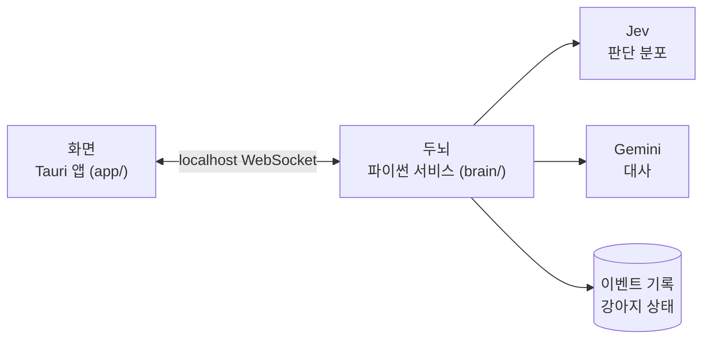
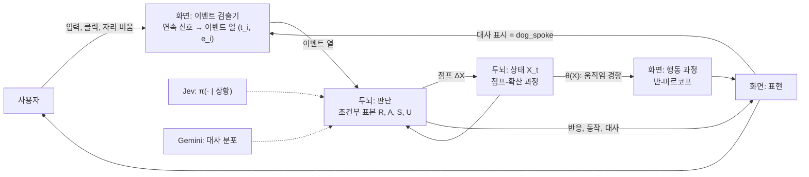
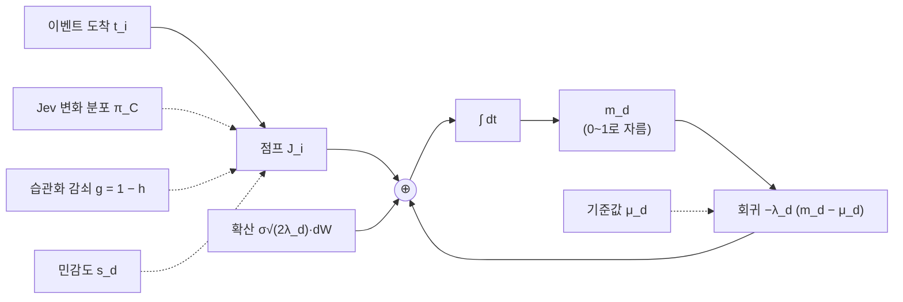
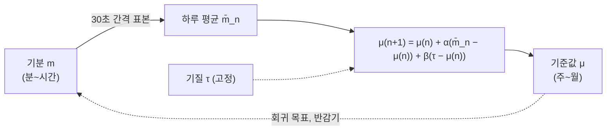
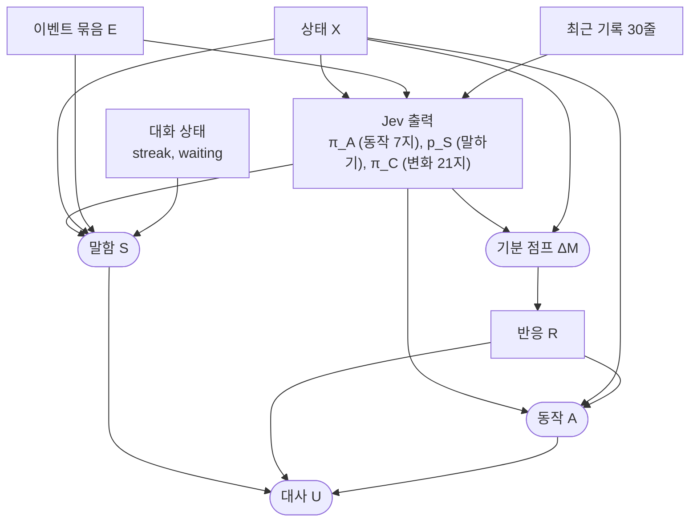
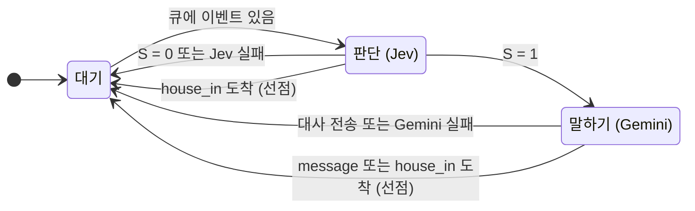
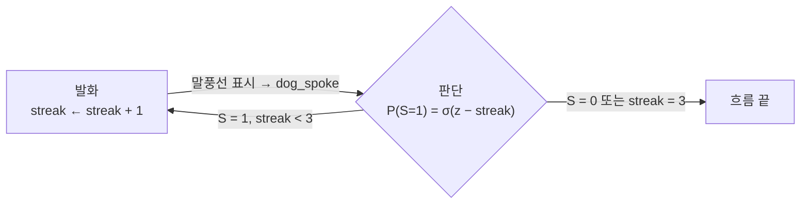
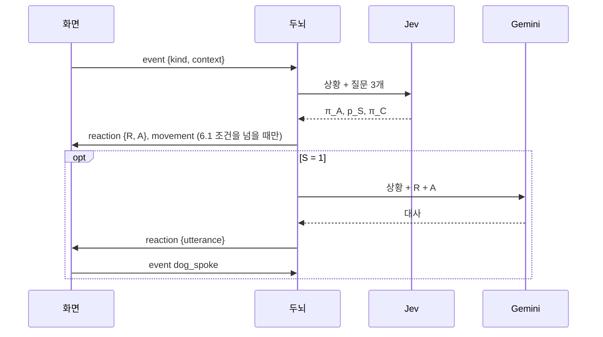
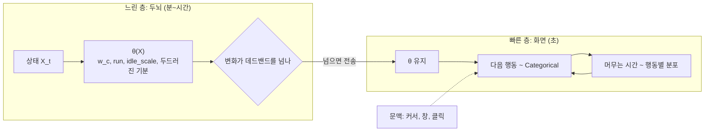
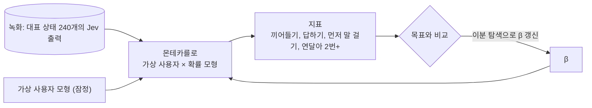

# ARCHITECTURE

TamagotchiChatBot의 구조와 동작 원리를 한 문서로 정리했다. 세부 근거는 각 절의 링크를 따라간다.

> 기준: 두뇌 v2 ([스펙](docs/superpowers/specs/2026-10-15-brain-v2-design.md), 2026-10-15 구현), 프로토콜 v3. 상수는 `brain/brain/tuning.py`의 현재 값이다.

이 문서는 강아지를 **확률 과정**으로 서술한다. 메커니즘마다 과정의 종류, 상태, 전이(분포), 매개변수를 적는다. 블록 다이어그램에서 실선은 신호, 점선은 매개변수로 들어가는 값, ⊕는 합이다.

## 1. 한눈에 보기

### 1.1 구성



- **화면**은 연속 신호(입력, 커서, 자리 비움, 몸 물리)를 이벤트로 바꿔 두뇌에 보내고, 두뇌가 준 경향대로 초 단위 행동을 뽑아 그린다.
- **두뇌**는 화면을 모르는 독립 서비스다. 강아지의 상태(성격·기분·기억)를 갖고, 이벤트마다 Jev 분포와 확률 모델로 반응·동작·대사를 뽑는다.
- 두뇌는 고정이고 화면은 바뀔 수 있다(나중에 Android) ([0012](docs/decisions/0012-brain-as-frontend-independent-service.md)).

### 1.2 시스템 모형

시스템은 되먹임 루프 세 개로 이루어진다.



| 루프 | 경로 | 시간 척도 | 절 |
|---|---|---|---|
| 상호작용 | 사용자 → 이벤트 → 판단 → 표현 → 사용자 | 초 | 5 |
| 자기 여기 | 대사 → dog_spoke 이벤트 → 판단 → 대사 | 초 | 5.4 |
| 적응 | 기분 → 하루 평균 → 기준값 → 기분의 회귀 목표 | 일~주 | 4.4 |

## 2. 원칙

| 원칙 | 뜻 | 근거 |
|---|---|---|
| 두뇌는 화면을 모른다 | 화면이 [프로토콜](docs/brain-protocol.md)을 따른다 | [0012](docs/decisions/0012-brain-as-frontend-independent-service.md) |
| 이벤트가 판단의 단위 | Jev 호출은 이벤트가 올 때만. **언제** 이벤트를 낼지는 화면이 정한다 | [0013](docs/decisions/0013-event-driven-brain-with-event-log.md) |
| 이벤트 기록이 기억 | 대화도 이벤트다. 찌름·돌아옴·강아지의 반응까지 한 줄로 쌓인다 | [0013](docs/decisions/0013-event-driven-brain-with-event-log.md) |
| Jev는 분포, 결정은 확률 모델 | Jev 응답의 확률에서 뽑는다. 같은 상황에서도 가끔 다르게 행동한다 | [0014](docs/decisions/0014-probabilistic-model-with-jev-distributions.md) |
| Jev에만 맡기지 않는다 | Jev가 약한 성격·기분·대화 흐름은 우리 모형이 보정한다 | [성격 유형 실측](docs/spikes/2026-10-15-personality-types.md) |
| 빠른 일은 화면, 느린 일은 두뇌 | 초 단위 움직임 선택은 화면이 혼자, 분 단위 경향은 두뇌가 보낸다 | [스펙 6.5](docs/superpowers/specs/2026-10-15-brain-v2-design.md) |

## 3. 시간 척도

과정들의 시간 상수는 서로 한 자릿수 이상 떨어져 있다. 그래서 빠른 과정은 느린 과정을 상수로 보고(준정적 근사), 느린 과정은 빠른 과정의 평균만 본다. 화면과 두뇌의 역할 분담은 이 분리에 기대고 있다.

| 과정 | 시간 상수 | 담당 | 근거 |
|---|---|---|---|
| 행동 하나의 지속 | 3~20초 | 화면 | 6.2의 머무는 시간 분포 |
| 이벤트 도착 간격 | 0.6초(타이핑) ~ 30분(조용함) | 화면 | 7절 검출 규칙 |
| 판단 한 번(서비스 시간) | Jev ≤ 3초 + Gemini ≤ 5초 | 두뇌 | 클라이언트 시간 제한 |
| 기분 회귀 | 반감기 H_d·(0.5 + μ_d) = 0.55H_d ~ 1.45H_d<br>놀람 1.7~4.4분, 궁금함 8~22분, 들뜸·무서움 11~29분,<br>분노 17~44분, 심심함·시무룩·행복 33~87분, 졸림 66~174분 | 두뇌 | `half_life_s` |
| 습관화 회복 | 반감기 1시간 | 두뇌 | `habit_half_life_s` |
| 친밀도 회귀 | 반감기 14일 | 두뇌 | `intimacy_half_life_s` |
| 기준값(성격) 적응 | 반감기 약 27일 | 두뇌 | 4.4의 유도 |

## 4. 상태와 동역학

### 4.1 상태 공간

강아지의 상태는 X = (m, I, h, μ)이고 고정 매개변수는 (s, τ, w)다. 기분 차원 D = {심심함, 졸림, 들뜸, 시무룩, 분노, 궁금함, 놀람, 무서움, 행복}, |D| = 9.

| 기호 | 뜻 | 범위 | 동역학 |
|---|---|---|---|
| m_d | 기분 | [0, 1] | 평균 회귀 점프-확산 (4.2) |
| I | 친밀도 | [0, 1] | 평균 회귀 + 점프 (4.3) |
| h_k, k ∈ {poke, pet, throw} | 습관화 | [0, 1) | 1차 적응 (4.3) |
| μ_d | 기준값 | [0.05, 0.95] | 하루 단위 이산 시간 적응 (4.4) |
| s_d | 민감도 | [0.2, 0.9] | 고정 |
| τ_d | 기질 | [0.05, 0.95] | 고정 |
| w | 변덕 | [0, 1] | 고정 |

**탄생**: μ_d ~ N(μ̄_d, 0.1²), s_d ~ N(0.5, 0.1²), w ~ N(0.5, 0.15²)를 각 범위로 자른다. μ̄는 기본 성격 "호기심 많고 수다스러운 강아지"를 옮긴 값이다(`BIRTH_BASELINE`). 초기값은 τ = μ, m = μ, I = 0.3, h = 0.

### 4.2 기분: 평균 회귀 점프-확산

기분 한 차원은 기준값으로 끌려가는 Ornstein–Uhlenbeck 과정에, 이벤트 시각마다 점프가 더해진 과정이다.



```text
dm_d = −λ_d (m_d − μ_d) dt  +  σ √(2λ_d) dW_t  +  Σ_i J_{d,i} δ(t − t_i)

λ_d     = ln2 / (H_d · (0.5 + μ_d))                      σ = 0.05
J_{d,i} = g_i · 2s_d · ( Σ_{e∈E_i} a_d(e) + k · w(e_last) · (π_C[d↑] − π_C[d↓]) ) + ε      k = 0.3,  ε ~ N(0, 0.01²)
         그 뒤 반대 기분 억제: J_b −= ρ·max(J_a, 0),  (a, b) ∈ 반대 쌍,  ρ = 0.6
a_d(e)  = 우리 평가 사전값 (찌르기 → 놀람 +0.20, 던지기 → 무서움 +0.30·충격, 쓰다듬기 → 행복 +0.12, …)
w(e)    = Jev 가중치: 메시지 1.0, 타이핑 0.5, 자기 말 0, 그 밖 0.3
g_i     = 1 − max{ h_e : e ∈ 이번 이벤트 묶음 }             습관화 대상이 없으면 1
```

- **평가 사전값 + Jev 조정** ([0015](docs/decisions/0015-appraisal-prior-mood-change.md)): 뜻이 정해진 이벤트의 기분 충격은 우리가 정하고, Jev는 종류별 가중치만큼 조정한다. 자기 말은 기분을 바꾸지 않는다. 반대 기분(무서움↔행복·들뜸, 분노↔행복, 시무룩↔들뜸·행복, 졸림↔들뜸)은 서로 억제한다. 사전값 표: [스펙](docs/superpowers/specs/2026-10-16-appraisal-prior-design.md).

- **이벤트가 없을 때**: 정상 분포는 N(μ_d, σ²)이다. 기분은 기준값 ± 0.05에서 흔들린다.
- **점프 크기**: 평균 강아지(민감도 0.5)에서 세게 던지면 무서움 +0.3, 찌르면 놀람 +0.2. 메시지 내용이 강하면 π_C[d↑] − π_C[d↓]가 ±0.6이라 ±0.18.
- **이벤트가 계속 올 때**: 이벤트가 평균율 r로 오고 평균 점프가 J̄_d면, 장기 평균은 μ_d + δ_d, δ_d ≈ r·J̄_d / λ_d다(경계 효과 무시). 4.4에서 이 δ를 쓴다.
- **기준값의 이중 역할**: μ_d는 회귀 목표이면서 회귀 속도도 정한다. 기준값이 높은 기분일수록 천천히 풀린다.
- **계산 방식**: 구현은 이 확률 미분 방정식의 정확한 이산화다. m ← μ + (m − μ)e^(−λΔt) + σ√(1 − e^(−2λΔt))·ε. 그래서 값을 읽는 간격(판단, 30초 시계, 상태 조회)과 상관없이 같은 분포가 나온다.

### 4.3 친밀도와 습관화

**친밀도**는 기분과 같은 구조에서 확산 항이 없다.

```text
dI = −(ln2 / 14일)(I − 0.3) dt  +  Σ_i ΔI_i,     ΔI_i = g_i · (0.02 · w(e_last) · (π_C[친밀도↑] − π_C[친밀도↓]) + Σ a_I(e))
```

한 번의 점프는 최대 0.02다(쓰다듬기 +0.005, 던지기 −0.01·충격 더함). 강하게 좋은 메시지 약 25번이면 +0.5 오른다.

**습관화**는 1차 적응이다. 같은 자극이 올 때마다 포화하며 오르고, 사이에는 지수적으로 회복한다.

```text
자극 k가 올 때      h_k ← h_k + η_k (1 − h_k),     η_k = 0.3 · (1.5 − s_{d(k)})
그 사이             h_k ← h_k · e^(−ln2·Δt / 1시간)
d(poke) = 놀람,  d(pet) = 들뜸,  d(throw) = 무서움
```

- 자극을 촘촘히 n번 주면 h = 1 − (1 − η)^n이다. 민감도 0.5(η = 0.3)에서 5번이면 0.83이다.
- 민감한 강아지일수록 η가 작아 천천히 무뎌진다.
- 감쇠 g = 1 − h는 그 자극이 주로 건드리는 기분만이 아니라 **모든 기분과 친밀도의 점프**에 곱해진다.

### 4.4 기준값: 느린 적응

기준값은 하루 단위 이산 시간 과정이다. 날짜가 바뀐 뒤 처음 기분을 계산할 때 한 번 갱신된다.



```text
μ_{n+1} = μ_n + α (m̄_n − μ_n) + β (τ − μ_n),      α = β = 0.025,  결과는 [0.05, 0.95]로 자름
m̄_n     = 하루 n 동안 30초 간격 기분 표본의 평균 (두뇌가 켜져 있던 시간만)
```

4.2에 따라 m̄_n ≈ μ_n + δ (δ: 그날 이벤트가 기분을 밀어 올린 평균 편차)로 두고 대입하면 다음과 같다.

```text
μ_{n+1} − μ* = (1 − β)(μ_n − μ*),      μ* = τ + (α/β)·δ = τ + δ
```

- **고정점** μ* = τ + δ: 타고난 기질에서 경험이 만든 편차만큼 옮겨 간 자리에 자리 잡는다. 개성(τ)이 경험에 지워지지 않는다.
- **수렴 속도**: 반감기 ln2 / −ln(1 − 0.025) ≈ 27일.
- **β = 0이면** μ_{n+1} = μ_n + αδ가 되어 고정점이 없다. 기준값이 δ 방향으로 계속 흘러 경계에 붙는다. 실제로 기질 항 없이 8주를 시뮬레이션하자 모든 강아지가 같은 성격으로 수렴했다. 기질 항을 넣은 이유다([시뮬레이션](docs/spikes/2026-10-15-simulation.md)).

### 4.5 파생량 (저장하지 않음)

방향 계수 a_d: 심심함·들뜸·궁금함·행복 = +1, 졸림·시무룩·분노·무서움 = −1, 놀람 = 0.

| 양 | 정의 | 쓰는 곳 |
|---|---|---|
| 말수 L | 0.7 · [ (I − 0.5) + Σ_d a_d (m_d − 0.5) + Σ_d a_d (μ_d − 0.5) ] | 말할 확률 (5.2) |
| 두드러진 기분 | d* = argmax_d (m_d − μ_d). 차이가 0.15 이상이면 d*, 아니면 `calm` | 평소 모습 (6.1) |

상세: [스펙 4절](docs/superpowers/specs/2026-10-15-brain-v2-design.md), [vision](docs/vision.md).

## 5. 판단: 이벤트에서 행동까지

### 5.1 확률 그래프 모형

판단 한 번은 아래 조건부 구조로 반응 R, 동작 A, 말함 S, 대사 U를 정한다. 둥근 노드는 표본으로 뽑는 확률 변수, 사각 노드는 결정적 계산이다.



```text
(π_A, p_S, π_C) = Jev(X, E, 기록)            외부 모형. 출력 분포만 쓴다

ΔM = 4.2의 점프 식(π_C, s, h, ε)

R  = 반응(d*)          max_d ΔM_d ≥ 0.02 일 때,   d* = argmax_d ΔM_d
   = 반응(d*) 또는 curious   E에 typing이 있을 때 (max ΔM > 0 이면 반응(d*))
   = none              그 밖

P(A = a) ∝ π_A(a)^(1/T) · exp( Σ_d B[a,d](m_d − 0.5) + C[R, a] ),     T = 0.5 + w ∈ [0.5, 1.5]

P(S = 1) = σ( logit p_S + L + β[e_last] − streak − 1[waiting] )
         = 0   (streak ≥ 3 또는 e_last = house_in)

U ~ Gemini( · | X, E, 기록, R, A )            S = 1일 때만
```

### 5.2 각 결정의 해석

- **반응 R**은 따로 묻지 않는다. 기분 점프의 argmax로 정해지는 결정적 함수다. 잡음 ε 때문에 결과는 확률적이다.
- **동작 A**는 **전문가 곱(product of experts)**이다.
  - Jev 분포를 온도 T로 조정한다. 변덕 w가 크면 분포가 평평해져 덜 그럴듯한 동작도 나온다.
  - 여기에 기분 친화도(B: 졸림→잠 등)와 반응 친화도(C: 짜증→짖기 등)를 곱한다. B, C의 성분은 0 또는 +1이다.
  - 우리 항이 동작 하나의 로그 점수를 움직이는 폭은 최대 기분 ±1.5, 반응 +1이다. Jev 로그확률 차이(1~3)보다 작게 잡아 Jev의 1위 동작이 대체로 유지된다(시뮬레이션 지표 "Jev 1위 동작 유지 ≥ 0.6").
- **말함 S**는 Jev 확률을 사전으로 두고 logit 공간에서 더하는 **로지스틱 모형**이다.
  - L은 성격·기분의 기여, β는 이벤트 종류별 기저율이다(8절에서 맞춘다).
  - streak·waiting 항은 대화 흐름을 억제한다.
- **성격·기분이 들어가는 두 경로**: Jev는 X를 텍스트로 받으므로 성격·기분이 Jev 해석을 통해 한 번 들어가고, 우리 모형 항(T, B, L)으로 다시 들어간다. 실측에서 Jev가 성격·기분에 둔감해서 두 번째 경로를 두었다([성격 유형 실측](docs/spikes/2026-10-15-personality-types.md)).

| 이벤트 종류 | β | 목표 P(S=1) (평균 성격) |
|---|---|---|
| message | −0.8 | 0.85 (답하기) |
| typing | −3.19 | 0.30 (끼어들기) |
| quiet | −2.53 | 1/3 (먼저 말 걸기 → 30분에 한 번) |
| dog_spoke | −2.04 | 연달아 2번 이상 0.30 (5.4) |
| 그 밖 | 0 | |

### 5.3 처리 과정: 서버 하나인 큐

두뇌의 판단은 **서버가 하나인 큐**다.
- 서비스 시간은 Jev 지연(≤ 3초)에, 말할 때는 Gemini 지연(≤ 5초)을 더한 것이다.
- 서비스 중에 도착한 이벤트는 큐에 쌓였다가 다음 서비스 한 번에 **묶여** 처리된다. 그래서 Jev 호출률은 1/E[서비스 시간]을 넘지 않는다. 몰려온 이벤트는 하나의 묶음 E가 된다.



- **선점**: `house_in`은 진행 중인 서비스를 취소하고 큐도 비운다. `message`는 대사 생성 단계만 취소한다. 사용자가 새로 말했으니 이전 흐름의 대사는 쓸모없기 때문이다.
- **진입 거부**: 화면이 끊겼거나 키가 없으면 큐를 버린다. 이벤트는 기록에 남으므로 다음 판단의 "최근 기록"으로 반영된다.
- **대화 상태 갱신**: `streak`은 `dog_spoke`가 아닌 이벤트가 오면 0, 대사를 보내면 +1이다. `waiting`은 대사가 `?`로 끝나면 참이 되고, `message`·`typing`이 오면 거짓이 된다.

### 5.4 대화의 자기 여기 루프

강아지가 말하면 화면이 말풍선을 띄우고 `dog_spoke` 이벤트를 보낸다. 이 이벤트가 다시 판단을 일으키므로 대화에는 **자기 여기**가 있다. 이를 streak 벌점과 상한 3이 억제한다.



z = logit p_S + L − 2.04 − 1[waiting]으로 두면 첫 발화 뒤 k번째 이어 말할 확률은 q_k = σ(z − k)다(k = 1, 2). 발화 흐름의 길이 N은 다음을 따른다.

```text
P(N ≥ 2) = q_1,    P(N = 3) = q_1 · q_2,    N ≤ 3
```

사용자 입력이나 다른 이벤트가 오면 streak이 0이 되어 새 흐름이 시작된다.

### 5.5 메시지 순서



## 6. 평소 움직임: 두 시간 척도 계층 모형

느린 층(두뇌)은 기분으로 행동 분포의 매개변수 θ를 정한다. 빠른 층(화면)은 그 θ로 초 단위 행동 열을 뽑는다.



### 6.1 느린 층: 경향 θ(X)와 전송

```text
c ∈ {rest, sleep, roam, approach, play, explore}
w_c        = base_c · exp( Σ_d A[c,d](m_d − 0.5) + Σ_d A'[c,d](μ_d − 0.5) + κ_c (I − 0.5) )
run        = σ( logit 0.2 + (m_들뜸 − 0.5) − (m_졸림 − 0.5) )                 걷기 중 달릴 확률
idle_scale = exp( (m_졸림 − 0.5) + (m_시무룩 − 0.5) − (m_들뜸 − 0.5) )          머무는 시간 배율
base = (0.6, 0.02, 0.4, 0.18, 0.06, 0.2),   A, A' ∈ {−1, 0, +1} (MOVE_MOOD, MOVE_BASELINE),
κ = 1 (approach, play), 0 (그 밖)
```

각 범주의 로그 가중치는 기분·기준값·친밀도의 선형 함수다(로그 선형 모형).

**전송은 변화량 기반 샘플링(send-on-delta)이다.** 두뇌는 30초 시계와 판단 직후에 θ를 다시 계산한다. 마지막으로 보낸 θ'와 비교해 다음 중 하나라도 넘을 때만 보낸다.
- 두드러진 기분이 바뀜
- 어떤 c에서 |w_c / w'_c − 1| > 0.10
- |run − run'| > 0.05
- |idle_scale / idle_scale' − 1| > 0.10

화면은 받은 θ를 다음 전송까지 그대로 쓴다(영차 유지). 화면의 θ 오차는 이 데드밴드 이내로 묶인다. 데드밴드 값은 사람이 움직임 차이를 느낄 만한 크기로 잡은 잠정값이다.

### 6.2 빠른 층: 반-마르코프 행동 과정

행동 하나가 끝나면(정한 시간 도달 또는 목적지 도착) 다음 행동을 뽑는다. **다음 행동의 분포는 직전 행동과 무관하다.** 즉 내재 전이 행렬의 모든 행이 같은 반-마르코프 과정이고, 행동 열은 θ와 문맥이 주어지면 독립 동일 분포다.

```text
행동 가중치   approach = ⅔·w_approach,  follow = ⅓·w_approach,  hunt = w_play,
              perch = watch = ½·w_explore,  idle = w_rest,  sleep = w_sleep,  walk = w_roam
문맥 조건     approach·follow·hunt: 커서가 450px 안일 때만 후보
              perch·watch: 올라앉을 창이 있을 때만 후보
              최근 3초 안 450px 안의 클릭이 있으면 approach·follow·hunt × 4
머무는 시간   idle ~ U(3, 10)초 × idle_scale,   sleep ~ U(8, 20)초 × idle_scale,
              follow ~ U(5, 10)초,   hunt ≤ 6초,   walk: 80~400px 떨어진 무작위 지점에 도착할 때까지
달리기        walk를 시작할 때 Bernoulli(run)
```

- **준정적 근사**: 행동 하나는 3~20초, 기분 반감기는 대부분 10분 이상이다. 행동 수십 개 동안 θ는 사실상 상수다.
- **선점**: 찌르기, 잡기·던지기, 판단이 준 동작 A, 집 들어가기는 이 과정을 선점한다. 타이핑이 시작되면 입력창 쪽을 바라보는 듣는 자세가 끼어든다.
- **설정 "쉬기"**: 가중치를 idle = 1, 나머지 0으로 바꾼다.
- **두뇌가 없으면** θ = (base, 0.2, 1)로 움직인다.

## 7. 이벤트 검출 (화면)

화면은 연속 신호를 일정 주기로 읽어 이산 이벤트 열로 바꾸는 **검출기**다. 이벤트의 **뜻**은 프로토콜이 고정하고, **검출 규칙**은 화면이 정한다([0013](docs/decisions/0013-event-driven-brain-with-event-log.md)).

| 이벤트 | 입력 신호 (샘플링 주기) | 검출 규칙 |
|---|---|---|
| `typing` | 입력창 글 (변경 즉시, 100ms 점검) | 마지막 변경 뒤 0.6초 정지, 또는 지난 typing보다 길이가 10자 이상 달라짐. 빈 글이면 내지 않음 |
| `message` | Enter | 즉시 |
| `dog_spoke` | 말풍선 표시 | 즉시 |
| `quiet` | 마지막 이벤트 시각 (100ms) | 경과 ≥ T, T = 10분(자리에 있음) / 30분(비움). 내면 시각이 갱신되어 주기 T로 반복(갱신 과정) |
| `returned` | OS 유휴 시간 (1초) | 유휴 ≥ 60초에서 < 60초로 바뀌는 순간(상승 에지) |
| `house_in` / `house_out` | 몸 상태 (프레임) | 상태 전이 순간 |
| `poke` / `pet` | 커서·버튼 (50ms) | 짧은 클릭 / 문지르기 |
| `throw` | 몸 물리 (프레임) | 착지 순간. impact = min(1, 최대 충돌 속도 / 2000px/초) |

- 강아지가 집에 있는 동안은 `house_out` 외의 이벤트를 막는다.
- `quiet`의 T는 먼저 말 걸기 목표(30분에 한 번)를 quiet에서 말할 확률(약 1/3)로 나눈 값이다.
- 전체 규약: [docs/brain-protocol.md](docs/brain-protocol.md).

## 8. 보정: 시뮬레이션 기반 맞춤

말하기 기저율 β(5.2)는 실제 사용 대신 **몬테카를로 시뮬레이션**으로 맞춘다. 비싼 Jev 호출은 미리 녹화한 출력으로 대신한다.



| 단계 | 내용 |
|---|---|
| 녹화 (`sim.record`) | 이벤트 종류 10 × 기분 프리셋 10(기본 + 한 기분 0.9) × 친밀도 {0.2, 0.8} × streak {0, 1, 2}(dog_spoke만) = 240개 상태에서 실제 Jev 호출 |
| Jev 근사 | 시뮬레이션 중 Jev(X) 대신 가장 가까운 녹화 상태의 출력을 쓴다(기분은 유클리드 거리, 친밀도는 가까운 쪽). 최근접 이웃 근사 |
| 가상 사용자 | 평일 9~18시 자리(12~13시 비움). 분당 확률: 메시지 0.03(앞에 typing 2번), 찌르기 0.005, 쓰다듬기 0.005, 던지기 0.002. 강아지가 말하면 50%가 답함. 대사의 30%가 질문 (모두 잠정값) |
| 맞춤 (`--fit`) | 지표가 β에 단조 증가하므로 각 β를 [−10, 10]에서 이분 탐색 14회. 네 β를 3바퀴 번갈아(좌표 하강). 평균 성격, 10일, 시드 고정 |
| 검증 | 성격 유형 4개(평균·과묵·예민·활발)의 지표, 무작위 100마리의 최소/중앙/최대, 8주 뒤 기준값이 경계에 붙은 수 |

- 결과는 사람이 `tuning.py`의 `kind_bias`로 옮긴다.
- **한계**: Jev 근사는 프리셋 10개의 최근접이라 기분이 섞인 상태의 오차가 있다. 가상 사용자 모형은 잠정값이다.
- 질문 문구나 Jev 버전을 바꾸면 π가 달라지므로 다시 녹화하고 다시 맞춘다.

## 9. 저장과 실행

| 무엇 | 어디 |
|---|---|
| 이벤트 기록, 강아지 상태 | `%APPDATA%\TamagotchiChatBot\brain\brain.db` (SQLite) |
| 두뇌 접속 정보 | `%APPDATA%\TamagotchiChatBot\brain\brain.json` (포트·토큰) |
| 두뇌 로그 | `%APPDATA%\TamagotchiChatBot\brain\logs\brain.log` (키·대화 내용은 쓰지 않음) |
| API 키 | Windows 자격 증명 관리자 (두뇌가 보관) |
| 화면 설정 | Tauri 앱 데이터 폴더 `settings.json` |

- 화면이 `brain.json`으로 접속을 시도하고, 안 되면 `brain/.venv`의 파이썬으로 두뇌를 띄운 뒤 2초마다 다시 접속한다. 접속 절차는 [프로토콜](docs/brain-protocol.md)에 있다.
- 두뇌는 시작할 때 다른 두뇌가 살아 있으면 바로 끝낸다. 같은 데이터를 두 두뇌가 쓰지 않게 하기 위해서다.
- 앱을 끄면 자기가 띄운 두뇌만 끈다. 두뇌가 죽어도 강아지는 기본 경향으로 계속 움직인다.

## 10. 오류 처리

원칙: 강아지는 멈추지 않는다.

| 상황 | 동작 |
|---|---|
| 키 없음 / 키 오류 | AI 호출 안 함, `status`로 화면에 알림("설정에서 키를 넣어 주세요") |
| Jev 실패·시간 초과(3초) | 이번 판단 건너뜀 |
| Gemini 실패·시간 초과(5초) | 대사 없이 반응·동작만 |
| 강아지 상태를 못 읽음 | 기본값으로 계속, 저장된 성격을 덮어쓰지 않음 |
| 기록 쓰기 실패 | 메모리로 계속 |

## 11. 코드 지도

| 위치 | 내용 |
|---|---|
| `brain/brain/model.py` | 확률 모델 (순수 함수): 상태 갱신, 점수, 뽑기, 움직임 경향 |
| `brain/brain/core.py` | 이벤트 큐·판단 태스크·기분 시계 틱 |
| `brain/brain/questions.py` | Jev 질문 3개와 정책 문구, state 직렬화 |
| `brain/brain/persona.py` | 기본 성격, Gemini 지시·프롬프트, 대사 다듬기 |
| `brain/brain/tuning.py` | 잠정값과 방향표 (근거 주석) |
| `brain/brain/store.py` | 이벤트 기록·강아지 상태 |
| `brain/brain/clients.py` | Jev·Gemini 클라이언트 |
| `brain/brain/config.py` | 데이터 폴더, 키 읽기·쓰기 (환경 값을 읽는 유일한 곳) |
| `brain/brain/server.py`, `__main__.py` | WebSocket, 실행 |
| `brain/sim/` | Jev 녹화, 시뮬레이터 |
| `app/src/body/` | 강아지 상태 기계·행동 선택(`dog.ts`), 이벤트 판정(`events.ts`), 쓰다듬기 등 순수 로직 |
| `app/src/character.ts` | 캐릭터 창: 그리기, 입력, 주기 작업, 두뇌 연결 |
| `app/src/input.ts`, `app/src/settings-page.ts` | 입력창, 설정 창 |
| `app/src/brain-link.ts`, `app/src/shared/brain-protocol.ts` | 두뇌 접속, 프로토콜 |
| `app/src-tauri/` | Rust 셸: 창, Win32 신호, 두뇌 실행 |

## 12. 문서 지도

모든 작업은 문서가 먼저다. 작업 규칙은 [`CLAUDE.md`](CLAUDE.md), 설치·실행은 [`README.md`](README.md).

| 문서 | 내용 |
|---|---|
| [`docs/vision.md`](docs/vision.md) | 제품 컨셉. 확정된 것과 미정인 것을 구분해 누적한다 |
| [`docs/glossary.md`](docs/glossary.md) | 용어 정의 |
| [`docs/decisions/`](docs/decisions/) | 결정 기록(ADR). 결정 하나에 파일 하나 |
| [`docs/brain-protocol.md`](docs/brain-protocol.md) | 화면 ↔ 두뇌 프로토콜. 화면은 이 문서만 보고 만들 수 있어야 한다 |
| [`docs/references/typesafe-jev.md`](docs/references/typesafe-jev.md) | Jev API 요약과 사내 사용 사례 |
| [`docs/references/similar-projects.md`](docs/references/similar-projects.md) | 비슷한 프로젝트 조사 (mochi-llm-pet) |
| [`docs/superpowers/specs/`](docs/superpowers/specs/) | 설계 스펙. [Windows 첫 버전](docs/superpowers/specs/2026-10-14-windows-desktop-pet-design.md), [두뇌 v1](docs/superpowers/specs/2026-10-15-brain-design.md), [두뇌 v2](docs/superpowers/specs/2026-10-15-brain-v2-design.md), [기분 8개·즉각 반응](docs/superpowers/specs/2026-10-15-mood-reaction-design.md), [기분×동작별 그림](docs/superpowers/specs/2026-10-15-mood-sprites-design.md), [검수 루프](docs/superpowers/specs/2026-10-15-review-loop-design.md), [평가 사전값](docs/superpowers/specs/2026-10-16-appraisal-prior-design.md) |
| [`docs/superpowers/plans/`](docs/superpowers/plans/) | 스펙별 구현 계획 ([검수 하네스](docs/superpowers/plans/2026-10-16-review-harness.md) 등) |
| [`brain/review/`](brain/review/README.md) | 검수 하네스: 시나리오 실행기, 상태 분석표, 커버리지 |
| [`docs/review/`](docs/review/) | 검수 루프: [진행 상황](docs/review/progress.md), [루프 프롬프트](docs/review/loop-prompt.md), [검수자 정의](docs/review/reviewer.md), [아는 결함](docs/review/known-defects.md), 회차별 판정(`rounds/`) |
| [`docs/spikes/`](docs/spikes/) | 실측·기술 검증. [배경 모드](docs/spikes/background-mode.md), [Jev speak_now](docs/spikes/2026-10-15-jev-speak-now-probe.md), [두뇌 v2 가정](docs/spikes/2026-10-15-brain-v2-assumptions.md), [성격 유형](docs/spikes/2026-10-15-personality-types.md), [질문 문구](docs/spikes/2026-10-15-question-wording.md), [시뮬레이션](docs/spikes/2026-10-15-simulation.md) |
| [`docs/manual-checks/`](docs/manual-checks/) | 화면·Win32·실제 키 동작 수동 확인 체크리스트 |

## 13. 결정 기록

| 번호 | 제목 | 상태 |
|---|---|---|
| [0001](docs/decisions/0001-jev-as-decision-engine.md) | 실시간 반응 결정에 Jev를 쓴다 | 채택 (일부 개정: 0014) |
| [0002](docs/decisions/0002-platform-order.md) | Windows PC 먼저, Android는 그다음 | 채택 |
| [0003](docs/decisions/0003-windows-display-modes.md) | Windows 배경·오버레이 모드 모두 지원, 설정으로 고정 | 대체됨(0010) |
| [0004](docs/decisions/0004-input-box-trigger.md) | 캐릭터 클릭·전역 단축키로 입력창, 상시 표시는 설정 | 대체됨(말풍선 아이콘으로) |
| [0005](docs/decisions/0005-local-history-storage.md) | 대화 기록은 PC에 저장 (서버 중계 부분은 0006으로 대체) | 일부 대체됨 |
| [0006](docs/decisions/0006-user-provided-api-keys.md) | 서버 없이 사용자가 입력한 API 키로 직접 호출 | 채택 |
| [0007](docs/decisions/0007-dialogue-llm.md) | 캐릭터 대사는 gemini-3.1-flash-lite로 생성 | 채택 |
| [0008](docs/decisions/0008-tech-stack-tauri.md) | Windows 앱은 Tauri(Rust + TypeScript) | 채택 |
| [0009](docs/decisions/0009-background-mode-wallpaper-replacement.md) | 배경 모드는 배경화면 대체 방식 | 대체됨(0010) |
| [0010](docs/decisions/0010-overlay-only-with-doghouse.md) | 오버레이 모드만, 강아지 집(비활성 모드) 추가 | 채택 |
| [0011](docs/decisions/0011-python-brain-local-sidecar.md) | 두뇌는 PC 안에서 도는 파이썬 프로세스 | 채택 (일부 개정: 0012) |
| [0012](docs/decisions/0012-brain-as-frontend-independent-service.md) | 두뇌는 화면과 독립된 WebSocket 서비스, 키도 두뇌가 보관 | 채택 |
| [0013](docs/decisions/0013-event-driven-brain-with-event-log.md) | 두뇌는 이벤트 단위로 판단, 이벤트 기록이 기억 | 채택 |
| [0014](docs/decisions/0014-probabilistic-model-with-jev-distributions.md) | Jev는 분포를 주고 확률 모델이 뽑아서 결정 | 채택 (기분 변화는 0015로 개정) |
| [0015](docs/decisions/0015-appraisal-prior-mood-change.md) | 기분 변화는 우리 평가 사전값이 정하고 Jev는 조정만 | 채택 (검수 루프) |
