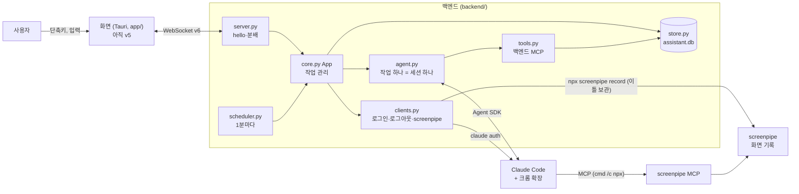

# ARCHITECTURE

TamagotchiChatBot의 구조와 동작 원리다. 지금 코드가 **어떻게 동작하는지**만 적는다.

> 기준: 브랜치 `feat/assistant`. 백엔드는 프로토콜 v6, 화면은 아직 v5다. 프로젝트를 조수로 바꾸면서 다마고치 기능을 모두 지웠다 ([0022](docs/decisions/0022-pivot-to-assistant.md)). 백엔드는 [조수 1단계 스펙](docs/superpowers/specs/2026-10-21-assistant-phase1-design.md)대로 다시 만들었고, 화면은 화면 계획에서 v6으로 바꾼다. 그 전까지 앱은 백엔드에 접속하지 못한다(버전이 달라 끊긴다).

## 1. 한눈에 보기

- 화면(Tauri 앱, `app/`)과 백엔드(`backend/`)는 localhost WebSocket으로 통신한다. 규약은 [프로토콜](docs/backend-protocol.md)이다.
- 백엔드는 화면을 모른다 ([0022](docs/decisions/0022-pivot-to-assistant.md)).
- 작업 하나 = 대화 하나 = Claude Code 세션 하나다 ([0029](docs/decisions/0029-claude-code-harness-and-session-per-task.md), [0030](docs/decisions/0030-io-interface-task-as-conversation.md)). 스케줄도 작업 하나다 ([0032](docs/decisions/0032-schedule-creation.md)). 대화 탭은 출처 `chat`인 작업 하나로, 처음 시작할 때 만들고 그 세션을 계속 이어 쓴다. 작업 목록·알림에는 넣지 않는다 ([0033](docs/decisions/0033-chat-tab-single-session.md)). 대화에서 일을 맡기면 에이전트가 `create_task`로 새 작업을 만들고 대화에 작업 칩 줄을 남긴다.
- 여러 작업이 동시에 돈다. 질문·권한 요청은 대화의 질문 줄이 되고, 사용자의 `say`가 답이 된다.

## 2. 화면 (`app/`)

> 아래는 v5 시절 그대로다. 입력창의 `message`, 설정 창의 키 저장(`set_key`)은 v6 백엔드가 받지 않는다. 화면 계획에서 다시 쓴다.

| 창 | 파일 | 하는 일 |
|---|---|---|
| 주 창 `main` | `index.html`, `src/main.ts` | 보이지 않는다. 백엔드 연결을 들고, 입력창·설정 창과 백엔드 사이를 잇는다. 입력창 단축키를 등록한다 |
| 입력창 `input` | `input.html`, `src/input.ts` | 단축키(기본 `Ctrl+Shift+Space`)로 화면 가운데에 열고 닫는다. Enter로 보낸다 |
| 설정 창 `settings` | `settings.html`, `src/settings-page.ts` | 트레이 메뉴로 연다. 단축키와 API 키를 저장한다 |

- `src/backend-link.ts`: 백엔드에 접속한다. 끊기거나 접속하지 못하면 2초 뒤 백엔드를 띄우고(이미 떠 있으면 그대로) 다시 접속한다.
- `src/shared/backend-protocol.ts`: 프로토콜 메시지 해석과 생성.
- `src/shared/settings.ts`: 화면 설정(단축키) 저장. 저장본에 예전 설정이 있어도 지금 쓰는 값만 꺼낸다.
- `src-tauri/src/backend.rs`: 접속 정보 파일 읽기, 개발 환경에서 `backend/.venv`의 파이썬으로 백엔드 띄우기, 앱이 끝날 때 함께 끄기.
- `src-tauri/src/lib.rs`: 트레이(설정, 종료)와 창 관리.
- `public/sprites/dog/`: 강아지 스프라이트. 지금은 쓰는 코드가 없다. 강아지가 화면 한 자리에 있다는 컨셉([vision](docs/vision.md))에 따라 둔다.

## 3. 백엔드 (`backend/`)

| 파일 | 하는 일 |
|---|---|
| `backend/__main__.py` | 실행 진입점. 이미 떠 있는 백엔드가 있으면 끝낸다. 저장소 → `App` → `startup`(끊긴 작업 닫기, 대화 작업이 없으면 만들기, 화면 기록 설정이 켜져 있으면 screenpipe 띄우기) → 빈 포트에서 WebSocket을 열고 `backend.json`에 포트·토큰을 쓴다 → 스케줄러를 돌린다. 끝날 때 screenpipe를 끄고 `backend.json`을 지운다 |
| `backend/server.py` | 전송 계층. `hello` 인증·버전 확인, 화면 교체, `type`별로 `App` 메서드를 부른다(`ROUTES`). 필드가 빠지거나 타입이 틀리면 버린다. 메서드 오류는 로그만 남기고 연결을 유지한다. `login`·`logout`은 기다리지 않고 따로 돌린다 |
| `backend/core.py` | 작업 관리(`App`). 화면 메시지마다 메서드 하나. 작업마다 Claude Code 세션을 백그라운드로 돌리고, 세션에서 일어난 일을 대화 줄·상태로 저장해 화면에 순서대로 보낸다. 스케줄 실행(`run_schedule`), 대화 작업, 로그아웃, 설정(권한 모드·화면 기록 켜고 끄기), 사용량도 여기서 |
| `backend/agent.py` | Claude Code 세션 하나(`AgentRun`). 실행 옵션(`build_options`: 하네스, 크롬, 켜고 끄는 도구, screenpipe MCP), 질문·권한 요청을 사용자 답으로 기다리기, 덧붙이기, 멈추기 |
| `backend/harness.md` | Claude Code에 붙이는 하네스 문서 (역할, 맥락 찾기, 일하는 방식, 하지 말 것, 말투) |
| `backend/tools.py` | 백엔드 MCP 도구. 작업 기록 찾기·읽기, 제목 붙이기, 스케줄 읽기·만들기·고치기(사용자 확인 뒤 저장), 새 작업 만들기(`create_task`, 대화에 작업 칩을 남긴다) |
| `backend/store.py` | SQLite 저장소. 작업·대화 줄·스케줄·설정(권한 모드, 화면 기록 켬/끔). 검색은 FTS5. 목록 한 쪽은 4줄. 작업 목록·알림 보기는 대화 작업을 뺀다 |
| `backend/schedule_rule.py` | 스케줄 규칙 검사, 다음 실행 시각, 표시 글(`매일 09:00`) |
| `backend/scheduler.py` | 1분마다 때가 된 스케줄을 `App.run_schedule`에 시킨다. 도는 중이거나 앱이 꺼져 놓친 실행은 건너뛴다 |
| `backend/clients.py` | 외부 프로세스. `claude auth status/login/logout`(구독 로그인 확인·로그인·로그아웃), screenpipe 띄우기·끄기(윈도에서는 `taskkill /T`로 트리째) |
| `backend/config.py` | 데이터 폴더·DB·작업 폴더 경로, Claude Code 환경(`ANTHROPIC_API_KEY`를 빈 값으로 덮는다), screenpipe 명령을 읽는 유일한 곳 (CLAUDE.md 3절) |

## 4. 저장과 실행

| 무엇 | 위치 |
|---|---|
| 작업 기록 (작업·대화 줄·스케줄·설정) | `%APPDATA%\TamagotchiChatBot\backend\assistant.db` |
| Claude Code 작업 폴더 (`cwd`) | `%APPDATA%\TamagotchiChatBot\backend\work\` |
| 백엔드 로그 | `%APPDATA%\TamagotchiChatBot\backend\logs\backend.log` (1MB × 4개 돌려 씀). 사용자 글·대화 내용은 쓰지 않는다 |
| 백엔드 접속 정보 | `%APPDATA%\TamagotchiChatBot\backend\backend.json` |
| 화면 기록 (screenpipe) | `%USERPROFILE%\.screenpipe` (screenpipe가 관리) |
| Claude Code 로그인 | Claude Code가 관리 (`claude auth login`, 구독) |
| 화면 설정 | `%APPDATA%\com.tamagotchi.app\settings.json` |

## 5. 문서 지도

| 문서 | 내용 |
|---|---|
| [`docs/vision.md`](docs/vision.md) | 제품 비전. 사용자가 말하거나 확인한 것만 적는다 |
| [`docs/glossary.md`](docs/glossary.md) | 용어집 |
| [`docs/backend-protocol.md`](docs/backend-protocol.md) | 화면 ↔ 백엔드 프로토콜 (v6) |
| [`docs/manual-checks/backend.md`](docs/manual-checks/backend.md) | 백엔드 수동 확인 목록: 실제 Claude Code·screenpipe로만 확인할 수 있는 것 |
| [`docs/decisions/`](docs/decisions/) | 결정 기록. 결정 하나에 파일 하나 |
| [`docs/design/`](docs/design/) | 디자인 요청서와 결과. [출력 계층 요청서](docs/design/2026-10-21-output-ui-brief.md), [출력 계층 화면 디자인](docs/design/2026-10-21-output-ui/README.md) |
| [`docs/spikes/`](docs/spikes/) | 기술 확인 시험. [Agent SDK로 띄운 Claude Code의 크롬 조작·질문·권한](docs/spikes/2026-10-21-agent-sdk-claude-code.md) |
| [`docs/references/similar-products.md`](docs/references/similar-products.md) | 비슷한 제품 조사: 실행 쪽(UFO², Cowork, 브라우저 에이전트)과 기억 쪽(screenpipe, Recall) |
| [`docs/references/typesafe-jev.md`](docs/references/typesafe-jev.md) | Jev API 요약. Jev를 다시 쓰게 되면 본다 |
| [`docs/superpowers/specs/`](docs/superpowers/specs/) | 설계 스펙. [조수 1단계](docs/superpowers/specs/2026-10-21-assistant-phase1-design.md) |
| [`docs/superpowers/plans/`](docs/superpowers/plans/) | 구현 계획. [1단계 백엔드](docs/superpowers/plans/2026-10-21-assistant-backend.md), [백엔드 추가분: 대화·설정 탭](docs/superpowers/plans/2026-10-21-assistant-backend-chat-settings.md) |

다마고치 시절의 스펙·계획·실측·검수 기록은 지웠다. git 기록 `4b8c747`에 있다.

## 6. 결정 기록

| 번호 | 제목 | 상태 |
|---|---|---|
| [0022](docs/decisions/0022-pivot-to-assistant.md) | 다마고치를 접고 브라우저를 조작하는 조수로 바꾼다 | 채택 |
| [0023](docs/decisions/0023-claude-code-first-then-own-agent.md) | 에이전트는 Claude Code로 먼저, 나중에 직접 설계한 에이전트로 | 채택 |
| [0024](docs/decisions/0024-observation-common-plus-enrichment.md) | 지금 상황은 공통 관찰 + 프로그램별 선택적 강화 | 채택 |
| [0025](docs/decisions/0025-own-scheduler.md) | 스케줄 작업은 직접 구현한다 | 채택 |
| [0026](docs/decisions/0026-input-layer-passes-request-only.md) | 입력 계층은 요청만 넘기고, 맥락은 에이전트가 화면 기록에서 찾는다 | 채택 |
| [0027](docs/decisions/0027-data-layer-ownership.md) | 데이터 계층: 데이터마다 저장소·쓰기·읽기·관리 주체 | 채택 |
| [0028](docs/decisions/0028-output-layer-is-ui.md) | 출력 계층은 사용자 인터페이스만, 행동은 백엔드 | 채택 |
| [0029](docs/decisions/0029-claude-code-harness-and-session-per-task.md) | Claude Code는 하네스 문서로 동작 원칙을 받고, 작업 하나에 세션 하나 | 채택 |
| [0030](docs/decisions/0030-io-interface-task-as-conversation.md) | 입출력 인터페이스: 작업 하나를 대화 하나로 | 채택 (백엔드 구현) |
| [0031](docs/decisions/0031-retrieval-by-agent-tool-search.md) | 에이전트는 데이터 계층을 검색 도구로 직접 찾아본다 (의미 검색은 나중에) | 채택 |
| [0032](docs/decisions/0032-schedule-creation.md) | 스케줄은 탭과 에이전트 둘 다로 만들고 확인받는다. 스케줄은 세션 하나라 대화할 수 있다. 에이전트는 자기 작업에 갇히지 않는다 | 채택 |
| [0033](docs/decisions/0033-chat-tab-single-session.md) | 대화 탭은 Claude Code 세션 하나로 그냥 대화한다. 대화로 작업·스케줄을 만들 수 있고, 세션 데이터에서 '대화'로 구분한다 | 채택 |

0001~0021은 다마고치 시절 기록이라 지웠다. 아직 유효한 원칙은 0022에 옮겼고, 원문은 git 기록 `4b8c747`에 있다.
