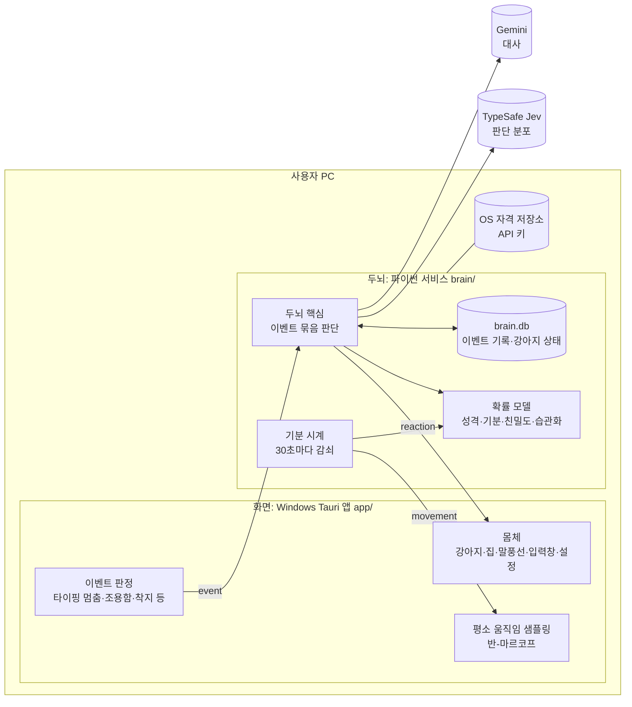
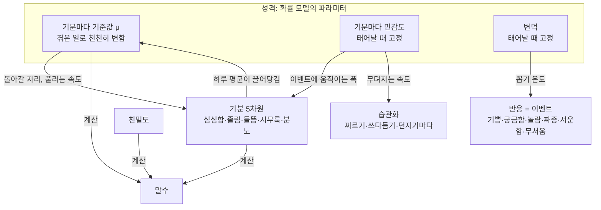
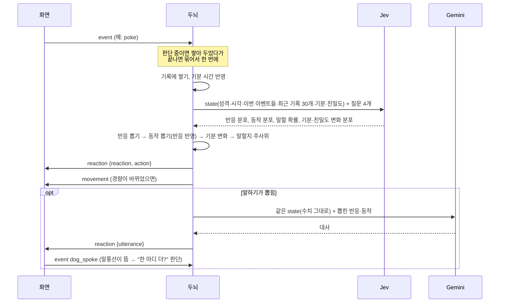
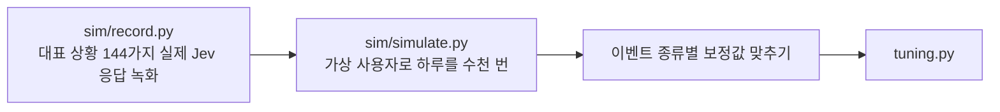

# ARCHITECTURE

TamagotchiChatBot의 구조와 동작 원리를 한 문서로 정리했다. 세부 근거는 각 절의 링크를 따라간다.

> 기준: 두뇌 v2 설계([스펙](docs/superpowers/specs/2026-10-15-brain-v2-design.md)). 2026-10-15 현재 v2를 구현하는 중이며, 저장소의 두뇌 코드는 아직 v1(스케줄러 + 임계값)이다. 구현이 끝나면 이 줄을 지운다.

## 1. 한눈에 보기



- **화면**은 강아지를 그리고, 무슨 일이 일어났는지(이벤트)를 두뇌에 알리고, 두뇌가 준 경향대로 평소 움직임을 뽑는다.
- **두뇌**는 화면을 모르는 독립 서비스다. 이벤트를 받아 Jev로 판단 분포를 얻고, 확률 모델로 뽑아 반응·대사를 정한다. 강아지의 성격·기분·기억을 갖는다.
- 둘은 **localhost WebSocket**으로 통신한다. 두뇌는 고정이고 화면은 바뀔 수 있다(나중에 Android) ([0012](docs/decisions/0012-brain-as-frontend-independent-service.md)).

## 2. 원칙

| 원칙 | 뜻 | 근거 |
|---|---|---|
| 두뇌는 화면을 모른다 | 화면이 [프로토콜](docs/brain-protocol.md)을 따른다 | [0012](docs/decisions/0012-brain-as-frontend-independent-service.md) |
| 이벤트가 판단의 단위 | Jev 호출은 이벤트가 올 때만. **언제** 이벤트를 낼지는 화면이 정한다 | [0013](docs/decisions/0013-event-driven-brain-with-event-log.md) |
| 이벤트 기록이 기억 | 대화도 이벤트다. 찌름·돌아옴·강아지의 반응까지 한 줄로 쌓인다 | [0013](docs/decisions/0013-event-driven-brain-with-event-log.md) |
| Jev는 분포, 결정은 확률 모델 | Jev 응답의 확률에서 뽑는다. 같은 상황에서도 가끔 다르게 행동한다 | [0014](docs/decisions/0014-probabilistic-model-with-jev-distributions.md) |
| Jev에만 맡기지 않는다 | Jev가 약한 성격·기분·대화 흐름은 우리 모형이 보정한다 | [성격 유형 실측](docs/spikes/2026-10-15-personality-types.md) |
| 빠른 일은 화면, 느린 일은 두뇌 | 초 단위 움직임 선택은 화면이 혼자, 분 단위 경향은 두뇌가 보낸다 | [스펙 6.5](docs/superpowers/specs/2026-10-15-brain-v2-design.md) |

## 3. 바뀌는 속도와 담당

| 무엇 | 속도 | 담당 | 소통 |
|---|---|---|---|
| 구체적인 움직임(걷기·앉기·커서 따라가기) | 초 | 화면 | 없음 |
| 이벤트 판정(타이핑 멈춤, 조용함, 착지) | 초~분 | 화면 | 이벤트가 생길 때 |
| 반응·동작·대사 | 이벤트마다 | 두뇌 (Jev + 확률 모델 + Gemini) | 판단할 때 |
| 기분 | 분~시간 | 두뇌 (이벤트 + 기분 시계) | 움직임 경향이 바뀔 때 |
| 친밀도 | 일~주 | 두뇌 | |
| 성격(기준값) | 주~월 | 두뇌 (하루 한 번) | |

## 4. 강아지의 상태



| 층 | 표현 | 무엇이 바꾸나 |
|---|---|---|
| **반응** | 라벨(없음 포함). 이벤트 기록에 "강아지" 줄로 남는다 | 이벤트마다 Jev 분포 × 우리 모형 보정에서 뽑음 |
| **기분** | 수치 5개(0~1) | ① 시간: 평균 회귀(기준값으로 돌아가며 흔들림. 반감기 = 기본 × (0.5 + 기준값)) ② 이벤트: Δ = k·(P↑−P↓)·민감도 × (1 − 습관화) |
| **친밀도** | 수치 1개 | 이벤트마다 아주 조금. 오래 안 보면 2주에 걸쳐 식음 |
| **성격** | 기준값·민감도(기분마다), 변덕 | 탄생 때 무작위(기본 성격 "호기심 많고 수다스러운 강아지"를 평균으로). 기준값만 하루 한 번 어제 기분 평균 쪽으로 5% |
| **습관화** | 자극마다 0~1 | 같은 자극이 반복되면 오르고(민감할수록 천천히) 1시간 반감기로 회복 |
| **말수** | 저장하지 않음. 계산값 | 친밀도 + 지금 기분 + 기준값 (심심함·들뜸은 +, 졸림·시무룩·분노는 −) |

상세: [스펙 4절](docs/superpowers/specs/2026-10-15-brain-v2-design.md), [vision](docs/vision.md).

## 5. 이벤트 하나가 처리되는 과정



**뽑기 점수** = Jev 로그확률 ÷ 온도(0.5 + 변덕) + 우리 모형 보정

| 대상 | 우리 모형 보정 |
|---|---|
| 반응 | 기분→반응 친화도(분노→짜증 등), 민감한 성격은 "없음"이 줄고 습관화되면 "없음"이 는다 |
| 동작 | 기분→동작 친화도(졸림→잠 등), 방금 뽑힌 반응→동작(짜증→짖기 등) |
| 말하기 | logit p = logit P_Jev + 말수 + 이벤트 종류별 보정 − 연달아 말한 횟수 − 답 기다림. 사용자 입력 없이 3번이면 멈춤 |

**폐기 규칙**: 대사를 만드는 중에 사용자가 메시지를 보내거나 강아지가 집에 들어가면 그 대사는 버린다. 집에 들어가면 쌓인 이벤트도 버린다.

## 6. 평소 움직임

```mermaid
flowchart LR
  CLK[기분 시계 30초] --> T[경향 계산<br>w_c = 기본_c × exp(기분·기준값·친밀도 보정)]
  T --> C{지난번 보낸 것과<br>10% 넘게 다른가}
  C -- 예 --> SCR[화면이 최신 경향 보관]
  SCR --> S[반-마르코프 뽑기<br>머무는 시간 → 다음 범주]
  INST[커서·창·클릭·자리 비움<br>화면만 아는 순간 정보] --> S
```

- 범주: 쉬기, 잠, 돌아다니기, 사용자 곁으로, 놀기(사냥), 구경하기 + 달리기 비율 + 머무는 시간 배율.
- 설정의 "쉬기"를 켜면 경향과 상관없이 그 자리에서 잔다.
- 두뇌가 없으면 화면은 기본 경향으로 움직인다.

## 7. 이벤트 (프로토콜 v2)

| 이벤트 | 화면이 내는 때 (Windows) |
|---|---|
| 타이핑 | 0.6초 멈춤 또는 10자 넘게 바뀜 |
| 메시지 보냄 | Enter |
| 강아지 말이 화면에 뜸 | 말풍선 표시 직후 |
| 조용함 | 마지막 이벤트 뒤 10분(자리에 있음)/30분(비움) |
| 돌아옴 | 1분 넘게 입력이 없다가 다시 입력 |
| 집에 들어감/나옴 | 집 클릭·트레이·단축키 |
| 찌르기/쓰다듬기/던지기 | 몸 상호작용 감지. 던지기는 착지 때 충격(0~1)과 함께 |

전체 규약: [docs/brain-protocol.md](docs/brain-protocol.md).

## 8. 저장과 실행

| 무엇 | 어디 |
|---|---|
| 이벤트 기록, 강아지 상태 | `%APPDATA%\TamagotchiChatBot\brain\brain.db` (SQLite) |
| 두뇌 접속 정보 | `%APPDATA%\TamagotchiChatBot\brain\brain.json` (포트·토큰) |
| 두뇌 로그 | `%APPDATA%\TamagotchiChatBot\brain\logs\brain.log` (키·대화 내용은 쓰지 않음) |
| API 키 | Windows 자격 증명 관리자 (두뇌가 보관) |
| 화면 설정 | Tauri 앱 데이터 폴더 `settings.json` |

- Tauri 앱이 시작할 때 `brain.json`으로 접속을 시도하고, 안 되면 `brain/.venv`의 파이썬으로 두뇌를 띄운다. 앱을 트레이 → 종료로 끄면 자기가 띄운 두뇌도 끈다.
- 두뇌가 죽거나 늦게 떠도 강아지는 계속 움직이고, 화면이 2초마다 다시 접속한다.

## 9. 오류 처리

원칙: 강아지는 멈추지 않는다.

| 상황 | 동작 |
|---|---|
| 키 없음 / 키 오류 | AI 호출 안 함, `status`로 화면에 알림("설정에서 키를 넣어 주세요") |
| Jev 실패·시간 초과(3초) | 이번 판단 건너뜀 |
| Gemini 실패·시간 초과(5초) | 대사 없이 반응·동작만 |
| 강아지 상태를 못 읽음 | 기본값으로 계속, 저장된 성격을 덮어쓰지 않음 |
| 기록 쓰기 실패 | 메모리로 계속 |

## 10. 값 맞추기: 녹화와 시뮬레이션



- 목표(평균 성격 기준): 말하면 보통 1번·가끔 2~3번(연달아 2번 이상 30%), 혼자 두면 30분에 한 번 먼저 말 걸기, 타이핑 중 끼어들기 15%, 메시지에 답하기 85%.
- 성격 유형 4개(평균·과묵·예민·활발)와 무작위 100마리로 차이와 극단을 확인한다.
- 질문 문구나 Jev 버전을 바꾸면 다시 녹화하고 다시 맞춘다.

## 11. 코드 지도

| 위치 | 내용 |
|---|---|
| `brain/brain/model.py` | 확률 모델 (순수 함수) |
| `brain/brain/core.py` | 이벤트 처리·묶음 판단·기분 시계 |
| `brain/brain/questions.py` | Jev 질문 4개와 정책 문구, state |
| `brain/brain/persona.py` | 기본 성격, Gemini 프롬프트 |
| `brain/brain/tuning.py` | 잠정값과 방향표 (근거 주석) |
| `brain/brain/store.py` | 이벤트 기록·강아지 상태 |
| `brain/brain/clients.py` | Jev·Gemini 클라이언트 |
| `brain/brain/server.py`, `__main__.py` | WebSocket, 실행 |
| `brain/sim/` | Jev 녹화, 시뮬레이터 |
| `app/src/body/` | 강아지 상태 기계, 이벤트 판정, 쓰다듬기 등 순수 로직 |
| `app/src/character.ts` | 캐릭터 창: 그리기, 입력, 두뇌 연결 |
| `app/src/brain-link.ts`, `app/src/shared/brain-protocol.ts` | 두뇌 접속, 프로토콜 |
| `app/src-tauri/` | Rust 셸: 창, Win32 신호, 두뇌 실행 |

## 12. 문서 지도

모든 작업은 문서가 먼저다. 작업 규칙은 [`CLAUDE.md`](CLAUDE.md), 설치·실행은 [`README.md`](README.md).

| 문서 | 내용 |
|---|---|
| [`docs/vision.md`](docs/vision.md) | 제품 컨셉. 확정된 것과 미정인 것을 구분해 누적한다 |
| [`docs/glossary.md`](docs/glossary.md) | 용어 정의 |
| [`docs/decisions/`](docs/decisions/) | 결정 기록(ADR). 결정 하나에 파일 하나 |
| [`docs/brain-protocol.md`](docs/brain-protocol.md) | 화면 ↔ 두뇌 프로토콜. 화면은 이 문서만 보고 만들 수 있어야 한다 |
| [`docs/references/typesafe-jev.md`](docs/references/typesafe-jev.md) | Jev API 요약과 사내 사용 사례 |
| [`docs/references/similar-projects.md`](docs/references/similar-projects.md) | 비슷한 프로젝트 조사 (mochi-llm-pet) |
| [`docs/superpowers/specs/`](docs/superpowers/specs/) | 설계 스펙. [Windows 첫 버전](docs/superpowers/specs/2026-10-14-windows-desktop-pet-design.md), [두뇌 v1](docs/superpowers/specs/2026-10-15-brain-design.md), [두뇌 v2](docs/superpowers/specs/2026-10-15-brain-v2-design.md) |
| [`docs/superpowers/plans/`](docs/superpowers/plans/) | 스펙별 구현 계획 |
| [`docs/spikes/`](docs/spikes/) | 실측·기술 검증. [배경 모드](docs/spikes/background-mode.md), [Jev speak_now](docs/spikes/2026-10-15-jev-speak-now-probe.md), [두뇌 v2 가정](docs/spikes/2026-10-15-brain-v2-assumptions.md), [성격 유형](docs/spikes/2026-10-15-personality-types.md), [질문 문구](docs/spikes/2026-10-15-question-wording.md), [시뮬레이션](docs/spikes/2026-10-15-simulation.md) |
| [`docs/manual-checks/`](docs/manual-checks/) | 화면·Win32·실제 키 동작 수동 확인 체크리스트 |

## 13. 결정 기록

| 번호 | 제목 | 상태 |
|---|---|---|
| [0001](docs/decisions/0001-jev-as-decision-engine.md) | 실시간 반응 결정에 Jev를 쓴다 | 채택 (일부 개정: 0014) |
| [0002](docs/decisions/0002-platform-order.md) | Windows PC 먼저, Android는 그다음 | 채택 |
| [0003](docs/decisions/0003-windows-display-modes.md) | Windows 배경·오버레이 모드 모두 지원, 설정으로 고정 | 대체됨(0010) |
| [0004](docs/decisions/0004-input-box-trigger.md) | 캐릭터 클릭·전역 단축키로 입력창, 상시 표시는 설정 | 대체됨(말풍선 아이콘으로) |
| [0005](docs/decisions/0005-local-history-storage.md) | 대화 기록은 PC에 저장 (서버 중계 부분은 0006으로 대체) | 일부 대체됨 |
| [0006](docs/decisions/0006-user-provided-api-keys.md) | 서버 없이 사용자가 입력한 API 키로 직접 호출 | 채택 |
| [0007](docs/decisions/0007-dialogue-llm.md) | 캐릭터 대사는 gemini-3.1-flash-lite로 생성 | 채택 |
| [0008](docs/decisions/0008-tech-stack-tauri.md) | Windows 앱은 Tauri(Rust + TypeScript) | 채택 |
| [0009](docs/decisions/0009-background-mode-wallpaper-replacement.md) | 배경 모드는 배경화면 대체 방식 | 대체됨(0010) |
| [0010](docs/decisions/0010-overlay-only-with-doghouse.md) | 오버레이 모드만, 강아지 집(비활성 모드) 추가 | 채택 |
| [0011](docs/decisions/0011-python-brain-local-sidecar.md) | 두뇌는 PC 안에서 도는 파이썬 프로세스 | 채택 (일부 개정: 0012) |
| [0012](docs/decisions/0012-brain-as-frontend-independent-service.md) | 두뇌는 화면과 독립된 WebSocket 서비스, 키도 두뇌가 보관 | 채택 |
| [0013](docs/decisions/0013-event-driven-brain-with-event-log.md) | 두뇌는 이벤트 단위로 판단, 이벤트 기록이 기억 | 채택 |
| [0014](docs/decisions/0014-probabilistic-model-with-jev-distributions.md) | Jev는 분포를 주고 확률 모델이 뽑아서 결정 | 채택 |
