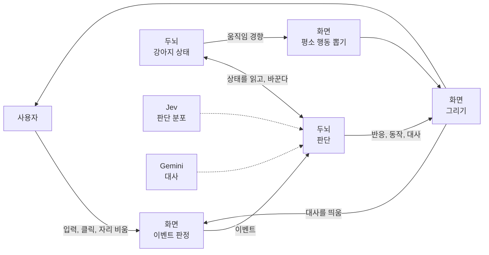
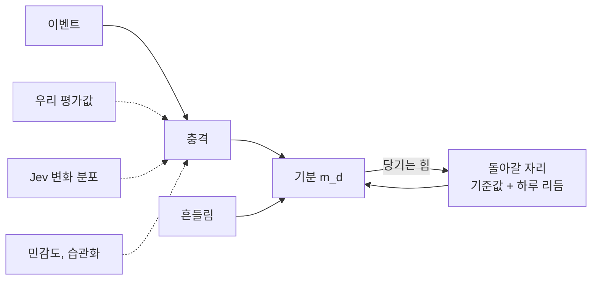
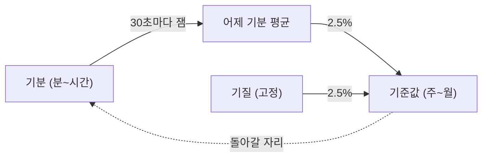
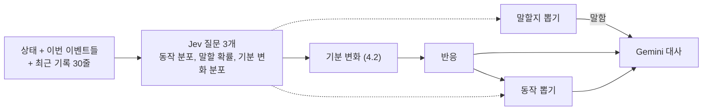
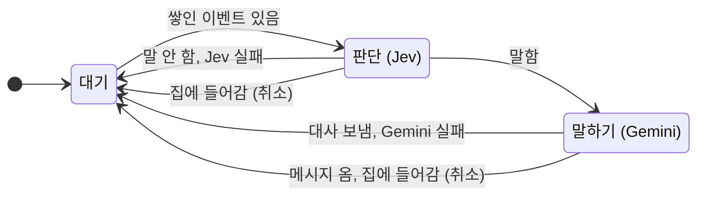
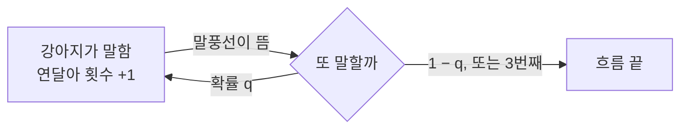
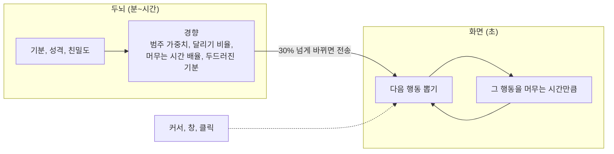
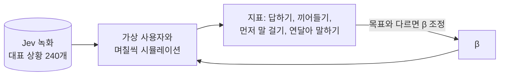

# ARCHITECTURE

TamagotchiChatBot이 어떻게 동작하는지 정리한 문서다. 세부 근거는 각 절의 링크를 따라간다.

> 기준: 두뇌 v2 ([스펙](docs/superpowers/specs/2026-10-15-brain-v2-design.md)), 프로토콜 v3. 숫자는 `brain/brain/tuning.py`의 현재 값이다.
>
> 그림 읽는 법: 실선은 값이 흐르는 방향, 점선은 계수로 들어가는 값이다.

## 1. 한눈에 보기



이 시스템은 네 문장으로 요약된다.

1. **강아지 상태**는 성격(느리게 변함), 기분 9개(분 단위로 변함), 친밀도, 습관화로 이루어진다 (4절).
2. **이벤트가 오면** 기분이 튀고, 두뇌가 반응·동작·말할지를 확률로 뽑는다. 말하기로 뽑히면 Gemini가 대사를 쓴다 (5절).
3. **이벤트가 없으면** 기분은 성격이 정한 자리로 천천히 돌아간다 (4절).
4. **평소 움직임**은 두뇌가 기분으로 경향만 정하고, 화면이 그 경향으로 초 단위 행동을 혼자 뽑는다 (6절).

- 화면(Tauri 앱, `app/`)과 두뇌(파이썬 서비스, `brain/`)는 localhost WebSocket으로 통신한다. 두뇌는 화면을 모르므로 화면만 바꿔 Android로 옮길 수 있다 ([0012](docs/decisions/0012-brain-as-frontend-independent-service.md)).
- 되먹임은 세 곳에 있다.
  - **대화**: 사용자 → 이벤트 → 반응 → 사용자.
  - **이어 말하기**: 강아지 대사 → 다음 판단 (5.3).
  - **성격 변화**: 기분 → 성격 (4.4).

## 2. 원칙

| 원칙 | 뜻 | 근거 |
|---|---|---|
| 두뇌는 화면을 모른다 | 화면이 [프로토콜](docs/brain-protocol.md)을 따른다 | [0012](docs/decisions/0012-brain-as-frontend-independent-service.md) |
| 이벤트가 판단의 단위 | Jev 호출은 이벤트가 올 때만. **언제** 이벤트를 낼지는 화면이 정한다 | [0013](docs/decisions/0013-event-driven-brain-with-event-log.md) |
| 이벤트 기록이 기억 | 대화도 이벤트다. 찌름·돌아옴·강아지의 반응까지 한 줄로 쌓인다 | [0013](docs/decisions/0013-event-driven-brain-with-event-log.md) |
| Jev는 분포, 결정은 확률 모델 | Jev 응답의 확률에서 뽑는다. 같은 상황에서도 가끔 다르게 행동한다 | [0014](docs/decisions/0014-probabilistic-model-with-jev-distributions.md) |
| Jev에만 맡기지 않는다 | Jev가 약한 성격·기분·대화 흐름은 우리 모형이 보정한다 | [성격 유형 실측](docs/spikes/2026-10-15-personality-types.md) |
| 빠른 일은 화면, 느린 일은 두뇌 | 초 단위 움직임 선택은 화면이 혼자, 분 단위 경향은 두뇌가 보낸다 | [스펙 6.5](docs/superpowers/specs/2026-10-15-brain-v2-design.md) |

## 3. 시간 척도

과정마다 빠르기가 크게 다르다. 그래서 빠른 과정을 볼 때는 느린 과정을 상수로 봐도 된다. 화면(초 단위)과 두뇌(분 단위 이상)의 역할 분담이 여기에 기댄다.

| 과정 | 빠르기 | 담당 |
|---|---|---|
| 행동 하나 (걷기, 앉기 등) | 3~20초 | 화면 |
| 이벤트 사이 간격 | 0.6초(타이핑) ~ 30분(조용함) | 화면 |
| 판단 한 번 | Jev ≤ 3초, 말하면 + Gemini ≤ 5초 | 두뇌 |
| 기분이 절반 풀림 (평균 성격) | 놀람 36초, 궁금함 5분, 무서움 9분, 분노 6분, 들뜸 9분, 시무룩 21분, 행복 27분, 심심함 33분, 졸림 48분 | 두뇌 |
| 습관화가 절반 풀림 | 1시간 | 두뇌 |
| 친밀도가 절반 식음 | 14일 | 두뇌 |
| 성격이 절반 옮겨 감 | 약 27일 (4.4) | 두뇌 |

## 4. 강아지 상태

### 4.1 무엇을 갖나

| 값 | 기호 | 범위 | 어떻게 변하나 |
|---|---|---|---|
| 기분 9개 | m_d | 0~1 | 돌아갈 자리로 풀리고, 이벤트에 튄다 (4.2) |
| 친밀도 | I | 0~1 | 0.3으로 식고, 이벤트에 조금씩 변한다 (4.3) |
| 습관화 (찌르기·쓰다듬기·던지기) | h_k | 0~1 | 반복되면 오르고, 쉬면 풀린다 (4.3) |
| 기준값 (성격) | μ_d | 0.05~0.95 | 하루 한 번 조금 옮겨 간다 (4.4) |
| 민감도 | s_d | 0.2~0.9 | 고정 |
| 기질 | τ_d | 0.05~0.95 | 고정 (태어날 때의 기준값) |
| 변덕 | w | 0~1 | 고정 |

- 기분 9개: 심심함, 졸림, 들뜸, 시무룩, 분노, 궁금함, 놀람, 무서움, 행복.
- **탄생**: 기준값은 기본 성격("호기심 많고 수다스러운 강아지") 평균에서 ±0.1, 민감도는 0.5 ± 0.1, 변덕은 0.5 ± 0.15 정규분포로 뽑는다. 처음 기분은 기준값과 같고 친밀도는 0.3이다.

### 4.2 기분: 돌아갈 자리로 당겨지고, 이벤트에 튄다

기분은 **고무줄에 매인 공**처럼 움직인다. 돌아갈 자리로 늘 당겨지면서 조금씩 흔들리고, 이벤트가 오면 순간적으로 튄다. 수학적으로는 평균 회귀 과정(Ornstein–Uhlenbeck)에 이벤트 충격을 더한 것이다.



**시간이 흐를 때**: 돌아갈 자리로 지수적으로 다가가면서 흔들린다.

```text
m_d ← 자리 + (m_d − 자리) · e^(−λΔt)  +  흔들림          흔들림: 오래 두면 자리 ± 0.03
자리   = 기준값 + 하루 리듬 − 1.5 × (반대 기분이 기준값보다 높은 만큼, 구간 평균)    (자리의 1/4 아래로는 안 내려감)
         하루 리듬: 새벽 3시에 졸림 +0.3, 들뜸·심심함 −0.1, 오후 3시엔 반대, 하루 평균 0
         반대 기분 누름: 겁먹은 동안 들뜸·행복이 돌아갈 자리도 내려가 함께 높은 채 머물지 않는다 (검수 004)
반감기 = 기본 반감기 × (0.5 + 기준값)    → 기준값이 높은 기분일수록 늦게 풀린다
```

**이벤트가 올 때**: 우리가 정한 평가값에 Jev의 판단을 더하고, 강아지 개성으로 크기를 바꾼다 ([0015](docs/decisions/0015-appraisal-prior-mood-change.md)).

```text
신호_d = ⊕(평가값_d × 2·민감도_d × (습관화 대상이면 1 − 습관화))  +  0.3 · Jev가중치 · (P_Jev[d↑] − P_Jev[d↓]) × 2·민감도_d × (1 − 습관화)
         ⊕: 묶음 안 같은 기분 충격은 확률의 합처럼 포화 합산(찌르기 7번 = 0.79, 1.4가 아님). 묶음 안에서도 이벤트마다 습관화가 쌓인다
그 뒤 반대 기분 억제: 한쪽이 오른 만큼의 30%를 반대쪽에서 뺀다
기분은 남은 여유만큼 움직인다: 오를 때 × (1 − m), 내릴 때 × m (잡음 ±0.01 포함) → 0·1에 붙지 않는다
반응 = 잡음 없는 신호가 가장 크게 오른 기분 (0.03 이상)
```

| 이벤트 | 우리 평가값 (평균 강아지 기준) | Jev 가중치 |
|---|---|---|
| 찌르기 | 놀람 +0.20, 분노 +0.06 + 0.10·습관화 (익숙할수록 짜증), 궁금함 +0.03·(1 − 습관화) | 0.3 |
| 던지기 | 무서움 +0.35·충격, 놀람 +0.10 + 0.15·충격, 행복·졸림 −0.10·충격 (반복하면 놀람만 무뎌진다) | 0.3 |
| 쓰다듬기 (3초) | 행복 +0.12, 들뜸 +0.04 (화나거나 무서운 만큼 줄어듦), 분노·시무룩·무서움 −0.03 | 0.3 |
| 돌아옴 | 행복 +0.15, 들뜸 +0.12, 심심함 −0.10 | 0.3 |
| 조용함 (10분) | 심심함 +0.04, 시무룩 +0.01 (자리에 있는 주인이 질문에 답하지 않았으면 한 번만 +0.07, 자리를 비운 조용함은 0). 주인이 30분 → 2시간 넘게 없으면 심심함 대신 졸림 +0.06 | 0.1 |
| 메시지 | 궁금함 +0.02, 심심함 −0.04 | **1.0** (글 내용은 Jev가 판단) |
| 타이핑 | 궁금함 +0.04 (이어 칠수록 습관화로 무뎌짐) | 0.8 (쓰는 글 내용도 Jev가 판단) |
| 강아지 자기 말 | 없음 | 0 |

- 뜻이 분명한 이벤트(찌르기, 던지기)는 우리가 정하고, 글 내용처럼 해석이 필요한 것은 Jev에 맡긴다. Jev가 던지기를 "행복"으로 읽는 등 틀린 적이 있어서다.
- 반대 쌍: 무서움↔행복·들뜸, 분노↔행복, 시무룩↔들뜸·행복, 졸림↔들뜸. 함께 높으면 어색한 기분들이다.
- **경계** (검수 004): 쓰다듬기의 기쁨은 지금 분노·무서움의 절대 수준(0.15 넘는 만큼 × 2)만큼 줄어든다. 성마른 강아지(분노 기준값이 높음)는 평소에도 잘 안 풀리고, 무서운 강아지는 쓰다듬어도 행복 반응이 나오지 않는다.
- **공감** (검수 005): Jev에 "사용자가 지금 속상한가"(예/아니오 확률 u)를 함께 묻는다. 메시지·타이핑에서 u만큼 강아지도 시무룩해지고(Jev 시무룩↑ 0.6u 상당), 궁금함과 '털어놓음 = 친밀도↑ = 행복' 해석은 꺼진다. u ≥ 0.5면 거의 늘 대답하고(+3.5), 대사에 "사용자 기분: 속상해 보인다"를 주어 조언 대신 곁에서 짧게 위로하게 한다.
- **관계 해석** (검수 002): Jev는 거절하는 말에 친밀도↓, 다정한 말에 친밀도↑를 주로 준다. 우리 모형은 이것을 기분으로도 읽는다: 친밀도↓ 확률의 0.8배를 시무룩↑로, 친밀도↑의 0.5배를 행복↑로·0.8배를 시무룩↓로 더한다(사과는 서운함을 던다). "저리 가"에 서운해한다.
- 습관화 대상: 찌르기 → 놀람, 쓰다듬기 → 행복, 던지기 → 놀람, 타이핑 → 궁금함. 대상 기분만 무뎌진다(Jev 조정도 대상 기분만). 타이핑이 이어지면 궁금함이 무뎌지고 글 내용의 기분(예: 슬픈 글 → 서운함)이 드러난다. Jev가 실패하거나 키가 틀려도 평가값으로 반응·동작은 낸다(대사는 없음). 상세: [기분 갱신 수식](docs/superpowers/specs/2026-10-16-mood-update-math-design.md) (검수 002).
- **숫자 감각**: 이벤트가 없으면 기분은 자리 ± 0.03에 머문다. 세게 던지면 무서움 +0.3, 찌르면 놀람 +0.2, 강한 메시지면 ±0.18 정도 튄다.
- 계산은 값을 읽을 때(판단, 30초 시계, 상태 조회)만 위 식의 정확한 풀이로 한다. 읽는 간격과 상관없이 같은 결과가 나온다.

### 4.3 친밀도와 습관화

**친밀도**는 기분과 같은 방식에서 흔들림만 없다. 0.3을 향해 반감기 14일로 식는다. 이벤트 한 번에 Jev 판단으로 최대 ±0.02 변하고, 쓰다듬기는 +0.005, 던지기는 −0.01·충격이 더해진다. 강하게 좋은 메시지 약 25번이면 +0.5 오른다.

**습관화**는 같은 자극에 무뎌진 정도다.

```text
자극이 올 때    h ← h + η(1 − h),   η = 0.3 × (1.5 − 민감도)      높을수록 덜 오른다
그 사이         반감기 1시간으로 풀린다
```

- 민감도 0.5인 강아지를 연달아 5번 찌르면 h = 0.83. 그 뒤 찌르기 충격은 17%로 줄어든다.
- 민감한 강아지일수록 η가 작아 천천히 무뎌진다.
- (1 − h)는 그 자극의 기분뿐 아니라 **모든 기분과 친밀도의 충격**에 곱해진다.

### 4.4 성격(기준값)의 변화

하루가 지나면 기준값이 **어제 기분 평균** 쪽으로 2.5%, **타고난 기질** 쪽으로 2.5% 옮겨 간다.



```text
기준값_내일 = 기준값 + 0.025 · (어제 평균 − 기준값) + 0.025 · (기질 − 기준값)
```

이벤트가 기분을 평소 평균 δ만큼 밀어 올린다고 하면(어제 평균 ≈ 기준값 + δ), 기준값은 다음 자리로 수렴한다.

- **수렴점 = 기질 + δ**: 타고난 성격에서 겪은 일만큼 옮겨 간 자리. 개성이 경험에 지워지지 않는다.
- **속도**: 반감기 약 27일.
- 기질 쪽으로 당기는 항이 없으면 수렴점이 없다. 기준값이 δ 방향으로 계속 흘러 끝에 붙는다. 실제로 8주 시뮬레이션에서 모든 강아지가 같은 성격이 되었다. 기질 항을 넣은 이유다 ([시뮬레이션](docs/spikes/2026-10-15-simulation.md)).
- 날짜가 바뀐 뒤 처음 기분을 계산할 때 한 번 갱신한다. 며칠을 건너뛰어도 한 번이다.

### 4.5 상태에서 계산하는 값 (저장하지 않음)

| 값 | 계산 | 쓰는 곳 |
|---|---|---|
| 말수 L | 0.7 × [(친밀도 − 0.5) + 수다 쪽 기분 − 과묵 쪽 기분 + 같은 방향의 기준값]<br>수다 쪽: 심심함·들뜸·궁금함·행복 / 과묵 쪽: 졸림·시무룩·분노·무서움 | 말할 확률 (5.1) |
| 두드러진 기분 | 기준값보다 가장 많이 높은 기분. 0.15 이상 높을 때만, 아니면 `calm` | 평소 모습 (6절) |

## 5. 판단: 이벤트 하나에서 행동까지

### 5.1 무엇을 어떻게 뽑나

판단 한 번은 반응, 동작, 말할지, 대사를 이 순서로 정한다.



| 결정 | 어떻게 정하나 | 무엇이 좌우하나 |
|---|---|---|
| **반응** | 이번에 가장 크게 오른 기분의 표출 (잡음 없는 신호가 0.03 이상 올랐을 때). 타이핑 중이면 늘 하나를 낸다 | 기분 변화 |
| **동작** | 점수를 온도로 나눈 softmax에서 뽑는다 | 이벤트별 기본값, 기분(기준값 대비), 반응, Jev(약하게) |
| **말할지** | 확률 σ(x)로 동전 던지기 | Jev 말할 확률, 말수, 이벤트 종류, 연달아 말한 횟수 |
| **대사** | 말하기로 뽑혔을 때만 Gemini가 쓴다 | 상황 전체 + 뽑힌 반응·동작 |

```text
동작 점수(a) = 기본(a) + 이벤트 사전값(a) + 5 · 기분 친화도(a) + 1.5 · 반응 친화도(a) + 0.3 · log(P_Jev(a) + 0.05)
P(동작 = a) ∝ exp( 점수(a) / T ),    T = 0.5 + 변덕   (변덕이 크면 의외의 동작이 잦다)
    기분 친화도: 기준값보다 높은 기분이 어울리는 동작을 민다 (졸림 → 잠, 분노 → 짖기 …)

말할 확률 = σ( logit P_Jev(말함) + 말수 L + β[이벤트 종류] − 연달아 말한 횟수 − [답을 기다리는 중]
                + 3.5·[메시지가 질문] + 3.5·[메시지가 속상한 이야기: 시무룩 신호 ≥ 0.05] )      (검수 004)
          = 0   (연달아 3번 말했거나, 집에 들어가는 순간, Jev가 실패했을 때,
                 또는 이어 말하기인데 직전 말이 타이핑 중 끼어들기·핀잔에 대한 답이었거나 질문이었을 때)
```

**Jev의 몫은 셋으로 다르다.**
- **기분 변화**: 우리 평가값에 더하는 조정이다. 메시지는 크게, 나머지는 작게 반영한다.
- **동작**: 약한 조정이다. 0.3배 로그라서 Jev가 한 동작에 98%를 줘도 점수 차이는 약 0.9에 그친다 ([0016](docs/decisions/0016-action-model-ours-first.md)).
- **말할지**: 출발점이다. 우리 모형이 그 위에 보정을 더한다.

Jev가 성격·기분에 둔감하다는 실측이 있어서([성격 유형 실측](docs/spikes/2026-10-15-personality-types.md)) 성격·기분은 우리 모형 항으로 다시 넣는다.

β는 이벤트 종류별 말하기 보정이다. 8절의 시뮬레이션으로 평균 성격이 목표에 맞게 맞췄다.

| 이벤트 | β | 목표 말할 확률 |
|---|---|---|
| 메시지 | −0.68 | 85% (답하기) |
| 조용함 | −2.45 | 1/3 (→ 30분에 한 번 먼저 말 걸기) |
| 강아지 말이 뜸 | −1.89 | 연달아 2번 이상 30% (5.3) |
| 타이핑 | −3.02 | 30% (끼어들기) |
| 그 밖 | 0 | |

화면에는 반응·동작을 먼저 보내고(`reaction`), 대사는 Gemini가 끝나면 따로 보낸다. 움직임 경향이 문턱 넘게 바뀌었으면 `movement`도 보낸다.

### 5.2 처리 순서: 한 번에 하나씩

두뇌는 판단을 **한 번에 하나씩** 한다. 판단 중에 온 이벤트는 쌓아 두었다가 끝나면 **한 묶음으로** 다음 판단에 넣는다. 그래서 이벤트가 몰려도 Jev는 판단 한 번에 한 번만 불린다.



- **취소**: 집에 들어가면 하던 판단과 쌓인 이벤트를 모두 버린다. 대사를 만드는 중에 사용자가 메시지를 보내면 그 대사는 버린다. 이미 지난 흐름의 말이기 때문이다.
- **판단할 수 없을 때**: 화면이 끊겼거나 키가 없으면 쌓인 이벤트를 버린다. 이벤트 기록에는 남으므로 다음 판단의 "최근 기록"으로 들어간다.

### 5.3 이어 말하기

강아지가 말하면 화면이 말풍선을 띄우고 "강아지 말이 뜸"(`dog_spoke`) 이벤트를 보낸다. 이 이벤트가 다시 판단을 부르므로 **강아지의 말이 다음 말을 부를 수 있다.** 연달아 말할수록 확률을 낮추고 3번에서 끊는다.



- k번째로 이어 말할 확률은 **우리 모형**이 정한다(검수 005: Jev로는 실사용 2마디+ 44%, 과묵도 50%): q_k = min(0.9, 0.425 · e^{1.2·(말수 − 평균 강아지 말수)}) · 0.3^{k−1}. 평균 강아지 첫 이어 말하기 0.43(질문이면 기다려서 막힘), 과묵 0.11, 활발 0.9. 세 마디는 드물다.
- 따라서 P(2번 이상) = q₁, P(3번) = q₁·q₂, 최대 3번.
- 사용자 입력이나 다른 이벤트가 오면 횟수가 0으로 돌아가 새 흐름이 된다.
- 대사에 `?`가 있으면("…? 멍!"도) "답을 기다리는 중"이 되어 **이어 말하지 않는다**. 단, 사용자와 말을 주고받는 흐름(메시지·타이핑이 연 흐름)의 질문만이다. 조용함·몸 이벤트에서 나온 혼잣말 질문은 기다리지 않는다(검수 004). 사용자가 타이핑하거나 메시지를 보내면 풀린다. 조용함이 오면 다시 말을 걸 수 있다(검수 002).
- 타이핑 중 끼어든 말에도 이어 말하지 않는다. 사용자가 아직 치는 중이다(검수 001). 핀잔(Jev 친밀도↓ 0.4 이상인 메시지)에 답한 말에도 이어 말하지 않는다(검수 002).
- 대사에는 성격에서 나온 **말투** 지시를 준다(과묵하면 한 문장, 활발하면 들뜸, 예민하면 투덜거림, 겁 많으면 조심스러움). 같은 상황이라도 성격마다 말이 다르다(검수 004).
- 대사에는 두뇌가 아는 **지금 상황 사실**을 준다: 주인이 곁에 있는지(30분 간격 조용함이 오면 자리를 비운 것, 사용자 행동이 오면 곁에 있음), 방금 주인이 돌아왔는지, 집에서 나온 쪽이 강아지인지(나온 뒤 10분 동안). 사실과 어긋나는 말을 하지 않게 한다(검수 005).
- 대사에는 **대화 기록**(실제로 오간 말 최근 20줄, 시각 포함)을 이벤트 기록과 따로 준다. 하룻밤이 지나도 들은 사실(이름, 생일)이 남고, 하지 않은 말을 지어내지 않게 한다(검수 004).
- 대사에는 "사용자가 마지막으로 뭔가 한 지"(예: 1시간)를 함께 준다. 조용함 맥락의 10분을 전체 시간으로 착각하지 않게 한다(검수 002).

## 6. 평소 움직임

두뇌는 **기분으로 경향(범주별 가중치)만** 정한다. 화면은 그 경향으로 **다음 행동과 머무는 시간을 혼자 뽑는다.** 기분은 분 단위, 행동은 초 단위라 행동 수십 개 동안 경향은 사실상 그대로다.



### 6.1 두뇌: 경향 계산

```text
범주 가중치_c = 기본_c × exp( 4 · 기분 효과_c + 성격 효과_c + 친밀도 효과_c )
    범주 c: 쉬기 0.6, 잠 0.08, 돌아다니기 0.4, 사용자 곁으로 0.18, 놀기 0.12, 구경하기 0.2 (기본값)
    기분 효과: 기준값보다 높은 기분이 어울리는 범주를 민다 (들뜸 → 놀기·돌아다니기, 졸림 → 쉬기·잠 …)
    성격 효과: 2 × (기준값 − 탄생 평균). 들뜸이 높은 성격은 돌아다니기·놀기·다가가기, 졸림이 높거나 들뜸이 낮은 성격은 쉬기
달리기 비율   = σ( logit 0.2 + 4 · (1.5Δ들뜸 − Δ졸림 − 0.5Δ무서움) + 2 · (2(μ들뜸 − 0.4) − (μ졸림 − 0.3)) )      Δ = 기분 − 기준값
머무는 시간 배율 = exp( 4 · (Δ졸림 + Δ시무룩 − Δ들뜸 + 0.5Δ행복) + 2 · ((μ졸림 − 0.3) − (μ들뜸 − 0.4)) )
```

- 기분은 **기준값 대비**로 4배 크게 본다. 기분에 따른 차이가 눈에 보여야 해서다(검수 001). 들뜸이 평소보다 0.3 높으면 놀기·돌아다니기가 3.3배, 달릴 확률이 0.2 → 0.5가 된다.
- 밤에는 하루 리듬으로 졸림이 기준값보다 높아져 쉬기·잠이 늘어난다.
- **성격도 평소 움직임에 보인다**(검수 003): 같은 평온한 상태에서 활발한 강아지는 달리기 0.50·쉬기 12%, 과묵한 강아지는 달리기 0.10·쉬기 71%다. 행복은 느긋한 기쁨이라 달리지 않고 곁에 머문다. 화나면 사용자를 피해 돌아다닌다.
- 들뜸이 평소보다 0.3 높으면 놀기가 움직임의 15% 넘게 나온다(놀기 기본 0.12, 들뜸 친화도 1.5, 검수 004). 하품 반응은 엎드리기·잠으로 이어진다.
- 동작: 졸림이 기준값보다 0.1 넘게 높지 않으면 잠 동작은 나오지 않는다. 짜증 반응은 짖기와 '하던 것 계속'(외면)이 섞인다.
- **전송 문턱**: 30초마다, 그리고 판단 직후에 다시 계산한다. 두드러진 기분이 바뀌었거나, 가중치·머무는 시간 배율이 30% 넘게, 달리기 비율이 0.1 넘게 바뀌었을 때만 보낸다. 화면은 다음 전송까지 마지막 값을 쓴다. 0.10 문턱에서는 시간당 95번 보내서 0.30으로 올렸다. 지금은 시간당 약 12번이다(2026-10-16 측정).

### 6.2 화면: 행동 뽑기

행동 하나가 끝나면 다음 행동을 뽑는다. 다음 행동은 **직전 행동과 무관하게** 같은 분포에서 뽑고, 머무는 시간은 행동마다 따로 뽑는다(가장 단순한 반-마르코프 과정).

| 행동 | 가중치 | 후보 조건 | 머무는 시간 |
|---|---|---|---|
| 커서로 다가가기 / 따라가기 | 사용자 곁으로 × ⅔ / × ⅓ | 커서가 450px 안 | 도착까지 / 5~10초 |
| 커서 사냥 | 놀기 | 커서가 450px 안 | 최대 6초 |
| 창에 올라앉기 / 창 옆에서 구경 | 구경하기 × ½ / × ½ | 주변에 창이 있음 | 도착 뒤 8~20초 / 6~12초 |
| 제자리 쉬기 | 쉬기 | 늘 | 3~10초 × 머무는 시간 배율 |
| 낮잠 | 잠 | 늘 | 8~20초 × 머무는 시간 배율 |
| 돌아다니기 | 돌아다니기 | 늘 | 80~400px 떨어진 곳에 도착할 때까지. 달리기 비율 확률로 뜀 |

- 최근 3초 안에 450px 안에서 클릭이 있었으면 커서 관련 행동이 4배가 된다.
- **끼어드는 것들**: 찌르기, 잡기·던지기, 판단이 준 동작, 집 들어가기는 지금 행동을 끊고 먼저 실행된다. 타이핑이 시작되면 두뇌를 기다리지 않고 입력창 쪽을 바라본다(듣는 자세).
- 설정의 "쉬기"를 켜면 경향과 상관없이 그 자리에서 잔다. 두뇌가 없으면 기본 경향으로 움직인다.

## 7. 이벤트 판정 (화면)

화면은 입력 신호를 주기적으로 읽어 이벤트로 바꾼다. 이벤트의 **뜻**은 프로토콜이 정하고, **언제 낼지**는 화면이 정한다 ([0013](docs/decisions/0013-event-driven-brain-with-event-log.md)).

| 이벤트 | 내는 때 | 읽는 주기 |
|---|---|---|
| 타이핑 | 마지막 입력 뒤 0.6초 멈춤, 또는 지난번보다 10자 넘게 바뀜 | 100ms |
| 메시지 보냄 | Enter | 즉시 |
| 강아지 말이 뜸 | 말풍선을 띄운 직후 | 즉시 |
| 조용함 | 마지막 이벤트 뒤 10분(자리에 있음) / 30분(비움). 계속 조용하면 그 간격으로 반복 | 100ms |
| 돌아옴 | 1분 넘게 입력이 없다가 다시 입력 | 1초 |
| 집에 들어감 / 나옴 | 집 클릭, 트레이, 단축키 | 프레임 |
| 찌르기 / 쓰다듬기 | 짧은 클릭 / 문지르기 | 50ms |
| 던지기 | 착지 순간. 충격 = min(1, 최대 충돌 속도 ÷ 2000px/초) | 프레임 |

- 집에 있는 동안은 "집에서 나옴" 외에는 내지 않는다.
- 조용함 10분은 "30분에 한 번 먼저 말 걸기" 목표를 조용함에서 말할 확률(약 1/3)로 나눈 값이다.
- 전체 규약: [docs/brain-protocol.md](docs/brain-protocol.md).

## 8. 보정값 맞추기: 시뮬레이션

말하기 보정 β는 사람이 직접 써 볼 수 없으니 **가상 사용자 시뮬레이션**으로 맞춘다. Jev는 미리 녹화한 응답으로 대신한다.



| 단계 | 내용 |
|---|---|
| 녹화 | 이벤트 10종 × 기분 10가지(기본 + 한 기분만 0.9) × 친밀도 2가지(0.2, 0.8), 강아지 말은 연달아 횟수 3가지 = 240개 상황에서 Jev를 실제로 부른다 |
| Jev 대신 | 시뮬레이션 중에는 지금 상태와 가장 가까운 녹화 상황의 응답을 쓴다 |
| 가상 사용자 | 평일 9~18시 자리(12~13시 점심). 분당 메시지 3%, 찌르기·쓰다듬기 0.5%, 던지기 0.2%. 강아지가 말하면 절반은 답한다 (잠정값) |
| 맞추기 | β를 키우면 지표도 커지므로 β마다 이분 탐색한다. 네 β를 번갈아 3바퀴 맞춘다 (평균 성격, 10일) |
| 확인 | 성격 유형 4개(평균·과묵·예민·활발), 무작위 100마리의 분포, 8주 뒤 성격이 끝에 붙은 강아지 수 |

- 결과 β는 사람이 `tuning.py`에 옮긴다.
- **한계**: 녹화 상황이 기분 10가지뿐이라 기분이 섞인 상태에서는 오차가 있다. 가상 사용자 행동은 잠정값이다.
- Jev 질문 문구나 Jev 버전을 바꾸면 응답 분포가 달라지므로 다시 녹화하고 다시 맞춘다.

## 9. 저장과 실행

| 무엇 | 어디 |
|---|---|
| 이벤트 기록, 강아지 상태 | `%APPDATA%\TamagotchiChatBot\brain\brain.db` (SQLite) |
| 두뇌 접속 정보 | `%APPDATA%\TamagotchiChatBot\brain\brain.json` (포트·토큰) |
| 두뇌 로그 | `%APPDATA%\TamagotchiChatBot\brain\logs\brain.log` (키·대화 내용은 쓰지 않음) |
| API 키 | Windows 자격 증명 관리자 (두뇌가 보관) |
| 화면 설정 | Tauri 앱 데이터 폴더 `settings.json` |

- 화면이 `brain.json`으로 접속을 시도하고, 안 되면 `brain/.venv`의 파이썬으로 두뇌를 띄운 뒤 2초마다 다시 접속한다. 접속 절차는 [프로토콜](docs/brain-protocol.md)에 있다.
- 두뇌는 시작할 때 다른 두뇌가 살아 있으면 바로 끝낸다. 같은 데이터를 두 두뇌가 쓰지 않게 하기 위해서다.
- 앱을 끄면 자기가 띄운 두뇌만 끈다. 두뇌가 죽어도 강아지는 기본 경향으로 계속 움직인다.

## 10. 오류 처리

원칙: 강아지는 멈추지 않는다.

| 상황 | 동작 |
|---|---|
| 키 없음 / 키 오류 | AI 호출 안 함, `status`로 화면에 알림("설정에서 키를 넣어 주세요") |
| Jev 실패·시간 초과(3초) | 이번 판단 건너뜀 |
| Gemini 실패·시간 초과(5초) | 대사 없이 반응·동작만 |
| 강아지 상태를 못 읽음 | 기본값으로 계속, 저장된 성격을 덮어쓰지 않음 |
| 기록 쓰기 실패 | 메모리로 계속 |

## 11. 코드 지도

| 위치 | 내용 |
|---|---|
| `brain/brain/model.py` | 확률 모델 (순수 함수): 상태 갱신, 점수, 뽑기, 움직임 경향 |
| `brain/brain/core.py` | 이벤트 대기열·판단 태스크·기분 시계 틱 |
| `brain/brain/questions.py` | Jev 질문 3개와 정책 문구, state 직렬화 |
| `brain/brain/persona.py` | 기본 성격, Gemini 지시(이벤트 뜻·대화 규칙)·프롬프트(말하는 상황·최근 한 말), 대사 다듬기 |
| `brain/brain/tuning.py` | 잠정값과 방향표 (근거 주석) |
| `brain/brain/store.py` | 이벤트 기록·강아지 상태 |
| `brain/brain/clients.py` | Jev·Gemini 클라이언트 |
| `brain/brain/config.py` | 데이터 폴더, 키 읽기·쓰기 (환경 값을 읽는 유일한 곳) |
| `brain/brain/server.py`, `__main__.py` | WebSocket, 실행 |
| `brain/sim/` | Jev 녹화, 시뮬레이터 |
| `app/src/body/` | 강아지 상태 기계·행동 선택(`dog.ts`), 이벤트 판정(`events.ts`), 쓰다듬기 등 순수 로직 |
| `app/src/character.ts` | 캐릭터 창: 그리기, 입력, 주기 작업, 두뇌 연결 |
| `app/src/input.ts`, `app/src/settings-page.ts` | 입력창, 설정 창 |
| `app/src/brain-link.ts`, `app/src/shared/brain-protocol.ts` | 두뇌 접속, 프로토콜 |
| `app/src-tauri/` | Rust 셸: 창, Win32 신호, 두뇌 실행 |

## 12. 문서 지도

모든 작업은 문서가 먼저다. 작업 규칙은 [`CLAUDE.md`](CLAUDE.md), 설치·실행은 [`README.md`](README.md).

| 문서 | 내용 |
|---|---|
| [`docs/vision.md`](docs/vision.md) | 제품 컨셉. 확정된 것과 미정인 것을 구분해 누적한다 |
| [`docs/glossary.md`](docs/glossary.md) | 용어 정의 |
| [`docs/decisions/`](docs/decisions/) | 결정 기록(ADR). 결정 하나에 파일 하나 |
| [`docs/brain-protocol.md`](docs/brain-protocol.md) | 화면 ↔ 두뇌 프로토콜. 화면은 이 문서만 보고 만들 수 있어야 한다 |
| [`docs/references/typesafe-jev.md`](docs/references/typesafe-jev.md) | Jev API 요약과 사내 사용 사례 |
| [`docs/references/similar-projects.md`](docs/references/similar-projects.md) | 비슷한 프로젝트 조사 (mochi-llm-pet) |
| [`docs/superpowers/specs/`](docs/superpowers/specs/) | 설계 스펙. [Windows 첫 버전](docs/superpowers/specs/2026-10-14-windows-desktop-pet-design.md), [두뇌 v1](docs/superpowers/specs/2026-10-15-brain-design.md), [두뇌 v2](docs/superpowers/specs/2026-10-15-brain-v2-design.md), [기분 8개·즉각 반응](docs/superpowers/specs/2026-10-15-mood-reaction-design.md), [기분×동작별 그림](docs/superpowers/specs/2026-10-15-mood-sprites-design.md), [검수 루프](docs/superpowers/specs/2026-10-15-review-loop-design.md), [평가 사전값](docs/superpowers/specs/2026-10-16-appraisal-prior-design.md), [동작 모형](docs/superpowers/specs/2026-10-16-action-model-design.md), [시간 모형](docs/superpowers/specs/2026-10-16-time-model-design.md), [기분 갱신 수식](docs/superpowers/specs/2026-10-16-mood-update-math-design.md) |
| [`docs/superpowers/plans/`](docs/superpowers/plans/) | 스펙별 구현 계획 ([검수 하네스](docs/superpowers/plans/2026-10-16-review-harness.md) 등) |
| [`brain/review/`](brain/review/README.md) | 검수 하네스: 시나리오 실행기, 상태 분석표, 커버리지 |
| [`docs/review/`](docs/review/) | 검수 루프: [진행 상황](docs/review/progress.md), [루프 프롬프트](docs/review/loop-prompt.md), [검수자 정의](docs/review/reviewer.md), [아는 결함](docs/review/known-defects.md), 회차별 판정(`rounds/`) |
| [`docs/spikes/`](docs/spikes/) | 실측·기술 검증. [배경 모드](docs/spikes/background-mode.md), [Jev speak_now](docs/spikes/2026-10-15-jev-speak-now-probe.md), [두뇌 v2 가정](docs/spikes/2026-10-15-brain-v2-assumptions.md), [성격 유형](docs/spikes/2026-10-15-personality-types.md), [질문 문구](docs/spikes/2026-10-15-question-wording.md), [시뮬레이션](docs/spikes/2026-10-15-simulation.md) |
| [`docs/manual-checks/`](docs/manual-checks/) | 화면·Win32·실제 키 동작 수동 확인 체크리스트 |

## 13. 결정 기록

| 번호 | 제목 | 상태 |
|---|---|---|
| [0001](docs/decisions/0001-jev-as-decision-engine.md) | 실시간 반응 결정에 Jev를 쓴다 | 채택 (일부 개정: 0014) |
| [0002](docs/decisions/0002-platform-order.md) | Windows PC 먼저, Android는 그다음 | 채택 |
| [0003](docs/decisions/0003-windows-display-modes.md) | Windows 배경·오버레이 모드 모두 지원, 설정으로 고정 | 대체됨(0010) |
| [0004](docs/decisions/0004-input-box-trigger.md) | 캐릭터 클릭·전역 단축키로 입력창, 상시 표시는 설정 | 대체됨(말풍선 아이콘으로) |
| [0005](docs/decisions/0005-local-history-storage.md) | 대화 기록은 PC에 저장 (서버 중계 부분은 0006으로 대체) | 일부 대체됨 |
| [0006](docs/decisions/0006-user-provided-api-keys.md) | 서버 없이 사용자가 입력한 API 키로 직접 호출 | 채택 |
| [0007](docs/decisions/0007-dialogue-llm.md) | 캐릭터 대사는 gemini-3.1-flash-lite로 생성 | 채택 |
| [0008](docs/decisions/0008-tech-stack-tauri.md) | Windows 앱은 Tauri(Rust + TypeScript) | 채택 |
| [0009](docs/decisions/0009-background-mode-wallpaper-replacement.md) | 배경 모드는 배경화면 대체 방식 | 대체됨(0010) |
| [0010](docs/decisions/0010-overlay-only-with-doghouse.md) | 오버레이 모드만, 강아지 집(비활성 모드) 추가 | 채택 |
| [0011](docs/decisions/0011-python-brain-local-sidecar.md) | 두뇌는 PC 안에서 도는 파이썬 프로세스 | 채택 (일부 개정: 0012) |
| [0012](docs/decisions/0012-brain-as-frontend-independent-service.md) | 두뇌는 화면과 독립된 WebSocket 서비스, 키도 두뇌가 보관 | 채택 |
| [0013](docs/decisions/0013-event-driven-brain-with-event-log.md) | 두뇌는 이벤트 단위로 판단, 이벤트 기록이 기억 | 채택 |
| [0014](docs/decisions/0014-probabilistic-model-with-jev-distributions.md) | Jev는 분포를 주고 확률 모델이 뽑아서 결정 | 채택 (기분 변화는 0015로 개정) |
| [0015](docs/decisions/0015-appraisal-prior-mood-change.md) | 기분 변화는 우리 평가 사전값이 정하고 Jev는 조정만 | 채택 (검수 루프) |
| [0016](docs/decisions/0016-action-model-ours-first.md) | 동작 선택은 우리 모형 중심, Jev는 약한 조정 | 채택 (검수 루프) |
