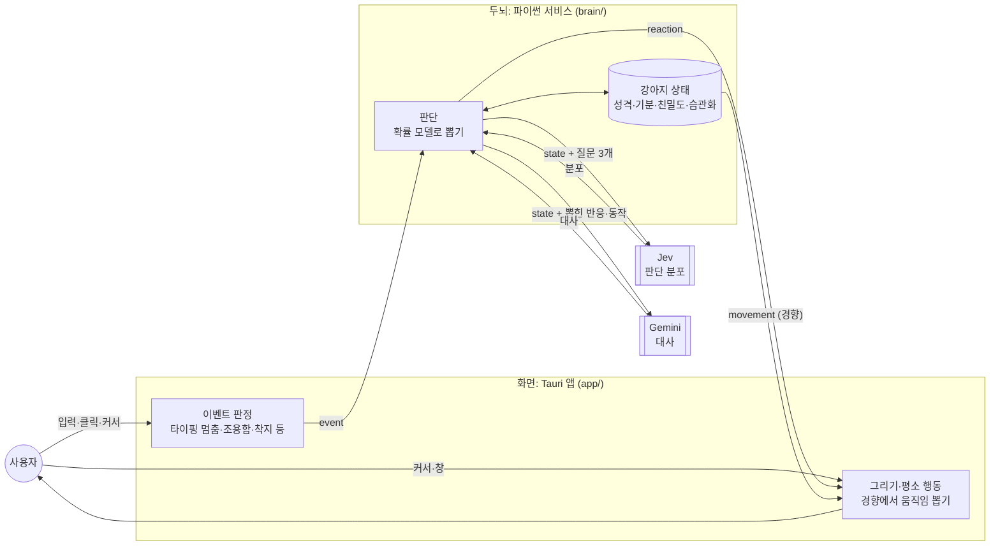
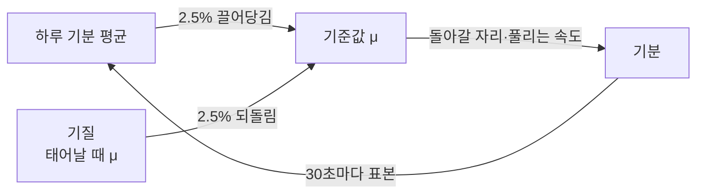
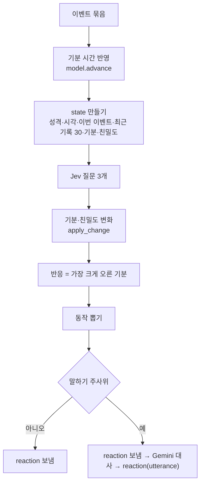
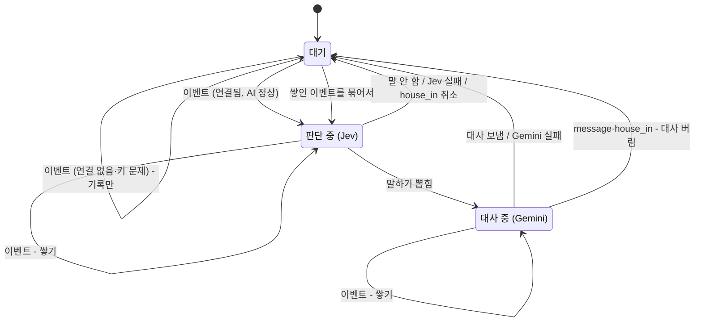
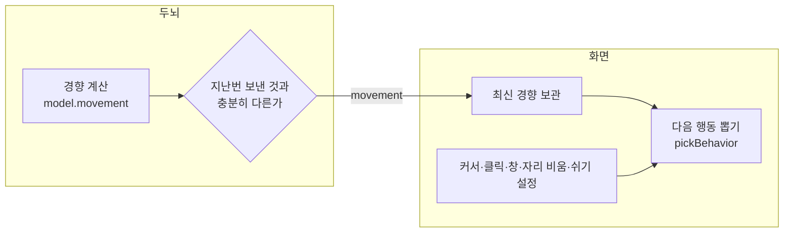

# ARCHITECTURE

TamagotchiChatBot의 구조와 동작 원리다. 모든 수치는 이 커밋의 코드 기준이고, 괄호 안에 정의된 파일을 적었다. 작업 규칙은 [`CLAUDE.md`](CLAUDE.md), 설치·실행은 [`README.md`](README.md)에 있다.

## 1. 한눈에 보기



화면은 강아지를 그리고, 무슨 일이 일어났는지를 이벤트로 두뇌에 알린다. 두뇌는 이벤트마다 Jev에게 판단 분포를 받고, 강아지 상태로 보정해 반응·동작·말할지를 뽑는다. 말하기로 뽑히면 Gemini가 대사를 쓴다. 기분은 시간이 지나면 기준값으로 돌아가고, 두뇌는 기분에서 평소 움직임 경향을 계산해 화면에 보낸다. 화면은 그 경향에서 초 단위 움직임을 혼자 뽑는다.

화면은 `app/`(Rust 셸 + TypeScript), 두뇌는 `brain/`(파이썬)에 있다. 둘은 localhost WebSocket으로 [두뇌 프로토콜 v3](docs/brain-protocol.md)을 주고받는다.

## 2. 원칙

| 원칙 | 뜻 | 근거 |
|---|---|---|
| 두뇌는 화면을 모른다 | 화면이 프로토콜을 따른다. 화면은 바꿀 수 있다 | [0012](docs/decisions/0012-brain-as-frontend-independent-service.md) |
| 이벤트가 판단 단위 | Jev는 이벤트가 올 때만 부른다. 언제 낼지는 화면이 정한다 | [0013](docs/decisions/0013-event-driven-brain-with-event-log.md) |
| 이벤트 기록이 기억 | 대화·찌르기·강아지 반응이 한 기록에 쌓이고, 최근 기록이 판단 입력이 된다 | [0013](docs/decisions/0013-event-driven-brain-with-event-log.md) |
| Jev는 분포, 결정은 확률 모델 | Jev 확률을 보정해 뽑는다. 같은 상황에서도 가끔 다르게 한다 | [0014](docs/decisions/0014-probabilistic-model-with-jev-distributions.md) |
| 빠른 일은 화면, 느린 일은 두뇌 | 초 단위 움직임은 화면, 분 단위 경향은 두뇌 | [두뇌 v2 스펙 6.5절](docs/superpowers/specs/2026-10-15-brain-v2-design.md) |
| 키는 사용자 것, 두뇌가 보관 | 서버 없이 사용자 키로 직접 호출한다 | [0006](docs/decisions/0006-user-provided-api-keys.md), [0012](docs/decisions/0012-brain-as-frontend-independent-service.md) |
| 강아지는 멈추지 않는다 | AI·저장소가 실패해도 화면은 계속 움직인다 | [두뇌 v2 스펙 8절](docs/superpowers/specs/2026-10-15-brain-v2-design.md) |

## 3. 구성 요소

| 구성 요소 | 가진 것·하는 일 |
|---|---|
| **화면** (`app/`) | 창 3개(`character` 투명 전체 화면, `input` 입력창, `settings` 설정). 강아지 상태 기계, 이벤트 판정, 몸 상호작용(찌르기·쓰다듬기·잡기·던지기)의 즉시 반응, 평소 움직임 뽑기, 기분별 모습 그리기. Rust 셸은 Win32 신호(커서·클릭·입력 없음 시간·창 목록)와 두뇌 실행을 맡는다 |
| **두뇌** (`brain/`) | 강아지 상태, 이벤트 기록, 판단(확률 모델), 기분 시계, API 키 보관, Jev·Gemini 호출 |
| **Jev** (TypeSafe System One) | 질문 3개에 대한 확률 분포만 준다 ([0014](docs/decisions/0014-probabilistic-model-with-jev-distributions.md)) |
| **Gemini** (`gemini-3.1-flash-lite`) | 말하기로 뽑혔을 때 대사 한마디 ([0007](docs/decisions/0007-dialogue-llm.md)) |

**프로토콜 v3** (`server.PROTOCOL_VERSION`, `brain-protocol.ts`). 모든 메시지에 `v: 3`과 `type`이 있다.

- 화면 → 두뇌: `hello`, `event`, `set_key`, `clear_history`, `reset`, `get_state`, `get_log`
- 두뇌 → 화면: `reaction`, `status`, `movement`, `state`, `log`

전체 규약은 [docs/brain-protocol.md](docs/brain-protocol.md)다.

**바뀌는 속도와 담당**

| 무엇 | 속도 | 담당 | 출처 |
|---|---|---|---|
| 걸음·그리기 | 매 프레임 | 화면 | `dog.ts` `step` |
| 신호 확인: 커서·클릭·쓰다듬기 / 타이핑 멈춤·조용함 / 창 목록 / 자리 비움 | 50ms / 100ms / 200ms / 1초 | 화면 | `character.ts` |
| 움직임 하나에 머무는 시간 | 수 초(대기 3~10초 × `idle_scale`) | 화면 | `dog.ts` |
| 반응·동작·대사 | 이벤트마다 | 두뇌 | `core.py` |
| 기분 시계(회귀·하루 평균 표본·경향 확인) | 30초 | 두뇌 | `tuning.clock_s` |
| 기분 회귀 | 반감기 3분(놀람)~2시간(졸림) × (0.5 + 기준값) | 두뇌 | `tuning.half_life_s` |
| 습관화 회복 | 반감기 1시간 | 두뇌 | `tuning.habit_half_life_s` |
| 친밀도 회귀 | 반감기 14일 | 두뇌 | `tuning.intimacy_half_life_s` |
| 성격(기준값) | 하루 한 번 | 두뇌 | `model.advance` |

## 4. 강아지 상태

### 4.1 값

| 값 | 범위 | 탄생 | 무엇이 바꾸나 |
|---|---|---|---|
| 기분 9개: 심심함·졸림·들뜸·시무룩·분노·궁금함·놀람·무서움·행복 | 0~1 | 기준값과 같게 | 시간(4.2), 이벤트(4.3) |
| 친밀도 | 0~1 | 0.3 | 이벤트(4.3), 시간(4.4) |
| 습관화: 찌르기·쓰다듬기·던지기 | 0~1 | 0 | 같은 자극 반복, 시간(4.4) |
| 기준값 μ (기분마다) | 0.05~0.95 | N(탄생 평균, 0.1) | 하루 한 번(4.5) |
| 기질 (기분마다) | 0.05~0.95 | 태어날 때의 기준값 | 고정 |
| 민감도 (기분마다) | 0.2~0.9 | N(0.5, 0.1) | 고정 |
| 변덕 | 0~1 | N(0.5, 0.15) | 고정 |

탄생 평균 기준값은 기본 성격 "호기심 많고 수다스러운 강아지"를 숫자로 옮긴 값이다: 심심함 0.6, 졸림 0.3, 들뜸 0.4, 시무룩 0.2, 분노 0.1, 궁금함 0.5, 놀람 0.1, 무서움 0.1, 행복 0.4 (`tuning.BIRTH_BASELINE`). 저장된 상태를 읽지 못하면 이 평균값 강아지(민감도 0.5, 변덕 0.5)로 계속한다 (`model.default_dog`).

### 4.2 기분이 시간에 따라

기분은 기준값으로 돌아가며 조금 흔들린다(평균 회귀). 경과 시간 `dt`마다 (`model.advance`):

```
e = exp(−ln2 · dt / h),  h = h0 × (0.5 + μ)
m ← clip(μ + (m − μ)·e + 0.05·√(1 − e²)·N(0,1))
```

| 기분 | 심심함 | 졸림 | 들뜸 | 시무룩 | 분노 | 궁금함 | 놀람 | 무서움 | 행복 |
|---|---|---|---|---|---|---|---|---|---|
| 기본 반감기 h0 | 60분 | 120분 | 20분 | 60분 | 30분 | 15분 | 3분 | 20분 | 60분 |

- 기준값이 높은 기분일수록 늦게 풀린다(배율 0.55~1.45). 흔들림 0.05는 `tuning.mood_noise`.
- 시간대(하루 리듬)에 따른 변화는 없다.
- 판단할 때, 기분 시계(30초)마다, 설정 창 상태 조회 때 갱신한다.

### 4.3 이벤트가 기분을 바꾸는 방식

Jev의 `change` 질문은 21개 선택지(기분 9개 × ↑↓, 친밀도 ↑↓, 변화없음) 위의 분포 하나를 준다. 기분마다 (`model.apply_change`):

```
Δ기분 = (0.3 · (P[기분↑] − P[기분↓]) · 민감도 + N(0, 0.02)) · (1 − h)
Δ친밀도 = 0.05 · (P[친밀도↑] − P[친밀도↓]) · (1 − h)
```

- `h`: 이번 묶음에 든 습관화 대상 자극의 습관화 중 가장 큰 값(없으면 0).
- 0.3은 `change_k`, 0.05는 `intimacy_k`, 0.02는 `change_noise`. 사전 분포나 다른 보정은 없다.
- 근거: 강한 내용(P↑−P↓ ≈ ±0.6~0.7) × 민감도 0.5면 한 이벤트에 ±0.1 (`tuning.py` 주석).

### 4.4 친밀도·습관화

- **친밀도**: 이벤트로 4.3만큼 변하고, 시간이 지나면 반감기 14일로 0.3을 향해 돌아간다(흔들림 없음).
- **습관화**: 대상 자극과 그 자극의 민감도 기분은 찌르기→놀람, 쓰다듬기→들뜸, 던지기→무서움이다 (`HABIT_KINDS`). 그 자극이 오면 `h ← h + 0.3·(1.5 − 민감도)·(1 − h)`. 민감할수록 천천히 익숙해진다. 같은 자극 5번이면 h ≈ 0.83(민감도 0.5). 반감기 1시간으로 0을 향해 풀린다.

### 4.5 성격 변화

기분 시계가 30초마다 지금 기분을 하루 합계에 더한다. 날짜(로컬)가 바뀐 뒤 처음 갱신할 때 기준값을 옮긴다:

```
μ ← clip(μ + 0.025·(어제 평균 − μ) + 0.025·(기질 − μ), 0.05, 0.95)
```



- 경험과 기질의 한가운데에 자리 잡아 개성이 남는다. 되돌림이 없으면 8주 시뮬레이션에서 모든 강아지가 같은 성격으로 수렴했다 ([시뮬레이션](docs/spikes/2026-10-15-simulation.md)).
- 민감도·변덕은 바뀌지 않는다. 성격이 변하는 경로는 이것 하나다.

### 4.6 상태에서 계산하는 값

저장하지 않고 필요할 때 계산한다 (`model.py`). `(x − 0.5)`꼴 합을 "친화도"라 부른다.

| 값 | 식 | 쓰는 곳 |
|---|---|---|
| 말수 | `0.7 × ((친밀도 − 0.5) + Σ±(기분 − 0.5) + Σ±(μ − 0.5))`. +: 심심함·들뜸·궁금함·행복, −: 졸림·시무룩·분노·무서움 (놀람은 빠짐) | 말할 확률(5.1) |
| 두드러진 기분 | (기분 − μ)가 가장 큰 기분. 0.15 이상이면 그 기분 id, 아니면 `calm` | `movement.mood` → 평소 모습 |
| 온도 | 0.5 + 변덕 | 동작 뽑기(5.1) |
| 움직임 경향 | 7.1절 | `movement` |

화면은 두드러진 기분으로 기분별 얼굴 시트와 속도·처짐·색·떨림·갸웃을 고른다 (`mood-style.ts`, [기분별 그림 스펙](docs/superpowers/specs/2026-10-15-mood-sprites-design.md)).

## 5. 판단

### 5.1 파이프라인



| 결정 | 정하는 방법 (`model.py`) |
|---|---|
| 반응 | 따로 묻지 않는다. 이번 Δ기분이 가장 큰 기분이 0.02 이상 올랐으면 그 기분의 반응 id(`bored`·`sleepy`·`excited`·`sad`·`annoyed`·`curious`·`surprised`·`scared`·`happy`). 아니면 `none`. 단 묶음에 타이핑이 있으면 늘 반응한다: 조금이라도 오른 기분이 있으면 그 기분, 없으면 `curious` |
| 동작 | 점수 `log P_Jev(a) / 온도 + 1.0·친화도(기분→동작) + 1.0·[반응→동작]`를 소프트맥스로 뽑는다. 동작 7개: `stand`·`sit`·`lie_down`·`sleep`·`beg`·`bark`·`none` |
| 말할지 | `p = σ(logit P_Jev(speak) + 말수 + c[종류] − 1.0·연속 − 1.0·답 기다림)`. 종류는 묶음의 마지막 이벤트. 연속이 3이면 0, 마지막이 `house_in`이면 0 |
| 대사 | 6절 |

동작 보정표 (`tuning.MOOD_ACTION`, `REACTION_ACTION`):

| 동작 | 기분 친화도(+) | 이 반응이면 +1 |
|---|---|---|
| `sleep` | 졸림 | |
| `lie_down` | 졸림·시무룩·무서움 | `scared`·`sad`·`sleepy` |
| `bark` | 들뜸·분노·놀람 | `annoyed`·`surprised` |
| `beg` | 심심함·행복 | `excited`·`happy` |
| `stand` | 궁금함 | `curious` |
| `sit`·`none` | 없음 | |

- `c[종류]`: 9절에서 맞춘 이벤트 종류별 보정. `연속`: 사용자 입력 없이 이어 말한 횟수. `답 기다림`: 강아지의 마지막 대사가 `?`로 끝났으면 참, 타이핑·메시지가 오면 거짓.
- 근거: 보정 가중치 1.0은 기분이 0.5 벗어나면 로그 점수 ±0.5로, Jev 로그확률 차이(1~3)보다 작게 둔 잠정값이다 (`tuning.w_mood`).

### 5.2 Jev 질문

질문 정의는 `questions.QUESTIONS` 한곳에 있다. 세 질문을 한 번의 `system_one` 호출로 묻는다.

| 키 | 형식 | 묻는 것 | 쓰는 곳 |
|---|---|---|---|
| `action` | Choice (7개) | 이 강아지가 지금 할 동작은? 선택지마다 언제 하는지 정책 문구 (`ACTION_TEXT`) | 동작 점수의 `P_Jev(a)` |
| `speak` | Noul | 대화 흐름상 지금 강아지가 말할 차례인가 (`SPEAK_TEXT`) | 말할 확률의 `P_Jev(speak)` |
| `change` | Choice (21개) | 이번 이벤트 자체로 기분·친밀도가 어떻게 변하나. 시간이 흘러 생기는 변화는 따지지 않는다 (`CHANGE_TEXT`) | 4.3 기분·친밀도 변화 |

state(`questions.jev_state`, 수치는 소수 둘째 자리): 강아지 성격(기본 성격 문장·기준값·민감도·변덕), 지금 시각(`YYYY-MM-DD (요일) HH:MM`), 이번 이벤트들, 최근 이벤트 기록(최근 30개 중 타이핑·말풍선 표시를 뺀 상대 시각 문장), 기분, 친밀도. 문구를 바꾸면 다시 녹화하고 보정값을 다시 맞춘다(9절).

### 5.3 처리 순서

판단은 한 번에 하나다. 판단 중에 온 이벤트는 쌓아 두었다가 끝나면 한 묶음으로 판단한다 (`core.Brain`). 모든 이벤트는 판단 여부와 상관없이 먼저 기록에 쌓인다.



- `house_in`이 오면 진행 중인 판단·대사를 취소하고 쌓인 이벤트도 버린다. `house_in` 자체는 판단하되 말하지 않는다.
- 대사를 만드는 중에 `message`가 오면 그 대사를 버리고 새 메시지를 판단한다.
- 화면 연결이 끊기면 진행 중인 판단을 취소하고 쌓인 이벤트를 버린다.
- 판단 결과는 메모리의 판단 로그(최근 200개)에 남고, 설정 창 로그 탭이 `get_log`로 최근 50개를 본다.

### 5.4 이어 말하기

대사 → 화면이 말풍선을 띄움 → `dog_spoke {text}` → 두뇌가 다시 판단(`c[dog_spoke]` = −2.04, 연속 1회당 −1.0) → 또 말하거나 멈춘다.

- 연속 횟수는 대사를 보낼 때 1 오르고, `dog_spoke`가 아닌 이벤트가 오면 0이 된다.
- 연속 3번(`tuning.max_streak`)이면 말할 확률이 0이 되어 흐름이 끝난다.
- 강아지가 집에 있으면 화면이 대사를 보여 주지 않고 `dog_spoke`도 보내지 않는다.

## 6. 대사 만들기

Gemini 호출 하나에 시스템 지시와 프롬프트를 준다 (`persona.py`).

| 부분 | 내용 |
|---|---|
| 시스템 지시 | 화면 위에 사는 강아지라는 설정, JSON의 성격·기분·친밀도(0~1)와 뽑힌 반응·동작을 말투에 반영하라는 지시, 기본 성격("호기심 많고 수다스러운 강아지. 사용자를 좋아한다."), 말투(반말 + 멍·왈 같은 의성어, 한두 문장) |
| 프롬프트 | Jev와 같은 state JSON(수치 그대로) + "이번에 뽑힌 반응"·"이번에 뽑힌 동작"(한국어 이름) + "할 말 한마디만, 따옴표·이름표 없이" |

후처리 `trim_line`: 줄바꿈을 합치고, 앞의 `강아지:` 이름표와 감싼 따옴표를 지우고, 앞의 두 문장만 남긴다. 결과가 비면 대사를 보내지 않는다. 대사는 이벤트 기록에 강아지 줄로 남는다.

## 7. 평소 움직임



### 7.1 두뇌의 경향

범주 6개마다 (`model.movement`, `tuning.MOVE_*`, `move_scale` 1.0):

```
w_c = 기본_c × exp(친화도(기분) + 친화도(기준값) + [c가 approach·play면] (친밀도 − 0.5))
run = σ(logit 0.2 + (들뜸 − 0.5) − (졸림 − 0.5))
idle_scale = exp((졸림 − 0.5) + (시무룩 − 0.5) − (들뜸 − 0.5))
```

| 범주 | 기본 | 기분 + | 기분 − | 기준값 + | 친밀도 |
|---|---|---|---|---|---|
| `rest` 쉬기 | 0.6 | 졸림·시무룩·무서움 | 들뜸 | 졸림 | |
| `sleep` 잠 | 0.02 | 졸림 | 들뜸·심심함 | 졸림 | |
| `roam` 돌아다니기 | 0.4 | 심심함·들뜸 | 졸림·시무룩 | 심심함 | |
| `approach` 사용자 곁으로 | 0.18 | 심심함·들뜸·궁금함·행복 | 분노·시무룩·무서움 | 심심함·들뜸·행복 | + |
| `play` 놀기 | 0.06 | 들뜸 | 졸림·시무룩·분노·무서움 | 들뜸 | + |
| `explore` 구경하기 | 0.2 | 심심함·궁금함 | 졸림 | 심심함 | |

**보내는 기준** (`model.movement_changed`): 두드러진 기분이 바뀌었거나, 어느 범주 가중치든 10% 넘게 변했거나, `run`이 0.05 넘게 변했거나, `idle_scale`이 10% 넘게 변했으면 보낸다. 접속 직후·초기화 직후에는 무조건 보낸다. 판단 뒤와 기분 시계마다 확인한다.

### 7.2 화면의 뽑기

화면은 경향을 구체 행동으로 나눠 가중치대로 뽑는다 (`dog.ts` `behaviorWeights`·`pickBehavior`·`decide`). 두뇌가 없으면 마지막으로 받은 경향을, 받은 적이 없으면 `DEFAULT_MOVEMENT`(= `MOVE_BASE`, run 0.2)를 쓴다.

| 범주 | 행동 (가중치) | 조건 | 하는 일 |
|---|---|---|---|
| `rest` | 대기 (w) | | 서기 50%·앉기 35%·엎드리기 15%로 3~10초 × `idle_scale` |
| `sleep` | 낮잠 (w) | | 8~20초 × `idle_scale` 동안 잔다. 사용자가 있어도 깨지 않는다 |
| `roam` | 걷기 (w) | | 80~400px 무작위 방향. `run` 확률로 달린다 |
| `approach` | 다가가기 (⅔w), 따라가기 (⅓w) | 커서 450px 안 | 커서 60px 앞까지 / 5~10초 따라가기 |
| `play` | 사냥 (w) | 커서 450px 안 | 6초 동안 쫓다가 140px 안이면 덮친다 |
| `explore` | 창 위 앉기 (½w), 창 구경 (½w) | 윗변이 보이는 넓은 창 | 8~20초 / 6~12초. 사용 중인 창을 60% 확률로 고른다 |

- 근처 클릭(450px 안, 3초 안): 커서 행동 가중치 ×4, 대기 중이면 50% 확률로 바로 다시 뽑는다.
- 사용자가 3분 동안 입력이 없으면 스스로 움직이던 강아지는 그 자리에서 잔다.
- 설정의 "쉬기"를 켜면 경향과 상관없이 대기 행동만 하고 그 자리에서 잔다(8~20초씩).
- 타이핑이 시작되면 대기 중인 강아지는 두뇌를 기다리지 않고 입력창(집) 쪽을 바라본다. 250px보다 멀면 30% 확률로 120px 다가온다 (`listenTo`).
- 두뇌가 보낸 동작은 2.5초 보여 준다. 반응은 머리 위 아이콘·톡 튐·그 기분의 얼굴로 1.5초 보인다 (`ACTION_MS`, `REACTION_MS`).

## 8. 이벤트 판정 (화면)

강아지가 집에 있거나 집으로 가는 동안은 `house_in`·`house_out` 외에는 보내지 않는다. 판정 로직은 `events.ts`·`petting.ts`, 확인 루프는 `character.ts`에 있다.

| 이벤트 | 내는 때 | 확인 주기 |
|---|---|---|
| `typing` {text} | 지난번 보낸 글보다 길이가 10자 이상 달라지면 바로, 아니면 0.6초 멈췄을 때. 빈 글은 내지 않는다 | 입력마다 + 100ms |
| `message` {text} | 입력창에서 Enter (조합 중·빈 글 제외) | 입력마다 |
| `dog_spoke` {text} | 두뇌 대사를 말풍선에 띄운 직후 | 수신마다 |
| `quiet` {seconds} | 마지막으로 보낸 이벤트 뒤 10분(자리에 있음)/30분(자리 비움). 반복 | 100ms |
| `returned` {away_seconds} | 입력 없음이 1분 이상이었다가 다시 입력 | 1초 |
| `house_in` | 강아지가 집에 도착했을 때 (집 클릭·트레이·단축키로 출발) | 매 프레임 |
| `house_out` {away_seconds} | 집에 있던 강아지를 꺼낼 때 | 조작마다 |
| `poke` | 강아지를 눌렀다가 6px 안 움직이고 뗄 때 | 포인터 이벤트 |
| `pet` {seconds} | 누르지 않고 강아지 위에서 1.5초 안에 좌우 방향을 3번 바꿈(6px 이상씩). 그 뒤 3초는 세지 않음 | 50ms |
| `throw` {impact, bounces, flight_seconds} | 던진 강아지가 착지할 때. 놓는 속도 600px/초 이상만 던지기. impact = 가장 세게 부딪힌 속도 ÷ 2000px/초 (최대 1) | 매 프레임 |

- 10분은 "먼저 말 걸기 30분에 한 번 ÷ 말할 확률 약 1/3"에서 나왔다. 값은 모두 잠정값이다 (`events.ts` 주석).
- 자리 비움 판정은 Win32 `GetLastInputInfo` 기준 60초다 (`USER_ACTIVE_IDLE_MS`).

## 9. 보정값 맞추기: 녹화와 시뮬레이션

- **녹화** (`sim/record.py`): 이벤트 10종 × 기분 프리셋 10개(기본 + 기분 하나 0.9) × 친밀도 2개(0.2·0.8), `dog_spoke`는 연속 0·1·2까지 = 240개.
- **시뮬레이션** (`sim/simulate.py`): 녹화에서 가장 가까운 상황의 분포를 꺼내 쓴다. 가상 사용자는 평일 9~18시 자리에 있고 12~13시 비운다. 분당 메시지 0.03·찌르기 0.005·쓰다듬기 0.005·던지기 0.002, 강아지가 말하면 50% 답한다 (잠정값).
- **맞추기** (`--fit`): 평균 성격 강아지로 10일을 돌려 네 종류의 보정값을 −10~10에서 이분 탐색(14번 × 3바퀴)한다.
- **보고**: 성격 유형 4개(평균·과묵·예민·활발)와 무작위 100마리의 7일 지표, 20마리 8주의 성격 변화(한계에 붙음·움직인 폭·개성)를 낸다.

| 지표 (평균 성격) | 목표 | 맞추는 보정 | 지금 값 (`tuning.kind_bias`) |
|---|---|---|---|
| 타이핑 중 끼어들기 | 0.30 | `typing` | −3.19 |
| 메시지에 답하기 | 0.85 | `message` | −0.80 |
| 조용할 때 먼저 말 걸기 | 1/3 | `quiet` | −2.53 |
| 말하면 연달아 2번 이상 | 0.30 | `dog_spoke` | −2.04 |
| 나머지 종류 | | | 0 |

질문 문구나 Jev 버전을 바꾸면 다시 녹화하고 다시 맞춘다. 근거와 결과는 [시뮬레이션 스파이크](docs/spikes/2026-10-15-simulation.md)에 있다.

## 10. 저장과 실행

| 무엇 | 어디 |
|---|---|
| 이벤트 기록, 강아지 상태 | `%APPDATA%\TamagotchiChatBot\brain\brain.db` (SQLite, `events` 표와 한 줄짜리 `dog` 표). 최근 500개는 메모리에도 둔다 |
| 두뇌 접속 정보 | 같은 폴더 `brain.json` = `{port, token, pid}`. 두뇌가 끝날 때 지운다 |
| 두뇌 로그 | 같은 폴더 `logs\brain.log` (1MB, 백업 3개 순환). 키·대화 내용은 쓰지 않는다 |
| API 키 | Windows 자격 증명 관리자, 서비스 이름 `TamagotchiChatBot.brain`, 키 `typesafe`·`gemini` (`config.py`) |
| 화면 설정 | Tauri store `settings.json`: 쉬기, 집에 있을 때 집 숨기기, 단축키(입력창 `Ctrl+Shift+Space`, 집 `Ctrl+Shift+H`) |

**실행 순서**

1. 두뇌(`python -m brain`): 데이터 폴더·로그 준비 → `brain.json`의 포트에 다른 두뇌가 살아 있으면(1초 안에 접속되면) 바로 끝낸다 → v1 `history.db`가 있고 기록이 비어 있으면 이벤트로 옮기고 파일 이름을 바꾼다 → 강아지를 읽거나 새로 태어나게 한다 → 키를 읽는다 → `127.0.0.1`의 빈 포트에 열고 무작위 토큰과 함께 `brain.json`을 쓴다 → 기분 시계를 돈다.
2. 화면(`brain-link.ts`): `brain.json`을 읽어 접속하고 `hello`를 보낸다. 읽지 못하거나 연결이 끊기면 `brain_start`로 두뇌를 띄우고 2초 뒤 다시 시도한다.
3. `brain_start`(`brain.rs`)는 이 앱이 띄운 두뇌가 살아 있지 않을 때만 `brain/.venv`의 파이썬을 콘솔 창 없이 띄운다. 경로는 빌드할 때의 저장소 위치다(개발 환경 기준). 앱이 끝나면 자기가 띄운 두뇌만 끈다.
4. 두뇌는 `hello`가 5초 안에 오고 토큰과 버전이 맞아야 받는다. 받으면 `status`와 `movement`를 보낸다.

**하나만 돌기**: 두뇌는 위 1의 확인으로 한 데이터 폴더에 하나만 돈다. 화면 연결은 하나만 받고, 새 화면이 `hello`에 성공하면 이전 연결을 4002로 닫는다. 화면 앱 자체의 중복 실행 방지는 없다.

## 11. 오류 처리

원칙: 강아지는 멈추지 않는다. 실패는 두뇌 로그에 남는다.

| 상황 | 동작 |
|---|---|
| 키 없음 | AI를 부르지 않는다. `status no_keys` → 화면 말풍선 "트레이 아이콘 → 설정에서 키를 넣어 주세요". 이벤트는 기록만 한다 |
| 키 오류 (Jev 인증·권한 오류, Gemini 401·403·"API key" 400) | `status bad_key`. 키를 다시 넣을 때까지 판단하지 않는다 |
| Jev 실패·시간 초과(3초, 재시도 없음) | 이번 판단을 건너뛴다. 판단 로그에 오류를 남긴다 |
| Gemini 실패·시간 초과(5초) | 반응·동작은 이미 보냈고 대사만 없다 |
| 저장소를 열지 못함 | 메모리로 계속한다. 강아지 상태는 기본값으로, 저장하지 않는다 |
| 강아지 상태를 못 읽음·모양이 어긋남 | 기본값 강아지로 계속하고 저장본을 덮어쓰지 않는다. 설정 창 초기화는 덮어쓴다 |
| 이벤트 기록 쓰기 실패 | 메모리로 계속한다 |
| 자격 저장소 읽기 실패 | 그 키가 없는 것으로 본다 |
| 모르는 메시지·이벤트 종류 | 버리고 연결은 유지한다. 화면은 모르는 반응·동작 어휘만 그 항목을 버린다 |
| 두뇌 없음·끊김 | 화면은 마지막 경향으로 계속 움직이고 2초마다 다시 접속한다. 설정 창에는 "두뇌에 연결되지 않음" |

Jev·Gemini 예외는 `clients.py`가 `AuthError`(키 문제)와 `CallError`(일시적 실패) 두 가지로 바꿔 두뇌 핵심에 넘긴다.

## 12. 코드 지도

| 위치 | 역할 |
|---|---|
| `brain/brain/core.py` | 두뇌 핵심: 이벤트 받기, 묶음 판단, 취소, 기분 시계, 초기화, 조회 |
| `brain/brain/model.py` | 확률 모델 순수 함수: 상태, 회귀, 변화, 뽑기, 말할 확률, 움직임 경향 |
| `brain/brain/tuning.py` | 잠정값·방향표와 근거 주석 |
| `brain/brain/questions.py` | Jev 질문 3개, 정책 문구, state, 이벤트 기록 문장 |
| `brain/brain/persona.py` | 기본 성격, Gemini 시스템 지시·프롬프트, `trim_line` |
| `brain/brain/clients.py` | Jev·Gemini 클라이언트, 오류 분류 |
| `brain/brain/store.py` | 이벤트 기록·강아지 상태 (SQLite), v1 기록 옮기기 |
| `brain/brain/config.py` | 데이터 폴더, 키 읽기·쓰기 (환경 값을 읽는 유일한 곳) |
| `brain/brain/server.py` | WebSocket 전송, hello 인증, 메시지 분배 |
| `brain/brain/__main__.py` | 실행: 중복 확인, 포트 열기, `brain.json` |
| `brain/sim/` | `record.py` Jev 녹화, `simulate.py` 시뮬레이션·보정 |
| `brain/tests/` | 두뇌 단위 테스트 (pytest) |
| `app/src/character.ts` | 캐릭터 창: 그리기, 입력·Win32 신호 확인, 이벤트 보내기, 두뇌 메시지 처리 |
| `app/src/brain-link.ts` | 두뇌 접속과 재접속 |
| `app/src/input.ts` | 입력창 창 |
| `app/src/settings-page.ts` | 설정 창: 키, 쉬기, 단축키, 기록 삭제, 초기화, 상태·로그 탭 |
| `app/src/body/dog.ts` | 강아지 상태 기계, 평소 행동 뽑기, 몸 상호작용 |
| `app/src/body/events.ts`·`petting.ts` | 타이핑·조용함·충격 판정, 쓰다듬기 판정 |
| `app/src/body/mood-style.ts` | 기분별 모습, 반응 아이콘·톡 튐 |
| `app/src/body/sprite.ts` | 스프라이트 시트, 기분별 시트 고르기 |
| `app/src/body/bubble.ts`·`house.ts`·`windows.ts`·`coords.ts` | 말풍선 표시 시간, 집·아이콘 픽셀 그림, 창 윗변 중 보이는 구간, 좌표 변환 |
| `app/src/shared/brain-protocol.ts` | 프로토콜 v3 타입·해석 |
| `app/src/shared/settings.ts`·`status-view.ts` | 화면 설정 저장·기본값, 설정 창 상태·로그 탭 줄 만들기 |
| `app/src-tauri/src/lib.rs` | Tauri 셸: 창, 트레이, 명령 등록, 종료 시 두뇌 끄기 |
| `app/src-tauri/src/signals.rs` | Win32: 커서, 왼쪽 버튼, 입력 없음 시간, 창 목록 |
| `app/src-tauri/src/brain.rs` | `brain.json` 읽기, 두뇌 프로세스 띄우기·끄기 |
| `app/tests/` | 화면 순수 로직 테스트 (vitest) |
| `app/tools/draw_moods.py` | 기분별 임시 시트 만들기 |

## 13. 문서 지도

| 문서 | 내용 |
|---|---|
| [`CLAUDE.md`](CLAUDE.md) | 작업 규칙 |
| [`README.md`](README.md) | 설치·실행 |
| [`docs/vision.md`](docs/vision.md) | 제품 컨셉. 확정과 미정을 구분해 누적한다 |
| [`docs/glossary.md`](docs/glossary.md) | 용어집 |
| [`docs/brain-protocol.md`](docs/brain-protocol.md) | 화면 ↔ 두뇌 프로토콜 v3 |
| [`docs/decisions/`](docs/decisions/) | 결정 기록 (14절) |
| [`docs/references/typesafe-jev.md`](docs/references/typesafe-jev.md) | Jev API 요약과 사내 사용 사례 |
| [`docs/references/similar-projects.md`](docs/references/similar-projects.md) | 비슷한 프로젝트 조사 |
| [`docs/superpowers/specs/`](docs/superpowers/specs/) | 설계 스펙: [Windows 첫 버전](docs/superpowers/specs/2026-10-14-windows-desktop-pet-design.md), [두뇌 v1](docs/superpowers/specs/2026-10-15-brain-design.md), [두뇌 v2](docs/superpowers/specs/2026-10-15-brain-v2-design.md), [기분과 즉각 반응](docs/superpowers/specs/2026-10-15-mood-reaction-design.md), [기분×동작별 그림](docs/superpowers/specs/2026-10-15-mood-sprites-design.md), [검수자 + 랄프 루프](docs/superpowers/specs/2026-10-15-review-loop-design.md) |
| [`docs/superpowers/plans/`](docs/superpowers/plans/) | 구현 계획: [몸체](docs/superpowers/plans/2026-10-14-body.md), [배경 모드 스파이크](docs/superpowers/plans/2026-10-14-spike-background-mode.md), [두뇌 v1](docs/superpowers/plans/2026-10-15-brain.md), [두뇌 v2](docs/superpowers/plans/2026-10-15-brain-v2.md) |
| [`docs/spikes/`](docs/spikes/) | 실측: [배경 모드](docs/spikes/background-mode.md), [Jev speak_now](docs/spikes/2026-10-15-jev-speak-now-probe.md), [두뇌 v2 가정](docs/spikes/2026-10-15-brain-v2-assumptions.md), [성격 유형](docs/spikes/2026-10-15-personality-types.md), [질문 문구](docs/spikes/2026-10-15-question-wording.md), [시뮬레이션](docs/spikes/2026-10-15-simulation.md) |
| [`docs/manual-checks/`](docs/manual-checks/) | 수동 확인 체크리스트: [몸체](docs/manual-checks/body.md), [두뇌](docs/manual-checks/brain.md) |

## 14. 결정 기록

| 번호 | 제목 | 상태 |
|---|---|---|
| [0001](docs/decisions/0001-jev-as-decision-engine.md) | 실시간 반응 결정에 Jev를 쓴다 | 채택 (0014로 개정) |
| [0002](docs/decisions/0002-platform-order.md) | Windows PC를 먼저, Android는 그다음 | 채택 |
| [0003](docs/decisions/0003-windows-display-modes.md) | 배경·오버레이 모드 모두 지원, 설정으로 고정 | 대체됨 (0010) |
| [0004](docs/decisions/0004-input-box-trigger.md) | 캐릭터 클릭·전역 단축키로 입력창, 상시 표시는 설정 | 대체됨 (집 옆 말풍선 아이콘·단축키) |
| [0005](docs/decisions/0005-local-history-storage.md) | 대화 기록은 PC에만, 호출은 서버 중계 | 일부 대체됨 (중계 → 0006) |
| [0006](docs/decisions/0006-user-provided-api-keys.md) | 중계 서버 없이 사용자 API 키로 직접 호출 | 채택 |
| [0007](docs/decisions/0007-dialogue-llm.md) | 대사는 gemini-3.1-flash-lite로 생성 | 채택 |
| [0008](docs/decisions/0008-tech-stack-tauri.md) | Windows 앱은 Tauri(Rust + TypeScript) | 일부 수정됨 (0011: 두뇌는 파이썬) |
| [0009](docs/decisions/0009-background-mode-wallpaper-replacement.md) | 배경 모드는 배경화면 대체 방식 | 대체됨 (0010) |
| [0010](docs/decisions/0010-overlay-only-with-doghouse.md) | 오버레이 모드만, 강아지 집(비활성 모드) | 채택 |
| [0011](docs/decisions/0011-python-brain-local-sidecar.md) | 두뇌는 PC 안의 파이썬 프로세스 | 채택 (0012로 일부 개정) |
| [0012](docs/decisions/0012-brain-as-frontend-independent-service.md) | 두뇌는 화면과 독립된 WebSocket 서비스 | 채택 |
| [0013](docs/decisions/0013-event-driven-brain-with-event-log.md) | 이벤트 단위 판단, 이벤트 기록이 기억 | 채택 |
| [0014](docs/decisions/0014-probabilistic-model-with-jev-distributions.md) | Jev는 분포를 주고 확률 모델이 뽑아서 결정 | 채택 |
