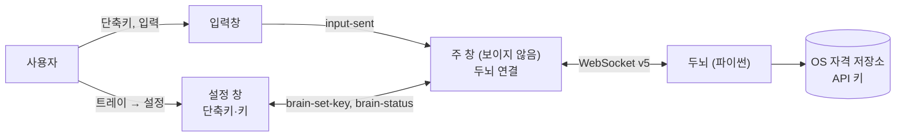

# ARCHITECTURE

TamagotchiChatBot의 구조와 동작 원리다. 지금 코드가 **어떻게 동작하는지**만 적는다.

> 기준: 브랜치 `feat/assistant`, 프로토콜 v5. 프로젝트를 조수로 바꾸면서 다마고치 기능을 모두 지웠다 ([0022](docs/decisions/0022-pivot-to-assistant.md)). 지금은 화면 ↔ 두뇌 **껍데기**만 있다. 조수 설계가 끝나면 이 문서를 다시 쓴다.

## 1. 한눈에 보기

- 화면(Tauri 앱, `app/`)과 두뇌(파이썬 서비스, `brain/`)는 localhost WebSocket으로 통신한다. 규약은 [프로토콜](docs/brain-protocol.md)이다.
- 두뇌는 화면을 모른다 ([0022](docs/decisions/0022-pivot-to-assistant.md)).
- 두뇌는 지금 키 상태만 알리고, 받은 요청은 처리하지 않는다.

## 2. 화면 (`app/`)

| 창 | 파일 | 하는 일 |
|---|---|---|
| 주 창 `main` | `index.html`, `src/main.ts` | 보이지 않는다. 두뇌 연결을 들고, 입력창·설정 창과 두뇌 사이를 잇는다. 입력창 단축키를 등록한다 |
| 입력창 `input` | `input.html`, `src/input.ts` | 단축키(기본 `Ctrl+Shift+Space`)로 화면 가운데에 열고 닫는다. Enter로 보낸다 |
| 설정 창 `settings` | `settings.html`, `src/settings-page.ts` | 트레이 메뉴로 연다. 단축키와 API 키를 저장한다 |

- `src/brain-link.ts`: 두뇌에 접속한다. 끊기거나 접속하지 못하면 2초 뒤 두뇌를 띄우고(이미 떠 있으면 그대로) 다시 접속한다.
- `src/shared/brain-protocol.ts`: 프로토콜 메시지 해석과 생성.
- `src/shared/settings.ts`: 화면 설정(단축키) 저장. 저장본에 예전 설정이 있어도 지금 쓰는 값만 꺼낸다.
- `src-tauri/src/brain.rs`: 접속 정보 파일 읽기, 개발 환경에서 `brain/.venv`의 파이썬으로 두뇌 띄우기, 앱이 끝날 때 함께 끄기.
- `src-tauri/src/lib.rs`: 트레이(설정, 종료)와 창 관리.
- `public/sprites/dog/`: 강아지 스프라이트. 지금은 쓰는 코드가 없다. 강아지 모습을 남긴다는 판단(확인 전, [vision](docs/vision.md))에 따라 둔다.

## 3. 두뇌 (`brain/`)

| 파일 | 하는 일 |
|---|---|
| `brain/__main__.py` | 실행 진입점. 이미 떠 있는 두뇌가 있으면 끝낸다. 빈 포트에서 WebSocket을 열고 `brain.json`에 포트·토큰을 쓴다 |
| `brain/server.py` | 전송 계층. `hello` 인증, 화면 교체, 메시지 분배 |
| `brain/core.py` | 두뇌 핵심. 키가 모두 있으면 `ok`, 아니면 `no_keys`를 알린다. `message`는 받기만 한다 |
| `brain/config.py` | 데이터 폴더와 API 키를 읽는 유일한 곳 (CLAUDE.md 3절). 키는 Windows 자격 증명 관리자에 둔다 |

## 4. 저장과 실행

| 무엇 | 위치 |
|---|---|
| 두뇌 로그 | `%APPDATA%\TamagotchiChatBot\brain\logs\brain.log` |
| 두뇌 접속 정보 | `%APPDATA%\TamagotchiChatBot\brain\brain.json` |
| API 키 | Windows 자격 증명 관리자 (`TamagotchiChatBot.brain`) |
| 화면 설정 | `%APPDATA%\com.tamagotchi.app\settings.json` |

## 5. 문서 지도

| 문서 | 내용 |
|---|---|
| [`docs/vision.md`](docs/vision.md) | 제품 비전. 사용자가 말한 것과 Claude 판단을 나눠 적는다 |
| [`docs/glossary.md`](docs/glossary.md) | 용어집 |
| [`docs/brain-protocol.md`](docs/brain-protocol.md) | 화면 ↔ 두뇌 프로토콜 |
| [`docs/decisions/`](docs/decisions/) | 결정 기록. 결정 하나에 파일 하나 |
| [`docs/references/similar-products.md`](docs/references/similar-products.md) | 비슷한 제품 조사: 실행 쪽(UFO², Cowork, 브라우저 에이전트)과 기억 쪽(screenpipe, Recall) |
| [`docs/references/typesafe-jev.md`](docs/references/typesafe-jev.md) | Jev API 요약. Jev를 다시 쓰게 되면 본다 |
| `docs/superpowers/specs/`, `plans/` | 조수 설계 스펙과 구현 계획 (아직 없음) |

다마고치 시절의 스펙·계획·실측·검수 기록은 지웠다. git 기록 `4b8c747`에 있다.

## 6. 결정 기록

| 번호 | 제목 | 상태 |
|---|---|---|
| [0022](docs/decisions/0022-pivot-to-assistant.md) | 다마고치를 접고 브라우저를 조작하는 조수로 바꾼다 | 채택 |
| [0023](docs/decisions/0023-claude-code-first-then-own-agent.md) | 에이전트는 Claude Code로 먼저, 나중에 직접 설계한 에이전트로 | 채택 |
| [0024](docs/decisions/0024-observation-common-plus-enrichment.md) | 지금 상황은 공통 관찰 + 프로그램별 선택적 강화 | 채택 |

0001~0021은 다마고치 시절 기록이라 지웠다. 아직 유효한 원칙은 0022에 옮겼고, 원문은 git 기록 `4b8c747`에 있다.
