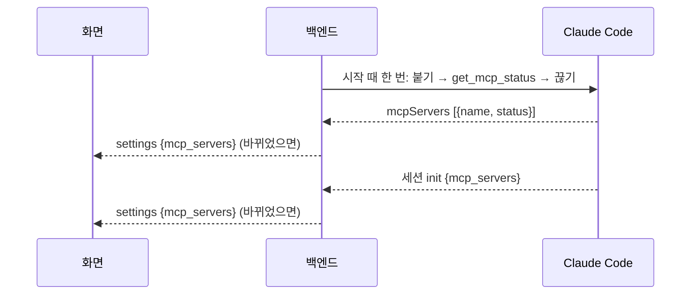
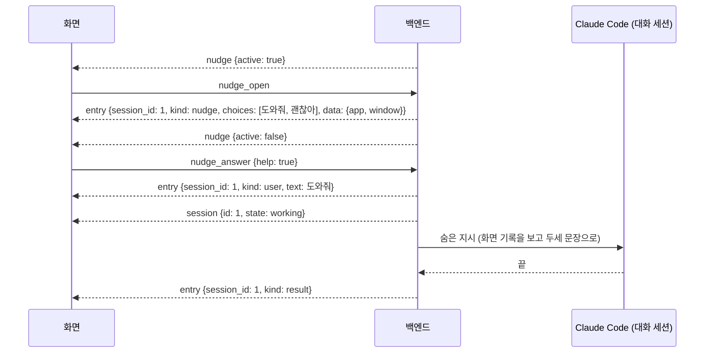
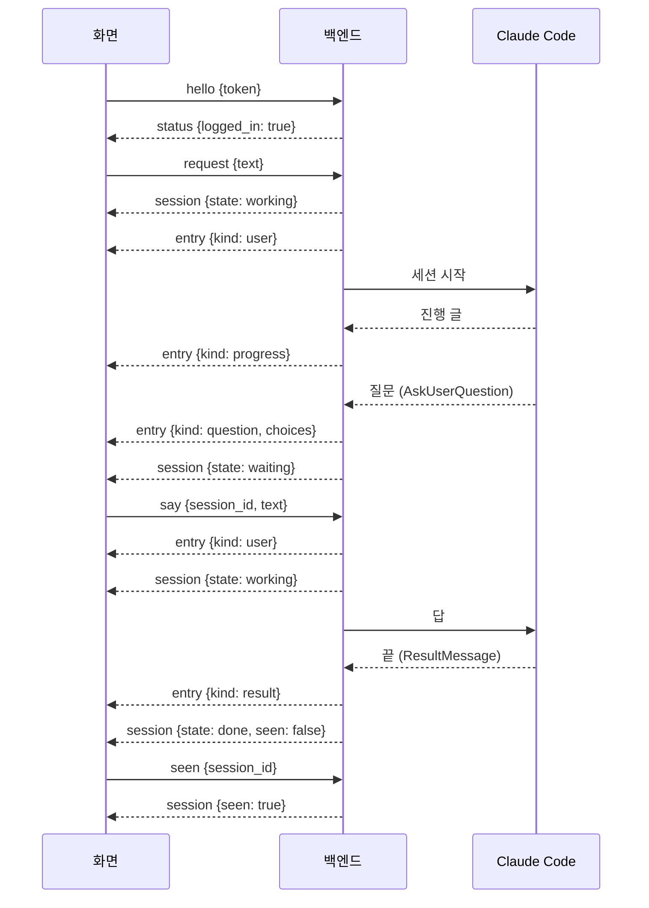
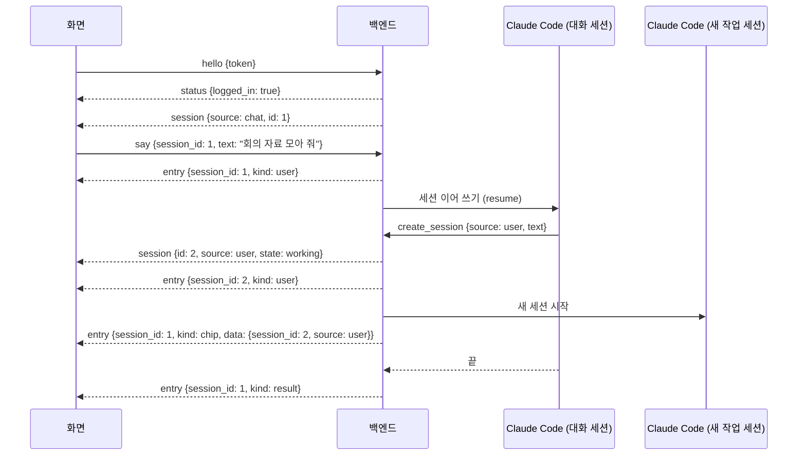

# 화면 ↔ 백엔드 프로토콜 (v7)

화면과 백엔드는 이 문서로만 이어진다. 단위는 **세션**이다. 세션 하나가 대화 하나이고 Claude Code 세션 하나다. 작업·대화·스케줄은 세션의 종류(`source`)다 ([0030](decisions/0030-io-interface-task-as-conversation.md), [0034](decisions/0034-session-as-top-level-term.md)). v7은 v6의 `task` 이름을 `session`으로 바꾼 것이고 동작은 같다. `delete_session`·`session_deleted`·`activity`는 v7에 더한 메시지다(버전은 그대로 `7`, [0030](decisions/0030-io-interface-task-as-conversation.md) "수정: 지우기"·"수정: 준비 중 표시"). 먼저 말 걸기의 `nudge`·`nudge_open`·`nudge_answer`·`set_jev_key`, `settings.jev_key_set`, 대화 줄 `nudge`도 v7에 더했다([먼저 말 걸기 설계](superpowers/specs/2026-10-22-proactive-help-design.md)). `settings.mcp_servers`도 v7에 더했다([연결된 MCP 목록 계획](superpowers/plans/2026-10-22-mcp-list.md)). 메시지 목록의 기준은 [조수 1단계 스펙](superpowers/specs/2026-10-21-assistant-phase1-design.md) 4절이고, 필드 이름은 백엔드 코드(`backend/backend/server.py`의 `ROUTES`, `core.py`가 보내는 메시지)와 같다.

## 연결

- 백엔드는 `127.0.0.1`의 빈 포트에서 WebSocket을 연다. 포트와 토큰을 `%APPDATA%\AssistantChatBot\backend\backend.json`에 쓴다 (`{"port", "token", "pid"}`). 끝날 때 지운다.
- 화면은 그 파일을 읽어 접속하고, 첫 메시지로 `hello`를 보낸다. 5초 안에 오지 않거나 토큰이 틀리면 백엔드가 끊는다.
- 새 화면이 `hello`에 성공하면 이전 화면은 끊긴다. 화면은 하나다.
- 모든 메시지는 JSON이고 `v`(프로토콜 버전, 지금 `7`)와 `type`을 갖는다. `hello`의 버전이 다르면 백엔드가 끊는다.
- 접속하면 백엔드가 `status`를 먼저 보내고, 이어서 대화 탭의 대화 세션을 `session`으로, 끝으로 배지 상태를 `nudge`로 보낸다. 화면은 그 세션 ID로 대화 탭을 연다(`get_session`)·말한다(`say`) ([0033](decisions/0033-chat-tab-single-session.md), [0030](decisions/0030-io-interface-task-as-conversation.md) "수정: 대화 탭").

## 화면 → 백엔드

필드가 빠지거나 타입이 틀린 메시지, 모르는 `type`은 로그만 남기고 버린다. 연결은 유지한다. 정수 자리에 `true`, 참거짓 자리에 `1`도 틀린 타입이다. 처리 중에 오류가 나도 로그(오류 종류만)를 남기고 연결은 유지한다.

메시지는 온 순서대로 하나씩 처리한다. `login`·`logout`만 예외다: 로그인은 사용자가 브라우저에서 마칠 때까지, 로그아웃은 CLI가 끝날 때까지(최대 20초) 걸리므로 따로 돌리고, 그동안 다른 메시지를 계속 처리한다.

| type | 필드 | 뜻 |
|---|---|---|
| `hello` | `token`: 문자열 | 접속 인증 |
| `login` | 없음 | 로그인 버튼. `claude auth login`을 띄우고 끝나면 `status`를 보낸다(실패하거나 오류가 나도 보낸다). 로그인이 이미 진행 중이면 무시한다 |
| `logout` | 없음 | 설정 탭 로그아웃 버튼. `claude auth logout`(20초 제한)을 부르고 `status {logged_in: false}`를 보낸다. 이미 돌고 있는 세션은 멈추지 않고 계속 돈다 |
| `request` | `text`: 문자열 | 작업 탭 입력칸. 새 작업 세션을 만든다 |
| `add_schedule` | `name`: 문자열, `rule`: 규칙, `instruction`: 문자열 | 새 스케줄 양식의 [등록]. 확인 없이 바로 저장한다 |
| `say` | `session_id`: 정수, `text`: 문자열 | 대화 안에서 말하기. 질문의 답, 덧붙이기, 되물음, 등록 확인의 [등록] 모두. 대화 탭의 말하기도 대화 세션 ID로 보낸다 |
| `stop` | `session_id`: 정수 | 멈추기 |
| `seen` | `session_id`: 정수 | 열어 봤을 때 |
| `list_sessions` | `page`: 정수(1부터), `view`: `"user"` \| `"alerts"` | 작업 탭(`user`)·알림 탭(`alerts`) 한 쪽 |
| `get_session` | `session_id`: 정수 | 대화 열기. 없는 세션이면 `session_deleted`로 답한다 |
| `list_schedules` | `page`: 정수 | 스케줄 탭 한 쪽 |
| `set_schedule` | `session_id`: 정수, `name`, `rule`, `instruction` | 지시서 수정 양식의 [저장]. 등록 확인을 기다리는 중이면 [고치기]로 고친 값을 그 확인의 답으로 넘긴다 |
| `set_schedule_enabled` | `session_id`: 정수, `enabled`: 참거짓 | 스케줄 스위치 |
| `get_settings` | 없음 | 설정 탭 |
| `set_permission_mode` | `mode`: 권한 모드 | 설정 탭에서 바꿀 때. 새로 띄우는 세션부터 적용 |
| `clear_recording` | 없음 | 설정 탭 [비우기]. 백엔드가 띄운 screenpipe를 끄고 내려갈 때까지 기다린 뒤 기록(`db.sqlite*`, `data/`)을 지우고, 화면 기록이 켜 있으면 다시 띄운 다음 `settings`를 보낸다. screenpipe 자체 설정(`secrets.sqlite`, `machine_id` 등)은 남긴다. 사용자가 따로 띄운 screenpipe가 떠 있으면 지우지 않고 `settings`만 보낸다. 끈 screenpipe가 5초 안에 내려가지 않아도 지우지 않는다(그대로 두고 `settings`만 보낸다). `db.sqlite`를 먼저 지우고, 그것을 못 지우면(누가 열고 있음) 나머지도 남긴다. 그 밖의 파일은 하나를 못 지워도 나머지는 지운다. 비우는 동안 `set_recording`과 다른 `clear_recording`은 비우기가 끝날 때까지 기다리고, 먼저 말 걸기 판단은 쉰다. 폴더가 없으면 아무 일 없이 끝난다. ([0030](decisions/0030-io-interface-task-as-conversation.md) "수정: 화면 기록 폴더와 비우기") |
| `set_recording` | `enabled`: 참거짓 | 설정 탭 화면 기록 스위치. 저장하고 screenpipe를 띄우거나 끈 뒤 `settings`를 보낸다. 끈 채 저장되면 다음 시작 때도 띄우지 않는다. 백엔드가 띄운 screenpipe만 끈다(사용자가 따로 켠 것은 건드리지 않는다). 끈 직후 다시 켜면 이전 것이 내려갈 때까지 최대 5초 기다렸다 띄운다 |
| `get_usage` | 없음 | 사용량 탭 |
| `nudge_open` | 없음 | 배지(`nudge {active: true}`)가 뜬 강아지를 누름. 대화 세션에 `nudge` 줄을 남기고 `nudge {active: false}`를 보낸다. 그새 배지가 꺼졌으면 무시한다. 아래 [먼저 말 걸기](#먼저-말-걸기) |
| `nudge_answer` | `help`: 참거짓 | `nudge` 줄의 [도와줘](`true`)·[괜찮아](`false`). 대화 세션의 마지막 `nudge` 줄 뒤에 `user` 줄이 없을 때만 받고, 아니면 무시한다 |
| `set_jev_key` | `key`: 문자열 | 설정 탭 Jev API 키 [저장]. 앞뒤 공백을 떼고 저장한 뒤 `settings`를 보낸다. 빈 값이면 키를 지운다 |
| `delete_session` | `session_id`: 정수 | 지우기. 돌거나 답을 기다리면 먼저 멈춘다(`stop`과 같이 질문은 "거부"로 풀고 Claude Code 세션을 끊는다). 세션·대화 줄·검색 색인·스케줄을 지우고 `session_deleted`를 보낸다. 지운 뒤 늦게 온 진행·결과는 버리고, 도구가 지운 세션에 대화 줄을 남기지도 않는다. 대화 세션을 지우면 새 대화 세션(제목 `대화`)을 만들어 `session`으로 보낸다. 없는 세션이어도 `session_deleted`를 보낸다 |

- **규칙 `rule`**: `{"repeat": "daily"|"weekdays"|"weekly"|"monthly", "time": "HH:MM", "weekday": 0-6, "day": 1-31}`. `weekday`(월=0)는 `weekly`일 때, `day`는 `monthly`일 때만 필요하다 ([0032](decisions/0032-schedule-creation.md)). 틀린 규칙은 버린다.
- **권한 모드 `mode`**: `"default"`(기본), `"acceptEdits"`, `"plan"`, `"auto"`, `"bypassPermissions"`. 다른 값은 버린다.
- 한 쪽은 4줄이다. 없는 쪽을 달라고 하면 빈 `items`가 간다.

## 백엔드 → 화면

| type | 필드 | 언제 |
|---|---|---|
| `status` | `logged_in`: 참거짓 | 접속할 때, `login`·`logout`이 끝났을 때, 로그아웃 상태에서 `request`·`say`가 왔을 때(에이전트의 `create_session`으로 작업을 만들 때도) |
| `session` | `session`: 세션 | 세션이 생기거나 바뀔 때, 접속할 때(대화 세션) |
| `entry` | `session_id`, `entry`: 대화 줄 | 대화 줄이 쌓일 때 |
| `sessions` | `view`, `page`, `pages`: 전체 쪽 수, `items`: 세션 목록 | `list_sessions`의 답 |
| `session_detail` | `session`: 세션, `entries`: 대화 줄 전체, `schedule`: 스케줄 또는 `null` | `get_session`의 답 |
| `schedules` | `page`, `pages`, `items`: `{session_id, name, label, next_run, state}` 목록 | `list_schedules`의 답 |
| `schedule` | `schedule`: 스케줄 | 만들거나 고치거나 켜고 끄거나 실행이 끝났을 때 (에이전트가 등록 확인을 받아 만들거나 고쳤을 때도) |
| `settings` | `permission_mode`, `recording`: 참거짓(화면 기록 켬, 기본 켬), `recording_dir`: 문자열(screenpipe 기록 폴더 전체 경로), `recording_bytes`: 정수(지울 수 있는 기록의 바이트 합. 폴더가 없으면 0), `jev_key_set`: 참거짓(Jev 키가 있음. 키 원문은 보내지 않는다), `mcp_servers`: 연결된 MCP 목록(아래 [연결된 MCP](#연결된-mcp-settingsmcp_servers)) | `get_settings`의 답, 바뀌었을 때(MCP 상태 목록이 바뀌었을 때도) |
| `usage` | `limits`: `{type, utilization, resets_at, received_at}` 목록 | `get_usage`의 답, 새 사용량 이벤트가 왔을 때 |
| `session_deleted` | `session_id` | `delete_session`의 답. `get_session`에 없는 세션이 왔을 때 |
| `activity` | `session_id`, `kind`, `text` | 돌고 있는 세션이 하는 일이 바뀔 때. 대화 기록에 남기지 않는다. 아래 [지금 하는 일](#지금-하는-일-activity) |
| `nudge` | `active`: 참거짓 | 먼저 말 걸기 배지를 켜고 끌 때(판단, 5분 지남, `nudge_open`), 접속할 때 |

### 세션 `session`

| 필드 | 값 |
|---|---|
| `id` | 정수 |
| `source` | 세션 종류. `"user"`(작업: 사용자 요청), `"schedule"`(스케줄), `"chat"`(대화: 대화 탭. 하나뿐이고 백엔드가 처음 시작할 때 제목 `대화`로 만든다) |
| `title` | 제목. 요청 글 앞 30자로 시작하고, 에이전트가 짧은 제목으로 바꿀 수 있다 |
| `state` | 아래 세션 상태 |
| `seen` | 참거짓. 끝난 뒤 사용자가 열어 봤는지 |
| `claude_session_id` | Claude Code 세션 ID 또는 `null` |
| `created_at` | ISO 8601 지역 시각 |

**세션 상태 `state`**

| 값 | 뜻 |
|---|---|
| `working` | 일하는 중 |
| `waiting` | 답 기다림 (질문·권한·등록 확인) |
| `done` | 다 함 |
| `failed` | 못 함. 앱이 꺼져 끊긴 세션도 다음 시작 때 여기로 닫는다 |
| `stopped` | 멈춤 |

작업 목록(`view: "user"`)은 작업 세션(`source: "user"`)만 담는다. 알림 목록(`view: "alerts"`)은 답 기다림, 안 본 실패, 안 본 완료 순이고 대화 세션을 넣지 않는다. 대화 세션도 끝나면 `done`·`failed`가 되지만, 다시 `say`하면 저장된 Claude Code 세션을 이어 쓴다. 앱이 꺼져 끊긴 대화 세션은 시작 때 실패로 닫지 않고 `done`으로 되돌린다(실패 줄도 남기지 않는다). 에이전트의 세션 조회 Tool(`recent_sessions`, `search_sessions`, `get_session`)은 모든 종류의 세션을 찾는다. 대화 세션의 제목은 `대화`로 고정이다(에이전트가 바꾸지 못한다).

### 대화 줄 `entry`

| 필드 | 값 |
|---|---|
| `id`, `session_id` | 정수 |
| `at` | ISO 8601 지역 시각 |
| `kind` | 아래 종류 |
| `text` | 글 |
| `choices` | 고를 답 목록 또는 `null`. 질문, 등록 확인, 먼저 말 걸기에만 있다 |
| `data` | 등록 확인의 내용, 세션 칩의 `{session_id, source}`, 먼저 말 걸기의 `{app, window}`, 또는 `null` |

| `kind` | 뜻 |
|---|---|
| `user` | 사용자 말 |
| `progress` | 진행 (에이전트가 말한 글). 최종 답과 같은 마지막 글은 `result`로만 보낸다. 대화 탭 세션에서는 앱이 그리지 않는다 |
| `question` | 질문. `choices`가 고를 답이다. 권한 요청은 `["허용", "거부"]`. 선택지 밖의 글로 답해도 된다 |
| `result` | 결과. 일하는 중에 덧붙인 말로 다음 차례가 이어지면 앞 차례의 결과도 `result`(오류면 `failure`)로 오고, 세션은 `working` 그대로다. 마지막 차례의 결과와 함께 `done`·`failed`가 된다 ([스펙](superpowers/specs/2026-10-21-assistant-phase1-design.md) 5.1 "덧붙이기") |
| `failure` | 실패 |
| `proposal` | 등록 확인. `choices`는 `["등록", "고치기"]`, `data`는 `{name, rule, label, instruction, first_run}` (고칠 때는 `changed`: 바뀐 칸 이름 목록도) |
| `run` | 스케줄 실행 구분선 (예: `10/21 (수) 09:00 실행`) |
| `edit` | 지시서 수정 |
| `nudge` | 먼저 말 걸기 물음. 대화 세션에만 생긴다. `text`는 `도움이 필요해?`, `choices`는 `["도와줘", "괜찮아"]`, `data`는 `{"app": 앱 이름, "window": 창 제목}`(판단에 쓴 가장 최근 화면). 답은 `say`가 아니라 `nudge_answer`로 보낸다 |
| `chip` | 세션 칩. 에이전트가 `create_session`으로 새 세션을 만들었을 때 그 세션을 만든 대화에 남는다(어느 세션에서든). `text`는 새 세션 제목, `data`는 `{"session_id": 새 세션 ID, "source": "user" \| "schedule"}`. `source`가 없는 옛 칩은 작업이다. 누르면 그 세션 대화로 간다 ([0035](decisions/0035-create-session-from-any-session.md)) |

등록 확인에 답하는 법: [등록]은 `say`로 `"등록"`을 보낸다. [고치기]는 양식을 열고, 고친 값을 `set_schedule`로 보낸다. 이때 백엔드는 `user` 줄 `고쳐서 등록: <이름> (<반복>)`을 남긴다.

### 스케줄 `schedule`

| 필드 | 값 |
|---|---|
| `session_id` | 이 스케줄의 세션 ID (스케줄 = 세션 하나) |
| `name`, `rule`, `instruction` | 이름, 규칙, 할 일 |
| `label` | 규칙을 글로 (예: `매일 09:00`, `평일 08:30`) |
| `enabled` | 참거짓 |
| `next_run` | 다음 실행 시각(ISO 8601) 또는 꺼져 있으면 `null` |
| `last_run_at` | 마지막 실행 시각 또는 `null` |
| `last_result` | 마지막 실행이 끝난 상태(`done`·`failed`·`stopped`) 또는 `null` |

`schedules` 목록의 `state`: `"running"`(도는 중·답 기다림), `"next"`(켜짐), `"off"`(꺼짐).

### 지금 하는 일 `activity`

Claude Code를 `include_partial_messages`로 띄워 받은 `StreamEvent` 중 `content_block_start`에서 만든다(스펙 5.1). 글자 조각(`content_block_delta`)마다 보내지 않는다. 바로 앞에 보낸 것과 `kind`·`text`가 같으면 보내지 않는다. 질문·권한 요청·등록 확인을 띄우면 이 비교를 처음으로 되돌린다(답한 뒤 같은 일도 다시 보낸다). 멈춘 뒤에는 보내지 않는다.

| 블록 | `kind` | `text` |
|---|---|---|
| `thinking` | `thinking` | `생각하는 중` |
| `text` | `writing` | `답 쓰는 중` |
| `tool_use` `mcp__screenpipe__*` | `tool` | `화면 기록에서 찾는 중` |
| `tool_use` `mcp__claude-in-chrome__*` | `tool` | `크롬에서 작업하는 중` |
| `tool_use` `mcp__backend__*` (백엔드 Tools) | `tool` | `지난 작업 찾는 중` |
| `tool_use` `WebSearch` | `tool` | `웹에서 검색하는 중` |
| `tool_use` `WebFetch` | `tool` | `웹 페이지 읽는 중` |
| `tool_use` `Bash` | `tool` | `명령 실행하는 중` |
| `tool_use` `Read`·`Glob`·`Grep` | `tool` | `파일 읽는 중` |
| `tool_use` `Write`·`Edit`·`NotebookEdit` | `tool` | `파일 고치는 중` |
| `tool_use` `Task`·`Agent` | `tool` | `다른 에이전트에게 맡기는 중` |
| `tool_use` `AskUserQuestion` | — | 보내지 않는다(질문 줄이 대신 보인다) |
| `tool_use` 그 밖 | `tool` | `도구 쓰는 중` |
| 그 밖의 블록 | — | 보내지 않는다 |

### 사용량 `usage`

`limits`의 각 칸은 Claude Code의 사용량 이벤트(`RateLimitEvent`)에서 읽은 창(`type`)별 마지막 값이다. `utilization`은 쓴 비율(0~1), `resets_at`은 초기화 시각(epoch 초), `received_at`은 백엔드가 받은 시각이다. 세션이 돌지 않으면 갱신되지 않는다.

- **원천:** 이벤트 원본(`RateLimitInfo.raw`)의 `unifiedWindows`에서 창마다 한 칸을 만든다. `unifiedWindows`가 없거나 사전이 아니면 SDK가 풀어 준 칸(`rate_limit_type`, `utilization`, `resets_at`)으로 한 칸만 만든다. 풀린 칸은 창 하나뿐이고 `utilization`이 비어 온다(아래 실측). BusinessFactory와 같은 방식이다.
- **저장:** 받을 때마다 `limits`를 백엔드 DB `settings`의 `usage` 키에 JSON으로 둔다. 켤 때(`startup`) 읽으므로 다시 켜도 `get_usage`에 마지막 값이 나간다. 저장한 값이 깨졌으면 빈 목록으로 시작한다.

실측한 원본 모양 (2026-10-23, 이 PC, 짧은 세션 하나에 이벤트 1개):

```json
{"status": "allowed", "resetsAt": 1792728600, "rateLimitType": "five_hour",
 "overageStatus": "rejected", "overageDisabledReason": "org_level_disabled", "isUsingOverage": false,
 "unifiedWindows": {"five_hour": {"utilization": 0.04, "resetsAt": 1792728600},
                    "seven_day": {"utilization": 0.28, "resetsAt": 1792969200}}}
```

이때 SDK가 풀어 준 `utilization`은 `None`이었다. 창 이름은 `five_hour`·`seven_day` 둘이 왔다. 모델별 창(`opus`·`sonnet`)은 아직 본 적이 없다.

### 연결된 MCP `settings.mcp_servers`

설정 탭 "연결된 MCP" 칸의 목록이다. 각 칸은 `{name, description, status}`이다. Claude Code에 연결된 MCP 전부를 받은 순서대로 담고, 이 프로그램의 파이썬 백엔드 MCP(이름 `backend`)만 뺀다(사용자).

- `status`: `connected`(연결됨), `disconnected`(연결 안 됨), `checking`(확인 중) 셋 중 하나다. Claude Code 상태 `connected`는 `connected`, `failed`·`needs-auth`·`disabled`는 `disconnected`, `pending`은 `checking`으로 바꾼다. 모르는 상태는 `disconnected`로 본다 (Claude 판단).
- `description`: 이름별 문구(`config.MCP_DESCRIPTIONS`). `screenpipe` `화면 기록 검색`, `claude-in-chrome` `크롬 브라우저 조작`. 그 밖에 이름이 `claude.ai `로 시작하면 `claude.ai 계정 커넥터`, 아니면 빈 글이다.
- 값은 백엔드 메모리에만 둔다. 처음에는 `screenpipe`, `claude-in-chrome` 두 칸이 `checking`이다. 백엔드가 뜬 뒤 한 번 세션과 같은 옵션으로 Claude Code를 붙여 상태만 읽고(모델 호출 없음) 끊는다. 연결 중(`pending`)인 MCP가 있으면 1초마다 다시 읽는다(잠정값). 10초가 지나면 마지막으로 읽은 목록을 쓰고, 한 번도 못 읽었으면 처음 값을 둔다. 끊기도 5초 안에 끝낸다(잠정값). 그 뒤로는 세션이 시작될 때마다 오는 `init`의 `mcp_servers`로 고친다. 세션 `init`이 시작 때 읽기보다 먼저 오면 뒤늦은 읽기 결과는 버린다. 시작 때 읽기는 질문을 보내지 않고 도구 권한은 모두 거부한다. 읽기가 실패하거나 모양이 다르면 이전 값을 둔다.
- 목록이 바뀌었을 때만 `settings`를 다시 보낸다.



### 먼저 말 걸기

백엔드가 30초마다 최근 화면 기록을 Jev에 물어 사용자가 작업 화면에서 일하고 있으면 배지를 켠다(같은 창에서 [괜찮아]라고 했으면 그 창에서는 켜지 않는다). 판단 방법과 값은 [설계](superpowers/specs/2026-10-22-proactive-help-design.md) 4절에 있다.

- 배지는 켠 뒤 5분이 지나면 백엔드가 끈다. 켜기 직전에 로그인을 확인해 로그아웃이면 켜지 않는다. 마지막으로 보낸 `status`가 `logged_in: false`면 판단도 쉰다. 대화 중(답하지 않은 `nudge` 줄이 있거나 대화 세션이 `working`·`waiting`)과 화면 기록을 비우는 중에도 쉰다.
- [도와줘] (`nudge_answer {help: true}`): `user` 줄 `도와줘`를 남기고, 대화 세션에 숨은 지시를 보낸다. 지시 글은 대화 줄에 남지 않는다. 대화 세션이 답을 쓰는 중이면 `say`처럼 이어서 받는다. 질문·등록 확인의 답을 기다리는 중이면 지시를 그 답으로 쓰지 않고 미뤄 두었다가 그 실행이 끝나면 이어 묻는다. 그사이 대화 세션을 멈추거나 지우면 버린다(기다리던 질문은 그대로 답할 수 있다. 화면은 `nudge` 줄 바로 뒤의 `user` 줄을 질문의 답으로 치지 않는다). 로그아웃이면 `say`처럼 `status {logged_in: false}`만 보낸다.
- [괜찮아] (`nudge_answer {help: false}`): `user` 줄 `괜찮아`를 남긴다. 백엔드는 그 시각과 `nudge` 줄의 앱·창을 다음 판단에 넣는다(최근 1시간, 메모리에만 둔다).



## 예: 요청 하나



## 예: 대화 탭에서 일 맡기기



## 닫힘 코드

| 코드 | 뜻 |
|---|---|
| 4001 | `hello`가 없거나 토큰이 틀림 |
| 4002 | 다른 화면이 접속해 교체됨 |
| 4003 | 프로토콜 버전이 다름 |

해석할 수 없는 메시지는 버리고 연결은 유지한다.
