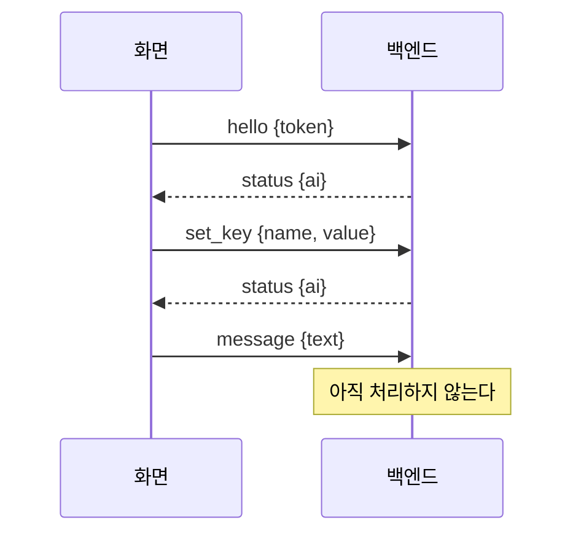

# 화면 ↔ 백엔드 프로토콜 (v5)

화면과 백엔드는 이 문서로만 이어진다. v5는 조수 설계 전의 최소 규약이다 ([0022](decisions/0022-pivot-to-assistant.md)). 조수 설계가 끝나면 다시 쓴다.

## 연결

- 백엔드는 `127.0.0.1`의 빈 포트에서 WebSocket을 연다. 포트와 토큰을 `%APPDATA%\TamagotchiChatBot\brain\brain.json`에 쓴다 (`{"port", "token", "pid"}`).
- 화면은 그 파일을 읽어 접속하고, 첫 메시지로 `hello`를 보낸다. 5초 안에 오지 않거나 토큰이 틀리면 백엔드가 끊는다.
- 새 화면이 `hello`에 성공하면 이전 화면은 끊긴다. 화면은 하나다.
- 모든 메시지는 JSON이고 `v`(프로토콜 버전)와 `type`을 갖는다. 버전이 다르면 백엔드가 끊는다.

## 화면 → 백엔드

| type | 필드 | 뜻 |
|---|---|---|
| `hello` | `token` | 접속 인증 |
| `message` | `text` | 사용자가 입력창에서 보낸 요청 |
| `set_key` | `name`(`typesafe`·`gemini`), `value` | API 키 저장. 백엔드가 OS 자격 저장소에 보관한다 |

## 백엔드 → 화면

| type | 필드 | 뜻 |
|---|---|---|
| `status` | `ai`(`ok`·`no_keys`) | 키 상태. 접속할 때와 키가 바뀔 때 보낸다. 키가 모두 있으면 `ok` |

## 닫힘 코드

| 코드 | 뜻 |
|---|---|
| 4001 | `hello`가 없거나 토큰이 틀림 |
| 4002 | 다른 화면이 접속해 교체됨 |
| 4003 | 프로토콜 버전이 다름 |

모르는 메시지와 해석할 수 없는 메시지는 버리고 연결은 유지한다.
