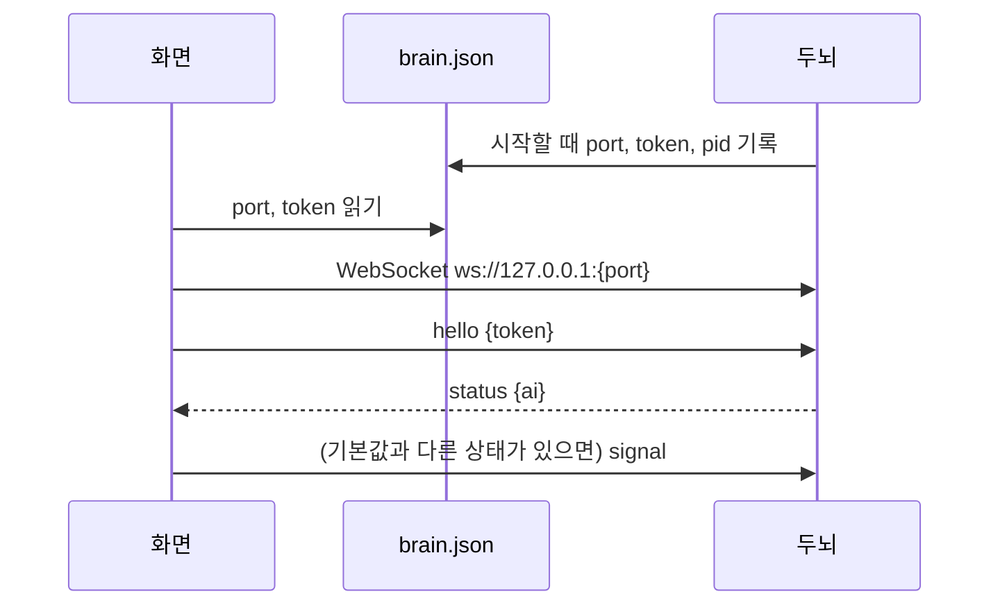

# 두뇌 프로토콜 (v1)

화면(프론트엔드)과 두뇌가 주고받는 규약이다. 화면은 이 문서만 보고 만들 수 있어야 한다. 두뇌는 고정이고 화면은 바뀔 수 있다 ([0012](decisions/0012-brain-as-frontend-independent-service.md)).

## 접속

- 접속 정보 파일: `%APPDATA%\TamagotchiChatBot\brain\brain.json` = `{"port": 숫자, "token": 문자열, "pid": 숫자}`. 파일이 없거나 접속이 안 되면 두뇌가 꺼진 것이다.
- 두뇌는 `127.0.0.1`에서만 받는다. 첫 메시지는 5초 안에 `hello`여야 한다.
- 화면은 하나만 붙는다. 새 화면이 `hello`에 성공하면 이전 연결은 코드 4002로 닫힌다.
- 닫기 코드: 4001 토큰·hello 오류, 4002 다른 화면으로 교체, 4003 프로토콜 버전 불일치.
- 두뇌는 처음에 "강아지는 집 밖, 사용자는 자리에 있음"으로 안다. 화면은 접속 직후 이와 다른 상태(집 안, 자리 비움)를 `signal`로 알린다. 두뇌는 연결이 끊겨도 이 상태를 기억한다.

## 메시지

모든 메시지는 JSON 객체 하나이고 `v: 1`과 `type`이 있다. 해석할 수 없는 메시지는 버리고 연결은 유지한다.

### 화면 → 두뇌

| type | 필드 | 뜻 |
|---|---|---|
| `hello` | `token` | 인증. 첫 메시지 |
| `signal` | `signal`: 아래 Signal | 무슨 일이 있었는지 알림 |
| `set_key` | `name`: `typesafe`·`gemini`, `value` | API 키 저장. 두뇌가 OS 자격 저장소에 보관한다 |
| `clear_history` | | 대화 기록 전체 삭제 |

**Signal**

| kind | 필드 | 뜻 |
|---|---|---|
| `typing` | `text` | 입력 중인 글이 바뀜 (보내기 전) |
| `sent` | `text` | 메시지를 보냄 |
| `house` | `inside`, `awayMs` | 강아지가 집에 들어감(`inside: true`) / 나옴(`false`, `awayMs`는 집에 있던 시간) |
| `bubble_seen` | | 사용자가 말풍선을 봤음 (판단 기준은 화면이 정한다) |
| `user_away` / `user_return` | | 사용자가 자리를 비움 / 돌아옴 (판단 기준은 화면이 정한다) |
| `interaction` | `type`: `poke`·`pet`·`throw` | 몸 상호작용 (찌르기·쓰다듬기·던지기) |

### 두뇌 → 화면

| type | 필드 | 뜻 |
|---|---|---|
| `reaction` | `emotion?`, `action?`, `utterance?` | 강아지 반응. 바뀐 항목만 온다. 감정·행동과 대사는 따로 올 수 있다 |
| `status` | `ai`: `ok`·`no_keys`·`bad_key` | AI 상태. `hello` 직후와 바뀔 때 온다. 보여주는 방법은 화면이 정한다 |

**어휘** — 모든 화면이 전부 표현해야 한다.

| 감정 `emotion` | 뜻 |
|---|---|
| `excited` | 신남 |
| `angry` | 분노 |
| `curious` | 궁금함 |
| `surprised` | 놀람 |
| `sad` | 슬픔 |
| `sleepy` | 졸림 |
| `calm` | 평온 |

| 행동 `action` | 뜻 |
|---|---|
| `stand` | 서서 바라보기 |
| `sit` | 앉기 |
| `lie_down` | 엎드리기 |
| `sleep` | 잠자기 |
| `beg` | 두 발로 서서 조르기 |
| `bark` | 짖기 |

(`none`은 두뇌 안에서만 쓰고 화면으로 보내지 않는다.)

## 바꿀 때

메시지 모양을 바꾸면 `v`를 올리고 이 문서와 두뇌·모든 화면을 같은 커밋에서 고친다.
