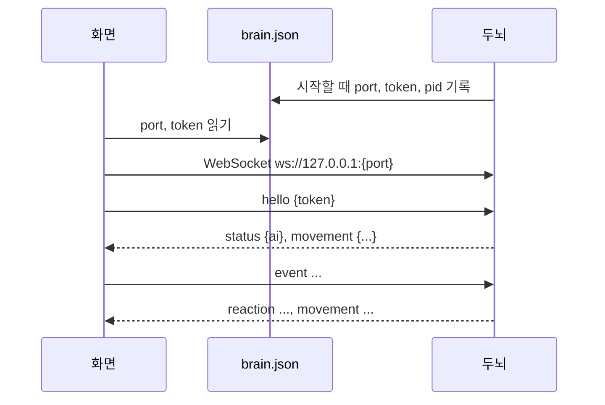

# 두뇌 프로토콜 (v3)

화면(프론트엔드)과 두뇌가 주고받는 규약이다. 화면은 이 문서만 보고 만들 수 있어야 한다. 두뇌는 고정이고 화면은 바뀔 수 있다 ([0012](decisions/0012-brain-as-frontend-independent-service.md)). 이벤트의 **의미**는 여기서 고정하고, **언제** 낼지는 화면이 정한다 ([0013](decisions/0013-event-driven-brain-with-event-log.md)).

## 접속

- 접속 정보 파일: `%APPDATA%\TamagotchiChatBot\brain\brain.json` = `{"port", "token", "pid"}`. 파일이 없거나 접속이 안 되면 두뇌가 꺼진 것이다.
- 두뇌는 `127.0.0.1`에서만 받는다. 첫 메시지는 5초 안에 `hello`여야 한다.
- 화면은 하나만 붙는다. 새 화면이 `hello`에 성공하면 이전 연결은 4002로 닫힌다.
- 닫기 코드: 4001 토큰·hello 오류, 4002 다른 화면으로 교체, 4003 프로토콜 버전 불일치.

## 메시지

모든 메시지는 JSON 객체 하나이고 `v: 3`과 `type`이 있다. (v3: 반응 어휘가 기분 8개의 표출로 바뀌고 `movement`에 `mood`가 생겼다, [기분 8개 스펙](superpowers/specs/2026-10-15-mood-reaction-design.md)) 해석할 수 없는 메시지는 버리고 연결은 유지한다.

### 화면 → 두뇌

| type | 필드 | 뜻 |
|---|---|---|
| `hello` | `token` | 인증. 첫 메시지 |
| `event` | `kind`, `context` | 일어난 일 (아래 표) |
| `set_key` | `name`: `typesafe`·`gemini`, `value` | API 키 저장. 두뇌가 OS 자격 저장소에 보관한다 |
| `clear_history` | | 이벤트 기록 전체 삭제 (강아지 성격·기분·친밀도는 남는다) |
| `reset` | | 초기화: 강아지가 새 성격으로 다시 태어나고 이벤트 기록·판단 로그를 지운다. API 키는 남는다. 두뇌는 새 `movement`를 보낸다 |
| `get_state` | | 강아지 상태 조회 → `state` |
| `get_log` | | 판단 로그 조회 → `log` |

**이벤트**: 강아지가 집에 있는 동안은 `house_out` 외에는 보내지 않는다. 세기 값은 0~1로 정규화해 보낸다(정규화는 화면이 정한다).

| kind | context | 뜻 | Windows 화면이 내는 때 |
|---|---|---|---|
| `typing` | `text` | 보내기 전 쓰는 중 | 0.6초 멈춤, 또는 지난 typing 뒤 10자 넘게 바뀜 |
| `message` | `text` | 사용자가 말함 | Enter |
| `dog_spoke` | `text` | 강아지 말이 화면에 뜸 | 말풍선 표시 직후 |
| `quiet` | `seconds` | 한동안 아무 일 없음 | 마지막 이벤트 뒤 10분(자리에 있음)/30분(비움). 반복 |
| `returned` | `away_seconds` | 사용자가 돌아옴 | 1분 넘게 입력이 없다가 다시 입력 |
| `house_in` | | 강아지가 집에 들어감 | 집 클릭·트레이·단축키 |
| `house_out` | `away_seconds` | 강아지가 집에서 나옴 | 같음 |
| `poke` | | 찌르기 | 짧은 클릭 |
| `pet` | `seconds` | 쓰다듬기 | 문지르기 감지 |
| `throw` | `impact`(0~1), `bounces`, `flight_seconds` | 던지기 | 착지할 때. impact = 가장 세게 부딪힌 속도 ÷ 2000px/초 |

### 두뇌 → 화면

| type | 필드 | 뜻 |
|---|---|---|
| `reaction` | `reaction?`, `action?`, `utterance?` | 강아지 반응. 반응은 이번에 가장 크게 오른 기분의 즉각 표출이다. 반응·동작과 대사는 따로 올 수 있다 |
| `status` | `ai`: `ok`·`no_keys`·`bad_key` | AI 상태. `hello` 직후와 바뀔 때 |
| `movement` | `weights`, `mood`, `run`, `idle_scale` | 평소 움직임 경향과 두드러진 기분(`mood`: 아래 반응 어휘 또는 `calm`). `hello` 직후와 바뀔 때(강아지가 집에 있는 동안은 보내지 않고 `house_out` 뒤 바로 보낸다). 화면은 최신 값으로 평소 움직임을 뽑고, `mood`로 평소 모습을 고른다 |
| `state` | `dog`, `talkativeness`, `movement` | `get_state`에 대한 답: 성격·기분·친밀도·습관화, 말수 계산값, 지금 경향 (설정 창 상태 탭용) |
| `log` | `judgements`, `events`, `brain_log` | `get_log`에 대한 답: 최근 판단 50개(Jev 분포·보정 뒤 확률·뽑힌 결과·기분 변화·대사), 이벤트 기록 문장, 두뇌 실행 로그 30줄 (설정 창 로그 탭용) |

| 반응 `reaction` (= 기분) | 동작 `action` | 움직임 범주 `weights` 키 |
|---|---|---|
| `bored` 지루함 (심심함) | `stand` 서기 | `rest` 쉬기 |
| `sleepy` 하품 (졸림) | `sit` 앉기 | `sleep` 잠 |
| `excited` 신남 (들뜸) | `lie_down` 엎드리기 | `roam` 돌아다니기 |
| `sad` 서운함 (시무룩) | `sleep` 잠 | `approach` 사용자 곁으로 |
| `annoyed` 짜증 (분노) | `beg` 조르기 | `play` 놀기 |
| `curious` 궁금함 | `bark` 짖기 | `explore` 구경하기 |
| `surprised` 놀람 | | |
| `scared` 무서움 | | |
| `happy` 행복 | | |

- `run`: 돌아다닐 때 달리는 비율(0~1). `idle_scale`: 한 움직임에 머무는 시간 배율(양수).
- 모든 화면이 위 어휘를 모두 표현해야 한다. "없음"은 보내지 않는다.

## 바꿀 때

메시지 모양을 바꾸면 `v`를 올리고 이 문서와 두뇌·모든 화면을 같은 커밋에서 고친다.
