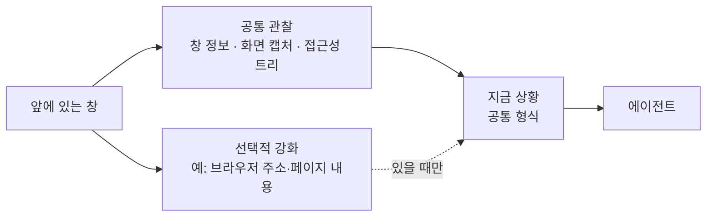

# 0024. 지금 상황은 공통 관찰 위에 프로그램별 강화를 덧붙이는 구조로 받는다

- 상태: 채택 (위치는 [0026](0026-input-layer-passes-request-only.md)으로 수정: 화면 기록은 입력 계층이 아니라 백그라운드 데이터 출처)
- 날짜: 2026-10-21

## 배경

입력 계층의 핵심은 사용자가 보고 있는 창의 **지금 상황**이다 ([vision](../vision.md)). 사용자가 보며 작업하는 프로그램은 브라우저, 슬랙, 카카오톡, 폴더 창, 소스트리 등 종류가 많다. 사용자는 프로그램마다 입력 구조를 따로 설계하지 않는 확장 가능한 구조를 원했다.

## 결정

지금 상황을 두 층으로 받는다.

- **공통 관찰**은 모든 프로그램에서 같게 동작한다.
  - 창 정보: 프로그램 이름, 창 제목, 위치.
  - 화면 캡처: 접근성 정보가 부실한 프로그램(예: 카카오톡)에서도 동작하는 안전망.
  - 접근성 트리: Windows UI Automation. 글자·버튼·선택 영역을 구조로 준다.
- **선택적 강화**는 더 좋은 정보원이 있는 프로그램에서만 공통 관찰에 덧붙인다.
- 에이전트는 늘 같은 형식의 지금 상황을 받는다. 공통 칸은 항상 있고, 강화 칸은 있을 때만 있다.
- 프로그램 지원을 늘릴 때는 관찰 공급자를 하나 더한다. 입력 구조와 에이전트는 바꾸지 않는다.

Claude가 제안했고 사용자가 수용했다.

## 검토한 대안

| 대안 | 장점 | 단점 | 채택하지 않은 이유 |
|---|---|---|---|
| 프로그램마다 전용 입력 구조 | 프로그램별로 가장 풍부한 정보 | 프로그램이 늘 때마다 설계를 다시 한다. 지원하지 않는 프로그램에서는 아무것도 모른다 | 확장성이 없다 |
| 화면 캡처만 | 가장 단순하다. 모든 프로그램에서 같다 | 글자를 정확히 읽지 못할 수 있다. 주소처럼 화면에 다 안 보이는 정보를 놓친다 | 정보원이 있는 곳에서도 버리게 된다 |

## 결과

- 공통 형식(칸 이름과 모양)은 에이전트 계층 설계와 함께 정한다.
- 화면 캡처와 접근성 트리에는 민감한 내용이 담길 수 있다. 외부 AI로 보낼 때의 범위와 고지는 설계에서 정한다.
- 출력 계층에도 같은 원리(범용 조작 + 전용 수단 강화)를 쓸지는 출력 계층에서 정한다.
