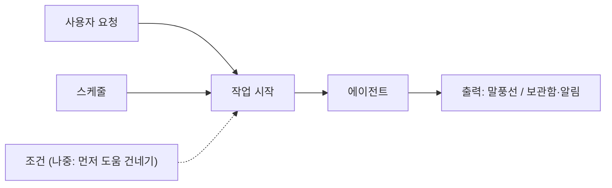

# 0025. 스케줄 작업은 직접 구현하고, 에이전트는 "작업 시작" 하나의 입구로 깨운다

- 상태: 채택 (스케줄 직접 구현은 사용자 결정. 입구·작업 정의·무인 실행 규칙은 Claude 제안이고 확인 전)
- 날짜: 2026-10-21

## 배경

사용자가 자동화 스케줄(예: 매일 18시에 오늘 슬랙 정리)을 염두에 두기로 했다. 지금 구조에서 에이전트는 사용자 요청으로만 시작한다.

screenpipe에는 pipes가 있다. 마크다운 파일 하나에 지시문과 스케줄을 적으면 정해진 시간에 Claude Code 같은 코딩 에이전트를 돌려 화면 기록을 조회하고 행동한다 (screenpipe README, 2026-10-21 확인).

## 결정

- 스케줄링은 **직접 구현한다**. 사용자가 정했다.
- 에이전트를 깨우는 입구를 **작업 시작** 하나로 모은다 (Claude 제안).

- 스케줄러는 두뇌 안에 둔다. 운영체제와 상관없는 일이기 때문이다 (Claude 제안).

## 검토한 대안

| 대안 | 장점 | 단점 | 채택하지 않은 이유 |
|---|---|---|---|
| screenpipe pipes | 이미 있다. 1단계에 바로 쓴다 | 결과가 우리 출력 계층(강아지, 보관함)을 거치지 않는다. 작업 정의·무인 실행 규칙을 우리가 정하지 못한다 | 사용자가 직접 구현을 골랐다 |

## 결과

- 작업 정의 칸(Claude 제안): 무엇을, 언제, 어떤 맥락(화면 히스토리 범위), 어디까지 해도 되나, 결과는 어디로. 사용자가 말로 요청하면 에이전트가 작업 정의로 바꿔 저장한다.
- 무인 실행 규칙(Claude 제안): 질문이 필요하면 멈추고 보관함에 남긴다. 사용자가 브라우저 등을 쓰는 중이면 기다린다(작업은 한 번에 하나, 줄 서기). 작업 정의의 권한을 넘지 않는다.
- 출력 계층에 **보관함**과 알림 갈래가 생긴다.
- 조건으로 깨우기(먼저 도움 건네기)는 같은 입구에 나중에 붙인다.
