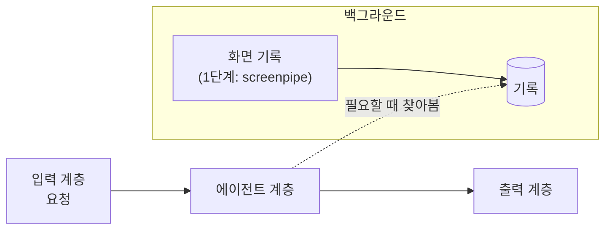

# 0026. 입력 계층은 요청만 넘기고, 맥락은 에이전트가 화면 기록에서 찾는다

- 상태: 채택
- 날짜: 2026-10-21
- 수정: [0024](0024-observation-common-plus-enrichment.md)의 "지금 상황은 입력 계층이 받는다"는 위치. 공통 관찰 + 선택적 강화라는 기록의 모양은 그대로다.

## 배경

screenpipe를 입력 계층으로 볼 수 있는지 따져 보았다. 사용자는 screenpipe가 백그라운드에서 도는 작업이라 입력 계층으로 보기 힘들다고 했다. 그러면 입력 계층이 무엇을 하는지 정해야 했다.

## 결정

입력 계층은 요청만 받아 그대로 에이전트에 넘긴다. 맥락은 에이전트가 화면 기록에서 직접 찾아본다. 사용자가 정했다.

## 검토한 대안

| 대안 | 장점 | 단점 | 채택하지 않은 이유 |
|---|---|---|---|
| 입력 계층이 요청과 함께 그 순간의 맥락(지금 화면, 최근 기록)을 모아 넘긴다 | 에이전트가 찾지 않아도 기본 맥락을 갖고 시작한다 | 입력 계층이 무엇이 필요한 맥락인지 미리 판단해야 한다 | 사용자가 요청만 넘기는 쪽을 골랐다 |

## 결과

- 화면 기록은 계층이 아니라 백그라운드 데이터 출처다.
- 맥락을 찾는 일은 에이전트 계층의 몫이다.
