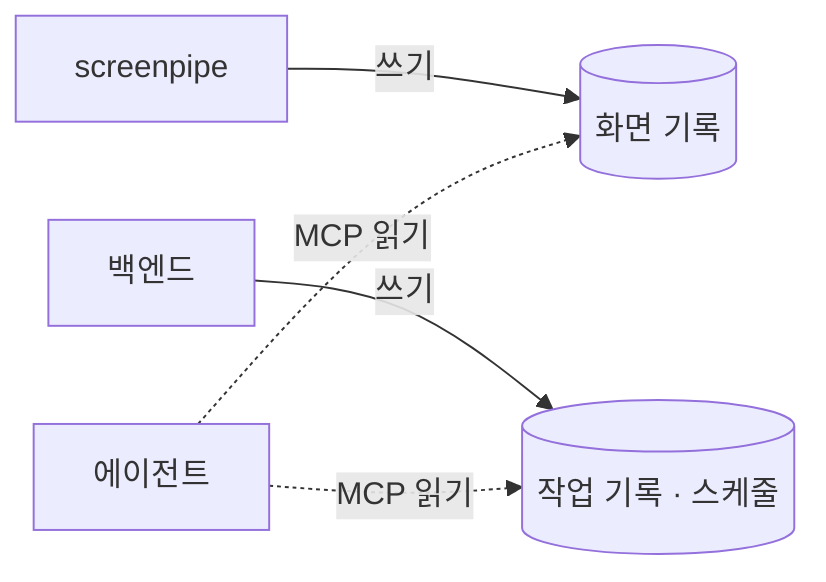

# 0027. 데이터 계층: 데이터마다 저장소, 쓰기, 읽기, 관리 주체를 정한다

- 상태: 채택
- 날짜: 2026-10-21

## 배경

데이터 계층에서 데이터 명세, DB, 읽기, 쓰기, 관리 주체를 정해야 했다. 화면 기록 줄은 screenpipe 공개 코드에서 확인한 사실이고, 나머지는 Claude가 제안하고 사용자가 수용했다.

## 결정

| 데이터 | 명세 | DB | 쓰기 | 읽기 | 관리 |
|---|---|---|---|---|---|
| 화면 기록 | screenpipe `frames`(시각, 앱 이름, 창 제목, 브라우저 주소, 문서 경로, 포커스 여부, 사진 경로, 접근성 글자, 찍은 계기), `elements`(역할, 글자, 위치), `ocr_text` | screenpipe SQLite(`%USERPROFILE%\.screenpipe\db.sqlite`) + JPEG | screenpipe | 에이전트 (MCP) | screenpipe |
| 대화·작업 기록 | 작업 ID, 시작 시각, 요청 글, 출처(사용자·스케줄), 상태, 봤는지, Claude Code 세션 ID, 대화 줄(사용자 말·진행·질문·결과·실패) | 백엔드 SQLite | 백엔드 | 에이전트 (MCP), 출력 계층 | 백엔드 |
| 스케줄 작업 | ID, 지시문, 일정, 켜짐 여부, 마지막 실행 시각과 결과 | 백엔드 SQLite | 백엔드 | 스케줄러 | 백엔드 |
| 설정·키 | 입력창 단축키 / API 키 | `settings.json` / Windows 자격 증명 관리자 | 화면 / 백엔드 | 화면 / 백엔드 | 화면 / 백엔드 |

- 데이터마다 쓰는 주체는 하나다.
- ~~에이전트는 읽기만 한다.~~ → 수정 (2026-10-21, 사용자): 에이전트는 자기 작업에만 갇히지 않는다. 백엔드가 여는 도구를 불러 앱 기능(예: 스케줄 만들기)을 쓸 수 있다. 실제로 쓰는 주체는 여전히 백엔드다. [0032](0032-schedule-creation.md)
- 입력 계층은 요청만 넘기므로([0026](0026-input-layer-passes-request-only.md)), 에이전트는 대화·작업 기록도 MCP로 직접 찾아본다. 백엔드가 이 기록을 MCP로 연다.

## 검토한 대안

| 대안 | 장점 | 단점 | 채택하지 않은 이유 |
|---|---|---|---|
| 대화·작업 기록을 Claude Code 세션에만 둔다 | 따로 만들 것이 없다 | 2단계에서 에이전트를 바꾸면 기록을 잃거나 옮겨야 한다 | 기록을 백엔드가 갖는 안을 수용했다 |

## 결과

- 백엔드는 대화·작업 기록과 스케줄 작업을 SQLite에 저장하고, 대화·작업 기록을 MCP 서버로 연다.

## 작업 기록 상세 (Claude 제안, 사용자 수용, 2026-10-21)

검색 방식([0031](0031-retrieval-by-agent-tool-search.md))을 정한 뒤 작업 기록을 이렇게 정했다.

- **저장 위치**: 백엔드 SQLite에 따로 기록한다. Claude Code도 세션 로그(`~/.claude/projects/`)에 대화를 남기지만 쓰지 않는다. 중복이 생겨도 2단계 교체 때 기록이 남고, 상태·봤는지·출처처럼 Claude Code 로그에 없는 정보와 함께 키워드·기간으로 찾을 수 있다.
- **기록 내용**: 사용자에게 보이는 줄만 남긴다. 사용자 말, 진행, 질문, 결과, 실패([0030](0030-io-interface-task-as-conversation.md)). 클릭·페이지 이동 같은 세부 동작은 남기지 않는다. 다른 작업을 참조할 때 필요한 내용은 결과 줄에 담긴다.
- 패널의 "작업 대화"와 에이전트가 찾는 "작업 기록"은 같은 데이터다.
- **MCP 도구** (작업 기록 조회용, 백엔드 프로세스 안에 띄운다):

| 도구 | 받는 것 | 돌려주는 것 |
|---|---|---|
| `recent_tasks` | 개수 | 최근 작업 목록: ID, 시각, 출처, 요청 글, 상태, 결과 한 줄 |
| `search_tasks` | 검색어, 기간(선택) | 요청 글이나 대화에 검색어가 들어간 작업 목록 |
| `get_task` | 작업 ID | 작업 하나와 대화 전체 |

- 검색은 SQLite 전문 검색(FTS5)으로 한다.
