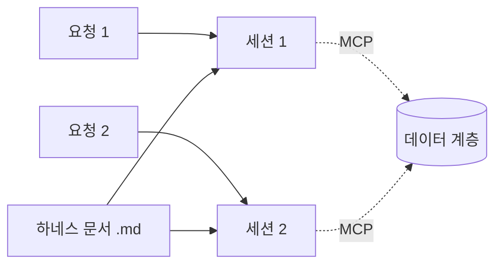

# 0029. Claude Code는 하네스 문서로 동작 원칙을 받고, 작업 하나에 세션 하나로 띄운다

- 상태: 채택
- 날짜: 2026-10-21

## 배경

1단계 에이전트는 Claude Code다 ([0023](0023-claude-code-first-then-own-agent.md)). Claude Code를 어떻게 다루고 어떻게 띄워 이어 쓸지 정해야 했다.

## 결정

- **동작 원칙은 Claude Code의 하네스 문서(.md)가 정한다. 데이터는 데이터 계층([0027](0027-data-layer-ownership.md))과 주고받는다.** 사용자가 정했다.
- **Claude Code는 파이썬 Agent SDK로 띄운다** (`ClaudeSDKClient`). 질문·권한 요청을 콜백(`can_use_tool`)으로 받고 크롬 조작이 켜지는 것을 [스파이크](../spikes/2026-10-21-agent-sdk-claude-code.md)로 확인했다. Claude가 제안하고 사용자가 수용했다 (2026-10-21).
- **작업 하나 = 세션 하나.** Claude가 제안하고 사용자가 수용했다.
  - 새 요청은 새 Claude Code 세션으로 시작한다.
  - 지난 맥락("아까 그거")은 Claude Code 세션이 아니라 데이터 계층(작업 기록, 화면 기록)에서 MCP로 찾는다.
  - 같은 작업 안에서 질문에 답하거나 덧붙일 때만 그 세션을 이어 간다.

## 검토한 대안

| 대안 | 장점 | 단점 | 채택하지 않은 이유 |
|---|---|---|---|
| 요청마다 같은 세션을 이어 쓴다 (`--resume`) | 대화 맥락이 Claude Code 안에 남는다 | 기억이 Claude Code 세션에 묶여 2단계 교체 때 잃는다 | 데이터는 데이터 계층과 주고받기로 했다 |
| Claude Code 하나를 계속 띄워 둔다 (`--input-format stream-json`) | 시작이 빠르다 | 기억이 프로세스에 묶인다. 프로세스 관리가 복잡하다 | 같은 이유 |

## 결과

- Claude Code는 기억을 갖지 않는 실행기다. 2단계에서 직접 만든 에이전트로 바꿔도 기억은 데이터 계층에 남는다.
- 새 세션마다 시작에 몇 초가 걸린다.
- 확인함 (2026-10-21, [스파이크](../spikes/2026-10-21-agent-sdk-claude-code.md)): 파이썬 Agent SDK로 띄우면 크롬 조작이 켜지고, 질문·권한 요청이 콜백으로 오며, 선택지 밖의 글로도 답할 수 있다.

## 하네스 문서 목차 (Claude 제안, 사용자 수용, 2026-10-21)

1. 역할 — 이 조수는 누구이고 무엇을 하나
2. 맥락 찾기 — 요청을 받으면 화면 기록·작업 기록을 먼저 찾아본다 ([0026](0026-input-layer-passes-request-only.md), [0027](0027-data-layer-ownership.md))
3. 일하는 방식 — 진행을 어떻게 알리나, 언제 사용자에게 묻나
4. 하지 말 것 — 금지 동작
5. 말투 — 사용자에게 쓰는 글의 모양

### 1. 역할 (Claude 초안, 사용자 수용)

> 너는 사용자의 Windows PC에서 일하는 조수다.
> 사용자가 무엇을 보며 무엇을 해 왔는지(화면 기록)를 알고 있으므로, 사용자가 맥락을 일일이 설명하지 않아도 하고자 하는 일을 알아듣는다.
> 사용자의 요청을 받아 대답하거나, 사용자가 보고 있는 브라우저를 직접 조작해 일을 처리한다.
> 정해 둔 시간에 스스로 일하기도 한다(스케줄 작업).
> 화면 한 자리에 강아지 모습으로 있다.

나머지 칸(3~5)의 내용은 아직 정하지 않았다.

