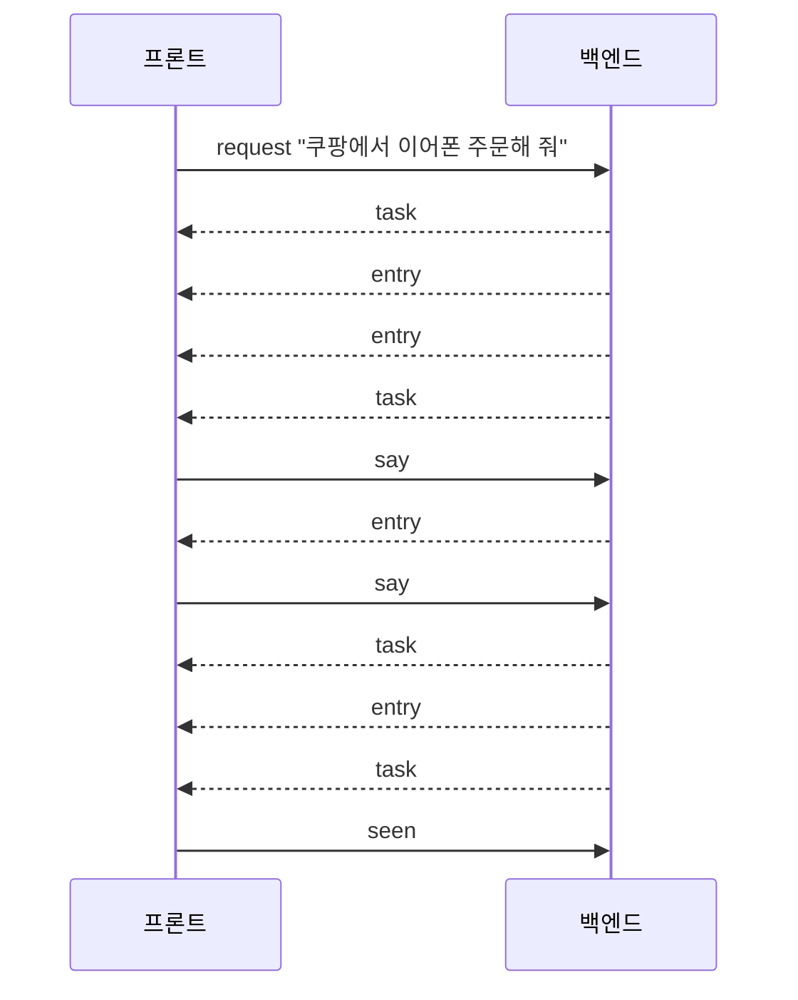

# 0030. 입출력 인터페이스: 작업 하나를 대화 하나로 보고 주고받는다

- 상태: 채택 (백엔드 구현: [프로토콜 v6](../backend-protocol.md). 화면은 화면 계획에서 구현)
- 날짜: 2026-10-21

## 배경

출력 계층 디자인([design/2026-10-21-output-ui](../design/2026-10-21-output-ui/README.md))이 나오면서 처음 인터페이스 초안을 고쳐야 했다.

- 작업이 여러 개 동시에 돈다.
- 작업 대화 안에서 사용자가 언제든 말을 덧붙인다.
- 앱을 다시 켜면 지난 작업과 대화를 불러온다.
- 스케줄 목록을 보여 준다.
- 되물음에 대한 대답과 새 질문을 구분할지 정해야 한다.

## 결정

**작업 하나 = 대화 하나.** 진행, 질문, 결과, 사용자의 말이 모두 그 작업 대화에 한 줄씩 쌓인다. Claude가 제안하고 사용자가 수용했다.

### 프론트 → 백엔드

| 메시지 | 담는 것 | 언제 |
|---|---|---|
| `request` | 글 | 새 작업 화면에서 새 일을 시킬 때 (작업 탭의 "새 작업" 버튼으로 연다) |
| `say` | 작업 ID, 글 | 작업 대화 안에서 말할 때. 질문에 대한 답, 덧붙이기, 되물음 모두 |
| `stop` | 작업 ID | 멈출 때 |
| `seen` | 작업 ID | 사용자가 그 작업을 열어 봤을 때 |
| `list_tasks` | 쪽 번호 | 작업 탭·알림 탭을 열 때, 앱을 다시 켰을 때 |
| `get_task` | 작업 ID | 작업 대화를 열 때 |
| `list_schedules` | 쪽 번호 | 스케줄 탭을 열 때 |
| `hello` | v5 그대로 | 접속 인증 |
| `login` | 없음 | 사용자가 설정 탭의 로그인 버튼을 눌렀을 때. 백엔드가 `claude auth login`(구독 로그인)을 띄운다 |
| `logout` | 없음 | 설정 탭의 로그아웃 버튼. 백엔드가 `claude auth logout`을 부른다 (2026-10-21 더함, 사용자) |
| `set_recording` | 켬/끔 | 설정 탭의 화면 기록 스위치. 백엔드가 screenpipe를 띄우거나 끈다 (2026-10-21 더함, 사용자) |

### 백엔드 → 프론트

| 메시지 | 담는 것 | 언제 |
|---|---|---|
| `task` | 작업 ID, 출처(사용자·스케줄), 제목, 상태, 봤는지 | 작업이 생기거나 상태가 바뀔 때 |
| `entry` | 작업 ID, 대화 한 줄 | 작업 대화에 한 줄이 쌓일 때 |
| `tasks` | 작업 목록 한 쪽 | `list_tasks`의 답 |
| `task_detail` | 작업 하나와 대화 전체 | `get_task`의 답 |
| `schedules` | 스케줄 목록 한 쪽 | `list_schedules`의 답 |
| `status` | 로그인됨 / 안 됨 | 접속할 때와 로그인 상태가 바뀔 때. 백엔드가 `claude auth status`로 확인한다 |

- **작업 상태**: 일하는 중, 답 기다림, 다 함, 못 함, 멈춤.
- **대화 한 줄의 종류**: 사용자 말, 진행, 질문(고를 답이 있으면 함께), 결과, 실패.
- **배지**는 프론트가 작업 상태로 센다. 빨강은 답 기다림, 노랑은 못 함이면서 안 봄, 초록은 다 함이면서 안 봄.
- **되물음과 새 질문을 구분하지 않는다.** 사용자의 말은 무엇이든 `say` 하나로 보내고, 뜻은 에이전트가 알아듣는다. 고를 답 버튼은 그 글을 `say`로 보내는 것과 같다.

### 예

## 검토한 대안

| 대안 | 장점 | 단점 | 채택하지 않은 이유 |
|---|---|---|---|
| 처음 초안: `reply`(질문 ID에 대한 답)와 `progress`·`question`·`result` 등 메시지를 따로 | 메시지마다 뜻이 분명하다 | 덧붙이기·되물음을 담지 못한다. 지난 작업을 불러오지 못한다 | 디자인의 작업 대화와 맞지 않는다 |
| 되물음에 대한 대답과 새 질문을 메시지로 구분 | 프론트가 둘을 다르게 보일 수 있다 | 사용자가 무엇을 하는지 프론트가 판단해야 한다 | 뜻은 에이전트가 알아듣기로 했다 |

## 결과

- 작업 기록([0027](0027-data-layer-ownership.md))에 작업 상태, 봤는지, 대화 한 줄들이 저장되어야 한다.
- 작업 대화가 오래 남으므로 앱을 다시 켜도 `list_tasks`·`get_task`로 되살린다.

## 수정 (2026-10-21)

- 디자인 변경: 키 입력 요청 대신 **Claude 로그인 요청**을 보인다 (사용자).
- 그래서 `set_key`를 빼고 `login`을 더했다. `status`는 키 상태 대신 로그인 상태를 알린다. 설정 창의 TypeSafe·Gemini 키 입력칸은 쓸 곳이 없어 뺀다 (Claude 제안, 사용자 수용).
- 확인한 것: `claude auth status`는 `loggedIn`, `authMethod`(`claude.ai`), `subscriptionType`을 JSON으로 준다. `claude auth login`에는 `--claudeai`(기본), `--email`, `--sso` 옵션이 있다 (Claude Code 2.1.305). 로그아웃 상태에서 `claude auth login`을 띄워 브라우저가 열리고 끝남을 알아차리는지는 아직 시험하지 않았다.
- 문서 확인 ([CLI 레퍼런스](https://code.claude.com/docs/en/cli-reference.md)): `claude auth status`는 로그인되어 있으면 종료 코드 0, 아니면 1이다. 로그인 끝남을 알리는 신호는 문서에 없다. `claude auth login` 프로세스가 끝나기를 기다린 뒤 `claude auth status`로 확인하는 방법을 시험해야 한다.
- **약관 주의** ([Agent SDK 개요](https://code.claude.com/docs/en/agent-sdk/overview.md)): "사전 승인 없이 제3자 개발자가 자기 제품에서 claude.ai 로그인을 제공하는 것을 허용하지 않는다." 개인·내부 앱 예외는 문서에 없다. 1단계 기술 프로토타입(개발자 본인 PC)을 넘어 다른 사람에게 쓰게 하기 전에 Anthropic 승인을 받거나 API 키 방식으로 바꿔야 한다. [0023](0023-claude-code-first-then-own-agent.md)의 결과와 같은 제약이다.

## 수정: 설정 탭과 사용량 탭 (2026-10-21)

디자인에 설정 탭(권한 모드)과 사용량 탭(구독 사용량 한도)이 생겨(사용자) 메시지를 더한다. 메시지 정의는 사용자가 Claude에 맡겼다.

| 방향 | 메시지 | 담는 것 | 언제 |
|---|---|---|---|
| 프론트 → 백엔드 | `get_settings` | 없음 | 설정 탭을 열 때 |
| 프론트 → 백엔드 | `set_permission_mode` | 권한 모드(`default`, `acceptEdits`, `plan`, `auto`, `bypassPermissions`) | 설정 탭에서 바꿀 때. 새 작업부터 적용 |
| 백엔드 → 프론트 | `settings` | 지금 권한 모드, 화면 기록 켬/끔 | `get_settings`의 답, 바뀌었을 때 |
| 프론트 → 백엔드 | `get_usage` | 없음 | 사용량 탭을 열 때 |
| 백엔드 → 프론트 | `usage` | 한도 종류별 쓴 비율, 초기화 시각, 마지막으로 받은 시각 | `get_usage`의 답, 값이 바뀌었을 때 |

권한 모드는 백엔드가 설정 데이터로 저장한다([0027](0027-data-layer-ownership.md)의 설정·키 줄에 더함).

## 수정: 스케줄 (2026-10-21)

스케줄 = 세션 하나 = 작업 하나([0032](0032-schedule-creation.md))라서 작업 메시지(`get_task`, `say`, `stop`, `entry`, `task`)를 그대로 쓴다. 스케줄에만 필요한 것을 더한다. Claude가 제안하고 사용자가 수용했다. 켜고 끄기는 사용자가 넣기로 했다.

| 방향 | 메시지 | 담는 것 | 언제 |
|---|---|---|---|
| 프론트 → 백엔드 | `add_schedule` | 이름, 언제, 할 일 | 스케줄 탭의 새 스케줄 양식에서 [등록]할 때. 확인 없이 바로 저장한다. 세션은 첫 실행 때 연다 (2026-10-21 고침: 자유 글 `schedule_request` 대신 양식, 사용자) |
| 프론트 → 백엔드 | `set_schedule` | 작업 ID, 이름, 언제, 할 일 | 지시서 수정 양식에서 저장할 때 |
| 프론트 → 백엔드 | `set_schedule_enabled` | 작업 ID, 켬/끔 | 켜고 끌 때 |
| 백엔드 → 프론트 | `schedules` | 목록 한 쪽: 작업 ID, 이름, 언제, 상태(도는 중 / 다음 실행 시각 / 꺼짐) | `list_schedules`의 답 |
| 백엔드 → 프론트 | `schedule` | 이름, 언제, 할 일, 켜짐, 다음 실행, 마지막 실행 | 스케줄이 바뀌었을 때 |

- "언제"는 글이 아니라 구조(반복, 시각, 요일, 날짜)다. 모양은 [0032](0032-schedule-creation.md)의 "언제와 권한" 절.
- 등록 확인 카드는 에이전트에게 말로 시켜 만들 때만 대화에 생긴다.
- `task_detail`은 출처가 스케줄이면 지시서도 함께 담는다.
- [등록]과 "이 스케줄에 말하기"는 `say`로 보낸다.
- 대화 한 줄의 종류를 셋 더한다: **등록 확인**(이름, 언제, 할 일, 첫 실행. [등록] [고치기] 카드), **실행 구분선**("10/21 09:00 실행"), **지시서 수정**("작업 지시서에 '뉴스레터는 뺀다'를 넣었어요").

## 수정: 대화 탭 (2026-10-21)

[0033](0033-chat-tab-single-session.md)의 대화 탭도 작업 하나로 다룬다. 출처가 '대화'인 작업이다. 새 메시지는 더하지 않는다. Claude가 제안하고 사용자가 수용했다.

- 대화 작업은 하나뿐이다. 백엔드가 앱을 처음 켤 때 만들고, 그 뒤로 같은 Claude Code 세션을 이어 쓴다.
- 접속하면 백엔드가 대화 작업의 `task`를 보낸다. 프론트는 그 작업 ID로 `get_task`(대화 탭 열기)와 `say`(말하기)를 쓴다.
- 대화 작업은 `list_tasks`의 작업 목록에 넣지 않고, 알림과 배지에도 세지 않는다. 대화에서 만든 작업·스케줄은 평소대로 센다.
- 대화로 일을 맡기면 에이전트가 백엔드 도구 `create_task`로 새 작업(새 세션)을 만든다. 대화에는 **작업 칩** 줄이 남고, 누르면 그 작업 대화로 간다. 대화 한 줄의 종류에 작업 칩을 더한다.
- 대화로 스케줄을 만들면 지금처럼 `create_schedule`로 등록 확인 카드를 거친다.

## 수정: 지우기 (2026-10-22)

> **v7 이름.** 이 절은 v6 때 쓴 것이다. v7은 `task`를 `session`으로 바꿨다([0034](0034-session-as-top-level-term.md)). 아래 `delete_task`는 `delete_session`, `task_deleted`는 `session_deleted`, "작업 ID"는 `session_id`다. 지금 이름은 [backend-protocol.md](../backend-protocol.md)가 기준이다.

대화·작업·스케줄(= 세션)은 지울 수 있어야 한다(사용자). 메시지는 Claude가 제안하고 사용자가 수용했다.

| 방향 | 메시지 | 담는 것 | 언제 |
|---|---|---|---|
| 프론트 → 백엔드 | `delete_task` | 작업 ID | 지우기 확인에서 [지우기]를 눌렀을 때. 작업·스케줄·대화 탭 모두 같은 메시지 |
| 백엔드 → 프론트 | `task_deleted` | 작업 ID | 지운 뒤. 프론트는 목록·배지에서 뺀다 |

- 백엔드는 돌고 있거나 답을 기다리는 작업이면 먼저 멈춘 뒤, 그 작업의 대화 기록(스케줄이면 지시서까지)을 지운다.
- 대화 탭을 지우면 대화 기록을 비우고 새 세션으로 다시 시작한다. 대화 작업은 늘 하나 남고, 백엔드가 새 `task`를 보낸다.

## 수정: 준비 중 표시 (2026-10-22)

> **v7 이름.** 이 절은 v6 때 쓴 것이다. v7은 `task`를 `session`으로 바꿨다([0034](0034-session-as-top-level-term.md)). 아래 `activity`의 "작업 ID"는 `session_id`다. 지금 이름은 [backend-protocol.md](../backend-protocol.md)가 기준이다.

대답을 준비하는 동안 지금 무엇을 하는지(준비 중, 생각 중, 실행 중)가 보여야 한다(사용자). 메시지는 Claude가 제안하고 사용자가 수용했다.

| 방향 | 메시지 | 담는 것 | 언제 |
|---|---|---|---|
| 백엔드 → 프론트 | `activity` | 작업 ID, 종류(생각 중 / 도구 실행 중 / 답 쓰는 중), 글 | 대답을 준비하는 동안 하는 일이 바뀔 때 |

- 백엔드는 Claude Code를 스트리밍으로 띄워(`include_partial_messages`) 도중 이벤트를 받는다. 새 블록이 시작될 때 종류(생각·도구·글)를 보고 `activity`를 보낸다. 도구는 이름을 사람이 읽을 말로 바꿔 글에 담는다.
- 프론트는 대화 맨 아래에 "지금 하는 일" 줄로 보이고, 첫 `activity`부터 걸린 시간을 센다. 결과·실패·질문 `entry`가 오거나 멈추면 줄을 지운다.
- `activity`는 대화 기록(`entries`)에 남기지 않는다.

## 수정: 화면 기록 폴더와 비우기 (2026-10-22)

설정 탭에 screenpipe 기록 폴더 위치와 용량을 보이고, 비우기 버튼을 둔다(사용자). 메시지는 Claude가 제안하고 사용자가 수용했다.

| 방향 | 메시지 | 담는 것 | 언제 |
|---|---|---|---|
| 프론트 → 백엔드 | `clear_recording` | 없음 | 비우기 확인에서 [비우기]를 눌렀을 때 |
| 백엔드 → 프론트 | `settings` | (기존 칸에 더해) 기록 폴더 경로, 기록 용량(바이트) | `get_settings`의 답, 비운 뒤, 바뀌었을 때 |

- 백엔드는 screenpipe를 멈춘 뒤 기록 폴더를 지운다. 쓰는 중에 지우면 기록 DB가 깨질 수 있어서다. 화면 기록이 켜져 있었으면 다시 띄운다.
- 용량은 설정 탭을 열 때와 비운 뒤에 다시 잰다.

## 수정: 연결된 MCP 목록 (2026-10-22)

설정 탭에 연결된 MCP 목록을 보여 주는 칸을 둔다(사용자). 메시지는 Claude가 제안하고 사용자가 수용했다.

| 방향 | 메시지 | 담는 것 | 언제 |
|---|---|---|---|
| 백엔드 → 프론트 | `settings` | (기존 칸에 더해) MCP 목록: 이름, 하는 일, 상태(연결됨 / 연결 안 됨 / 확인 중) | `get_settings`의 답, 상태가 바뀌었을 때 |

- 상태는 Claude Code가 세션을 시작할 때 보내는 `init` 시스템 메시지의 MCP 서버 상태에서 받아, 백엔드가 서버마다 마지막 값을 보관한다. 아직 세션을 띄운 적이 없거나 연결을 기다리는 중이면 "확인 중"이다.
- 하는 일 설명은 백엔드 설정에 서버 이름별로 둔 문구다. 보기만 하고, 추가·삭제는 없다.
- 이 프로그램의 파이썬 백엔드 MCP(`backend`)는 내부라 목록에서 뺀다(사용자). 외부 MCP(`screenpipe`, `claude-in-chrome`)만 보인다.
- 수정 (2026-10-22): 목록은 연결된 MCP 전부다(claude.ai 커넥터 포함). 파이썬 백엔드 MCP(`backend`)만 뺀다(사용자). 상태는 백엔드가 시작할 때 Claude Code를 질문 없이 잠깐 붙여 한 번 읽고(`get_mcp_status`, 연결 중이면 1초마다 다시 읽음, 10초 제한), 그 뒤로는 세션 `init`의 `mcp_servers`로 고친다. 그래서 세션을 띄운 적이 없어도 "확인 중"에 머물지 않는다. 자세한 값은 [연결된 MCP 목록 계획](../superpowers/plans/2026-10-22-mcp-list.md)과 [프로토콜](../backend-protocol.md) "연결된 MCP".
