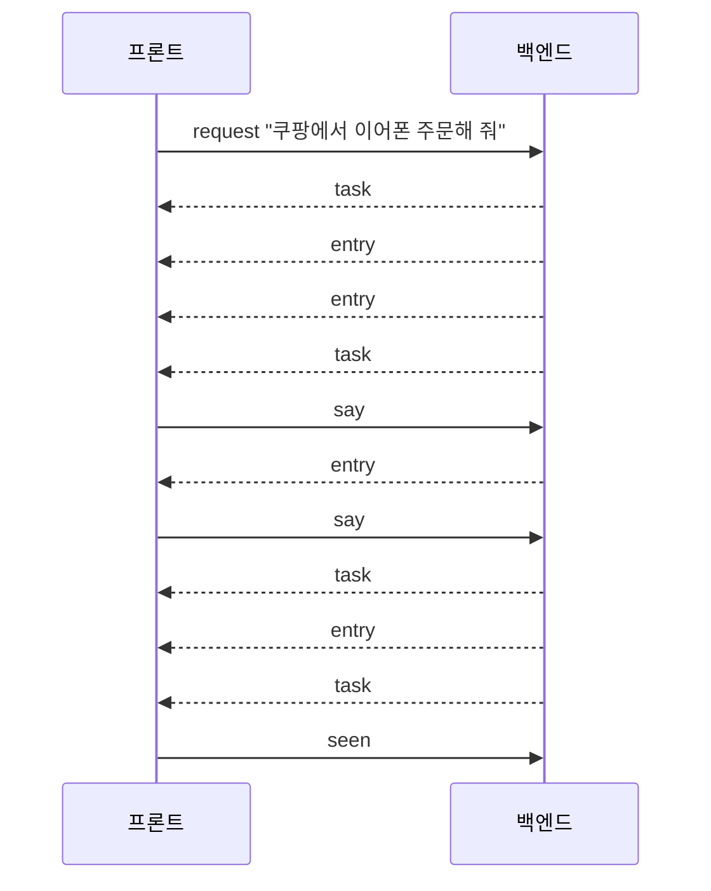

# 0030. 입출력 인터페이스: 작업 하나를 대화 하나로 보고 주고받는다

- 상태: 채택 (구현 전. 구현할 때 [프로토콜](../brain-protocol.md)을 v6으로 바꾼다)
- 날짜: 2026-10-21

## 배경

출력 계층 디자인([design/2026-10-21-output-ui](../design/2026-10-21-output-ui/README.md))이 나오면서 처음 인터페이스 초안을 고쳐야 했다.

- 작업이 여러 개 동시에 돈다.
- 작업 대화 안에서 사용자가 언제든 말을 덧붙인다.
- 앱을 다시 켜면 지난 작업과 대화를 불러온다.
- 스케줄 목록을 보여 준다.
- 되물음에 대한 대답과 새 질문을 구분할지 정해야 한다.

## 결정

**작업 하나 = 대화 하나.** 진행, 질문, 결과, 사용자의 말이 모두 그 작업 대화에 한 줄씩 쌓인다. Claude가 제안하고 사용자가 수용했다.

### 프론트 → 백엔드

| 메시지 | 담는 것 | 언제 |
|---|---|---|
| `request` | 글 | 입력칸에서 새 일을 시킬 때 |
| `say` | 작업 ID, 글 | 작업 대화 안에서 말할 때. 질문에 대한 답, 덧붙이기, 되물음 모두 |
| `stop` | 작업 ID | 멈출 때 |
| `seen` | 작업 ID | 사용자가 그 작업을 열어 봤을 때 |
| `list_tasks` | 쪽 번호 | 작업 탭·알림 탭을 열 때, 앱을 다시 켰을 때 |
| `get_task` | 작업 ID | 작업 대화를 열 때 |
| `list_schedules` | 쪽 번호 | 스케줄 탭을 열 때 |
| `hello` | v5 그대로 | 접속 인증 |
| `login` | 없음 | 사용자가 로그인 버튼을 눌렀을 때. 백엔드가 `claude auth login`(구독 로그인)을 띄운다 |

### 백엔드 → 프론트

| 메시지 | 담는 것 | 언제 |
|---|---|---|
| `task` | 작업 ID, 출처(사용자·스케줄), 제목, 상태, 봤는지 | 작업이 생기거나 상태가 바뀔 때 |
| `entry` | 작업 ID, 대화 한 줄 | 작업 대화에 한 줄이 쌓일 때 |
| `tasks` | 작업 목록 한 쪽 | `list_tasks`의 답 |
| `task_detail` | 작업 하나와 대화 전체 | `get_task`의 답 |
| `schedules` | 스케줄 목록 한 쪽 | `list_schedules`의 답 |
| `status` | 로그인됨 / 안 됨 | 접속할 때와 로그인 상태가 바뀔 때. 백엔드가 `claude auth status`로 확인한다 |

- **작업 상태**: 일하는 중, 답 기다림, 다 함, 못 함, 멈춤.
- **대화 한 줄의 종류**: 사용자 말, 진행, 질문(고를 답이 있으면 함께), 결과, 실패.
- **배지**는 프론트가 작업 상태로 센다. 빨강은 답 기다림, 노랑은 못 함이면서 안 봄, 초록은 다 함이면서 안 봄.
- **되물음과 새 질문을 구분하지 않는다.** 사용자의 말은 무엇이든 `say` 하나로 보내고, 뜻은 에이전트가 알아듣는다. 고를 답 버튼은 그 글을 `say`로 보내는 것과 같다.

### 예

## 검토한 대안

| 대안 | 장점 | 단점 | 채택하지 않은 이유 |
|---|---|---|---|
| 처음 초안: `reply`(질문 ID에 대한 답)와 `progress`·`question`·`result` 등 메시지를 따로 | 메시지마다 뜻이 분명하다 | 덧붙이기·되물음을 담지 못한다. 지난 작업을 불러오지 못한다 | 디자인의 작업 대화와 맞지 않는다 |
| 되물음에 대한 대답과 새 질문을 메시지로 구분 | 프론트가 둘을 다르게 보일 수 있다 | 사용자가 무엇을 하는지 프론트가 판단해야 한다 | 뜻은 에이전트가 알아듣기로 했다 |

## 결과

- 작업 기록([0027](0027-data-layer-ownership.md))에 작업 상태, 봤는지, 대화 한 줄들이 저장되어야 한다.
- 작업 대화가 오래 남으므로 앱을 다시 켜도 `list_tasks`·`get_task`로 되살린다.

## 수정 (2026-10-21)

- 디자인 변경: 키 입력 요청 대신 **Claude 로그인 요청**을 보인다 (사용자).
- 그래서 `set_key`를 빼고 `login`을 더했다. `status`는 키 상태 대신 로그인 상태를 알린다. 설정 창의 TypeSafe·Gemini 키 입력칸은 쓸 곳이 없어 뺀다 (Claude 제안, 사용자 수용).
- 확인한 것: `claude auth status`는 `loggedIn`, `authMethod`(`claude.ai`), `subscriptionType`을 JSON으로 준다. `claude auth login`에는 `--claudeai`(기본), `--email`, `--sso` 옵션이 있다 (Claude Code 2.1.305). 로그아웃 상태에서 `claude auth login`을 띄워 브라우저가 열리고 끝남을 알아차리는지는 아직 시험하지 않았다.
- 문서 확인 ([CLI 레퍼런스](https://code.claude.com/docs/en/cli-reference.md)): `claude auth status`는 로그인되어 있으면 종료 코드 0, 아니면 1이다. 로그인 끝남을 알리는 신호는 문서에 없다. `claude auth login` 프로세스가 끝나기를 기다린 뒤 `claude auth status`로 확인하는 방법을 시험해야 한다.
- **약관 주의** ([Agent SDK 개요](https://code.claude.com/docs/en/agent-sdk/overview.md)): "사전 승인 없이 제3자 개발자가 자기 제품에서 claude.ai 로그인을 제공하는 것을 허용하지 않는다." 개인·내부 앱 예외는 문서에 없다. 1단계 기술 프로토타입(개발자 본인 PC)을 넘어 다른 사람에게 쓰게 하기 전에 Anthropic 승인을 받거나 API 키 방식으로 바꿔야 한다. [0023](0023-claude-code-first-then-own-agent.md)의 결과와 같은 제약이다.
