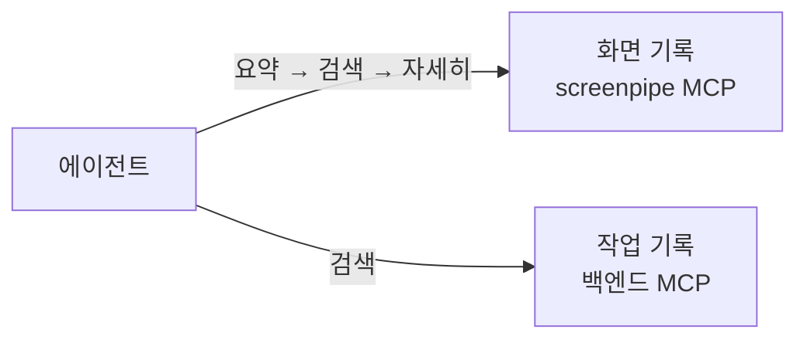

# 0031. 에이전트는 데이터 계층을 검색 도구로 직접 찾아본다 (의미 검색은 나중에)

- 상태: 채택
- 날짜: 2026-10-21

## 배경

입력 계층은 요청만 넘기고([0026](0026-input-layer-passes-request-only.md)), 맥락은 에이전트가 데이터 계층([0027](0027-data-layer-ownership.md))에서 찾는다. 작업 기록을 어떻게 저장할지는 에이전트가 기록을 어떻게 찾느냐(검색 방식)에 달려 있어, 검색 방식을 먼저 정해야 했다 (사용자 지적).

screenpipe 공개 코드(2026-10-21 확인)의 조회 방식:

- MCP 도구 `activity-summary`(기간 요약), `search-content`(검색어 + 기간·앱·창 거름), `keyword-search`(SQLite FTS5 키워드), `search-elements`(화면 요소), `frame-context`(캡처 한 장의 전체 글자·구조·주소). 같은 기능을 REST(`localhost:3030`)와 SQL로도 연다.
- 임베딩 의미 검색은 없다. `screenpipe-semantic`은 앱 화면을 규칙대로 해석하는 파서다.

## 결정

에이전트가 **검색 도구를 여러 번 불러 스스로 좁혀 가며 찾는다**. 키워드와 기간 같은 거름 조건으로 찾는다. 의미 검색(임베딩) 같은 RAG 고도화는 나중에 한다. Claude가 제안하고 사용자가 정했다.

## 검토한 대안

| 대안 | 장점 | 단점 | 채택하지 않은 이유 |
|---|---|---|---|
| 의미 검색 (임베딩 + 벡터 색인) | 말이 달라도 뜻이 같으면 찾는다 | 임베딩 모델과 색인을 만들어야 한다 | 1단계에는 과하다. 나중에 고도화한다 |
| 백엔드가 미리 찾아 컨텍스트에 넣어 주기 | 에이전트가 찾지 않아도 된다 | 무엇이 관련 있는지 백엔드가 미리 판단해야 한다 | 맥락은 에이전트가 찾기로 했다(0026) |

## 결과

- 작업 기록도 키워드·기간으로 찾는 도구를 열어 screenpipe와 같은 방식으로 맞춘다.
- 백엔드 MCP의 서버 이름은 처음 `assistant`였다. → `backend`로 바꿈(도구 접두사 `mcp__backend__`, 2026-10-22, 사용자: `assistant`는 헷갈린다. [연결된 MCP 목록 계획](../superpowers/plans/2026-10-22-mcp-list.md)).
- 할 일: RAG 고도화(의미 검색 등). "뜻은 같은데 말이 달라 못 찾는" 경우가 쌓이면 다시 본다.
