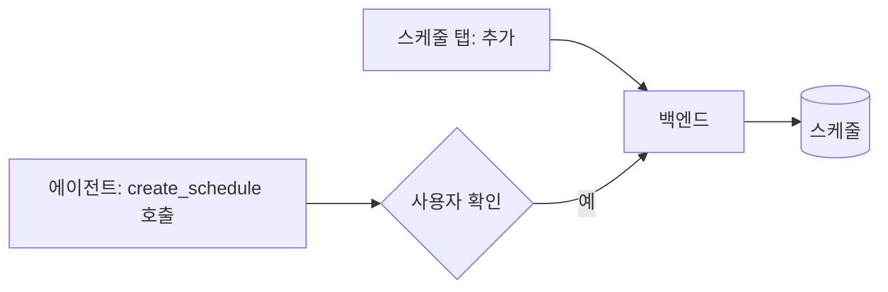

# 0032. 스케줄은 스케줄 탭과 에이전트 둘 다로 만들고, 만들기 전에 확인받는다

- 상태: 채택
- 날짜: 2026-10-21
- 수정: [0027](0027-data-layer-ownership.md)의 "에이전트는 읽기만 한다"

## 배경

스케줄을 어떻게 만들지 정해야 했다. 말로 시키는 경우 에이전트가 스케줄을 써야 해서, 0027의 "에이전트는 읽기만 한다"와 부딪히는 것처럼 보였다.

사용자가 짚었다. 에이전트가 백엔드의 스케줄 생성 도구를 부르면 실제로 쓰는 것은 백엔드다. "쓰는 주체는 하나" 원칙은 그대로다.

## 결정

사용자가 정했다.

- 스케줄은 **두 길 모두로** 만든다.
  - **스케줄 탭에서 추가**한다. 이것이 기본 경로다.
  - **에이전트에게 메시지로** 시켜도 된다. 예: "매일 오후 6시에 오늘 슬랙에서 나한테 온 요청 정리해 줘".
- 에이전트를 통해 만들 때는 **확인받고 만든다**. 에이전트가 알아들은 일정과 내용을 작업 대화의 질문 줄로 보이고, 사용자가 확인해야 백엔드가 저장한다.
- **에이전트는 자기 작업 창 안에 엄격하게 갇히지 않는다.** 이번 일만이 아니라, 백엔드가 여는 도구를 불러 앱 기능을 쓰는 유연성을 갖는다. 실제로 데이터를 쓰는 주체는 백엔드다.

## 검토한 대안

| 대안 | 장점 | 단점 | 채택하지 않은 이유 |
|---|---|---|---|
| 에이전트는 읽기 도구만 갖는다 | 에이전트가 속아도 데이터를 바꾸지 못한다 | 말로 스케줄을 만들 수 없다. 에이전트가 앱 기능을 쓰지 못한다 | 사용자가 에이전트의 유연성을 택했다 |
| 에이전트가 확인 없이 바로 만든다 | 빠르다 | 잘못 알아듣거나 숨은 지시에 넘어갔을 때 막지 못한다 | 사용자가 확인을 택했다 |

## 결과

- 백엔드는 에이전트에게 `create_schedule` 도구를 연다. 이 도구는 저장 전에 확인 질문을 띄운다.
- 디자인의 스케줄 탭에 "추가"가 필요하다. 디자인 README의 열린 질문("스케줄 표에서 켜고 끄기·추가·편집을 할지") 가운데 추가는 하기로 정했다. 켜고 끄기·편집은 아직 정하지 않았다.
