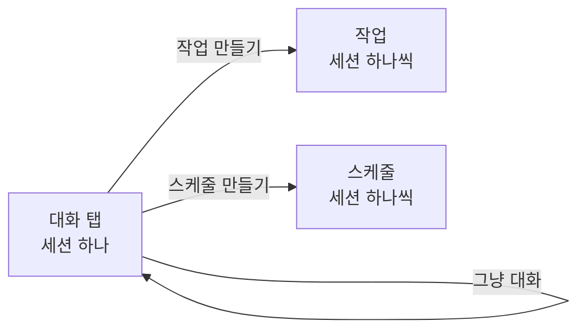

# 0033. 대화 탭은 Claude Code 세션 하나로 그냥 대화한다

- 상태: 채택
- 날짜: 2026-10-21
- 관련: [0029](0029-claude-code-harness-and-session-per-task.md)(작업 하나 = 세션 하나), [0032](0032-schedule-creation.md)(스케줄 = 세션 하나)

## 배경

지금까지 Claude Code와 이야기하는 길은 작업과 스케줄뿐이었다. 둘 다 일을 맡기는 단위라, 일을 맡기지 않고 묻거나 이야기만 하고 싶을 때 쓸 곳이 없었다.

## 결정

사용자가 정했다.

- 패널에 **대화** 탭을 둔다. Claude Code와 그냥 대화하는 채팅 화면이다.
- 대화는 **세션을 늘리지 않는다. 세션 하나만** 쓴다.
- 대화로 **작업이나 스케줄을 만들 수도** 있고, **그냥 대화만** 할 수도 있다.
- 대화도 작업·스케줄처럼 **세션 데이터로 관리**한다. 다만 **'대화'로 구분**해서 관리한다.

## 검토한 대안

| 대안 | 장점 | 단점 | 채택하지 않은 이유 |
|---|---|---|---|
| 대화도 열 때마다 새 세션 | 대화끼리 맥락이 섞이지 않는다 | 세션이 쌓인다. 앞서 한 이야기를 이어 가지 못한다 | 사용자가 세션 하나를 택했다 |
| 대화 탭 없이 작업으로만 이야기 | 구조가 단순하다 | 일을 맡기지 않는 이야기도 작업이 되어 작업 목록이 어지럽다 | 사용자가 대화 탭을 택했다 |

## 결과

- 세션 데이터의 종류(출처)는 사용자 작업, 스케줄, 대화 셋이 된다.
- 프로토콜과 백엔드 동작은 [0030](0030-io-interface-task-as-conversation.md)의 "수정: 대화 탭" 절과 [1단계 스펙](../superpowers/specs/2026-10-21-assistant-phase1-design.md)에 적었다 (Claude 제안, 사용자 수용).
- 화면: [디자인](../design/2026-10-21-output-ui/README.md)의 18번 아트보드.
