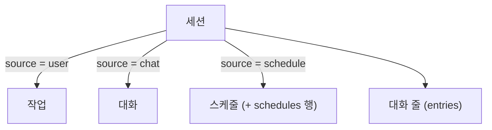

# 0034. 상위 단위의 이름을 '작업'에서 '세션'으로 바꾼다

- 상태: 채택 (`create_task`를 두는 부분은 [0035](0035-create-session-from-any-session.md)로 대체)
- 날짜: 2026-10-22
- 수정: [0029](0029-claude-code-harness-and-session-per-task.md), [0030](0030-io-interface-task-as-conversation.md), [0033](0033-chat-tab-single-session.md)의 용어. 동작은 그대로다.

## 배경

`tasks` 테이블의 한 행은 대화 줄을 담고 Claude Code 세션 하나와 묶이는 대화 단위다. 그런데 이름이 '작업'이라, 작업이 아닌 대화 탭과 스케줄까지 '작업'으로 불렸다. 사용자가 이 행이 실제로는 세션이고, 작업·대화·스케줄은 세션의 종류라고 짚었다.

## 결정

상위 단위를 **세션**이라 부른다. 작업·대화·스케줄은 세션의 종류(`source`)다. 문서와 코드 모두 바꾼다 (사용자).

### 이름 대응

규칙: 종류와 상관없이 세션 전체를 가리키는 이름은 `session`으로 바꾼다. 작업 종류(`source = user`)나 작업 탭·작업 화면만 가리키는 이름은 `task`로 둔다.

| 구분 | 이전 | 이후 |
|---|---|---|
| DB 테이블 | `tasks` | `sessions` |
| DB 열 (Claude Code 세션 ID) | `tasks.session_id` | `sessions.claude_session_id` |
| DB 열 (참조) | `entries.task_id`, `schedules.task_id` | `session_id` |
| 검색 색인 | `task_text(task_id, text)` | `session_text(session_id, text)` |
| 프로토콜 보내는 메시지 | `task`(필드 `task`), `tasks`, `task_detail`(필드 `task`) | `session`(필드 `session`), `sessions`, `session_detail`(필드 `session`) |
| 프로토콜 받는 메시지 | `list_tasks`, `get_task` | `list_sessions`, `get_session` |
| 프로토콜 필드 | `task_id` (모든 메시지·`Entry`·`Schedule`·`ScheduleRow`) | `session_id` |
| 작업 칩 줄의 `data` | `{"task_id": N}` | `{"session_id": N}` |
| 프로토콜 버전 | 6 | 7 |
| 백엔드 Tools | `recent_tasks`, `search_tasks`, `get_task`, `set_task_title` | `recent_sessions`, `search_sessions`, `get_session`, `set_session_title` |
| 그대로 두는 것 | `create_task`(작업 종류 세션을 만든다), `source` 값 `user`·`chat`·`schedule`, 목록 `view` 값 `user`·`alerts`, 화면의 작업 탭·`task` 화면, 화면에 보이는 글 "작업" | — |

## 검토한 대안

| 대안 | 장점 | 단점 | 채택하지 않은 이유 |
|---|---|---|---|
| 문서에서만 '세션'으로 부르고 코드 이름은 둔다 | 코드 변경이 없다 | 문서와 코드의 이름이 어긋나 대응표를 늘 봐야 한다 | 사용자가 모두 바꾸라고 했다 |
| 프로토콜 버전을 6으로 둔다 | 숫자를 안 바꾼다 | 옛 백엔드에 새 화면이 붙으면 메시지가 조용히 버려진다 | 숫자 하나로 막을 수 있다 |

## 결과

- 기존 `assistant.db`는 백엔드 시작 때 새 이름으로 옮긴다 (`store.py`). 기록은 그대로 남는다.
- 0022~0033, 스펙·계획·디자인 문서는 당시 기록이라 고치지 않는다. 거기의 '작업'은 이 기록의 '세션'으로 읽는다.
