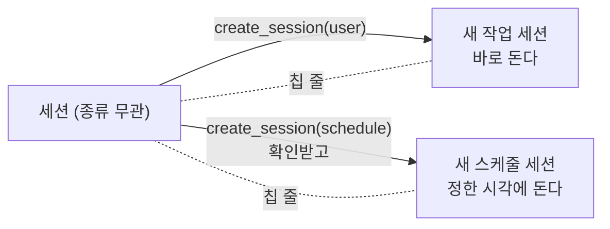

# 0035. 새 세션은 어느 세션에서든 `create_session` 하나로 만든다

- 상태: 채택
- 날짜: 2026-10-22
- 수정: [0032](0032-schedule-creation.md)의 "에이전트가 `create_schedule`로 스케줄을 만든다", [0033](0033-chat-tab-single-session.md)의 "대화에서 `create_task`로 작업을 만든다", [0034](0034-session-as-top-level-term.md)의 "`create_task`는 그대로 둔다"

## 배경

[0034](0034-session-as-top-level-term.md)로 작업·대화·스케줄이 모두 세션의 종류가 됐다. 그런데 에이전트가 세션을 만드는 길은 종류마다 달랐다.

| 이전 Tool | 동작 |
|---|---|
| `create_task` | 새 작업 세션을 만들고 지금 세션에 칩을 남긴다 |
| `create_schedule` | 새 세션을 만들지 않고 **지금 세션의 종류를 `schedule`로 바꾼다** |

이 때문에 "대화에서 작업을 만든다", "작업이 스케줄이 된다" 같은 종류 사이의 관계가 생겼다. 이 관계를 막는 장치는 없었고, 대화 탭에서 스케줄을 시키면 대화 세션이 스케줄로 바뀌는 문제도 있었다. 사용자가 모두 같은 세션이고 성격만 다를 뿐이니 이 모순을 고치라고 했다.

## 결정

- 에이전트는 Tool 하나 `create_session(source, …)`로 새 세션을 만든다. 어느 세션에서 부르든 같다 (사용자).
- 새 세션은 언제나 **새로** 만든다. 지금 세션의 종류는 바꾸지 않는다. 세션 종류는 만들 때 정해지고 바뀌지 않는다.
- 만든 세션은 지금 세션에 칩 줄로 잇는다. 칩의 `data`는 `{session_id, source}`다.

| `source` | 받는 값 | 동작 |
|---|---|---|
| `user` (작업) | `text` | 작업 세션을 만들어 바로 돌린다. 로그아웃이면 만들지 않는다 |
| `schedule` (스케줄) | `name`, `rule`, `instruction` | 지금 세션에 등록 확인([등록]·[고치기])을 띄우고, 받으면 스케줄 세션을 만든다. 스케줄 탭 양식(`add_schedule`)과 같은 길로 만든다 |
| `chat` (대화) | — | 만들지 않는다. 대화 세션은 하나뿐이다 ([0033](0033-chat-tab-single-session.md)) |

- `update_schedule`, `get_schedule`, `set_session_title`은 만들기가 아니라 지금 세션을 다루는 Tool이라 그대로 둔다. 스케줄을 고치려면 그 스케줄 세션에서 고친다.

## 검토한 대안

| 대안 | 장점 | 단점 | 채택하지 않은 이유 |
|---|---|---|---|
| `create_task`·`create_schedule`을 두고 `create_schedule`만 새 세션을 만들게 고친다 | 바꿀 곳이 적다 | 종류마다 Tool이 따로라 종류 사이 관계처럼 보인다 | 사용자가 `create_session` 하나라고 했다 |

## 결과

- 백엔드 Tools: `create_task`, `create_schedule` → `create_session`. `store.update_session`은 `source`를 고치지 못한다.
- 칩은 작업만이 아니라 만든 세션을 가리킨다. 화면은 칩의 `source`로 이름(작업·스케줄)과 열 화면을 정한다. `source`가 없는 옛 칩은 작업으로 본다.
- 하네스: 어느 세션에서든 `create_session`을 쓴다.
