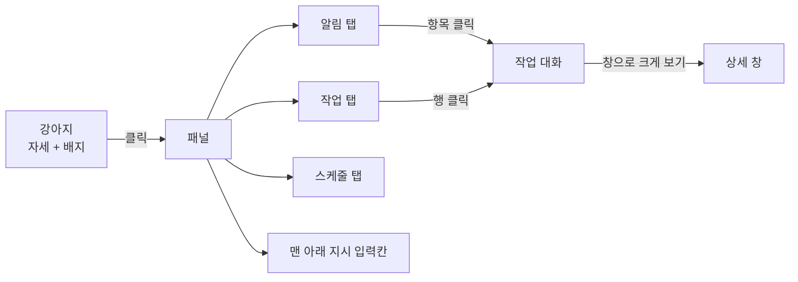

# 출력 계층 화면 디자인 (2026-10-21)

[디자인 요청서](../2026-10-21-output-ui-brief.md)를 받아 만든 화면 설계 결과다. 원본 캔버스는 claude.ai 아티팩트에 있고, 이 폴더는 그 사본이다.

- 원본 캔버스: https://claude.ai/artifact/2z77Y9Krq64JbJR4qtjr7c (비공개. 소유자만 열 수 있다)
- 확정한 컨셉은 [vision.md](../../vision.md)의 "여러 작업" 절에 있다. 이 문서와 어긋나면 vision.md가 우선이다.

## 한눈에

강아지 클릭 하나로 모든 것에 닿는다. 말풍선은 없다.

## 확정한 것

| 항목 | 내용 | 누가 |
|---|---|---|
| 접근 | 마우스로. 강아지 클릭 하나. 단축키는 불편하다 | 사용자 |
| 말풍선 | 두지 않는다 | 사용자 |
| 패널 구성 | 알림·작업·스케줄 탭 + 맨 아래 늘 보이는 지시 입력칸 | Claude 제안, 사용자 확정 |
| 공간 | 화면을 많이 차지하지 않는다. 목록은 페이지로 나눈다 | 사용자 |
| 대화 기록 | 작업마다 주고받은 말이 쌓인다. 되물음과 답도 쌓인다 | 사용자 |
| 배지 | 성격별 개수를 따로: 빨강(답 필요)·노랑(못 함)·초록(새 소식) | 사용자 (노랑은 Claude 제안, 사용자 확정) |

## Claude가 제안하고 사용자가 확정한 값

- 강아지 위치: 화면 오른쪽 아래, 작업 표시줄 위.
- 패널 크기: 너비 340px. 한 쪽에 4줄.
- 알림 순서: 키 없음 → 답 필요 → 못 함 → 다 함. 같은 성격끼리는 최신이 위.
- 첫 번째 질문만 카드로 펼치고, 나머지 질문은 한 줄 + "답하기".
- 강아지 자세: 키 없음(잠) → 질문(조르기) → 일하는 중(걷기) → 못 함(엎드림) → 다 함(서기) → 쉼(앉기) 중 가장 급한 것.
- 마우스를 올리면 툴팁: "눌러서 일 맡기기", "일하는 중 · 작업 2개".
- 지시 입력칸: 한 줄로 시작해 5줄(120px)까지 위로 늘어난다. 넘치면 안에서 스크롤. Enter 보내기, Shift+Enter 줄바꿈.
- 작업 대화: 패널 안 높이 440px 고정, 본문만 스크롤. 진행 단계는 한 줄로 접는다.
- 스프라이트 시트의 줄 → 동작 대응은 그림을 보고 짐작했다. 구현 때 확인한다.

## 아직 정할 것

- 툴팁에 배지 내용을 풀어 쓸지 ("답할 것 2 · 새 소식 3 · 일하는 중 2").
- 작업 멈추기 아이콘 색. 지금 빨강이라 "답 필요" 빨강과 겹친다.
- 스케줄 표에서 켜고 끄기·추가·편집을 할지.
- [프로토콜](../../brain-protocol.md)에 필요한 것:
  - 되물음에 대한 대답과 새 질문을 구분할지.
  - 앱을 다시 켠 뒤 지난 작업·대화를 불러오는 메시지.
  - 스케줄 목록을 보내는 메시지.

## 아트보드

| 파일 | 화면 |
|---|---|
| `Main.dc.html` | 1 작업 없음 |
| `Progress.dc.html` | 2 일하는 중 |
| `Question.dc.html` | 3 답이 필요함 (빨강 배지) |
| `Result.dc.html` | 4 새 소식 (초록 배지) |
| `Failed.dc.html` | 5 못 함 (노랑 배지) |
| `Input.dc.html` | 6 지시 입력, 긴 글 |
| `Alerts.dc.html` | 7 알림 탭, 여러 성격이 섞였을 때 |
| `TaskPanel.dc.html` | 8 작업 탭 |
| `SchedulePanel.dc.html` | 9 스케줄 탭 |
| `NoKeys.dc.html` | 10 키 없음 |
| `TaskDetail.dc.html` | 11 작업 대화 |
| `DetailWindow.dc.html` | 12 상세 창 |

`canvas.json`은 캔버스 배치(아트보드 위치·크기·제목)다.

## 파일에 대해

- `.dc.html`은 Claude Design 캔버스 형식이다. `support.js`가 없어서 브라우저로 바로 열면 제대로 보이지 않는다. 구조와 문구, 색·크기 값을 읽는 용도다.
- 강아지 그림은 저장소의 [`app/public/sprites/dog/dog-02.png`](../../../app/public/sprites/dog/dog-02.png)를 가리키게 바꿨다. 원본 캔버스는 업로드한 사본을 쓴다.
- 예시 문구(쿠팡 주문, 민지, 메일 요약, 시각, 가격)는 지어낸 것이다.
- 이어서 고칠 때는 원본 캔버스를 고친 뒤 이 폴더를 다시 맞춘다.
