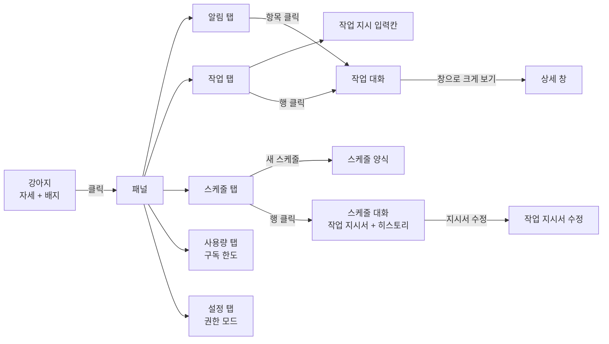

# 출력 계층 화면 디자인 (2026-10-21)

[디자인 요청서](../2026-10-21-output-ui-brief.md)를 받아 만든 화면 설계 결과다. 원본 캔버스는 claude.ai 아티팩트에 있고, 이 폴더는 그 사본이다.

- 원본 캔버스: https://claude.ai/artifact/2z77Y9Krq64JbJR4qtjr7c (비공개. 소유자만 열 수 있다)
- 확정한 컨셉은 [vision.md](../../vision.md)의 "여러 작업" 절에 있다. 이 문서와 어긋나면 vision.md가 우선이다.

## 한눈에

강아지 클릭 하나로 모든 것에 닿는다. 말풍선은 없다.

## 확정한 것

| 항목 | 내용 | 누가 |
|---|---|---|
| 접근 | 마우스로. 강아지 클릭 하나. 단축키는 불편하다 | 사용자 |
| 말풍선 | 두지 않는다 | 사용자 |
| 패널 구성 | 알림·작업·스케줄·사용량·설정 탭 | Claude 제안, 사용자 확정 |
| 스케줄 상세 | 스케줄을 누르면 작업 지시서와 히스토리(대화 내역)가 보인다 | 사용자 |
| 스케줄 = 세션 하나 | 스케줄도 Claude Code 세션 하나라 대화할 수 있다. 실행이 같은 대화에 날짜 구분선과 함께 쌓이고, 아래 입력칸으로 스케줄에 말한다. [0032](../../decisions/0032-schedule-creation.md) | 사용자 |
| 작업 지시서 수정 | 지시서를 수정할 수 있다. 대화 위 지시서 줄의 "수정"으로 이름·언제·할 일을 고친다 | 사용자 (화면 모양은 Claude 제안) |
| 스크롤 | 대화·목록의 스크롤 위치는 사용자가 둔 곳에 고정한다. 새 메시지가 와도 맨 아래로 내려가지 않는다. "새 메시지 ↓" 같은 표시도 두지 않는다. (아트보드의 `column-reverse`는 시안에서 마지막 메시지를 보여 주려는 것일 뿐, 구현 규칙이 아니다) | 사용자 |
| 입력칸 키 | 모든 입력칸(지시, 답, 스케줄 대화)에서 Enter는 보내기, Shift+Enter는 줄바꿈. 보낸 뒤에도 커서는 입력칸에 남는다 | 사용자 |
| 지시 입력 | 작업 지시는 작업 탭에서, 스케줄은 스케줄 탭에서 | 사용자 |
| 스케줄 양식 | 스케줄은 자유 글이 아니라 정해진 양식으로 넣는다. 양식은 작업 지시서 데이터 명세를 따른다 | 사용자 |
| 스케줄 만들기 | 스케줄 탭에서 추가하는 것이 기본. 에이전트에게 말로 시켜도 되고, 그때는 확인받고 만든다 ([0032](../../decisions/0032-schedule-creation.md)) | 사용자 |
| 공간 | 화면을 많이 차지하지 않는다. 목록은 페이지로 나눈다 | 사용자 |
| 대화 기록 | 작업마다 주고받은 말이 쌓인다. 되물음과 답도 쌓인다 | 사용자 |
| 배지 | 성격별 개수를 따로: 빨강(답 필요)·노랑(못 함)·초록(새 소식) | 사용자 (노랑은 Claude 제안, 사용자 확정) |
| 인증 | API 키 입력 대신 Claude Code 구독 로그인을 요청한다 | 사용자 |
| 설정 | 패널에 설정 탭을 두고, 그 안에서 Claude Code 권한 모드를 고른다 | 사용자 |
| 사용량 | 패널에 사용량 탭을 두고, Claude Code 구독 사용량 한도를 보여 준다 | 사용자 |

## Claude가 제안하고 사용자가 확정한 값

- 강아지 위치: 화면 오른쪽 아래, 작업 표시줄 위.
- 패널 크기: 너비 340px. 한 쪽에 4줄.
- 알림 순서: 로그인 필요 → 답 필요 → 못 함 → 다 함. 같은 성격끼리는 최신이 위.
- 첫 번째 질문만 카드로 펼치고, 나머지 질문은 한 줄 + "답하기".
- 강아지 자세: 로그인 필요(잠) → 질문(조르기) → 일하는 중(걷기) → 못 함(엎드림) → 다 함(서기) → 쉼(앉기) 중 가장 급한 것.
- 마우스를 올리면 툴팁: "눌러서 일 맡기기", "일하는 중 · 작업 2개".
- 지시 입력칸: 한 줄로 시작해 5줄(120px)까지 위로 늘어난다. 넘치면 안에서 스크롤.
- 작업 대화: 패널 안 높이 440px 고정, 본문만 스크롤. 진행 단계는 한 줄로 접는다.
- 스프라이트 시트의 줄 → 동작 대응은 그림을 보고 짐작했다. 구현 때 확인한다.

## 아직 정할 것

- 툴팁에 배지 내용을 풀어 쓸지 ("답할 것 2 · 새 소식 3 · 일하는 중 2").
- 작업 멈추기 아이콘 색. 지금 빨강이라 "답 필요" 빨강과 겹친다.
- ~~스케줄 켜고 끄기·편집을 할지.~~ → 추가·편집·켜고 끄기 모두 한다 ([0032](../../decisions/0032-schedule-creation.md)).
  - 켜고 끄기는 스케줄 대화(16번) 머리의 스위치로 한다. 스케줄 목록은 상태만 보여 준다 (Claude 제안, 사용자 확정).
- 스케줄 양식 (Claude 제안, 사용자 확인 전):
  - 칸은 [작업 지시서 명세](../../decisions/0032-schedule-creation.md)의 `schedules` 칸을 따른다: 이름, 언제, 할 일. 켜짐은 스케줄 대화 머리의 스위치, 마지막 실행은 백엔드가 채운다.
  - "언제"는 반복(매일·평일·매주·매월) + 시각. 매주면 요일 칩, 매월이면 날짜 칸이 더 나온다. 모양과 검사 규칙은 [0032](../../decisions/0032-schedule-creation.md)의 "언제와 권한" 절에 적었다.
  - 스케줄 대화(16번)에서 일정(반복·시각·다음 실행)은 머리가 아니라 작업 지시서 줄에 함께 보인다. 머리가 좁아서다 (사용자).
  - 스케줄 탭 맨 아래는 입력칸 대신 "+ 새 스케줄" 버튼이다. 누르면 15번 양식이 열린다.
  - 양식으로 직접 넣으므로 알아듣는 단계가 없어 등록 확인 카드도 없다. 에이전트에게 말로 시킬 때만 확인을 거친다.
  - 지시서 수정(17번)도 같은 양식이다.
  - 알림·사용량·설정 탭에는 입력칸이 없다.
- 설정 탭 (Claude 제안, 사용자 확인 전):
  - 탭이 넷이라 너비가 모자라서 설정 탭은 톱니 아이콘만 보인다.
  - 권한 모드 다섯 개: 매번 묻기(Manual, 기본)·수정은 바로(Accept edits)·계획만(Plan)·자동(Auto)·묻지 않음(Bypass permissions). `dontAsk`는 CLI·자동화용이라 뺐다. 출처: [Claude Code 권한 모드 문서](https://code.claude.com/docs/en/permission-modes), 2026-10-21 확인.
  - 바꾼 모드는 새로 맡기는 작업부터 적용한다.
  - 작업마다 다른 모드를 쓸지는 정하지 않았다.
- 사용량 탭 (Claude 제안, 사용자 확인 전):
  - 탭이 다섯이 되어 사용량·설정 탭은 아이콘만 보이고, 패널 머리의 닫기(✕) 버튼은 뺐다. 패널은 강아지를 다시 눌러 닫는다.
  - 막대 두 무리. 각 막대에 쓴 비율과 초기화까지 남은 시간을 붙인다. 출처: Claude Code `/usage`의 구독 사용량 막대 ([문서](https://code.claude.com/docs/en/vs-code)), 2026-10-21 확인.
    - 모든 모델 공통: 현재 세션, 이번 주. 모델을 바꿔도 풀리지 않는다.
    - 모델별: Opus, Sonnet. 그 모델 계열에만 걸리고, 다른 모델로 바꾸면 계속 일할 수 있다. 출처: [오류 문서](https://code.claude.com/docs/en/errors)의 "You've hit your Opus/Sonnet limit", 2026-10-21 확인.
  - 플랜마다 보이는 한도가 다를 수 있다. 백엔드가 받은 한도만 그린다.
  - "이 PC에서 계산한 근삿값"이라고 밝힌다. `/usage` 문서가 다른 기기·claude.ai 사용량은 빠진다고 적고 있다.
  - 한도에 가까울 때 색을 바꿀지, 알림으로 띄울지는 정하지 않았다.
  - 사용량 값을 백엔드가 어떻게 얻어 화면에 보낼지(프로토콜)는 정하지 않았다.
- [프로토콜](../../brain-protocol.md)에 필요한 것:
  - 되물음에 대한 대답과 새 질문을 구분할지.
  - 앱을 다시 켠 뒤 지난 작업·대화를 불러오는 메시지.
  - 스케줄 목록을 보내는 메시지.

## 아트보드

| 파일 | 화면 |
|---|---|
| `Main.dc.html` | 1 작업 없음 |
| `Progress.dc.html` | 2 일하는 중 |
| `Question.dc.html` | 3 답이 필요함 (빨강 배지) |
| `Result.dc.html` | 4 새 소식 (초록 배지) |
| `Failed.dc.html` | 5 못 함 (노랑 배지) |
| `Input.dc.html` | 6 지시 입력, 긴 글 |
| `Alerts.dc.html` | 7 알림 탭, 여러 성격이 섞였을 때 |
| `TaskPanel.dc.html` | 8 작업 탭 |
| `SchedulePanel.dc.html` | 9 스케줄 탭 |
| `NeedLogin.dc.html` | 10 로그인 필요 |
| `TaskDetail.dc.html` | 11 작업 대화 |
| `DetailWindow.dc.html` | 12 상세 창 |
| `Settings.dc.html` | 13 설정 탭, 권한 모드 |
| `Usage.dc.html` | 14 사용량 탭, 구독 사용량 한도 |
| `ScheduleAdd.dc.html` | 15 새 스케줄 양식 |
| `ScheduleDetail.dc.html` | 16 스케줄 대화: 작업 지시서와 히스토리, 대화 입력 |
| `ScheduleEdit.dc.html` | 17 작업 지시서 수정 |

`canvas.json`은 캔버스 배치(아트보드 위치·크기·제목)다.

## 파일에 대해

- `.dc.html`은 Claude Design 캔버스 형식이다. `support.js`가 없어서 브라우저로 바로 열면 제대로 보이지 않는다. 구조와 문구, 색·크기 값을 읽는 용도다.
- 강아지 그림은 저장소의 [`app/public/sprites/dog/dog-02.png`](../../../app/public/sprites/dog/dog-02.png)를 가리키게 바꿨다. 원본 캔버스는 업로드한 사본을 쓴다.
- 예시 문구(쿠팡 주문, 민지, 메일 요약, 시각, 가격)는 지어낸 것이다.
- 이어서 고칠 때는 원본 캔버스를 고친 뒤 이 폴더를 다시 맞춘다.
