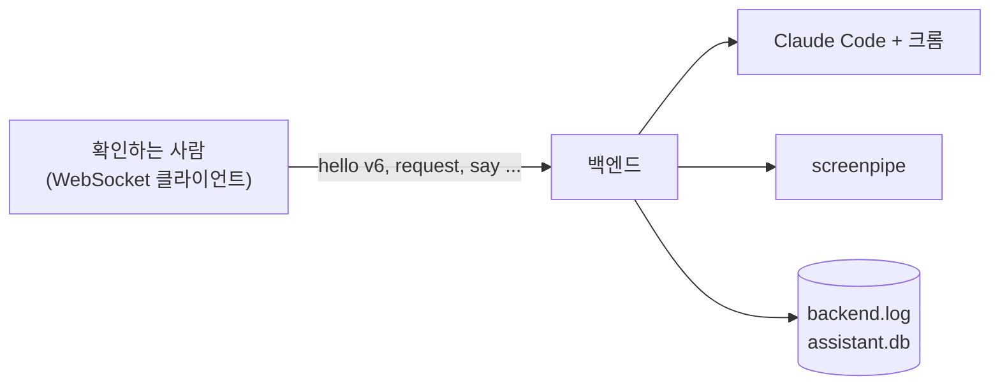

# 백엔드 수동 확인

자동 시험은 Claude Code·screenpipe를 가짜로 바꿔 돈다. 아래는 실제 프로그램으로만 확인할 수 있다. 앞의 다섯 줄은 [조수 1단계 스펙](../superpowers/specs/2026-10-21-assistant-phase1-design.md) 8절 "시험하지 않은 것"이다. 안 되는 것은 스펙으로 돌아가 사용자와 정한다.

## 준비

- [README](../../README.md)의 "필요한 것"을 갖춘다: Claude Code, 구독 로그인, Claude in Chrome 확장, Node.js(`npx`).
- 화면 앱은 아직 v5라 붙지 않는다. 백엔드만 띄우고(`cd backend && uv run python -m backend`), `backend.json`의 포트·토큰으로 WebSocket 클라이언트를 붙여 v6 메시지를 직접 보낸다 ([프로토콜](../backend-protocol.md)).
- 로그: `%APPDATA%\TamagotchiChatBot\backend\logs\backend.log`. 작업 기록: 같은 폴더의 `assistant.db`.

## 확인 목록

| # | 무엇 | 어떻게 | 기대 | 결과 |
|---|---|---|---|---|
| 1 | 일하는 도중 덧붙이기(`say`) | 오래 걸리는 `request`를 보내고, 질문이 없는 동안 같은 `task_id`로 `say`를 보낸다 | 덧붙인 말이 세션에 들어가 에이전트가 반영한다. `entry {kind: user}`가 쌓이고 작업은 `working` 그대로 | [ ] |
| 2 | 여러 작업이 크롬 하나를 함께 쓰기 | 크롬을 쓰는 `request` 두 개를 잇달아 보낸다 | 두 작업이 서로의 탭을 망가뜨리지 않고 끝난다. 안 되면 동시 작업 방식을 다시 정한다 | [ ] |
| 3 | 로그인 흐름 (`claude auth login`) | `claude auth logout` 뒤 백엔드에 붙어 `status {logged_in: false}`를 확인하고 `login`을 보낸다 | 브라우저가 열리고, 로그인을 마치면 `status {logged_in: true}`가 온다. 끝나지 않고 멈추면 시간 제한을 정한다 | [ ] |
| 4 | 사용량 이벤트(`RateLimitEvent`)가 오는 때와 종류 이름 | 작업을 몇 개 돌리며 `usage` 메시지와 로그를 본다 | 언제 오는지, `type`에 어떤 이름이 오는지(예: 5시간·주간) 적는다. 사용량 탭 디자인에 맞는지 본다 | [ ] |
| 5 | 스케줄 세션을 며칠에 걸쳐 `resume` | `add_schedule`(매일)로 만들고 며칠 둔다 | 날마다 같은 `session_id`로 이어지고, `run` 구분선 뒤에 결과가 쌓인다. 앞날의 대화를 기억한다 | [ ] |
| 6 | screenpipe 켜고 끄기 | 백엔드를 띄웠다가 Ctrl+C로 끈다 | 로그에 `screenpipe 시작`, 끝날 때 `taskkill /T`로 `npx` 밑의 `node`·`screenpipe.exe`까지 모두 꺼진다(작업 관리자에서 확인). 이미 떠 있으면 `screenpipe가 이미 떠 있어 그대로 둔다`가 찍히고 끌 때 건드리지 않는다 | [ ] |
| 7 | 윈도에서 screenpipe MCP (`cmd /c npx`) | screenpipe 기록을 찾아야 하는 `request`를 보낸다 (예: "아까 보던 문서 이름 알려줘") | Claude Code가 screenpipe MCP를 띄워 도구를 쓴다. 실패하면 Claude Code의 MCP 오류를 확인한다 ([agent.py](../../backend/backend/agent.py)의 `SCREENPIPE`) | [ ] |
| 8 | 세션 도중 끄기 | 크롬을 쓰는 `request`를 보내 일하는 동안 백엔드를 Ctrl+C로 끈다 | `claude` 프로세스와 그 밑의 MCP 서버(`screenpipe-mcp`의 `node`)·크롬 연결 프로세스가 모두 꺼진다(작업 관리자에서 확인). 남으면 끌 때 세션을 끊는 길을 만든다 | [ ] |
| 9 | 로그인 중 끄기 | `login`을 보내 브라우저가 열린 채로 백엔드를 Ctrl+C로 끈다 | `claude auth login` 프로세스가 트리째 꺼진다 | [ ] |
| 10 | 로그아웃 뒤 로그인 | 로그인된 상태에서 `logout`을 보낸 뒤 `request`를 보내고, 이어 `login`을 보낸다 | `logout` 뒤 `status {logged_in: false}`가 오고 `claude auth status`도 로그아웃으로 나온다. `request`에는 `status {logged_in: false}`만 다시 온다. `login`으로 다시 로그인되면 `status {logged_in: true}` | [ ] |
| 11 | 화면 기록 끄기·켜기 | 백엔드가 띄운 screenpipe가 도는 중에 `set_recording {enabled: false}`, 이어 `{enabled: true}`를 보낸다. 끈 상태로 백엔드를 다시 띄워 본다 | 끄면 `screenpipe.exe`와 그 위의 `npx`·`node`가 작업 관리자에서 사라지고, 켜면 다시 생긴다. 매번 `settings {recording}`이 온다. 끈 채 다시 띄우면 로그에 `screenpipe 시작`이 찍히지 않는다 | [ ] |
| 12 | 대화 탭 세션 이어 쓰기 | 접속해 받은 대화 작업(`source: chat`)에 `say`를 두 번 보내고, 백엔드를 껐다 켠 뒤 또 `say`를 보낸다. 한 번은 "회의 자료 모아 줘"처럼 일을 맡긴다 | 같은 `session_id`로 이어지고 앞 이야기를 기억한다. 일을 맡기면 새 작업이 생기고 대화에 `chip` 줄이 남는다. 그냥 묻는 말에는 새 작업 없이 대화에서 답한다 | [ ] |

## 화면 계획에 넘기는 주의

- Tauri가 백엔드를 강제로 끄면(`backend.rs`의 `child.kill`) 파이썬의 정리 코드가 돌지 않는다. 그러면 백엔드가 띄운 screenpipe와 `claude` 세션 프로세스(그 밑의 MCP·크롬 연결까지)가 고아로 남는다. 화면 계획에서는 백엔드를 정상 종료시키거나(종료 신호 → 정리 대기), 그게 안 되면 프로세스 트리째(`taskkill /T`) 끈다.

## 지금까지 본 것

- 2026-10-21, 6번 일부: `uv run python -m backend`로 띄우자 로그에 `screenpipe 시작`, `백엔드 시작: 포트 …`가 찍혔다. `cmd /c npx.CMD` → `node npx-cli.js` → `cmd /c screenpipe record` → `node cli.js` → `screenpipe.exe`로 뜨는 것을 보았다. 18초 안에는 `localhost:3030/health`가 응답하지 않았다(처음 실행이라 준비 중으로 보인다). 끄기는 `taskkill /T /F`로 프로세스 트리를 죽여서 확인했고, 정상 종료(Ctrl+C) 경로의 `Recorder.stop()`은 아직 보지 못했다.
