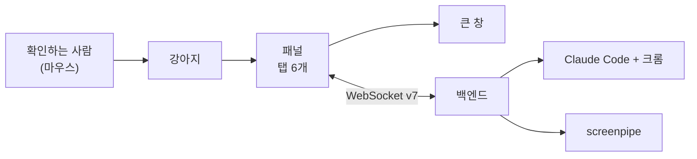

# 화면 수동 확인

자동 시험은 `src/shared/*.ts`(순수 로직)만 돈다. 창·DOM·실제 백엔드에 기대는 동작은 아래 목록으로 실제 앱에서 본다. 기준 모양은 [디자인 다이제스트](../design/2026-10-21-output-ui/digest.md)의 아트보드 18개, 다이제스트에 없던 값은 [화면 계획](../superpowers/plans/2026-10-22-assistant-frontend.md)의 "정한 값"이다. 다르면 다이제스트·계획으로 돌아가 정한다.

## 준비

- [README](../../README.md)의 "필요한 것"을 갖춘다. 실제 작업을 돌리려면 Claude Code 구독 로그인과 Claude in Chrome 확장이 있어야 한다.
- `cd app && npm run tauri dev`. 앱이 백엔드를 띄운다(백엔드는 screenpipe도 띄운다).
- **확인이 끝나면 바로 트레이 → 종료로 닫는다** (CLAUDE.md 3절). 닫은 뒤 14번으로 남은 프로세스를 본다.
- 백엔드 로그: `%APPDATA%\TamagotchiChatBot\backend\logs\backend.log`.

## 1. 디자인 화면

강아지·패널이 해당 아트보드와 같은 모양·문구인지 본다. 상태를 만드는 방법은 "어떻게" 칸에 적었다.

| # | 아트보드 | 어떻게 | 기대 | 결과 |
|---|---|---|---|---|
| 1 | 1 Main (작업 없음) | 작업이 모두 끝나고 본 뒤 | 강아지 앉기, 배지 없음. 마우스를 올리면 툴팁 `눌러서 일 맡기기`(브라우저 기본 툴팁). 작업 영역 오른쪽 아래, 오른쪽에서 20px | [ ] |
| 2 | 2 Progress (일하는 중) | 오래 걸리는 작업을 맡긴다 | 강아지 걷기. 툴팁 `일하는 중 · 작업 N개` | [ ] |
| 3 | 3 Question (답 필요) | 질문하게 될 작업(예: "결제 전에 물어봐 줘")을 맡긴다 | 강아지 조르기, 빨강 배지 개수 | [ ] |
| 4 | 4 Result (새 소식) | 작업을 끝내고 열어 보지 않는다 | 강아지 서기, 초록 배지 | [ ] |
| 5 | 5 Failed (못 함) | 못 하는 작업을 맡기거나 도중에 실패시킨다 | 강아지 엎드림, 노랑 배지 | [ ] |
| 6 | 6 Input (새 작업) | 작업 탭 → [+ 새 작업] | 탭 바 없음, ‹ 뒤로 + `새 작업`, 160px 입력칸(파란 테두리), 힌트·[취소]·[맡기기]. 맡기면 작업 탭으로 | [ ] |
| 7 | 7 Alerts (알림 탭) | 질문·못 함·다 함을 섞어 만든다 | 맨 위 첫 질문만 카드(빨강 2px 테두리, 선택지, `대화 보기 ›`), 아래 행 순서 답 필요 → 못 함 → 다 함, 스케줄 항목에 청록 `스케줄` 태그, 탭 라벨 옆 미니 배지 | [ ] |
| 8 | 8 TaskPanel (작업 탭) | 일하는 중·답 필요·못 함이 섞인 상태 | 스피너(파랑/스케줄은 청록), 멈추기 44x44, [답하기], 페이저 `1 / N`, [+ 새 작업] | [ ] |
| 9 | 9 SchedulePanel (스케줄 탭) | 켜진·꺼진 스케줄, 도는 중인 스케줄 | 행 아이콘(도는 중·지난번 못 함·완료·꺼짐), 오른쪽 `도는 중`/`다음 …`/`꺼짐`, 꺼진 행 회색, [+ 새 스케줄] | [ ] |
| 10 | 10 NeedLogin (로그인 필요) | 터미널에서 `claude auth logout` 뒤 앱을 띄운다 | 강아지 잠, 배지 없음, 툴팁 `눌러서 로그인하기`. 패널을 열면 설정 탭부터, 알림 탭 배지 없음. 다른 탭도 눌린다 | [ ] |
| 11 | 11 TaskDetail (작업 대화) | 작업 행을 누른다 | 높이 440px, 본문만 스크롤, 머리에 제목·부제·크게 보기(대각 화살표)·지우기(휴지통)·멈추기 순서, 입력 placeholder `답하거나 되묻기` | [ ] |
| 12 | 12 DetailWindow (큰 창) | 탭 바·작업 대화·스케줄 대화 머리의 크게 보기 | 작은 패널이 닫히고 880x544 창(제목줄 `패널`, 크기 바꿀 수 있음)이 패널이 보던 탭·화면·세션 그대로 뜬다. 탭 바는 글자 탭 6개(14px, 알림 옆 배지 11px). 알림·작업·스케줄은 두 칸: 왼쪽 300px 목록(행 48px, 고른 행 #E3ECFF + 굵게, 페이저, 점선 [새 작업]·[새 스케줄]), 오른쪽 고른 대화나 양식, 고른 것이 없으면 `왼쪽 목록에서 골라 주세요`. 대화·사용량·설정은 한 칸. 오른쪽 머리: 제목 16px/700 + 부제(`내 요청 · HH:MM 시작 · 상태`), [지우기]·[멈추기] 글자 버튼(36px, 테두리). 대화 14px, 말풍선 75%, 날짜 줄, 진행은 펼친 상자, 질문 버튼 40px, 입력 44px → 최대 140px. [지우기]는 창 안에 19번과 같은 상자(너비 306px). 지우면 그 탭 목록으로. 닫기는 숨기기만 하고 작은 패널은 다시 열리지 않는다 | [ ] |
| 13 | 13 Settings (로그인됨) | 설정 탭 | `로그인됨 · Claude Code 구독`, [로그아웃], 화면 기록 스위치, 권한 모드 다섯(묻지 않음은 경고색). 이메일 줄은 없다(정한 값) | [ ] |
| 14 | 14 Usage (사용량) | 사용량 탭 | §2의 12번 항목 참고 | [ ] |
| 15 | 15 ScheduleAdd (새 스케줄) | 스케줄 탭 → [+ 새 스케줄] | 이름·반복·시각·할 일. 매주면 요일 칩 하나만 고른다, 매월이면 `일` 칸(1~31). 빈 칸이면 양식 아래 오류 글 | [ ] |
| 16 | 16 ScheduleDetail (스케줄 대화) | 스케줄 이름을 누른다 | 높이 460px, 머리에 켜짐 스위치(꺼지면 트랙 #C4CAD3, `꺼짐`)·지우기(휴지통)·크게 보기 순서, 작업 지시서 줄 + `✎ 수정`, 실행 구분선, 진행 칩 | [ ] |
| 17 | 17 ScheduleEdit (지시서 수정) | 스케줄 대화 → `✎ 수정` | 값이 채워진 양식, 힌트 `저장하면 다음 실행부터 적용돼요`, [저장] 뒤 스케줄 대화로 | [ ] |
| 18 | 18 Chat (대화 탭) | 대화 탭에서 말한다 | 탭 바 아래 얇은 줄(#F7F8FA, 왼쪽 `Claude와 나눈 대화`, 오른쪽 휴지통 + `대화 지우기`), 본문 324px 스크롤, 입력 placeholder `Claude에게 말하기`, 한 줄 40px → 최대 120px | [ ] |
| 19 | 19 DeleteConfirm (지우기 확인) | 작업 대화 머리의 휴지통. 스케줄 대화 휴지통, 대화 탭 `대화 지우기`로도 | 패널 안 어두운 덮개(모서리 14px) 위 흰 상자. 작업 `이 작업을 지울까요?` / `**<제목>**과 그 대화 기록이 모두 지워져요. 되돌릴 수 없어요. 돌고 있는 작업이면 먼저 멈춰요.`, 스케줄 `이 스케줄을 지울까요?` / `**<이름>**과 작업 지시서, 대화 기록이 모두 지워져요. …`, 대화 `대화를 지울까요?` / `Claude와 나눈 대화 기록이 모두 지워지고 새 대화로 시작해요. …`. [취소](포커스가 먼저 간다)·Esc는 닫기, [지우기](빨강 #B42318)는 지우고 닫는다 | [ ] |
| 22 | 22 Thinking (준비 중) | 대화 탭에서 말한 뒤 대답이 오기 전. 작업 대화·스케줄 대화·큰 창에서도 | 대화 맨 아래 회색 줄: 파란 점 3개 깜빡임 + 굵은 하는 일(`생각하는 중`·`화면 기록에서 찾는 중`·`답 쓰는 중` 등) + `· N초`. 1초마다 시간만 바뀌고 입력 글·커서·스크롤은 그대로. 하는 일이 바뀌어도 시간은 이어진다. 줄이 보이는 동안 진행 칩에 스피너가 없다. 대답 말풍선·질문·실패가 오거나 멈추면 줄이 사라진다 | [ ] |
| 23 | 23 ProactiveBadge (먼저 말 걸기 배지) | 설정 탭에 Jev 키를 넣고 화면 기록을 켠 채 엑셀 오류 같은 막힌 화면을 몇 분 띄운다(백엔드가 `nudge {active: true}`를 보낸다) | 강아지 왼쪽 위 배지 줄 맨 앞에 22x22 파란(#1D4ED8) 원, 흰 테두리 2px, 13px 굵은 흰 `!`. 개수 배지가 있으면 그 앞에 선다. 마우스를 올리면 툴팁 `할 말이 있어요`. 5분이 지나면 사라진다. 로그아웃이면 보이지 않는다 | [ ] |
| 24 | 24 Proactive (대화의 먼저 말 걸기) | 23번 상태에서 강아지를 누른다. 큰 창 대화 탭에서도 본다 | 대화 맨 아래 가운데 12px 회색 `강아지가 먼저 말을 걸었어요 · HH:MM`, 왼쪽 회색 말풍선 `도움이 필요해?`(테두리 2px #1D4ED8), 그 아래 둥근 칩 [도와줘] [괜찮아](높이 32, 테두리 1px #C4CAD3, 12px). 칩은 마지막 물음이고 그 뒤에 내 말이 없을 때만 보인다 | [ ] |

## 2. 실제로 아직 못 본 것

구현 중 단위 시험만 했거나 실제 앱에서 보지 못한 것이다.

| # | 무엇 | 어떻게 | 기대 | 결과 |
|---|---|---|---|---|
| 1 | 질문 카드 (알림 탭·대화) | 3번 상태를 만들고 알림 탭과 작업 대화를 연다 | 알림 탭 카드에 질문 본문과 선택지가 보인다. 선택지를 누르면 `say`가 가고, 그 카드의 선택지만 막힌다(보낸 뒤에만 막는다). 작업이 다시 `working`이 된다 | [ ] |
| 2 | 등록 확인 카드 [등록] | 대화 탭에서 "평일 18시에 슬랙 요청 정리해 줘"처럼 스케줄을 시킨다 | `이렇게 등록할까요?` 카드(이름 굵게, `평일 18:00 · 스케줄`). [등록]을 누르면 스케줄 탭에 새 스케줄이 생긴다 | [ ] |
| 3 | 등록 확인 카드 [고치기] | 2번 카드에서 [고치기] | 카드 값으로 채운 수정 양식이 열린다(힌트 글 없음 — 아직 등록 전이라서). 뒤로는 `대화로`. [저장]하면 `set_schedule`이 가고 대화 탭으로 돌아온다. 그 전에 다른 양식에 적던 값이 섞이지 않는다 | [ ] |
| 4 | 세션 칩 | 대화 탭에서 일을 맡기고(예: "회의 자료 모아 줘"), 작업 대화에서 반복할 일을 맡긴다(예: "매일 9시에 메일 요약해 줘" → [등록]) | 말풍선 뒤에 `작업 <제목> ›`, `스케줄 <이름> ›` 칩. 누르면 그 세션 대화로. 스케줄을 맡긴 작업은 작업 그대로 남는다 | [ ] |
| 5 | 큰 창 말하기·멈추기·상태 | 일하는 작업을 큰 창에서 열고 말한 뒤 [멈추기]. 패널을 함께 열어 두고도 한 번 | 말이 대화에 붙고 패널에도 보인다. [멈추기]는 확인창 없이 바로 멈추고 버튼이 사라진다. 패널과 큰 창이 서로 다른 탭·쪽을 보고 있어도 각자 제 목록 쪽이 채워진다(큰 창 작업 탭 2쪽 + 패널 알림 탭). 끊긴 동안 보낸 말은 입력칸으로 돌아온다. 큰 창이 앞에 있을 때 끝난 작업을 열면 `seen`(배지에서 빠짐). 닫기를 누르면 숨겨지고 다시 크게 보기를 누르면 같은 창에 그 화면이 그려진다 | [ ] |
| 6 | 긴 대화 스크롤 위치 | 줄이 많은 작업 대화에서 위로 올려 둔 채 새 줄이 오게 한다 | 위로 올려 두었으면 그 자리를 지킨다. 맨 아래에 있었으면 새 줄을 따라 내려간다 | [ ] |
| 7 | 진행 칩과 스피너 | 일하는 작업의 대화를 연다 | 이어진 진행 줄이 `진행 N단계 · <마지막 글>` 칩 하나로 접힌다. 일하는 중이고 마지막 줄이 진행이면 칩 앞에 스피너. 누르면 펼친다. 큰 창은 펼친 상자. 결과 말풍선과 같은 글은 칩에 없다. 대화 탭에는 칩이 없다 | [ ] |
| 8 | 여러 쪽 페이저 | 작업을 5개 넘게 만든다 | `1 / 2`, 다음·이전이 쪽을 바꾼다. 첫 쪽에서 이전은 비활성. 쪽을 바꿀 때 1쪽이 잠깐 비치지 않는다 | [ ] |
| 9 | 연결 끊김 띠와 다시 붙기 | 패널을 연 채 작업 관리자에서 백엔드 `python`만 끝낸다 | 패널 맨 위 `백엔드에 연결하는 중…`(12px, 회색 띠), 강아지 앉기. 백엔드가 다시 뜨고 붙으면 띠가 사라지고 보던 화면 목록이 다시 채워진다. 끊긴 동안 보내기를 눌러도 입력한 글은 지워지지 않는다 | [ ] |
| 10 | 로그인 흐름 | 10번 상태에서 설정 탭 [로그인] | 버튼이 `로그인하는 중…`으로 막힌다. 브라우저에서 로그인을 마치면 `로그인됨`으로 바뀌고 강아지가 깬다. 로그인을 실패·취소하면 `status`가 와서 버튼이 풀린다 | [ ] |
| 11 | 로그아웃 | 설정 탭 [로그아웃] | 10번 상태로 바뀐다. 돌던 작업은 계속 돈다 | [ ] |
| 12 | 사용량 막대 (실제 값) | 작업을 몇 개 돌린 뒤 사용량 탭 | 값이 없으면 `아직 사용량 정보가 없어요. 작업이 돌면 채워져요.` 값이 오면 `현재 세션`·`이번 주`(모든 모델 공통), `Opus`·`Sonnet`(모델별) 막대와 퍼센트·남은 시간. 모르는 `type`은 이름 그대로 | [ ] |
| 13 | 마크다운 모양 | 목록·굵게·코드가 든 답을 받는다(예: "할 일 세 가지를 목록으로") | 굵게, 인라인 코드(에이전트 말풍선 안에서는 흰 바탕), `- `·`1. ` 목록, 줄바꿈이 그려진다. 제목·링크는 글 그대로. HTML 태그를 보내도 글자로 보인다 | [ ] |
| 14 | 대화 탭 첫 클릭 | 앱을 막 띄운 뒤 패널을 열고 대화 탭을 한 번 누른다 | 한 번에 대화 탭이 열리고 대화가 채워진다(구현 중 한 번 첫 클릭이 먹지 않은 적이 있다) | [ ] |
| 15 | 한글 입력 Enter | 새 작업·작업 대화·대화 탭·스케줄 대화·큰 창에서 한글을 조합하다 Enter | 조합 중 Enter는 글자만 확정하고 보내지 않는다. 다시 Enter로 보낸다. Shift+Enter는 줄바꿈. 보낸 뒤에도 입력칸에 커서가 남는다 | [ ] |
| 16 | 패널 크기와 클릭 | 처음 자리에서 패널을 열고 닫고, 화면을 바꾼다 | 강아지는 96x72. 패널은 강아지 위 12px, 오른쪽 끝이 강아지 오른쪽 끝과 같고, 꼬리가 강아지 가운데를 가리킨다. 창이 패널과 강아지를 감싸는 크기로 바뀌고 강아지는 움직이지 않는다. 그림자는 없다. 패널이 열린 동안 강아지 옆의 투명한 띠는 아래 창 클릭을 막는다(알려진 제약). 열 때 한 순간 패널이 다른 자리에 비치지 않는지도 본다 | [ ] |
| 17 | 앱 종료 뒤 프로세스 | 작업이 도는 중에 트레이 → 종료. 한 번은 주 창에 Alt+F4 | 앱이 끝나고, `tasklist \| findstr /I "screenpipe python claude node"`에 이 앱이 띄운 백엔드·screenpipe·`claude`·MCP `node`가 남지 않는다(`taskkill /T /F`로 트리째). 남으면 [백엔드 수동 확인](backend.md) 8번과 함께 본다 | [ ] |
| 18 | 끌기 (20번) | 강아지를 누른 채 끈다. 패널이 열린 채로도 한 번 | 4px 넘게 움직이면 패널이 닫히고 `grabbing` 커서, 강아지가 떠 있고(그림자) 아래에 타원 그림자. 강아지가 커서를 따라 끊김 없이 움직인다. 놓으면 그 자리에 머물고 패널은 열리지 않는다(끈 뒤 click은 버림). 조금 흔들며 누르면 끌기가 아니라 패널 열고 닫기 | [ ] |
| 19 | 끌 수 있는 범위 | 강아지를 화면 가장자리·작업 표시줄 위로 끌어 놓는다. 모니터가 둘이면 다른 모니터로도 | 작업 영역 밖에 놓으면 그 모니터의 작업 영역 안으로 당겨진다. 다른 모니터에 놓으면 그 모니터에 머물고, 배율이 다른 모니터에서도 강아지 크기가 96x72(논리)다 | [ ] |
| 20 | 옮긴 뒤 패널 (21번) | 강아지를 네 구석과 가운데로 옮기고 각각 누른다. 작업 대화(440px)·스케줄 대화(460px)도 연다 | 위에 패널 높이 + 12px가 들어가면 위(꼬리가 강아지 가운데). 아니면 옆: 오른쪽에 들어가면 오른쪽, 아니면 왼쪽, 12px 간격, 위쪽 끝이 강아지와 같고 꼬리 없음(21번 모양). 어느 쪽이든 패널과 강아지가 작업 영역 밖으로 나가지 않고, 패널이 강아지를 가리지 않는다. 열린 채 화면을 바꿔 높이가 바뀌면 자리를 다시 맞춘다 | [ ] |
| 21 | 강아지 자리 기억 | 강아지를 옮기고 트레이 → 종료 뒤 다시 켠다. 한 번은 디스플레이 설정에서 그 모니터를 끄거나 해상도를 줄인 뒤 켠다 | 옮긴 자리에서 뜬다. 저장한 자리가 어느 모니터 작업 영역에도 없으면 주 모니터 오른쪽 아래(처음 자리)에서 뜬다 | [ ] |
| 22 | 지우기 버튼 | 일하는 작업·끝난 작업·스케줄·대화 탭에서 각각 지우기 → [지우기] | 작업 대화·스케줄 대화는 그 탭 목록으로 돌아가고 목록·배지에서 빠진다. 돌던 작업은 먼저 멈춘다. 대화 탭은 빈 새 대화가 열린다. 끊긴 동안 [지우기]를 누르면 상자가 남는다 | [ ] |
| 23 | 크게 보기 아이콘 (탭 바) | 목록 화면들(알림·작업·스케줄·사용량·설정)과 대화 탭에서 탭 바 오른쪽 끝을 본다 | 36x44 대각 화살표, 마우스를 올리면 `크게 보기`. 누르면 작은 패널이 닫히고 큰 창이 그 화면 그대로 뜬다(1절 12번). 작업·스케줄 대화 머리의 크게 보기도 같다 | [ ] |
| 24 | `activity` 실제 모양 | 실제 Claude Code로 대화 탭·작업에 말을 걸어 생각·글·도구(크롬·웹 검색·파일 읽기·Bash·질문 도구 `AskUserQuestion`)를 쓰게 한다. 백엔드 로그나 WebSocket 메시지를 같이 본다 | 백엔드 시험은 문서에서 따온 `StreamEvent` 모양으로 돌았다. 실제 `content_block_start`가 같은 모양(블록 `type`, 도구 이름)으로 오고, `kind`·`text`가 [backend-protocol.md](../backend-protocol.md) 표대로 나가며, 같은 값이 연달아 가지 않고, 질문 때는 `activity`가 없다. 줄이 대화 맨 아래에 뜨고 결과·실패·멈춤에 사라진다. 서브에이전트 도구가 줄을 바꾸는지도 본다 | [ ] |
| 25 | 먼저 말 걸기 배지 누름·칩 | 23번 상태에서 강아지를 누른다. 패널이 닫힌 채, 다른 탭을 연 채, 큰 창을 띄운 채 각각 한 번. 이어서 [도와줘]를 누르고, 다른 배지에서 [괜찮아]를 누른다 | 어느 경우든 작은 패널이 대화 탭으로 열리고(닫히지 않는다) 배지가 사라지며 24번 줄이 생긴다. [도와줘]는 내 말 `도와줘`가 남고 강아지가 화면 기록을 찾아 두세 문장으로 답한다. [괜찮아]는 내 말 `괜찮아`만 남는다. 누른 뒤 칩은 막히고 내 말이 오면 사라진다. 끊긴 동안 누르면 칩이 막히지 않는다 | [ ] |
| 26 | Jev 키 저장 | 설정 탭 맨 아래 `먼저 말 걸기` 칸에 키를 넣고 [저장](Enter도). 한 번은 빈 칸으로 [저장]. 한글 입력기를 켠 채로도 입력해 본다 | 입력 글은 `•`로 가려지고, 입력하는 동안 다른 작업이 끝나 다시 그려져도 글·커서가 남는다. 저장되면 입력칸이 비고 `Jev API 키` 옆에 `입력됨`. 빈 값 저장은 키를 지워 `입력됨`이 사라진다. 백엔드 로그에 키가 없다 | [ ] |
| 27 | 기록 폴더 줄 (13번) | 설정 탭에서 화면 기록 스위치 바로 아래를 본다. 큰 창 설정 탭도 | 아래 1px 선 있는 줄: 1행 `기록 폴더 · <용량>(굵게) · 이틀 지난 기록은 저절로 지워져요`, 2행 고정폭 폴더 경로 한 줄 말줄임(마우스를 올리면 전체 경로), 오른쪽 [비우기](36px, 테두리). 용량은 `X.X GB`/`X MB`/`X KB`. 권한 모드 행은 40px로 줄어 패널이 넘치지 않는다. 끊기면 [비우기]가 막힌다 | [ ] |
| 28 | 화면 기록 비우기 확인 (25번) | 기록 폴더 줄 [비우기]. 한 번은 [취소]·Esc, 한 번은 [비우기]. 한 번은 큰 창에서 | 설정 탭 위 어두운 덮개 + 흰 상자 `화면 기록을 모두 비울까요?` / `기록 폴더의 **<용량>**가 지워져요. 지금까지 본 화면을 찾지 못하게 돼요. 되돌릴 수 없어요. 화면 기록은 켜진 그대로 이어서 쌓여요.`. [취소](포커스가 먼저 간다)·Esc는 닫기, [비우기](빨강 #B42318)는 닫고 몇 초 뒤 용량이 줄어든다(screenpipe는 켜진 채 다시 뜬다). 끊긴 동안 누르면 상자가 남는다. 큰 창에서 상자를 연 채 다른 탭을 누르면 상자가 닫힌다 | [ ] |

## 지금까지 본 것

구현 중 실제 앱에서 본 것(화면 계획 진행 기록):

- 작업 맡기기, 배지, 강아지 자세 바뀜, 알림 행.
- 작업 대화: 열면 `seen`, 진행 칩 펼치기, 대화 탭 답장. 상세 창은 처음 열 때부터 데이터가 그려졌다.
- 스케줄: 새 스케줄(매주 일 03:00) 등록, 켜고 끄기, 지시서 수정.
- 설정: 권한 모드 바꾸기, 화면 기록 끄기·켜기(screenpipe가 꺼졌다가 약 8초 뒤 다시 뜸). 사용량 빈 상태.
