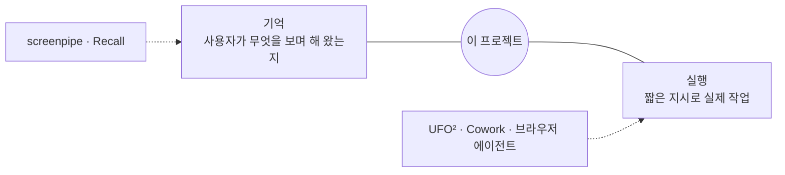

# 비슷한 제품 조사

2026-10-21 조사. 출처 대부분이 업체가 쓴 글이나 비교 블로그라 가격·기능은 공식 사이트에서 다시 확인한다.

## 결론

- **실행** 쪽(UFO², Cowork, 브라우저 에이전트)은 요청 순간의 화면만 본다. 사용자가 맥락을 직접 설명하고 작업을 일일이 지시해야 한다.
- **기억** 쪽(screenpipe, Recall)은 화면 히스토리를 쌓고 검색하게 하지만 직접 일하지 않는다.
- 조사한 범위에서는 둘을 함께 하는 제품을 찾지 못했다. 이 자리를 [상위 컨셉](../vision.md)으로 삼는다.

## 실행 쪽

### Microsoft UFO²

- Windows 데스크톱 에이전트. MIT 오픈소스, CLI로 쓴다. 여러 LLM(OpenAI, Claude, Gemini 등)을 붙일 수 있다.
- **보기**: UI Automation 접근성 트리가 기본. 부실한 화면은 스크린샷 + OmniParser로 보충한다. 우리 [0024](../decisions/0024-observation-common-plus-enrichment.md)의 "공통 관찰 + 선택적 강화"와 같은 모양이다.
- **일하기**: HostAgent가 요청을 쪼개고 프로그램을 고른다. 프로그램마다 AppAgent가 들어가 조작한다.
- **조작**: 전용 API(엑셀 xlwings, 아웃룩 win32com)를 먼저, 없으면 범용 클릭·입력. 프로그램별 능력은 MCP 서버로 붙인다.
- **화면 속 화면**: 원격 데스크톱 방식의 가상 화면에서 일해 사용자가 마우스를 뺏기지 않는다.
- **기억**: 도움말 문서, 웹 검색, 과거 실행 기록을 찾아 쓴다. 사용자 활동 기록은 없다.
- 한계: 성능 주장의 근거가 순환적이라는 독립 비평이 있다.
- 출처: [문서](https://microsoft.github.io/UFO/ufo2/overview/), [논문](https://arxiv.org/html/2504.14603v1), [GitHub](https://github.com/microsoft/UFO), [Pith 리뷰](https://pith.science/paper/2504.14603)

### Claude Cowork

- Anthropic의 데스크톱 에이전트. Claude Code의 에이전트 구조를 Claude 데스크톱 앱에 넣었다. 허락한 폴더 안에서 일한다. Windows판이 있다. 아직 자세히 조사하지 않았다.
- Microsoft Copilot Cowork는 이를 바탕으로 Microsoft 365 안에서 일하는 클라우드 판이다.
- 출처: [가이드](https://aifordevelopers.substack.com/p/the-complete-guide-to-claude-cowork), [VentureBeat](https://venturebeat.com/technology/anthropics-claude-cowork-finally-lands-on-windows-and-it-wants-to-automate)

### 브라우저 에이전트

- Claude in Chrome(확장), Gemini in Chrome(자동 브라우징), Perplexity Comet(브라우저)가 로그인된 사용자 브라우저에서 일한다. 로그인 상태를 쓰므로 프롬프트 주입 위험이 반복해서 지적된다.
- 출처: [browser-use 비교](https://browser-use.com/best-web-agents), [비교 글](https://www.tarekalaaddin.com/blog/best-ai-browsers-compared)

## 기억 쪽

### screenpipe

- 화면 글자(OCR)와 소리를 받아 적어 로컬 DB에 쌓고 검색하게 한다. Windows·Mac·Linux. 소스 공개(오픈소스 아님). 무료 등급과 유료 등급이 있다.
- "pipes": 기록 위에서 도는 자동화(회의 받아 적기, 할 일 뽑기).
- MCP 서버로 Claude 같은 에이전트가 기록을 검색한다. 도구 목록은 자료마다 다르다(`search`, `search_time_range`, `recent_context` 등).
- 스스로 나서거나 컴퓨터를 조작한다는 근거는 찾지 못했다.
- 출처: [screenpipe 블로그](https://screenpipe.com/blog/screen-assistant-ai-2026), [MCP 도구](https://screenpi.pe/resources/use-cases/mcp-tools), [AI Agent Index](https://theaiagentindex.com/agents/screenpipe)

### 그 밖

- **Windows Recall**: Windows 11 내장, 스냅샷을 로컬에 두고 검색한다. Copilot+ PC 전용, 외부 API 없음. [위키백과](https://en.wikipedia.org/wiki/Windows_Recall)
- **OpenRecall**: Recall의 오픈소스(AGPL) 판. [비교](https://luci.memories.ai/alternatives/microsoft-recall)
- **Limitless(옛 Rewind)**: 화면·소리 기록 검색. Mac 위주.
- **Littlebird**: 활성 창을 읽고 회의를 받아 적어 기억하는 조수. [블로그](https://littlebird.ai/blog/best-ai-assistants-with-memory)
- **Jarvis**: 단축키를 누를 때만 화면을 본다. 지난 화면을 되돌아보지 못한다. [소개](https://www.getjarvis.eu/alternatives/screenpipe-alternative)
