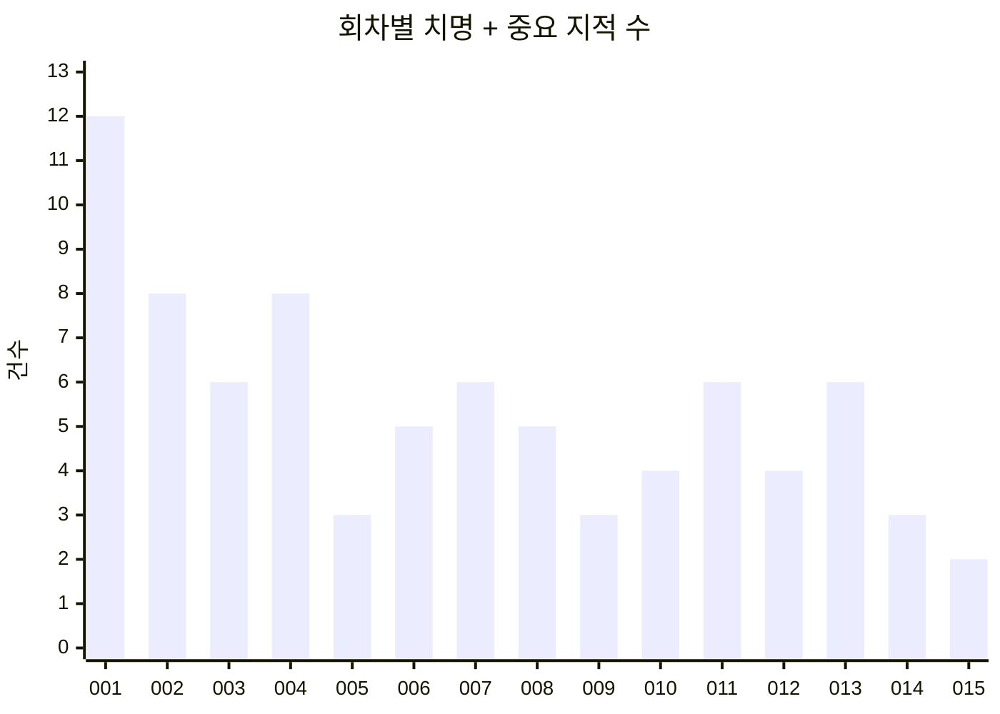

# 검수 루프 회차별 요약 (검수 001~015)

검수 회차마다 **지적받은 항목**과 **고친 것**만 짧게 모은 문서다. 근거·대안 비교·실측 수치는 회차별 판정(`rounds/NNN.md`)과 고친 기록(`rounds/NNN-fix.md`)에, 진행 기록은 [`progress.md`](progress.md)에 있다.

- 기간: 2026-10-15 ~ 2026-10-19. 15회 모두 불통과, 연속 통과 0. 2026-10-19 사용자 요청으로 중단했다(다음은 검수 016).
- 통과 조건: 필수 칸 100%, 모든 점수 4 이상, 치명·중요 0건.
- 지적은 치명·중요를 모두 적고, 사소는 한 줄로 묶었다.

## 흐름

| 검수 | 치명 | 중요 | 사소 | 메모 |
|---|---|---|---|---|
| 001 | 3 | 9 | 3 | 아는 결함 K-1~K-5 모두 지적 |
| 002 | 0 | 8 | 6 | 치명 0 |
| 003 | 0 | 6 | 5 | |
| 004 | 1 | 7 | 5 | 몸·기분·시간은 4점대, 대사·기억이 남음 |
| 005 | 0 | 3 | 5 | |
| 006 | 0 | 5 | 7 | |
| 007 | 0 | 6 | 6 | |
| 008 | 0 | 5 | 6 | |
| 009 | 0 | 3 | 5 | |
| 010 | 0 | 4 | 7 | 명령 따르기 등 새 관점 |
| 011 | 0 | 6 | 5 | 3점 6개 |
| 012 | 0 | 4 | 4 | 3점 5개 |
| 013 | 0 | 6 | 6 | 3점 5개(012 고치기의 역효과 포함) |
| 014 | 0 | 3 | 6 | 3점 2개 |
| 015 | 0 | 2 | 7 | 3점 2개, 나머지 4점 |

## 검수 001

**지적**
- [치명] 동작이 사실상 '서기' 하나다
- [치명] 반응이 자극과 맞지 않는다(던지기 → 지루함, 쓰다듬기 → 놀람)
- [치명] 자기 말로 자기 기분을 키워 기분이 1.00에 붙는다
- [중요] 찌르기 짜증이 30분 넘게 간다 / 밤에 졸리지 않는다 / 혼자 두면 무서워하고 돌아와도 반기지 않는다 / 같은 대사 반복 / 기분별 움직임이 체감되지 않는다 / 분노·행복이 함께 높다 / 던지기를 '뭔가 날아왔다'로 이해 / 질문에 안 답하고 위로를 뒤집는다 / 기분 변화 크기가 이벤트와 안 맞는다
- [사소] "멍" 시작 일색, 이유 없는 사과, 한 문장 타이핑에 두 번 재촉

**고친 것**
- 기분 변화 모형: 우리 평가 사전값 + Jev 조정 + 반대 기분 억제([0015](../decisions/0015-appraisal-prior-mood-change.md))
- 동작 선택: 우리 모형 중심([0016](../decisions/0016-action-model-ours-first.md)). 가장 흔한 동작 0.63 → 0.33~0.40
- 시간 감각: 반감기 줄임 + 하루 리듬
- 기분별 움직임: 기준값 대비 ×4
- 대사 지시: 이벤트 뜻, 대화 규칙, 최근 한 말
- 끼어들기는 한 문장에 한마디

## 검수 002

**지적**
- [중요] 기분이 0·1에 붙는다(쓰다듬기 한 번에 나쁜 기분이 0) / 자기 말 뒤 원인 없는 반응 / 질문해 놓고 답을 안 기다린다 / 욕·무시에 서운해하지 않는다 / 예민한 강아지도 1분 만에 행복 0.97 / 연타가 기분을 몇 배로 올리고 늘 놀람 / 끼어들기가 늘 "무슨 글 써?" / 혼자 8시간: 졸림 0·심심함 1
- [사소] 시간 착각, 욕 직후 꼬리 흔듦, 군말 반복, Jev 실패 시 찌르기 효과 사라짐, 집 안에서 움직임 전송, 세게 던져도 20분이면 잊음

**고친 것**
- 기분 갱신 수식: 남은 여유에 비례, 포화 합산, 대상 기분만 습관화, 경계하는 쓰다듬기, Jev 실패 시 사전값
- 질문하면 답을 기다림
- 거절·무시는 서운함(관계 해석)
- 타이핑 습관화 + 쓰는 중인 글에 반응하는 끼어들기
- 오래 혼자면 심심함 대신 졸음
- 사소 모음

## 검수 003

**지적**
- [중요] 조용하면 서운해한다(일한다고 해도) / 오지 않은 복귀를 지어낸다 / "10분" 읊기·존댓말 / 성격이 평소 움직임에 안 드러남 / 세게 던져도 무서움 반응 0 / 고른 것을 뒤집고 역할을 바꾼다
- [사소] 기분과 말투 어긋남, 들뜬·무서운 강아지가 잠, 행복이 마구 뛰는 움직임, 연타 뒤 분노가 끝에 붙음, 키 오류 때 찔러도 기분 그대로

**고친 것**
- 기분 인과: 조용함, 던지기, 사과, 키 오류
- 대사 지시: 복귀 지어내기, 분 읊기, 존댓말, 선택 뒤집기 금지
- 움직임·동작 표: 성격 효과(탄생 평균 대비), 잠은 졸릴 때만, 짜증은 외면

## 검수 004

**지적**
- [치명] 하지 않은 말을 했다고 지어내고 고른 것을 뒤집는다
- [중요] 하룻밤 지나면 생일을 잊는다 / 역할 혼동 / 무서움·들뜸 함께 높음 / 성마른 강아지가 쓰다듬기에 더 크게 행복 / 일하는 주인 곁 조용함에 서운함 되풀이 / 속상한 이야기·질문에 침묵 / 성격마다 말투가 같다
- [사소] 곁에 있는 주인에게 "어디 갔어?", 잠 동작 0, 무서움 0.84에 행복 반응, 연타 뒤 분노 1 근처, 들떠도 놀기 7% 이하

**고친 것**
- 대사의 기억과 일관성: 대화 기록 20줄 + 정직·기억·주체 규칙
- 기분끼리의 상호작용: 결합 평균 회귀, 절대 수준 경계
- 질문·속상한 이야기에는 대답(로짓 +3)
- 성격별 말투: 기준값 → 말투 지시·문장 수
- 사소 모음: 하품 → 잠, 놀기 보이게

## 검수 005

**지적**
- [중요] 연달아 말하기가 잦고 기계적(과묵도) / 주인이 곁에 있는지·누가 집에 들어갔는지 지어냄 / 주인이 속상하다는데 궁금해하고 기뻐함
- [사소] 사과 치는 중 서운함, 말버릇·'화면' 같은 말, 혼자 두면 하품만, "다시 말해 줘" 무시, 들뜸이 오래 감

**고친 것**
- 이어 말하기는 우리 모형(평균 대비 말수 × 횟수 감쇠)
- 공감: Jev 질문 "사용자 속상함" 추가, 다시 녹화
- 지금 상황 사실: 주인 곁/자리 비움/돌아옴, 집에서 나온 쪽
- 사소 모음: 부탁도 질문, 컴퓨터 말 금지, 들뜸 반감기 7분

## 검수 006

**지적**
- [중요] 사과하면 더 서운해한다 / 일한다는 주인을 2시간 내내 조른다 / 8시간 만의 귀가를 말로만 반기고 몸은 졸림 / "내일이 내 생일"을 틀리게 계산 / 방금 한 말을 뒤집는다
- [사소] 집·사과 역할 혼동, 겁먹은 덧말이 밝음, 연타 분노 0.90, 걱정이 '서운함'으로 찍힘, 놀아 줘도 들뜸 약함, 군더더기, 하네스 '말하는 중' 단계 없음

**고친 것**
- 달램: Jev 질문 "사과·달램" 추가, 다시 녹화. 돌아오면 잠이 깸
- 말하기 리듬: 대꾸 없으면 줄어듦, 끼어들기 메시지당 한 번, 덧말 상한
- 날짜는 우리가 계산, 방금 한 말을 사실로
- 사소 모음: 지금 기분 말투, 묶음 안 같은 자극 1/√k

## 검수 007

**지적**
- [중요] 겁먹은 강아지가 쓰다듬기에 기뻐하며 조름 / "말 걸지 마" 10분 뒤 말을 건다 / 선택 뒤집기, 끼어든 말과 답이 어긋남 / 끼어들기가 덜 친 글을 엉뚱하게 읽음 / 반기는 말이 같은 틀 / 겁에 질려서도 쉬지 않고 말함
- [사소] 집 역할 흔들림, 존댓말, 몰아친 묶음 안에서 덜 무서워함, 사과에 시무룩 그대로, 무서워도 물러나지 않음, 무서움·들뜸 잠깐 공존

**고친 것**
- 겁먹은 상태가 기쁨 반응·조르기·말하기·덧말을 누름
- "말 걸지 마": Jev 질문 "조용히 해 달라는 부탁" 추가, 1시간 먼저 말 걸기 −5
- 대사: 끼어들기 단정 금지, 선택 유지, 반김에 비운 시간·틀 금지

## 검수 008

**지적**
- [중요] 끼어들기가 첫 10글자 조각에서 나와 오독 / 하지 않은 행동·없는 물건을 지어냄 / 놀란 직후 "이제 괜찮아졌어" 덧말이 잦음 / 반기는 말이 매번 "드디어 …" / 사과 한 마디가 던져진 무서움을 쓰다듬기보다 빨리 끈다
- [사소] 집 역할 혼동, 무서움·들뜸 공존, "놀자"에 무응답, 일하는 주인에게 서운함, 새 강아지끼리 구별 안 됨, 낮은 확률 동작이 튐

**고친 것**
- 말하기 리듬: 15자 미만 끼어들기 막음, 덧말 목표 10%
- 달램을 기분마다: 말은 서운함을 크게, 무서움은 조금
- 대사: 동작 범위·없는 물건 금지, 놀란 직후 덧말 억제, "드디어" 걷기

## 검수 009

**지적**
- [중요] 상황마다 같은 틀("옆에 있을게", "목 빠지는 줄 알았어") / 대꾸가 없어도 갈수록 길게 조름 / 화면 밖 장소·물건에 있다고 지어냄
- [사소] 쓰다듬기에 일어나지 않은 놀람을 말함, 동작 쏠림, 맥락 오독, 무서움·들뜸 공존, 사과에 궁금함 반응

**고친 것**
- 되풀이 표현 금지 목록, 화면 밖 장소·틀 문장 걸러 내기
- 무시당하면 덧말도 준다, "말 걸지 마" 동안 덧말 0

## 검수 010

**지적**
- [중요] 명령을 따르지 않고 말과 동작이 어긋남 / 사과에 절반 넘게 무응답 / 같은 틀 되풀이(집 = 답답, 위로 = 옆에 있을게, 간식) / 쉬운 질문을 흘리고 "사용자" 같은 시스템 낱말이 샘
- [사소] 들뜸 남음, "말 걸지 마" 뒤 말 걺, 초기화 강아지가 거의 같음, 몸 반응이 성격과 무관, 하소연이 욕보다 서운함, 찔러 깨워도 졸림 그대로, 짜증인데 쉬기 80%

**고친 것**
- 메시지에서는 Jev 동작을 더 믿음, 말한 동작 = 뽑힌 동작
- 사과에는 대답, 대사의 "사용자" → "너"
- 지시 속 예시 문장을 걷고 원칙만
- 사소 모음: 공감 0.35, 찌르면 잠이 깸

## 검수 011

**지적**
- [중요] "꼬리" 입버릇과 자세 해설 / 혼자 둘 때 먼저 하는 말이 한 틀 / 화면에 없는 세계·지난 일을 지어냄 / 사용자가 한 일을 자기 일로 받음 / "짖어 봐"·"일어나"에 몸이 안 따름 / 던진 걸 사과하면 더 무서워함
- [사소] 신나면 조르기뿐, 핀잔 뒤 "기분 최고", 살짝 떨어뜨림에 크게 투덜, "자자" 뒤 새벽에 말 걺, 초기화 강아지가 같음

**고친 것**
- 대사의 세계·역할·실마리: 꼬리 해설 걷기, 끝맺음 틀 금지, 혼자 둘 때 꺼낼 이야기, 아는 세계 규칙, 주인 일·집에 넣은 이유를 사실로
- 사과의 효과: 사과 뜻이면 부정 기분 상승을 믿지 않음, 달램은 넘친 만큼에 비례, 말 한 번 상한
- 명령: Jev 질문 "시킨 동작" 추가, 따를지는 친밀도·화남·변덕으로 우리 모형이 정함, 자기 말 뒤 자세 유지

## 검수 012

**지적**
- [중요] "됐어"·"일 좀 할게"에 서운함이 쌓여 20분+ / 주인 말 오독·지어내기("이제 자"를 주인이 자는 것으로) / 명령 순종 들쭉날쭉("이제 자" 0/4)·말과 동작 어긋남 / 타이핑 중 자세가 1~2초마다 바뀜
- [사소] 하품에 짖기·조르기, 동작 쏠림, "말 걸지 마" 뒤 드물게 말 걺, 무서움·들뜸 공존

**고친 것**
- 서운함은 한 번만 셈(세 출처 중 최댓값), 혼자 있게 해 달라는 부탁은 거절이 아님
- 시킨 잠은 엎드리기, 듣는 동안 자세 유지, 시킨 동작을 했는지 대사 사실로
- 주인 말의 뜻을 사실로(부탁이면 위로 끔), 지어낸 문장 거르기

## 검수 013

**지적**
- [중요] 모진 말을 "주인이 속상하다"로 읽고 위로 / "저리 가 귀찮아"에 거의 안 서운함(012 부탁 보정의 역효과) / 집에서 꺼낸 뒤 역할 혼동 / 자세 해설·"몸이 근질거려" 반복 / 성마른 강아지가 성마르게 안 보임 / 질문·고백에 의성어 한마디
- [사소] 없는 감각 지어냄, 명령 어길 때 엉뚱한 동작, 8시간 귀가 반김 약함, 조용할 때 무서움 상승, 졸린데 조름, 기타 대사

**고친 것**
- Jev 질문 "모진 말" 추가: 담백한 부탁 = 부탁 × (1 − 모진 말), 모진 말에는 위로 대신 서운함
- 기질: 기준값이 높은 기분을 잘 드러냄(성마르면 짜증), 이미 놀랐으면 덜 놀람, 동작에도 기질 항, 화나면 안 조름
- 다듬기: 의성어 문장은 다음 문장에 붙여 셈, 몸짓 해설 거르기 넓힘, 집에서 나온 뒤 주인이 떠난 듯한 문장 뺌, 의성어뿐인 대답은 말하지 않음

## 검수 014

**지적**
- [중요] 직접 물었는데 침묵(013 의성어 버리기의 역효과) / 대사가 "!"로 시작 / 새벽 "잘 자" 뒤 안 자고 지루함·말 걸기
- [사소] 반응·동작 가끔 어긋남, 쓰다듬기에 "놀랐잖아", "옆에 있을게" 쏠림, 지문·역할 바뀜, 무서움·들뜸 공존, "말 걸지 마" 뒤 조르기

**고친 것**
- 의성어뿐인 대답은 한 번 다시 묻기, "드디어" 걷은 뒤 문장부호 지우기
- 잠자리: "잘 자"(시킨 잠)면 8시간 동안 먼저 말 걸지 않고, 조용함은 졸림으로

## 검수 015

**지적**
- [중요] 행선지를 말하고 나갔는데 돌아오면 "어디 갔다 왔어?" / 물음표 없는 소식에 대답 74%(목표 85%)
- [사소] 기분과 어긋난 대사, 지어낸 말, 위로·몸 해설 틀, 쓰다듬기에 말은 안 무뎌짐, 잠자리에 말함, 놀람이 1.5~2분 남음, 무서움·들뜸 공존

**고친 것**
- 돌아오면 떠나기 전 주인 말과 비운 시간을 사실로, 금지어 "목 빠·눈 빠"
- 답하기 85% 목표를 소식에만 적용(시뮬레이션이 질문을 따로 셈), 녹화 메시지를 소식으로 바꾸고 다시 보정

## 되풀이된 지적

여러 회차에 걸쳐 다시 나온 지적이다. 다음 검수에서 먼저 볼 만하다.

| 지적 | 나온 회차 | 지금 |
|---|---|---|
| 반대 기분 공존(무서움·들뜸) | 004·007·008·009·012·014·015 | 활발한 강아지가 세게 던져진 뒤 약 1분. 사소로 남음 |
| 역할 혼동(집, 던져짐, 떠남) | 004·005·006·007·008·011·013 | 사실 문장 + 다듬기로 줄어듦 |
| 위로 틀 "옆에 있을게" | 009·010·011·014·015 | 되풀이 금지 목록이 며칠에 걸쳐 막음. 사소로 남음 |
| 명령 따르기 | 010·011·012 | 시킨 동작 질문 + 순종 모형으로 고침 |
| 일하는 주인 곁 서운함 | 003·004·008·012 | 부탁 = 거절 아님(012), 모진 말 분리(013) |
| 지어내기(화면 밖, 물건, 감각) | 003·008·009·011·012·013·015 | 아는 세계 규칙 + 금지어. 사소로 남음 |
| 고치기의 역효과 | 013(012 부탁 보정), 014(013 의성어 버리기·"드디어" 걷기) | 다음 회차에 바로잡음 |
