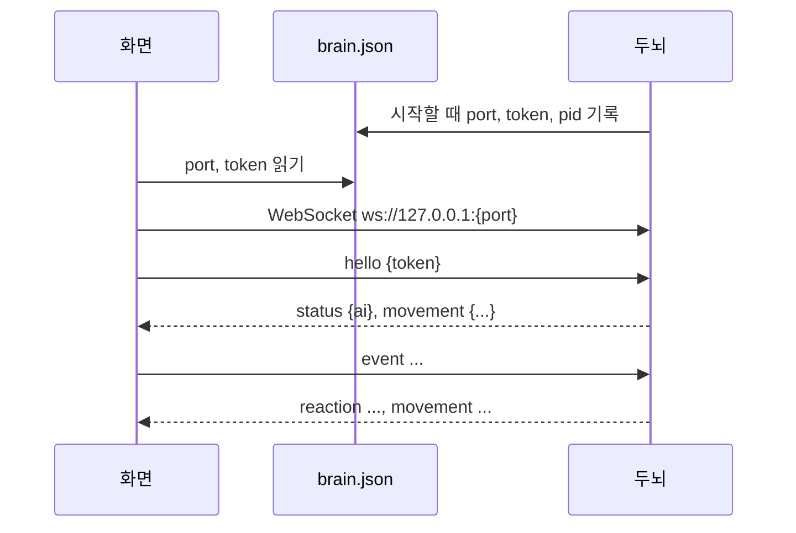

# 두뇌 v2 구현 계획

> **For agentic workers:** REQUIRED SUB-SKILL: Use superpowers:subagent-driven-development (recommended) or superpowers:executing-plans to implement this plan task-by-task. Steps use checkbox (`- [ ]`) syntax for tracking.

**Goal:** 두뇌를 이벤트 단위 판단 + 확률 모델(Jev 분포 × 우리 모형) + 기분 시계로 다시 만들고, 화면이 이벤트를 내고 움직임 경향으로 평소 움직임을 뽑게 한다.

**Architecture:** `brain/brain/model.py`가 확률 모델(탄생·평균 회귀·습관화·뽑기·말할 확률·움직임 경향)을 순수 함수로 갖는다. `core.py`는 이벤트를 모아 Jev를 한 번 부르고 모델을 적용하며, 기분 시계로 경향이 바뀔 때 화면에 보낸다. `store.py`가 이벤트 기록과 강아지 상태를 SQLite에 둔다. `brain/sim/`이 Jev 응답을 녹화해 시뮬레이션으로 보정값을 맞춘다. 화면은 프로토콜 v2 이벤트를 내고 `movement`로 평소 움직임을 뽑는다.

**Tech Stack:** Python 3.11+(uv), typesafe-sdk, google-genai, websockets, keyring, pytest / Tauri 2, TypeScript, Vitest.

**Spec:** [`docs/superpowers/specs/2026-10-15-brain-v2-design.md`](../specs/2026-10-15-brain-v2-design.md), 결정 [0013](../../decisions/0013-event-driven-brain-with-event-log.md)·[0014](../../decisions/0014-probabilistic-model-with-jev-distributions.md)

## Global Constraints

- 프로토콜 `v: 2`. 화면→두뇌: `hello`, `event{kind, context}`, `set_key`, `clear_history`. 두뇌→화면: `reaction{reaction?, action?, utterance?}`, `status{ai}`, `movement{weights, run, idle_scale}`.
- 이벤트 종류: `typing` `message` `dog_spoke` `quiet` `returned` `house_in` `house_out` `poke` `pet` `throw`.
- 반응: `joy` `curious` `surprised` `annoyed` `sad` `scared` `none`. 동작: `stand` `sit` `lie_down` `sleep` `beg` `bark` `none`. 움직임 범주: `rest` `sleep` `roam` `approach` `play` `explore`.
- 기분 5차원 키(한국어, Jev·Gemini state에 그대로): `심심함` `졸림` `들뜸` `시무룩` `분노`. 모든 수치 0~1, state에는 소수 둘째 자리.
- Jev 호출은 이벤트(모은 묶음)당 1번, 질문 4개(`reaction` `action` `speak` `change`). 기분 시계는 Jev를 부르지 않는다.
- 질문 문구·정책 설명은 `questions.py`, 잠정값·방향표는 `tuning.py` 한곳 (CLAUDE.md 3·4절).
- 키와 대화 내용은 로그에 쓰지 않는다. 환경 변수는 `config.py`에서만 읽는다.
- 무작위는 `random.Random` 인스턴스를 주입한다(테스트는 시드 고정).
- 개발용 앱(`npm run tauri dev`)은 확인이 끝나면 바로 닫는다.

## Review Focus

1. **강아지 상태를 읽다 실패** → 새로 태어나게 하지 않고 기본값으로 계속하며, 저장된 성격을 덮어쓰지 않는다. (Task 6 `test_unreadable_state_keeps_stored_personality`)
2. **판단 중 이벤트가 몰림(찌르기 연타)** → 다음 판단 한 번에 묶이고 밀리지 않는다. (Task 6 `test_events_during_judgement_are_batched`)
3. **강아지가 혼자 계속 말함** → 사용자 입력 없이 3번이면 멈추고, typing이 오면 다시 셀 수 있다. (Task 2 `test_streak_cap`, Task 6 `test_dog_spoke_chain_stops_at_cap`)
4. **며칠 꺼 뒀다 켬(긴 Δt)** → 기분이 기준값 근처로 돌아가고 값이 0~1을 벗어나지 않으며, 성격이 하루치만 움직인다. (Task 1 `test_long_gap_returns_near_baseline`, `test_drift_once_per_day_change`)
5. **두뇌가 없거나 movement를 아직 못 받음** → 화면은 기본 경향으로 평소처럼 움직인다. (Task 11 `두뇌가 없으면 기본 경향으로 움직인다`)

---

## 파일 구조

| 파일 | 책임 |
|---|---|
| `brain/brain/tuning.py` | 잠정값(`Tuning`), 방향표, 탄생 분포, 이벤트 종류 |
| `brain/brain/model.py` | 확률 모델 순수 함수, 어휘(반응·동작·움직임), 강아지 상태 직렬화 |
| `brain/brain/store.py` | 이벤트 기록·강아지 상태 저장, v1 대화 옮기기 (`memory.py` 대체) |
| `brain/brain/questions.py` | Jev 질문 4개·정책 설명, 이벤트 설명, 기록 문장, Jev state |
| `brain/brain/persona.py` | 기본 성격, Gemini 지시·프롬프트, 대사 다듬기 |
| `brain/brain/clients.py` | Jev(`Readout`)·Gemini 클라이언트 |
| `brain/brain/core.py` | 이벤트 처리·모으기·판단·폐기·기분 시계·movement 전송 |
| `brain/brain/server.py`, `__main__.py` | 프로토콜 v2 전송 계층, 실행 |
| `brain/sim/record.py`, `brain/sim/simulate.py` | Jev 녹화, 시뮬레이터·보정값 맞추기 |
| `app/src/shared/brain-protocol.ts` | 프로토콜 v2 타입·해석 |
| `app/src/body/events.ts` | 타이핑 판정·조용함·충격 정규화 (순수) |
| `app/src/body/dog.ts`, `petting.ts` | 던지기 충격 기록, 쓰다듬기 시간, movement 기반 평소 움직임 |
| `app/src/character.ts`, `input.ts`, `settings-page.ts`, `settings.html`, `shared/settings.ts` | 이벤트 내기, movement 반영, 쉬기 켜기/끄기 |

없애는 파일: `brain/brain/memory.py`, `brain/tests/test_memory.py`, `brain/tests/test_core_flow.py`, `brain/tests/test_core_schedule.py`, `brain/tests/test_questions_persona.py`(새 테스트로 대체).

**전환 구간 주의**: Task 4~7은 v1 두뇌(`core.py`, `questions.py`, `persona.py`, `memory.py`)를 v2로 갈아 끼우는 구간이다. Task 4부터 Task 7 끝까지는 v1 테스트와 `test_server.py`가 import 오류로 깨진다. 이 구간에서는 각 Task가 이름을 댄 테스트 파일만 돌리고, **Task 7 끝에서 전체 `uv run pytest`가 다시 초록**이어야 한다.

---

### Task 1: 잠정값과 강아지 상태 (탄생·평균 회귀·성격 변화)

**Files:**
- Modify: `brain/brain/tuning.py` (전체 교체)
- Create: `brain/brain/model.py`
- Test: `brain/tests/test_model_state.py`

**Interfaces:**
- Produces: `tuning.MOODS`, `tuning.EVENT_KINDS`, `tuning.Tuning`, 방향표 상수(아래 코드). `model.Personality(baseline, sensitivity, whim)`, `model.Dog(personality, mood, intimacy, updated_at, day, day_sum, day_count, habit)`, `model.birth(rng, now)`, `model.default_dog(now)`, `model.advance(dog, now, rng, t)`, `model.record_mood(dog)`, `model.dog_to_dict(dog)`, `model.dog_from_dict(d)`, `model.clip(x, lo=0, hi=1)`.

- [ ] **Step 1: 실패하는 테스트를 쓴다**

`brain/tests/test_model_state.py`:

```python
import json
import random
from dataclasses import replace
from datetime import datetime

import pytest

from brain import model
from brain.tuning import BASELINE_RANGE, MOODS, SENS_RANGE, Tuning

T = Tuning()
QUIET = replace(T, mood_noise=0.0)


def ts(d=15, h=12):
    return datetime(2026, 10, d, h).timestamp()


def test_birth_is_random_within_ranges():
    a, b = model.birth(random.Random(1), ts()), model.birth(random.Random(2), ts())
    assert a.personality != b.personality
    for dog in (a, b):
        for d in MOODS:
            assert BASELINE_RANGE[0] <= dog.personality.baseline[d] <= BASELINE_RANGE[1]
            assert SENS_RANGE[0] <= dog.personality.sensitivity[d] <= SENS_RANGE[1]
        assert 0 <= dog.personality.whim <= 1
        assert dog.mood == dog.personality.baseline
        assert dog.intimacy == 0.3


def test_birth_mean_matches_default_personality():
    dogs = [model.birth(random.Random(i), ts()) for i in range(400)]
    assert abs(sum(x.personality.baseline["심심함"] for x in dogs) / 400 - 0.6) < 0.02


def test_zero_gap_keeps_mood():
    dog = model.default_dog(ts())
    dog.mood["분노"] = 0.9
    model.advance(dog, ts(), random.Random(0), T)
    assert dog.mood["분노"] == 0.9


def test_mood_halves_toward_baseline_in_half_life():
    dog = model.default_dog(ts())  # 분노 기준값 0.1 → 반감기 1800 × (0.5 + 0.1) = 1080초
    dog.mood["분노"] = 0.9
    model.advance(dog, ts() + 1080, random.Random(0), QUIET)
    assert dog.mood["분노"] == pytest.approx(0.5, abs=1e-6)


def test_higher_baseline_recovers_slower():
    low, high = model.default_dog(ts()), model.default_dog(ts())
    low.personality.baseline["분노"], high.personality.baseline["분노"] = 0.2, 0.8
    low.mood["분노"], high.mood["분노"] = 0.3, 0.9
    for dog in (low, high):
        model.advance(dog, ts() + 1800, random.Random(0), QUIET)
    assert (high.mood["분노"] - 0.8) / 0.1 > (low.mood["분노"] - 0.2) / 0.1


def test_long_gap_returns_near_baseline():
    dog = model.default_dog(ts())
    dog.mood = {d: 1.0 for d in MOODS}
    model.advance(dog, ts() + 3 * 86400, random.Random(3), T)
    for d in MOODS:
        assert 0 <= dog.mood[d] <= 1
        assert abs(dog.mood[d] - dog.personality.baseline[d]) < 0.25


def test_intimacy_cools_over_two_weeks():
    dog = model.default_dog(ts())
    dog.intimacy = 0.9
    model.advance(dog, ts() + 14 * 86400, random.Random(0), QUIET)
    assert dog.intimacy == pytest.approx(0.6, abs=1e-6)


def test_habit_recovers_with_time():
    dog = model.default_dog(ts())
    dog.habit["poke"] = 0.8
    model.advance(dog, ts() + 3600, random.Random(0), QUIET)
    assert dog.habit["poke"] == pytest.approx(0.4, abs=1e-6)


def test_drift_once_per_day_change():
    dog = model.default_dog(ts(15, 10))
    for _ in range(10):
        dog.mood["들뜸"] = 0.9
        model.record_mood(dog)
    model.advance(dog, ts(16, 9), random.Random(0), QUIET)
    assert dog.personality.baseline["들뜸"] == pytest.approx(0.4 + 0.05 * (0.9 - 0.4))
    model.advance(dog, ts(16, 18), random.Random(0), QUIET)
    assert dog.personality.baseline["들뜸"] == pytest.approx(0.425)


def test_round_trip_through_json():
    dog = model.birth(random.Random(5), ts())
    data = json.loads(json.dumps(model.dog_to_dict(dog), ensure_ascii=False))
    assert model.dog_from_dict(data) == dog
```

- [ ] **Step 2: 실패를 확인한다**

Run: `cd brain && uv run pytest tests/test_model_state.py -q`
Expected: FAIL — `ImportError` (model 없음)

- [ ] **Step 3: 구현한다**

`brain/brain/tuning.py` (전체 교체):

```python
"""잠정값·방향표와 근거 (두뇌 스펙 v2 4·6·6.5·9절). 시뮬레이션(brain/sim)으로 맞추고 평가로 다시 본다.
방향표는 +1/−1만 정하고, 세기는 Tuning의 w·scale 값이 정한다."""
from dataclasses import dataclass, field

MOODS = ("심심함", "졸림", "들뜸", "시무룩", "분노")
EVENT_KINDS = ("typing", "message", "dog_spoke", "quiet", "returned", "house_in", "house_out", "poke", "pet", "throw")

# 탄생 (스펙 4.1): "호기심 많고 수다스러운 강아지"를 숫자로 옮긴 평균
BIRTH_BASELINE = {"심심함": 0.6, "졸림": 0.3, "들뜸": 0.4, "시무룩": 0.2, "분노": 0.1}
BIRTH_SD = 0.1
BASELINE_RANGE = (0.05, 0.95)
BIRTH_SENS, SENS_SD, SENS_RANGE = 0.5, 0.1, (0.2, 0.9)
BIRTH_WHIM, WHIM_SD = 0.5, 0.15
INTIMACY_START = 0.3

# 반응·동작 보정 (스펙 6절): 기분→반응 A, 기분→동작 B, 반응→동작 C
MOOD_REACTION = {"annoyed": {"분노": 1}, "sad": {"시무룩": 1}, "joy": {"들뜸": 1, "심심함": 1},
                 "curious": {"심심함": 1}, "none": {"졸림": 1}}
MOOD_ACTION = {"sleep": {"졸림": 1}, "lie_down": {"졸림": 1, "시무룩": 1}, "bark": {"들뜸": 1, "분노": 1}, "beg": {"심심함": 1}}
REACTION_ACTION = {"surprised": {"bark": 1}, "annoyed": {"bark": 1}, "scared": {"bark": 1},
                   "joy": {"beg": 1}, "sad": {"lie_down": 1}, "curious": {"stand": 1}}
# 말수 (스펙 6절 3): 독립 파라미터가 아니라 친밀도·기분·기준값에서 계산한다 (사용자 결정, 분노는 −)
TALK_MOOD = {"심심함": 1, "들뜸": 1, "졸림": -1, "시무룩": -1, "분노": -1}
TALK_BASELINE = {"심심함": 1, "들뜸": 1, "졸림": -1, "시무룩": -1, "분노": -1}
# 습관화 (스펙 4.5): 대상 자극과 그 자극이 주로 건드리는 기분
HABIT_KINDS = {"poke": "분노", "pet": "들뜸", "throw": "들뜸"}
# 평소 움직임 경향 (스펙 6.5). 기본값은 몸체 "보통" 프로필과 같다
MOVE_BASE = {"rest": 0.6, "sleep": 0.02, "roam": 0.4, "approach": 0.18, "play": 0.06, "explore": 0.2}
MOVE_MOOD = {"rest": {"졸림": 1, "시무룩": 1, "들뜸": -1}, "sleep": {"졸림": 1, "들뜸": -1, "심심함": -1},
             "roam": {"심심함": 1, "들뜸": 1, "졸림": -1, "시무룩": -1},
             "approach": {"심심함": 1, "들뜸": 1, "분노": -1, "시무룩": -1},
             "play": {"들뜸": 1, "졸림": -1, "시무룩": -1, "분노": -1}, "explore": {"심심함": 1, "졸림": -1}}
MOVE_BASELINE = {"rest": {"졸림": 1}, "sleep": {"졸림": 1}, "roam": {"심심함": 1},
                 "approach": {"심심함": 1, "들뜸": 1}, "play": {"들뜸": 1}, "explore": {"심심함": 1}}
MOVE_INTIMACY = {"approach": 1, "play": 1}
RUN_BASE, RUN_MOOD = 0.2, {"들뜸": 1, "졸림": -1}
IDLE_MOOD = {"졸림": 1, "시무룩": 1, "들뜸": -1}


@dataclass(frozen=True)
class Tuning:
    jev_timeout_s: float = 3.0          # SDK 기본 10초는 실시간 반응에 너무 길다 (v1)
    gemini_timeout_s: float = 5.0       # 늦은 대사는 버려질 가능성이 크다 (v1)
    recent_events: int = 30             # v1 대화 20개 + 찌르기 같은 짧은 이벤트
    max_streak: int = 3                 # 사용자 입력 없이 연달아 말하는 상한 (안전장치)
    # 기본 반감기 (기준값 0.5일 때). 실제 반감기 = 기본 × (0.5 + 기준값) (스펙 4.2)
    half_life_s: dict = field(default_factory=lambda: {"심심함": 3600.0, "졸림": 7200.0, "들뜸": 1200.0, "시무룩": 3600.0, "분노": 1800.0})
    mood_noise: float = 0.05            # 오래 두었을 때 기준값 주변 흔들림 표준편차
    intimacy_half_life_s: float = 14 * 86400.0
    change_k: float = 0.3               # 강한 내용 (P↑−P↓) ±0.6~0.7 × 민감도 0.5 → 한 이벤트에 ±0.1
    change_noise: float = 0.02
    intimacy_k: float = 0.05            # 강하게 좋은 일 약 20번에 +0.5
    drift_rate: float = 0.05            # 하루에 기준값이 어제 평균 쪽으로 5% 이동 (2주에 절반)
    habit_rate: float = 0.3             # 같은 자극 5번이면 h≈0.83 (민감도 0.5)
    habit_half_life_s: float = 3600.0   # 1시간 쉬면 습관화가 절반 풀림
    w_habit: float = 2.0
    w_mood: float = 1.0                 # 기분이 0.5 벗어나면 로그 점수 ±0.5. Jev 로그확률 차이(1~3)보다 작게
    w_sens: float = 1.0
    w_react: float = 1.0
    talk_scale: float = 1.0             # 말수 계수 크기
    kind_bias: dict = field(default_factory=lambda: {k: 0.0 for k in EVENT_KINDS})  # Task 9에서 시뮬레이션으로 맞춤
    streak_penalty: float = 1.0
    waiting_penalty: float = 1.0
    move_scale: float = 1.0
    clock_s: float = 30.0               # 기분 반감기가 20분 이상이라 30초 갱신이면 충분
    send_weight_ratio: float = 0.10     # 움직임 경향 전송 기준
    send_run_delta: float = 0.05
    send_idle_ratio: float = 0.10
```

`brain/brain/model.py`:

```python
"""확률 모델 (두뇌 스펙 v2 4·6·6.5절). 화면·전송·저장을 모르는 순수 함수다. 시각과 난수는 인자로 받는다."""
import math
from dataclasses import asdict, dataclass, field
from datetime import datetime

from .tuning import (BASELINE_RANGE, BIRTH_BASELINE, BIRTH_SD, BIRTH_SENS, BIRTH_WHIM, HABIT_KINDS,
                     INTIMACY_START, MOODS, SENS_RANGE, SENS_SD, WHIM_SD, Tuning)

LN2 = math.log(2)


def clip(x: float, lo: float = 0.0, hi: float = 1.0) -> float:
    return max(lo, min(hi, x))


@dataclass
class Personality:
    baseline: dict[str, float]      # 기분마다 기준값: 아무 일 없을 때 돌아가는 값. 겪은 일로 천천히 변한다
    sensitivity: dict[str, float]   # 기분마다 민감도: 같은 일에 움직이는 폭. 태어날 때 고정
    whim: float                     # 변덕: 뽑기 온도. 태어날 때 고정


@dataclass
class Dog:
    personality: Personality
    mood: dict[str, float]
    intimacy: float
    updated_at: float
    day: str                        # 기분 하루 평균을 모으는 날 (YYYY-MM-DD)
    day_sum: dict[str, float] = field(default_factory=lambda: {d: 0.0 for d in MOODS})
    day_count: int = 0
    habit: dict[str, float] = field(default_factory=lambda: {k: 0.0 for k in HABIT_KINDS})


def _day(ts: float) -> str:
    return datetime.fromtimestamp(ts).strftime("%Y-%m-%d")


def _new(p: Personality, now: float) -> Dog:
    return Dog(personality=p, mood=dict(p.baseline), intimacy=INTIMACY_START, updated_at=now, day=_day(now))


def default_dog(now: float) -> Dog:
    """탄생 분포의 평균. 저장된 상태를 읽지 못했을 때 쓴다."""
    return _new(Personality(dict(BIRTH_BASELINE), {d: BIRTH_SENS for d in MOODS}, BIRTH_WHIM), now)


def birth(rng, now: float) -> Dog:
    return _new(Personality(
        baseline={d: clip(rng.gauss(BIRTH_BASELINE[d], BIRTH_SD), *BASELINE_RANGE) for d in MOODS},
        sensitivity={d: clip(rng.gauss(BIRTH_SENS, SENS_SD), *SENS_RANGE) for d in MOODS},
        whim=clip(rng.gauss(BIRTH_WHIM, WHIM_SD))), now)


def half_life(t: Tuning, mood: str, baseline: float) -> float:
    # 기준값이 높은 기분일수록 늦게 풀린다 (사용자 결정: 반감기도 기존 성격에서)
    return t.half_life_s[mood] * (0.5 + baseline)


def advance(dog: Dog, now: float, rng, t: Tuning) -> None:
    """지난 갱신 뒤로 흐른 시간만큼 기분·친밀도·습관화를 평균 회귀시키고, 날이 바뀌었으면 기준값을 옮긴다."""
    dt = now - dog.updated_at
    if dt > 0:
        for d in MOODS:
            mu = dog.personality.baseline[d]
            e = math.exp(-LN2 / half_life(t, d, mu) * dt)
            dog.mood[d] = clip(mu + (dog.mood[d] - mu) * e + t.mood_noise * math.sqrt(1 - e * e) * rng.gauss(0, 1))
        e = math.exp(-LN2 / t.intimacy_half_life_s * dt)
        dog.intimacy = clip(INTIMACY_START + (dog.intimacy - INTIMACY_START) * e)
        e = math.exp(-LN2 / t.habit_half_life_s * dt)
        dog.habit = {k: h * e for k, h in dog.habit.items()}
        dog.updated_at = now
    today = _day(now)
    if today != dog.day:
        if dog.day_count:
            b = dog.personality.baseline
            for d in MOODS:
                b[d] = clip(b[d] + t.drift_rate * (dog.day_sum[d] / dog.day_count - b[d]), *BASELINE_RANGE)
        dog.day, dog.day_sum, dog.day_count = today, {d: 0.0 for d in MOODS}, 0


def record_mood(dog: Dog) -> None:
    """하루 기분 평균에 지금 기분을 더한다 (기분 시계가 일정 간격으로 부른다)."""
    for d in MOODS:
        dog.day_sum[d] += dog.mood[d]
    dog.day_count += 1


def dog_to_dict(dog: Dog) -> dict:
    return asdict(dog)


def dog_from_dict(data: dict) -> Dog:
    data = dict(data)
    return Dog(personality=Personality(**data.pop("personality")), **data)
```

- [ ] **Step 4: 통과를 확인한다**

Run: `cd brain && uv run pytest tests/test_model_state.py -q`
Expected: 10 passed

- [ ] **Step 5: 커밋한다**

```bash
git add brain/brain/tuning.py brain/brain/model.py brain/tests/test_model_state.py
git commit -m "feat(brain v2): 강아지 상태 — 탄생, 평균 회귀, 성격 변화"
```

---

### Task 2: 확률 모델 — 반응·동작 뽑기, 말할 확률, 기분 변화, 습관화

**Files:**
- Modify: `brain/brain/model.py` (import 줄 교체 + 끝에 덧붙임)
- Test: `brain/tests/test_model_choice.py`

**Interfaces:**
- Consumes: Task 1의 `Dog`, `Tuning`, 방향표.
- Produces: `model.REACTIONS`, `model.ACTIONS`, `model.REACTION_NAMES`, `model.ACTION_NAMES`, `model.temperature(dog)`, `model.reaction_scores(jev: dict, dog, habit: float, t) -> dict`, `model.action_scores(jev: dict, dog, reaction: str, t) -> dict`, `model.probabilities(scores) -> dict`, `model.pick(scores, rng) -> str`, `model.talkativeness(dog, t) -> float`, `model.speak_probability(p_jev, dog, kind, streak, waiting, t) -> float`, `model.habit_level(dog, kinds) -> float`, `model.apply_change(dog, change: dict, kinds: list[str], rng, t) -> dict`.

- [ ] **Step 1: 실패하는 테스트를 쓴다**

`brain/tests/test_model_choice.py`:

```python
import random
from dataclasses import replace

import pytest

from brain import model
from brain.tuning import MOODS, Tuning

T = Tuning()


def neutral(**kw):
    """기분·기준값·친밀도가 모두 0.5라 우리 모형 보정이 0인 강아지."""
    dog = model.Dog(personality=model.Personality({d: 0.5 for d in MOODS}, {d: 0.5 for d in MOODS}, kw.pop("whim", 0.5)),
                    mood={d: 0.5 for d in MOODS}, intimacy=0.5, updated_at=0.0, day="2026-10-15")
    for k, v in kw.items():
        setattr(dog, k, v)
    return dog


JEV = {"joy": 0.6, "curious": 0.3, "none": 0.1}


def test_whim_controls_temperature():
    sharp = model.probabilities(model.reaction_scores(JEV, neutral(whim=0.0), 0.0, T))
    flat = model.probabilities(model.reaction_scores(JEV, neutral(whim=1.0), 0.0, T))
    assert sharp["joy"] == pytest.approx(0.78, abs=0.01)
    assert flat["joy"] == pytest.approx(0.52, abs=0.01)


def test_mood_tilts_reaction():
    angry = neutral()
    angry.mood["분노"] = 0.95
    jev = {"joy": 0.5, "annoyed": 0.5}
    assert model.probabilities(model.reaction_scores(jev, angry, 0.0, T))["annoyed"] > \
        model.probabilities(model.reaction_scores(jev, neutral(), 0.0, T))["annoyed"]


def test_habit_makes_reaction_none_likelier():
    fresh = model.probabilities(model.reaction_scores(JEV, neutral(), 0.0, T))
    used = model.probabilities(model.reaction_scores(JEV, neutral(), 0.9, T))
    assert used["none"] > fresh["none"]


def test_reaction_tilts_action():
    jev = {"bark": 0.4, "beg": 0.4, "none": 0.2}
    after_annoyed = model.probabilities(model.action_scores(jev, neutral(), "annoyed", T))
    after_joy = model.probabilities(model.action_scores(jev, neutral(), "joy", T))
    assert after_annoyed["bark"] > after_annoyed["beg"]
    assert after_joy["beg"] > after_joy["bark"]


def test_sleepy_mood_tilts_action_to_sleep():
    sleepy = neutral()
    sleepy.mood["졸림"] = 0.95
    jev = {"sleep": 0.3, "stand": 0.7}
    assert model.probabilities(model.action_scores(jev, sleepy, "none", T))["sleep"] > \
        model.probabilities(model.action_scores(jev, neutral(), "none", T))["sleep"]


def test_pick_follows_probabilities():
    scores = model.reaction_scores(JEV, neutral(), 0.0, T)
    rng = random.Random(7)
    picks = [model.pick(scores, rng) for _ in range(4000)]
    assert picks.count("joy") / 4000 == pytest.approx(model.probabilities(scores)["joy"], abs=0.03)


def test_talkativeness_directions():
    base = model.talkativeness(neutral(), T)
    angry, bored_type = neutral(), neutral()
    angry.mood["분노"] = 0.9
    bored_type.personality.baseline["심심함"] = 0.9
    assert model.talkativeness(neutral(intimacy=0.9), T) > base
    assert model.talkativeness(angry, T) < base
    assert model.talkativeness(bored_type, T) > base


def test_speak_probability_formula():
    assert model.speak_probability(0.5, neutral(), "message", 0, False, T) == pytest.approx(0.5)
    assert model.speak_probability(0.5, neutral(), "message", 1, False, T) < 0.5
    assert model.speak_probability(0.5, neutral(), "message", 0, True, T) < 0.5
    biased = replace(T, kind_bias={**T.kind_bias, "dog_spoke": -2.0})
    assert model.speak_probability(0.5, neutral(), "dog_spoke", 0, False, biased) == pytest.approx(0.1192, abs=1e-3)


def test_streak_cap():
    assert model.speak_probability(0.99, neutral(), "dog_spoke", 3, False, T) == 0.0


def test_change_moves_mood_by_sensitivity_and_clips():
    dog = neutral()
    dog.personality.sensitivity["분노"] = 0.8
    model.apply_change(dog, {"분노↑": 1.0}, ["message"], random.Random(0), replace(T, change_noise=0.0))
    assert dog.mood["분노"] == pytest.approx(0.5 + 0.3 * 0.8)
    model.apply_change(dog, {"분노↑": 1.0}, ["message"], random.Random(0), replace(T, change_noise=0.0, change_k=5.0))
    assert dog.mood["분노"] == 1.0


def test_intimacy_change():
    dog = neutral()
    model.apply_change(dog, {"친밀도↓": 1.0}, ["message"], random.Random(0), replace(T, change_noise=0.0))
    assert dog.intimacy == pytest.approx(0.45)


def test_repeated_stimulus_habituates():
    quiet = replace(T, change_noise=0.0)
    dog = neutral()
    deltas = [model.apply_change(dog, {"분노↑": 1.0}, ["poke"], random.Random(0), quiet)["분노"] for _ in range(5)]
    assert deltas[0] > deltas[1] > deltas[2] > deltas[4] > 0
    assert model.habit_level(dog, ["poke"]) > 0.7
    assert model.habit_level(dog, ["message"]) == 0.0


def test_sensitive_dog_habituates_slower():
    quiet = replace(T, change_noise=0.0)
    calm, touchy = neutral(), neutral()
    calm.personality.sensitivity["분노"], touchy.personality.sensitivity["분노"] = 0.2, 0.9
    for dog in (calm, touchy):
        model.apply_change(dog, {}, ["poke"], random.Random(0), quiet)
    assert calm.habit["poke"] > touchy.habit["poke"]


def test_message_has_no_habituation():
    dog = neutral()
    model.apply_change(dog, {}, ["message", "message"], random.Random(0), T)
    assert all(h == 0.0 for h in dog.habit.values())
```

- [ ] **Step 2: 실패를 확인한다**

Run: `cd brain && uv run pytest tests/test_model_choice.py -q`
Expected: FAIL — `AttributeError: module 'brain.model' has no attribute 'probabilities'`

- [ ] **Step 3: 구현한다**

`model.py`의 `from .tuning import (...)` 줄을 교체:

```python
from .tuning import (BASELINE_RANGE, BIRTH_BASELINE, BIRTH_SD, BIRTH_SENS, BIRTH_WHIM, HABIT_KINDS,
                     IDLE_MOOD, INTIMACY_START, MOOD_ACTION, MOOD_REACTION, MOODS, MOVE_BASE, MOVE_BASELINE,
                     MOVE_INTIMACY, MOVE_MOOD, REACTION_ACTION, RUN_BASE, RUN_MOOD, SENS_RANGE, SENS_SD,
                     TALK_BASELINE, TALK_MOOD, WHIM_SD, Tuning)
```

`model.py` 끝에 덧붙임:

```python
# ---- 어휘 (프로토콜 v2) ----

REACTIONS = ("joy", "curious", "surprised", "annoyed", "sad", "scared", "none")
ACTIONS = ("stand", "sit", "lie_down", "sleep", "beg", "bark", "none")
REACTION_NAMES = {"joy": "기쁨", "curious": "궁금함", "surprised": "놀람", "annoyed": "짜증", "sad": "서운함", "scared": "무서움", "none": "없음"}
ACTION_NAMES = {"stand": "서기", "sit": "앉기", "lie_down": "엎드리기", "sleep": "잠", "beg": "조르기", "bark": "짖기", "none": "없음"}


def _log(p: float) -> float:
    return math.log(max(p, 1e-6))


def _sigmoid(x: float) -> float:
    return 1 / (1 + math.exp(-x))


def _logit(p: float) -> float:
    p = clip(p, 1e-4, 1 - 1e-4)
    return math.log(p / (1 - p))


def _affinity(row: dict[str, float], values: dict[str, float]) -> float:
    return sum(w * (values[d] - 0.5) for d, w in row.items())


# ---- 뽑기: 점수 = Jev 로그확률 / 온도 + 우리 모형 보정 (스펙 6절) ----

def temperature(dog: Dog) -> float:
    return 0.5 + dog.personality.whim


def reaction_scores(jev: dict[str, float], dog: Dog, habit: float, t: Tuning) -> dict[str, float]:
    T = temperature(dog)
    sens = sum(dog.personality.sensitivity.values()) / len(MOODS)
    scores = {}
    for r in REACTIONS:
        s = _log(jev.get(r, 0.0)) / T + t.w_mood * _affinity(MOOD_REACTION.get(r, {}), dog.mood)
        # 민감한 성격은 반응이 잘 나오고, 같은 자극에 익숙해지면 덤덤해진다
        s += t.w_habit * habit if r == "none" else t.w_sens * (sens - 0.5)
        scores[r] = s
    return scores


def action_scores(jev: dict[str, float], dog: Dog, reaction: str, t: Tuning) -> dict[str, float]:
    T = temperature(dog)
    return {a: _log(jev.get(a, 0.0)) / T + t.w_mood * _affinity(MOOD_ACTION.get(a, {}), dog.mood)
            + t.w_react * REACTION_ACTION.get(reaction, {}).get(a, 0) for a in ACTIONS}


def probabilities(scores: dict[str, float]) -> dict[str, float]:
    top = max(scores.values())
    w = {k: math.exp(v - top) for k, v in scores.items()}
    z = sum(w.values())
    return {k: v / z for k, v in w.items()}


def pick(scores: dict[str, float], rng) -> str:
    r, acc, key = rng.random(), 0.0, ""
    for key, p in probabilities(scores).items():
        acc += p
        if r < acc:
            return key
    return key


# ---- 말하기 (스펙 6절 3) ----

def talkativeness(dog: Dog, t: Tuning) -> float:
    """말수는 독립 파라미터가 아니라 친밀도·지금 기분·기준값에서 계산한다 (사용자 결정)."""
    return t.talk_scale * ((dog.intimacy - 0.5) + _affinity(TALK_MOOD, dog.mood)
                           + _affinity(TALK_BASELINE, dog.personality.baseline))


def speak_probability(p_jev: float, dog: Dog, kind: str, streak: int, waiting: bool, t: Tuning) -> float:
    if streak >= t.max_streak:
        return 0.0
    x = (_logit(p_jev) + talkativeness(dog, t) + t.kind_bias.get(kind, 0.0)
         - t.streak_penalty * streak - (t.waiting_penalty if waiting else 0.0))
    return _sigmoid(x)


# ---- 기분·친밀도 변화와 습관화 (스펙 4.3·4.5) ----

def habit_level(dog: Dog, kinds: list[str]) -> float:
    return max((dog.habit[k] for k in kinds if k in HABIT_KINDS), default=0.0)


def apply_change(dog: Dog, change: dict[str, float], kinds: list[str], rng, t: Tuning) -> dict[str, float]:
    damp = 1 - habit_level(dog, kinds)
    sens = dog.personality.sensitivity
    deltas = {}
    for d in MOODS:
        delta = (t.change_k * (change.get(f"{d}↑", 0.0) - change.get(f"{d}↓", 0.0)) * sens[d]
                 + rng.gauss(0, t.change_noise)) * damp
        dog.mood[d] = clip(dog.mood[d] + delta)
        deltas[d] = delta
    delta = t.intimacy_k * (change.get("친밀도↑", 0.0) - change.get("친밀도↓", 0.0)) * damp
    dog.intimacy = clip(dog.intimacy + delta)
    deltas["친밀도"] = delta
    # 같은 자극이 오면 익숙해진다. 민감한 강아지일수록 천천히 (사용자 결정)
    for k in set(kinds) & set(HABIT_KINDS):
        lam = t.habit_rate * (1.5 - sens[HABIT_KINDS[k]])
        dog.habit[k] += lam * (1 - dog.habit[k])
    return deltas
```

- [ ] **Step 4: 통과를 확인한다**

Run: `cd brain && uv run pytest tests/test_model_state.py tests/test_model_choice.py -q`
Expected: all passed

- [ ] **Step 5: 커밋한다**

```bash
git add brain/brain/model.py brain/tests/test_model_choice.py
git commit -m "feat(brain v2): 뽑기 보정, 말할 확률(말수 계산), 기분 변화, 습관화"
```

---

### Task 3: 움직임 경향

**Files:**
- Modify: `brain/brain/model.py` (끝에 덧붙임)
- Test: `brain/tests/test_model_movement.py`

**Interfaces:**
- Produces: `model.MOVES`, `model.movement(dog, t) -> {"weights": {범주: float}, "run": float, "idle_scale": float}`, `model.movement_changed(old: dict | None, new: dict, t) -> bool`.

- [ ] **Step 1: 실패하는 테스트를 쓴다**

`brain/tests/test_model_movement.py`:

```python
import pytest

from brain import model
from brain.tuning import MOODS, MOVE_BASE, Tuning

T = Tuning()


def neutral():
    return model.Dog(personality=model.Personality({d: 0.5 for d in MOODS}, {d: 0.5 for d in MOODS}, 0.5),
                     mood={d: 0.5 for d in MOODS}, intimacy=0.5, updated_at=0.0, day="2026-10-15")


def test_neutral_dog_gets_base_tendency():
    mv = model.movement(neutral(), T)
    assert mv["weights"] == pytest.approx(MOVE_BASE)
    assert mv["run"] == pytest.approx(0.2)
    assert mv["idle_scale"] == pytest.approx(1.0)


def test_sleepy_dog_rests_more_and_plays_less():
    dog = neutral()
    dog.mood["졸림"] = 0.95
    base, mv = model.movement(neutral(), T), model.movement(dog, T)
    assert mv["weights"]["sleep"] > base["weights"]["sleep"]
    assert mv["weights"]["rest"] > base["weights"]["rest"]
    assert mv["weights"]["play"] < base["weights"]["play"]
    assert mv["run"] < base["run"]
    assert mv["idle_scale"] > 1


def test_excited_dog_plays_and_runs():
    dog = neutral()
    dog.mood["들뜸"] = 0.95
    mv = model.movement(dog, T)
    assert mv["weights"]["play"] > MOVE_BASE["play"]
    assert mv["run"] > 0.2


def test_close_dog_approaches_more():
    dog = neutral()
    dog.intimacy = 0.95
    assert model.movement(dog, T)["weights"]["approach"] > MOVE_BASE["approach"]


def test_changed_threshold():
    a = model.movement(neutral(), T)
    small, big = neutral(), neutral()
    small.mood["졸림"] = 0.52
    big.mood["졸림"] = 0.8
    assert model.movement_changed(None, a, T)
    assert not model.movement_changed(a, model.movement(small, T), T)
    assert model.movement_changed(a, model.movement(big, T), T)
```

- [ ] **Step 2: 실패를 확인한다**

Run: `cd brain && uv run pytest tests/test_model_movement.py -q`
Expected: FAIL — `AttributeError: ... 'movement'`

- [ ] **Step 3: 구현한다** (`model.py` 끝에 덧붙임)

```python
# ---- 평소 움직임 경향 (스펙 6.5): 두뇌가 계산하고 화면이 샘플링한다 ----

MOVES = tuple(MOVE_BASE)


def movement(dog: Dog, t: Tuning) -> dict:
    m, b = dog.mood, dog.personality.baseline
    weights = {}
    for c in MOVES:
        x = _affinity(MOVE_MOOD[c], m) + _affinity(MOVE_BASELINE.get(c, {}), b) + MOVE_INTIMACY.get(c, 0) * (dog.intimacy - 0.5)
        weights[c] = round(MOVE_BASE[c] * math.exp(t.move_scale * x), 4)
    return {"weights": weights,
            "run": round(_sigmoid(_logit(RUN_BASE) + t.move_scale * _affinity(RUN_MOOD, m)), 4),
            "idle_scale": round(math.exp(t.move_scale * _affinity(IDLE_MOOD, m)), 4)}


def movement_changed(old: dict | None, new: dict, t: Tuning) -> bool:
    """화면에 보낼 만큼 경향이 바뀌었나 (사람이 움직임 차이를 느낄 만한 크기)."""
    if old is None:
        return True
    if any(abs(new["weights"][c] / old["weights"][c] - 1) > t.send_weight_ratio for c in MOVES):
        return True
    return (abs(new["run"] - old["run"]) > t.send_run_delta
            or abs(new["idle_scale"] / old["idle_scale"] - 1) > t.send_idle_ratio)
```

- [ ] **Step 4: 통과를 확인한다**

Run: `cd brain && uv run pytest tests/test_model_state.py tests/test_model_choice.py tests/test_model_movement.py -q`
Expected: all passed

- [ ] **Step 5: 커밋한다**

```bash
git add brain/brain/model.py brain/tests/test_model_movement.py
git commit -m "feat(brain v2): 평소 움직임 경향과 전송 기준"
```

---

### Task 4: Jev 질문 문구와 대사 프롬프트

**Files:**
- Modify: `brain/brain/persona.py` (전체 교체), `brain/brain/questions.py` (전체 교체)
- Delete: `brain/tests/test_questions_persona.py`, `brain/tests/test_core_flow.py`, `brain/tests/test_core_schedule.py`, `brain/tests/conftest.py` (v1 동작 테스트. Task 6에서 v2로 다시 쓴다)
- Test: `brain/tests/test_questions.py`

**Interfaces:**
- Consumes: `model.REACTIONS/ACTIONS/REACTION_NAMES/ACTION_NAMES`, `model.Dog`, `tuning.MOODS`.
- Produces: `persona.PERSONA`, `persona.system_instruction() -> str`, `persona.dialogue_prompt(state: dict, reaction: str, action: str) -> str`, `persona.trim_line(text, max_sentences=2) -> str`; `questions.QUESTIONS`(키 `reaction` `action` `speak` `change`), `questions.EVENT_NAMES`, `questions.relative(seconds) -> str`, `questions.log_line(ev, now) -> str | None`, `questions.format_log(events, now) -> list[str]`, `questions.jev_state(dog, batch, recent, now) -> dict`. 이벤트는 `ts`, `source`, `kind`, `data` 속성을 가진 객체(Task 5의 `store.Event`).

- [ ] **Step 1: 실패하는 테스트를 쓴다**

`brain/tests/test_questions.py`:

```python
import json
from types import SimpleNamespace

from brain import model, persona, questions
from brain.tuning import MOODS

NOW = 1_760_000_000.0


def ev(kind, data=None, ago=0.0, source="user"):
    return SimpleNamespace(ts=NOW - ago, source=source, kind=kind, data=data or {})


def test_question_vocabulary():
    q = questions.QUESTIONS
    assert set(q) == {"reaction", "action", "speak", "change"}
    assert set(q["reaction"].criteria) == set(model.REACTIONS)
    assert set(q["action"].criteria) == set(model.ACTIONS)
    assert len(q["change"].criteria) == 13 and "변화없음" in q["change"].criteria
    assert "분노↑" in q["change"].criteria and "친밀도↓" in q["change"].criteria


def test_relative_time():
    assert questions.relative(3) == "방금"
    assert questions.relative(42) == "42초 전"
    assert questions.relative(180) == "3분 전"
    assert questions.relative(7300) == "2시간 전"
    assert questions.relative(90000) == "1일 전"


def test_log_lines():
    assert questions.log_line(ev("typing", {"text": "안"}), NOW) is None
    assert questions.log_line(ev("dog_spoke", {"text": "멍"}), NOW) is None
    assert questions.log_line(ev("message", {"text": "안녕"}, 120), NOW) == "2분 전 · 사용자: 안녕"
    assert questions.log_line(ev("dog", {"utterance": "멍!"}, 60, "dog"), NOW) == "1분 전 · 강아지: 멍!"
    assert questions.log_line(ev("dog", {"reaction": "joy", "action": "beg"}, 5, "dog"), NOW) == "방금 · 강아지 반응 기쁨, 동작 조르기"
    assert questions.log_line(ev("throw", {"impact": 0.9}, 30), NOW) == "30초 전 · 던지기 (충격(0~1) 0.9)"
    assert questions.log_line(ev("poke"), NOW) == "방금 · 찌르기"


def test_jev_state_shape():
    dog = model.default_dog(NOW)
    dog.mood["분노"] = 0.123456
    state = questions.jev_state(dog, [ev("poke"), ev("poke")], [ev("message", {"text": "안녕"}, 60)], NOW)
    assert set(state) == {"강아지 성격", "지금 시각", "이번 이벤트들", "최근 이벤트 기록", "기분", "친밀도"}
    assert state["강아지 성격"]["기본 성격"] == persona.PERSONA
    assert set(state["강아지 성격"]["기준값"]) == set(MOODS)
    assert "변덕" in state["강아지 성격"] and "말수" not in state["강아지 성격"]
    assert state["기분"]["분노"] == 0.12
    assert state["이번 이벤트들"] == [{"종류": "찌르기"}, {"종류": "찌르기"}]
    assert state["최근 이벤트 기록"] == ["1분 전 · 사용자: 안녕"]
    json.dumps(state, ensure_ascii=False)


def test_dialogue_prompt_carries_state_and_picks():
    state = {"기분": {"시무룩": 0.9}}
    p = persona.dialogue_prompt(state, "sad", "lie_down")
    assert '"시무룩": 0.9' in p and "서운함" in p and "엎드리기" in p


def test_system_instruction_mentions_numbers_and_style():
    s = persona.system_instruction()
    assert persona.PERSONA in s and "반말" in s and "0~1" in s


def test_trim_line():
    assert persona.trim_line("멍! 뭐 해? 나도 볼래 멍멍.") == "멍! 뭐 해?"
    assert persona.trim_line('강아지: "산책 가자 멍!"') == "산책 가자 멍!"
    assert persona.trim_line("  \n ") == ""
```

- [ ] **Step 2: v1 테스트를 지우고 실패를 확인한다**

```bash
cd brain && git rm -q tests/test_questions_persona.py tests/test_core_flow.py tests/test_core_schedule.py tests/conftest.py
uv run pytest tests/test_questions.py -q
```
Expected: FAIL — `ImportError` (questions에 `relative` 없음 등)

- [ ] **Step 3: 구현한다**

`brain/brain/persona.py` (전체 교체):

```python
"""기본 성격과 대사(Gemini) 지시·프롬프트를 두는 한곳 (vision 캐릭터 절, 두뇌 스펙 v2 7절).
Gemini에도 Jev와 같은 데이터를 수치 그대로 준다 (사용자 결정)."""
import json
import re

from .model import ACTION_NAMES, REACTION_NAMES

PERSONA = "호기심 많고 수다스러운 강아지. 사용자를 좋아한다."
STYLE = "사람 말(반말)에 강아지 의성어(멍, 멍멍, 왈 등)를 섞는다. 말풍선이 작으니 한 번에 한두 문장으로 짧게 말한다."


def system_instruction() -> str:
    return ("너는 사용자의 컴퓨터 화면 위에 사는 강아지다. 아래 JSON의 성격(기준값·민감도·변덕), 기분, 친밀도(모두 0~1)와 "
            "이번에 뽑힌 반응·동작을 말투에 반영한다.\n"
            f"기본 성격: {PERSONA}\n말투: {STYLE}")


def dialogue_prompt(state: dict, reaction: str, action: str) -> str:
    data = {**state, "이번에 뽑힌 반응": REACTION_NAMES[reaction], "이번에 뽑힌 동작": ACTION_NAMES[action]}
    return json.dumps(data, ensure_ascii=False) + "\n강아지가 지금 할 말 한마디만 써라. 따옴표나 이름표 없이 대사만 쓴다."


_SENTENCE = re.compile(r"[^.!?~…]*[.!?~…]+|[^.!?~…]+$")
_LABEL = re.compile(r"^강아지\s*[:：]\s*")


def trim_line(text: str, max_sentences: int = 2) -> str:
    """LLM 출력을 말풍선 대사로 다듬는다: 줄바꿈·이름표·따옴표를 없애고 앞의 몇 문장만 남긴다."""
    t = " ".join(line.strip() for line in text.splitlines() if line.strip())
    t = _LABEL.sub("", t).strip().strip("\"'“”‘’").strip()
    parts = [p.strip() for p in _SENTENCE.findall(t) if p.strip()]
    return " ".join(parts[:max_sentences])
```

`brain/brain/questions.py` (전체 교체):

```python
"""Jev 질문 4개와 선택지 정책 설명, Jev state를 두는 한곳 (CLAUDE.md 4절, 두뇌 스펙 v2 5절).
문구를 바꾸면 분포가 달라지므로 Jev를 다시 녹화하고 보정값을 다시 맞춘다 (brain/sim)."""
from datetime import datetime

from typesafe_sdk import Choice, Noul

from .model import ACTION_NAMES, REACTION_NAMES, Dog
from .persona import PERSONA
from .tuning import MOODS

REACTION_TEXT = {
    "joy": "기쁨: 즐겁거나 반가워서 기뻐한다",
    "curious": "궁금함: 무언가가 궁금해 고개를 갸웃한다",
    "surprised": "놀람: 예상 못 한 일에 깜짝 놀란다",
    "annoyed": "짜증: 귀찮거나 싫은 일에 짜증을 낸다",
    "sad": "서운함: 무시당하거나 거절당해 서운해한다",
    "scared": "무서움: 위험하거나 거친 일에 겁을 먹는다",
    "none": "없음: 특별한 감정 반응 없이 담담하다",
}
# 정책: 반응·기분과 동작의 연결 (스펙 5절). 조르기가 모든 상황에 들어맞지 않게 쓴다 (성격 유형 실측)
ACTION_TEXT = {
    "stand": "서기: 서서 지켜본다. 궁금하거나 무언가를 기다릴 때",
    "sit": "앉기: 앉아서 쉰다. 차분하고 별일 없을 때",
    "lie_down": "엎드리기: 엎드린다. 졸리거나 시무룩할 때",
    "sleep": "잠: 잠든다. 아주 졸리고 아무 일이 없을 때만",
    "beg": "조르기: 두 발로 서서 조른다. 기뻐서 반기거나 무언가를 바랄 때",
    "bark": "짖기: 짖는다. 놀라거나 짜증 나거나 무섭거나 아주 신날 때",
    "none": "없음: 특별한 동작 없이 하던 대로 한다. 대부분의 평범한 순간",
}
# 첫 실측에서 상황 순서(보냄 > 방금 말함 > 타이핑·조용함)를 바로잡은 "차례" 문구
SPEAK_TEXT = ("대화 흐름상 지금은 강아지가 말할 차례다. 사용자의 대답을 기다려야 하거나 "
              "사용자가 아직 할 말을 다 하지 않았다면 강아지의 차례가 아니다")
CHANGE_TEXT = {f"{d}{s}": f"이 일 자체로 강아지의 {d}이(가) {'올라간다' if s == '↑' else '내려간다'}"
               for d in (*MOODS, "친밀도") for s in ("↑", "↓")}
CHANGE_TEXT["변화없음"] = "이 일로 기분과 친밀도는 거의 변하지 않는다. 시간이 흘러 생기는 변화(혼자 있으면 심심해짐 등)는 여기서 따지지 않는다"

QUESTIONS = {
    "reaction": Choice(instructions="이 강아지가 이번 이벤트(들)에 보일 감정 반응은?", criteria=REACTION_TEXT),
    "action": Choice(instructions="이 강아지가 지금 할 동작은?", criteria=ACTION_TEXT),
    "speak": Noul(instructions=SPEAK_TEXT),
    "change": Choice(instructions="이번 이벤트(들) 자체로 강아지의 기분·친밀도는 어떻게 변하나?", criteria=CHANGE_TEXT),
}

EVENT_NAMES = {"typing": "타이핑", "message": "메시지 보냄", "dog_spoke": "강아지 말이 화면에 뜸", "quiet": "조용함",
               "returned": "사용자가 돌아옴", "house_in": "강아지가 집에 들어감", "house_out": "강아지가 집에서 나옴",
               "poke": "찌르기", "pet": "쓰다듬기", "throw": "던지기"}
CONTEXT_NAMES = {"text": "글", "seconds": "시간(초)", "away_seconds": "떠나 있던 시간(초)", "impact": "충격(0~1)",
                 "bounces": "튕긴 횟수", "flight_seconds": "날아간 시간(초)"}


def describe_event(kind: str, context: dict) -> dict:
    d = {"종류": EVENT_NAMES.get(kind, kind)}
    if context:
        d["맥락"] = {CONTEXT_NAMES.get(k, k): v for k, v in context.items()}
    return d


def relative(seconds: float) -> str:
    s = int(max(0, seconds))
    if s < 10:
        return "방금"
    if s < 60:
        return f"{s}초 전"
    if s < 3600:
        return f"{s // 60}분 전"
    if s < 86400:
        return f"{s // 3600}시간 전"
    return f"{s // 86400}일 전"


def log_line(ev, now: float) -> str | None:
    """이벤트 기록 한 줄. 타이핑과 말풍선 표시는 대화·강아지 줄과 겹치므로 뺀다."""
    if ev.kind in ("typing", "dog_spoke"):
        return None
    if ev.kind == "message":
        what = f"사용자: {ev.data.get('text', '')}"
    elif ev.kind == "dog":
        if "utterance" in ev.data:
            what = f"강아지: {ev.data['utterance']}"
        else:
            what = f"강아지 반응 {REACTION_NAMES.get(ev.data.get('reaction'), '없음')}, 동작 {ACTION_NAMES.get(ev.data.get('action'), '없음')}"
    else:
        d = describe_event(ev.kind, ev.data)
        what = d["종류"] + (" (" + ", ".join(f"{k} {v}" for k, v in d["맥락"].items()) + ")" if "맥락" in d else "")
    return f"{relative(now - ev.ts)} · {what}"


def format_log(events: list, now: float) -> list[str]:
    return [line for e in events if (line := log_line(e, now))]


def _r(x: float) -> float:
    return round(x, 2)


def jev_state(dog: Dog, batch: list, recent: list, now: float) -> dict:
    """Jev와 Gemini가 함께 보는 데이터 (스펙 5절). 수치는 소수 둘째 자리."""
    p = dog.personality
    return {
        "강아지 성격": {"기본 성격": PERSONA, "기준값": {d: _r(p.baseline[d]) for d in MOODS},
                     "민감도": {d: _r(p.sensitivity[d]) for d in MOODS}, "변덕": _r(p.whim)},
        "지금 시각": datetime.fromtimestamp(now).strftime("%Y-%m-%d (%a) %H:%M"),
        "이번 이벤트들": [describe_event(e.kind, e.data) for e in batch],
        "최근 이벤트 기록": format_log(recent, now),
        "기분": {d: _r(dog.mood[d]) for d in MOODS},
        "친밀도": _r(dog.intimacy),
    }
```

- [ ] **Step 4: 통과를 확인한다**

Run: `cd brain && uv run pytest tests/test_questions.py tests/test_model_state.py tests/test_model_choice.py tests/test_model_movement.py -q`
Expected: all passed

- [ ] **Step 5: 문구를 실제 Jev로 고른다**

아래 스크립트를 스크래치 폴더에 두고 돌린다(커밋하지 않는다). 지금 문구(B)와 성격 유형 실측 때의 문구(A)를 평균 성격 강아지로 비교한다.

```python
"""질문 문구 A/B 비교 (버림). brain/에서: PYTHONPATH=. PYTHONIOENCODING=utf-8 uv run python <이 파일>"""
import asyncio
from types import SimpleNamespace
from typesafe_sdk import AsyncTypeSafeClient, Choice, Noul
from brain import config, model, questions

NOW = 1_760_000_000.0
A_ACTION = {"stand": "서서 바라본다. 궁금함·기쁨 반응이 있을 때 자주 한다", "sit": "앉는다. 기분이 평범하고 차분할 때 자주 한다",
            "lie_down": "엎드린다. 졸림이나 시무룩이 높을 때 자주 한다", "sleep": "잠든다. 졸림이 아주 높고 아무 일이 없을 때 한다",
            "beg": "두 발로 서서 조른다. 기쁨 반응이 있거나 심심함이 높을 때, 사용자가 관심을 줄 때 자주 한다",
            "bark": "짖는다. 놀람·짜증·무서움 반응이 있거나 들뜸이 높을 때 자주 한다", "none": "특별한 동작 없이 하던 대로 한다"}
A = {**questions.QUESTIONS, "action": Choice(instructions="이 강아지가 지금 할 동작은? 강아지의 성격과 기분을 반영한다", criteria=A_ACTION),
     "speak": Noul(instructions="이 강아지가 지금 사용자에게 한마디 하는 것이 자연스럽다")}
B = questions.QUESTIONS
EVENTS = [("message", {"text": "안녕"}), ("message", {"text": "저리 가 귀찮아"}), ("typing", {"text": "회의록 정리해야 하는데 자료가"}),
          ("dog_spoke", {"text": "멍! 간식 먹을래?"}), ("quiet", {"seconds": 600}), ("poke", {}), ("throw", {"impact": 0.9, "bounces": 3})]
LOG = [SimpleNamespace(ts=NOW - 300, source="user", kind="message", data={"text": "오늘 회의 너무 길었어"}),
       SimpleNamespace(ts=NOW - 290, source="dog", kind="dog", data={"utterance": "멍! 고생했어"})]

async def main():
    k = config.read_keys()
    async with AsyncTypeSafeClient(api_key=k["typesafe"]) as c:
        for name, qs in (("A", A), ("B", B)):
            beg_top, max_share, speak = 0, 0.0, {}
            for kind, ctx in EVENTS:
                st = questions.jev_state(model.default_dog(NOW), [SimpleNamespace(ts=NOW, source="user", kind=kind, data=ctx)], LOG, NOW)
                r = await c.system_one(state=st, questions=qs)
                act = r.choices["action"].probabilities
                top = max(act, key=act.get)
                beg_top += top == "beg"
                max_share += act[top] / len(EVENTS)
                speak[f"{kind}:{ctx.get('text', '')[:6]}"] = round(r.nouls["speak"].noul, 2)
            gap = speak["message:안녕"] - speak["dog_spoke:멍! 간식"]
            print(name, f"조르기 1위 {beg_top}/{len(EVENTS)}", f"동작 1위 평균 몫 {max_share:.2f}", f"말하기(안녕−질문 뒤) {gap:+.2f}", speak)
asyncio.run(main())
```

Run: `cd brain && PYTHONPATH=. PYTHONIOENCODING=utf-8 uv run python <스크립트 경로>`
Expected: A·B 한 줄씩. **고르는 기준**: (1) 조르기 1위 개수가 적을수록, (2) 동작 1위 평균 몫이 0.7 이하, (3) "말하기(안녕−질문 뒤)"가 양수(사용자가 말했을 때가 강아지가 질문하고 기다릴 때보다 높음). B가 A보다 나쁘면 A의 해당 문구로 되돌리고 원장에 Ruling으로 남긴다. 결과 숫자를 `docs/spikes/2026-10-15-question-wording.md`에 표로 남긴다(원자료 포함).

- [ ] **Step 6: 커밋한다**

```bash
git add -A brain/brain/persona.py brain/brain/questions.py brain/tests docs/spikes/2026-10-15-question-wording.md
git commit -m "feat(brain v2): Jev 질문 4개·정책 문구, 이벤트 기록 문장, 대사 프롬프트"
```

---

### Task 5: 이벤트 기록과 강아지 상태 저장

**Files:**
- Create: `brain/brain/store.py`
- Test: `brain/tests/test_store.py`

**Interfaces:**
- Produces: `store.Event(ts: float, source: str, kind: str, data: dict)`(frozen), `store.StoreError`, `store.Store(path: Path | None)` — `add(ev)`, `recent(n) -> list[Event]`(오래된 것부터), `clear_events()`, `load_dog() -> dict | None`(읽기 실패 시 `StoreError`), `save_dog(data: dict)`, `import_v1(history_path: Path) -> int`.

- [ ] **Step 1: 실패하는 테스트를 쓴다**

`brain/tests/test_store.py`:

```python
import sqlite3

import pytest

from brain.store import Event, Store, StoreError


def test_memory_store_events():
    s = Store(None)
    s.add(Event(1.0, "user", "message", {"text": "안녕"}))
    s.add(Event(2.0, "dog", "dog", {"utterance": "멍!"}))
    assert [e.kind for e in s.recent(5)] == ["message", "dog"]
    assert s.recent(1) == [Event(2.0, "dog", "dog", {"utterance": "멍!"})]
    s.clear_events()
    assert s.recent(5) == []


def test_persists_events_and_dog(tmp_path):
    db = tmp_path / "brain.db"
    s = Store(db)
    s.add(Event(1.0, "user", "poke", {}))
    s.save_dog({"intimacy": 0.4})
    again = Store(db)
    assert again.recent(5) == [Event(1.0, "user", "poke", {})]
    assert again.load_dog() == {"intimacy": 0.4}


def test_no_dog_yet(tmp_path):
    assert Store(tmp_path / "brain.db").load_dog() is None
    assert Store(None).load_dog() is None


def test_clear_keeps_dog(tmp_path):
    s = Store(tmp_path / "brain.db")
    s.save_dog({"a": 1})
    s.add(Event(1.0, "user", "poke", {}))
    s.clear_events()
    assert Store(tmp_path / "brain.db").recent(5) == []
    assert Store(tmp_path / "brain.db").load_dog() == {"a": 1}


def test_unopenable_db_keeps_events_in_memory_but_refuses_dog(tmp_path):
    s = Store(tmp_path / "no-such-dir" / "brain.db")
    s.add(Event(1.0, "user", "poke", {}))
    assert len(s.recent(5)) == 1
    with pytest.raises(StoreError):
        s.load_dog()  # 저장된 강아지가 있는지 모르므로 새로 태어나게 하면 안 된다


def test_broken_dog_row_raises(tmp_path):
    db = tmp_path / "brain.db"
    Store(db)
    con = sqlite3.connect(db)
    con.execute("INSERT INTO dog (id, json) VALUES (1, 'not json')")
    con.commit()
    con.close()
    with pytest.raises(StoreError):
        Store(db).load_dog()


def test_import_v1_history_once(tmp_path):
    old = tmp_path / "history.db"
    con = sqlite3.connect(old)
    con.execute("CREATE TABLE messages (ts REAL NOT NULL, speaker TEXT NOT NULL, text TEXT NOT NULL)")
    con.executemany("INSERT INTO messages VALUES (?, ?, ?)", [(1.0, "user", "안녕"), (2.0, "dog", "멍!")])
    con.commit()
    con.close()
    s = Store(tmp_path / "brain.db")
    assert s.import_v1(old) == 2
    assert s.recent(5) == [Event(1.0, "user", "message", {"text": "안녕"}), Event(2.0, "dog", "dog", {"utterance": "멍!"})]
    assert s.import_v1(old) == 0  # 이벤트가 이미 있으면 옮기지 않는다
```

- [ ] **Step 2: 실패를 확인한다**

Run: `cd brain && uv run pytest tests/test_store.py -q`
Expected: FAIL — `ModuleNotFoundError: No module named 'brain.store'`

- [ ] **Step 3: 구현한다**

`brain/brain/store.py`:

```python
"""이벤트 기록과 강아지 상태 (두뇌 스펙 v2 11절). 이벤트 쓰기가 실패하면 메모리로 계속한다.
강아지 상태를 읽지 못하면 StoreError: 저장된 성격이 있는지 모르는 채 새로 태어나게 하지 않기 위해서다."""
import json
import logging
import sqlite3
from dataclasses import dataclass
from pathlib import Path

log = logging.getLogger(__name__)

MEM_KEEP = 500  # 메모리에 들고 있는 최근 이벤트 수. tuning.recent_events보다 넉넉하게


@dataclass(frozen=True)
class Event:
    ts: float
    source: str   # user: 사용자가 한 일 / screen: 화면이 알린 상황 / dog: 강아지가 한 일
    kind: str
    data: dict


class StoreError(Exception):
    """강아지 상태를 읽지 못했다."""


class Store:
    def __init__(self, path: Path | None):
        self._mem: list[Event] = []
        self._dog: dict | None = None
        self._db: sqlite3.Connection | None = None
        self._failed = False
        if path is None:
            return
        try:
            self._db = sqlite3.connect(path)
            self._db.execute("CREATE TABLE IF NOT EXISTS events (ts REAL NOT NULL, source TEXT NOT NULL, kind TEXT NOT NULL, data TEXT NOT NULL)")
            self._db.execute("CREATE TABLE IF NOT EXISTS dog (id INTEGER PRIMARY KEY CHECK (id = 1), json TEXT NOT NULL)")
            self._db.commit()
            rows = self._db.execute("SELECT ts, source, kind, data FROM events ORDER BY rowid DESC LIMIT ?", (MEM_KEEP,)).fetchall()
            self._mem = [Event(r[0], r[1], r[2], json.loads(r[3])) for r in reversed(rows)]
        except (sqlite3.Error, ValueError):
            log.exception("기록 저장소를 열지 못해 메모리로 계속한다")
            self._db, self._failed = None, True

    def _write(self, sql: str, args: tuple = ()) -> None:
        assert self._db is not None
        self._db.execute(sql, args)
        self._db.commit()

    def add(self, ev: Event) -> None:
        self._mem.append(ev)
        del self._mem[:-MEM_KEEP]
        if self._db is None:
            return
        try:
            self._write("INSERT INTO events (ts, source, kind, data) VALUES (?, ?, ?, ?)",
                        (ev.ts, ev.source, ev.kind, json.dumps(ev.data, ensure_ascii=False)))
        except sqlite3.Error:
            log.exception("이벤트 기록 쓰기 실패. 메모리로 계속한다")  # 대화 내용은 로그에 쓰지 않는다

    def recent(self, n: int) -> list[Event]:
        return self._mem[-n:] if n > 0 else []

    def clear_events(self) -> None:
        self._mem.clear()
        if self._db is None:
            return
        try:
            self._write("DELETE FROM events")
        except sqlite3.Error:
            log.exception("이벤트 기록 삭제 실패")

    def load_dog(self) -> dict | None:
        if self._failed:
            raise StoreError("저장소를 열지 못했다")
        if self._db is None:
            return self._dog
        try:
            row = self._db.execute("SELECT json FROM dog WHERE id = 1").fetchone()
            return json.loads(row[0]) if row else None
        except (sqlite3.Error, ValueError) as e:
            raise StoreError("강아지 상태 읽기 실패") from e

    def save_dog(self, data: dict) -> None:
        self._dog = data
        if self._db is None:
            return
        try:
            self._write("INSERT OR REPLACE INTO dog (id, json) VALUES (1, ?)", (json.dumps(data, ensure_ascii=False),))
        except sqlite3.Error:
            log.exception("강아지 상태 쓰기 실패")

    def import_v1(self, history_path: Path) -> int:
        """v1 대화 기록(history.db)을 이벤트로 옮긴다. 이벤트가 이미 있으면 하지 않는다."""
        if self._mem or not history_path.exists():
            return 0
        try:
            con = sqlite3.connect(history_path)
            rows = con.execute("SELECT ts, speaker, text FROM messages ORDER BY rowid").fetchall()
            con.close()
        except sqlite3.Error:
            log.exception("v1 대화 기록을 읽지 못했다")
            return 0
        for ts, who, text in rows:
            self.add(Event(ts, "user", "message", {"text": text}) if who == "user" else Event(ts, "dog", "dog", {"utterance": text}))
        return len(rows)
```

- [ ] **Step 4: 통과를 확인한다**

Run: `cd brain && uv run pytest tests/test_store.py -q`
Expected: 7 passed

- [ ] **Step 5: 커밋한다**

```bash
git add brain/brain/store.py brain/tests/test_store.py
git commit -m "feat(brain v2): 이벤트 기록과 강아지 상태 저장, v1 대화 옮기기"
```

---

### Task 6: Jev 응답 해석과 두뇌 핵심

**Files:**
- Modify: `brain/brain/clients.py` (Jev 부분), `brain/brain/core.py` (전체 교체)
- Delete: `brain/brain/memory.py`, `brain/tests/test_memory.py`
- Create: `brain/tests/conftest.py`
- Test: `brain/tests/test_core.py`, `brain/tests/test_clients.py`(수정)

**Interfaces:**
- Consumes: Task 1~5 전부.
- Produces: `clients.Readout(reaction: dict, action: dict, speak: float, change: dict)`, `clients.to_readout(resp) -> Readout`, `Jev.judge(state) -> Readout`. `core.Brain(*, emit, make_clients, store, clock=time.time, rng=None, tuning=Tuning())` — `connected(on)`, `set_keys(keys)`, `handle_event(kind, context)`, `clock_tick()`, `run_clock()`, `clear_history()`, `drain()`, `aclose()`, 속성 `dog`. 내보내는 메시지: `{"type":"reaction", "reaction"?, "action"?}`, `{"type":"reaction","utterance"}`, `{"type":"status","ai"}`, `{"type":"movement","weights","run","idle_scale"}`.

- [ ] **Step 1: clients 테스트를 고친다**

`brain/tests/test_clients.py`의 `test_to_judgement_reads_answers`를 아래로 바꾼다:

```python
def test_to_readout_reads_all_four_answers():
    resp = SimpleNamespace(
        choices={"reaction": SimpleNamespace(probabilities={"joy": 0.7, "none": 0.3}),
                 "action": SimpleNamespace(probabilities={"beg": 1.0}),
                 "change": SimpleNamespace(probabilities={"변화없음": 1.0})},
        nouls={"speak": SimpleNamespace(noul=0.4)},
    )
    assert clients.to_readout(resp) == clients.Readout({"joy": 0.7, "none": 0.3}, {"beg": 1.0}, 0.4, {"변화없음": 1.0})


async def test_jev_unexpected_shape_becomes_call_error(monkeypatch):
    jev = clients.TypeSafeJev("k", timeout_s=1)
    async def odd(**kwargs):
        return SimpleNamespace(choices={}, nouls={})
    monkeypatch.setattr(jev._client, "system_one", odd)
    with pytest.raises(clients.CallError):
        await jev.judge({})
    await jev.aclose()
```

- [ ] **Step 2: 테스트 도우미와 핵심 테스트를 쓴다**

`brain/tests/conftest.py`:

```python
import asyncio
import random
from dataclasses import replace
from types import SimpleNamespace

import pytest

from brain.clients import Readout
from brain.core import Brain
from brain.store import Store
from brain.tuning import EVENT_KINDS, Tuning

BOTH_KEYS = {"typesafe": "t-key", "gemini": "g-key"}
_CALM = Tuning(mood_noise=0.0, change_noise=0.0)
SPEAK = replace(_CALM, kind_bias={k: 30.0 for k in EVENT_KINDS})    # 거의 늘 말함
SILENT = replace(_CALM, kind_bias={k: -30.0 for k in EVENT_KINDS})  # 거의 안 말함


class FakeClock:
    def __init__(self, t: float = 1_760_000_000.0):
        self.t = t

    def __call__(self) -> float:
        return self.t


class FakeJev:
    def __init__(self):
        self.calls: list[dict] = []
        self.readout = Readout({"joy": 1.0}, {"beg": 1.0}, 0.5, {"변화없음": 1.0})
        self.error: Exception | None = None
        self.gate: asyncio.Event | None = None

    async def judge(self, state):
        self.calls.append(state)
        if self.gate:
            await self.gate.wait()
        if self.error:
            raise self.error
        return self.readout

    async def aclose(self):
        pass


class FakeTalker:
    def __init__(self):
        self.calls: list[tuple[str, str]] = []
        self.line = "멍! 안녕"
        self.error: Exception | None = None
        self.gate: asyncio.Event | None = None

    async def say(self, system, prompt):
        self.calls.append((system, prompt))
        if self.gate:
            await self.gate.wait()
        if self.error:
            raise self.error
        return self.line

    async def aclose(self):
        pass


async def settle(predicate, tries: int = 100):
    for _ in range(tries):
        if predicate():
            return
        await asyncio.sleep(0)
    raise AssertionError("조건이 만족되지 않음")


async def build(tuning=SILENT, store=None, keys=BOTH_KEYS, connect=True):
    out: list[dict] = []

    async def emit(msg):
        out.append(msg)

    jev, talker, clock = FakeJev(), FakeTalker(), FakeClock()
    store = store if store is not None else Store(None)
    brain = Brain(emit=emit, make_clients=lambda k: (jev, talker), store=store, clock=clock,
                  rng=random.Random(0), tuning=tuning)
    await brain.set_keys(keys)
    if connect:
        await brain.connected(True)
    out.clear()
    return SimpleNamespace(brain=brain, out=out, jev=jev, talker=talker, clock=clock, store=store)


@pytest.fixture
async def make():
    built = []

    async def _make(**kw):
        env = await build(**kw)
        built.append(env)
        return env

    yield _make
    for env in built:
        await env.brain.aclose()


def utterances(out):
    return [m["utterance"] for m in out if m["type"] == "reaction" and "utterance" in m]


def kinds_in(state):
    return [e["종류"] for e in state["이번 이벤트들"]]
```

`brain/tests/test_core.py`:

```python
import asyncio
from dataclasses import replace

from brain import model
from brain.clients import AuthError, CallError, Readout
from brain.store import Store, StoreError
from brain.tuning import BIRTH_BASELINE

from .conftest import BOTH_KEYS, SILENT, SPEAK, kinds_in, settle, utterances


async def test_message_emits_reaction_and_logs(make):
    env = await make()
    await env.brain.handle_event("message", {"text": "안녕"})
    await env.brain.drain()
    assert env.out == [{"type": "reaction", "reaction": "joy", "action": "beg"}]
    assert [e.kind for e in env.store.recent(5)] == ["message", "dog"]
    assert env.store.recent(1)[0].data == {"reaction": "joy", "action": "beg"}
    assert kinds_in(env.jev.calls[0]) == ["메시지 보냄"]
    assert env.talker.calls == []


async def test_speaks_and_logs_utterance(make):
    env = await make(tuning=SPEAK)
    await env.brain.handle_event("message", {"text": "안녕"})
    await env.brain.drain()
    assert utterances(env.out) == ["멍! 안녕"]
    assert env.store.recent(1)[0].data == {"utterance": "멍! 안녕"}
    assert "이번에 뽑힌 반응" in env.talker.calls[0][1]


async def test_none_picks_are_not_sent(make):
    env = await make()
    env.jev.readout = Readout({"none": 1.0}, {"none": 1.0}, 0.5, {"변화없음": 1.0})
    await env.brain.handle_event("quiet", {"seconds": 600})
    await env.brain.drain()
    assert [m for m in env.out if m["type"] == "reaction"] == []


async def test_events_during_judgement_are_batched(make):
    env = await make()
    env.jev.gate = asyncio.Event()
    await env.brain.handle_event("poke", {})
    await settle(lambda: len(env.jev.calls) == 1)
    for kind in ("poke", "poke", "pet"):
        await env.brain.handle_event(kind, {})
    env.jev.gate.set()
    await env.brain.drain()
    assert len(env.jev.calls) == 2
    assert kinds_in(env.jev.calls[1]) == ["찌르기", "찌르기", "쓰다듬기"]


async def test_message_discards_line_being_spoken(make):
    env = await make(tuning=SPEAK)
    env.talker.gate = asyncio.Event()
    await env.brain.handle_event("message", {"text": "a"})
    await settle(lambda: len(env.talker.calls) == 1)
    await env.brain.handle_event("message", {"text": "b"})
    await settle(lambda: len(env.talker.calls) == 2)
    env.talker.gate.set()
    await env.brain.drain()
    assert utterances(env.out) == ["멍! 안녕"]
    assert env.jev.calls[1]["이번 이벤트들"] == [{"종류": "메시지 보냄", "맥락": {"글": "b"}}]


async def test_house_in_discards_and_clears_pending(make):
    env = await make()
    env.jev.gate = asyncio.Event()
    await env.brain.handle_event("poke", {})
    await settle(lambda: len(env.jev.calls) == 1)
    await env.brain.handle_event("poke", {})
    await env.brain.handle_event("house_in", {})
    await settle(lambda: len(env.jev.calls) == 2)
    env.jev.gate.set()
    await env.brain.drain()
    assert len(env.jev.calls) == 2
    assert kinds_in(env.jev.calls[1]) == ["강아지가 집에 들어감"]


async def test_dog_spoke_chain_stops_at_cap(make):
    env = await make(tuning=SPEAK)
    await env.brain.handle_event("message", {"text": "안녕"})
    await env.brain.drain()
    for _ in range(3):
        await env.brain.handle_event("dog_spoke", {"text": "멍! 안녕"})
        await env.brain.drain()
    assert len(utterances(env.out)) == 3  # 사용자 입력 없이 3번이면 멈춘다
    await env.brain.handle_event("typing", {"text": "그래서"})
    await env.brain.drain()
    assert len(utterances(env.out)) == 4  # 타이핑도 사용자 입력이라 다시 셀 수 있다


async def test_movement_on_connect_and_when_changed(make):
    env = await make(tuning=replace(SILENT, change_k=3.0), connect=False)
    await env.brain.connected(True)
    assert [m["type"] for m in env.out] == ["status", "movement"]
    env.out.clear()
    await env.brain.clock_tick()
    assert env.out == []  # 바뀐 게 없으면 보내지 않는다
    env.jev.readout = Readout({"none": 1.0}, {"none": 1.0}, 0.5, {"졸림↑": 1.0})
    await env.brain.handle_event("quiet", {"seconds": 600})
    await env.brain.drain()
    assert [m["type"] for m in env.out] == ["movement"]
    env.out.clear()
    env.clock.t += 7200
    await env.brain.clock_tick()
    assert [m["type"] for m in env.out] == ["movement"]  # 기분이 풀리면 다시 보낸다


async def test_disconnected_makes_no_judgement(make):
    env = await make(connect=False)
    await env.brain.handle_event("message", {"text": "안녕"})
    await env.brain.drain()
    await env.brain.clock_tick()
    assert env.jev.calls == [] and env.out == []
    assert [e.kind for e in env.store.recent(5)] == ["message"]


async def test_auth_error_then_new_keys_recover(make):
    env = await make()
    env.jev.error = AuthError("typesafe")
    await env.brain.handle_event("message", {"text": "a"})
    await env.brain.drain()
    assert env.out[-1] == {"type": "status", "ai": "bad_key"}
    env.jev.error = None
    await env.brain.handle_event("message", {"text": "b"})
    await env.brain.drain()
    assert len(env.jev.calls) == 1
    await env.brain.set_keys(BOTH_KEYS)
    assert env.out[-1] == {"type": "status", "ai": "ok"}
    await env.brain.handle_event("message", {"text": "c"})
    await env.brain.drain()
    assert len(env.jev.calls) == 2


async def test_jev_call_error_skips(make):
    env = await make()
    env.jev.error = CallError("timeout")
    await env.brain.handle_event("message", {"text": "a"})
    await env.brain.drain()
    assert [m for m in env.out if m["type"] == "reaction"] == []


async def test_talker_error_keeps_reaction(make):
    env = await make(tuning=SPEAK)
    env.talker.error = CallError("timeout")
    await env.brain.handle_event("message", {"text": "a"})
    await env.brain.drain()
    assert env.out[0] == {"type": "reaction", "reaction": "joy", "action": "beg"}
    assert utterances(env.out) == []


class BrokenStore(Store):
    def __init__(self):
        super().__init__(None)
        self.saved = 0

    def load_dog(self):
        raise StoreError("읽기 실패")

    def save_dog(self, data):
        self.saved += 1


async def test_unreadable_state_keeps_stored_personality(make):
    store = BrokenStore()
    env = await make(store=store)
    assert env.brain.dog.personality.baseline == BIRTH_BASELINE
    await env.brain.handle_event("message", {"text": "a"})
    await env.brain.drain()
    await env.brain.clock_tick()
    await env.brain.aclose()
    assert store.saved == 0


async def test_new_dog_is_born_and_saved(make):
    store = Store(None)
    env = await make(store=store)
    assert store.load_dog() == model.dog_to_dict(env.brain.dog)


async def test_stored_dog_is_restored(make):
    import random
    store = Store(None)
    saved = model.birth(random.Random(9), 1_760_000_000.0)
    store.save_dog(model.dog_to_dict(saved))
    env = await make(store=store)
    assert env.brain.dog.personality == saved.personality


async def test_unknown_kind_is_ignored(make):
    env = await make()
    await env.brain.handle_event("teleport", {})
    await env.brain.drain()
    assert env.jev.calls == [] and env.store.recent(5) == []


async def test_clear_history_keeps_dog(make):
    env = await make()
    await env.brain.handle_event("message", {"text": "a"})
    await env.brain.drain()
    before = model.dog_to_dict(env.brain.dog)
    await env.brain.clear_history()
    assert env.store.recent(5) == []
    assert env.store.load_dog() == before
```

- [ ] **Step 3: 실패를 확인한다**

Run: `cd brain && uv run pytest tests/test_core.py tests/test_clients.py -q`
Expected: FAIL — `ImportError` (`Readout`, v2 `Brain` 없음)

- [ ] **Step 4: 구현한다**

`brain/brain/clients.py`에서 Jev 부분을 바꾼다. `Judgement` 클래스와 `to_judgement` 함수를 지우고 아래를 넣는다. `Jev` 프로토콜의 `judge` 반환형을 `Readout`으로 바꾼다. `TypeSafeJev.judge`는 해석까지 `try` 안에서 하도록 바꾼다(응답 모양이 바뀌어도 `CallError`로):

```python
@dataclass(frozen=True)
class Readout:
    """Jev가 준 분포 (두뇌 스펙 v2 5절). 결정은 확률 모델이 한다."""
    reaction: dict[str, float]
    action: dict[str, float]
    speak: float
    change: dict[str, float]


def to_readout(resp) -> Readout:
    return Readout(dict(resp.choices["reaction"].probabilities), dict(resp.choices["action"].probabilities),
                   resp.nouls["speak"].noul, dict(resp.choices["change"].probabilities))
```

```python
    async def judge(self, state: dict) -> Readout:
        try:
            resp = await asyncio.wait_for(self._client.system_one(state=state, questions=QUESTIONS), self._timeout)
            return to_readout(resp)
        except (TypeSafeAuthenticationError, TypeSafePermissionDeniedError) as e:
            raise AuthError("typesafe") from e
        except Exception as e:
            raise CallError(f"jev {type(e).__name__}") from e
```

`git rm brain/brain/memory.py brain/tests/test_memory.py` 후 `brain/brain/core.py` (전체 교체):

```python
"""두뇌 핵심 (두뇌 스펙 v2): 화면이 보낸 이벤트를 모아 Jev를 한 번 부르고, 확률 모델로 뽑아 반응·대사를 낸다.
기분 시계는 Jev를 부르지 않고 기분을 갱신해, 움직임 경향이 바뀌면 화면에 보낸다. 전송 방식과 화면을 모른다."""
import asyncio
import logging
import random
import time
from typing import Awaitable, Callable

from . import model
from .clients import AuthError, CallError, Jev, Talker
from .persona import dialogue_prompt, system_instruction, trim_line
from .questions import jev_state
from .store import Event, Store, StoreError
from .tuning import EVENT_KINDS, Tuning

log = logging.getLogger(__name__)

Emit = Callable[[dict], Awaitable[None]]
MakeClients = Callable[[dict[str, str | None]], tuple[Jev, Talker]]
USER_KINDS = {"typing", "message", "poke", "pet", "throw", "returned"}  # 사용자가 한 일. 나머지는 화면이 알린 상황


class Brain:
    def __init__(self, *, emit: Emit, make_clients: MakeClients, store: Store,
                 clock: Callable[[], float] = time.time, rng: random.Random | None = None, tuning: Tuning = Tuning()):
        self._emit = emit
        self._make_clients = make_clients
        self._store = store
        self._clock = clock
        self._rng = rng or random.Random()
        self._t = tuning
        self._jev: Jev | None = None
        self._talker: Talker | None = None
        self._ai = "no_keys"
        self._connected = False
        self._pending: list[Event] = []
        self._task: asyncio.Task | None = None
        self._phase: str | None = None     # judging / speaking
        self._streak = 0                   # 사용자 입력 없이 강아지가 연달아 말한 횟수
        self._waiting = False              # 강아지가 질문하고 답을 기다리는 중
        self._sent_movement: dict | None = None
        self._can_save = True
        self._dog = self._load_dog()

    @property
    def dog(self) -> model.Dog:
        return self._dog

    def _load_dog(self) -> model.Dog:
        now = self._clock()
        try:
            data = self._store.load_dog()
        except StoreError:
            log.exception("강아지 상태를 읽지 못해 기본값으로 계속한다. 저장된 성격을 덮어쓰지 않도록 저장하지 않는다")
            self._can_save = False
            return model.default_dog(now)
        if data is None:
            dog = model.birth(self._rng, now)
            self._store.save_dog(model.dog_to_dict(dog))
            log.info("강아지가 태어났다")
            return dog
        return model.dog_from_dict(data)

    def _save(self) -> None:
        if self._can_save:
            self._store.save_dog(model.dog_to_dict(self._dog))

    # ---- 화면 연결과 설정 ----

    async def connected(self, on: bool) -> None:
        self._connected = on
        if on:
            await self._emit({"type": "status", "ai": self._ai})
            self._sent_movement = None
            await self._push_movement()
        else:
            self._cancel()
            self._pending.clear()

    async def set_keys(self, keys: dict[str, str | None]) -> None:
        await self._close_clients()
        if all(keys.get(name) for name in ("typesafe", "gemini")):
            self._jev, self._talker = self._make_clients(keys)
            await self._set_ai("ok")
        else:
            await self._set_ai("no_keys")

    async def clear_history(self) -> None:
        self._store.clear_events()

    async def aclose(self) -> None:
        self._cancel()
        await self._close_clients()
        self._save()

    # ---- 이벤트 ----

    async def handle_event(self, kind: str, context: dict) -> None:
        if kind not in EVENT_KINDS:
            log.warning("모르는 이벤트를 버림: %s", kind)
            return
        ev = Event(self._clock(), "user" if kind in USER_KINDS else "screen", kind, dict(context or {}))
        self._store.add(ev)
        if kind in ("message", "typing"):
            self._streak, self._waiting = 0, False
        if kind == "house_in" or (kind == "message" and self._phase == "speaking"):
            self._cancel()  # 만들던 대사를 버린다 (스펙 8절)
            if kind == "house_in":
                self._pending.clear()  # 집에서는 조용
        self._pending.append(ev)
        self._maybe_start()

    # ---- 기분 시계 (스펙 6.5) ----

    async def clock_tick(self) -> None:
        model.advance(self._dog, self._clock(), self._rng, self._t)
        model.record_mood(self._dog)
        self._save()
        await self._push_movement()

    async def run_clock(self) -> None:
        while True:
            await asyncio.sleep(self._t.clock_s)
            await self.clock_tick()

    async def drain(self) -> None:
        """진행 중인 판단과 이어지는 판단이 모두 끝날 때까지 기다린다 (테스트·종료용)."""
        while self._task is not None:
            await asyncio.gather(self._task, return_exceptions=True)
            await asyncio.sleep(0)

    # ---- 판단 ----

    def _busy(self) -> bool:
        return self._task is not None and not self._task.done()

    def _cancel(self) -> None:
        if self._busy():
            self._task.cancel()
        self._task, self._phase = None, None

    def _maybe_start(self) -> None:
        if self._busy() or not self._pending:
            return
        if not self._connected or self._ai != "ok":
            self._pending.clear()  # 기록에는 남았다
            return
        batch, self._pending = self._pending, []
        self._phase = "judging"
        self._task = asyncio.create_task(self._run(batch))

    async def _run(self, batch: list[Event]) -> None:
        try:
            await self._judge(batch)
        except Exception:
            log.exception("판단 중 예상하지 못한 오류")
        finally:
            if asyncio.current_task() is self._task:
                self._task, self._phase = None, None
                self._maybe_start()  # 판단 중에 온 이벤트를 묶어서 판단

    async def _judge(self, batch: list[Event]) -> None:
        assert self._jev is not None and self._talker is not None
        dog, t, now = self._dog, self._t, self._clock()
        model.advance(dog, now, self._rng, t)
        recent = [e for e in self._store.recent(t.recent_events + len(batch)) if e not in batch][-t.recent_events:]
        state = jev_state(dog, batch, recent, now)
        try:
            rd = await self._jev.judge(state)
        except AuthError:
            await self._set_ai("bad_key")
            return
        except CallError as e:
            log.warning("Jev 실패(%s). 이번 판단은 건너뛴다", e)
            return
        kinds = [e.kind for e in batch]
        reaction = model.pick(model.reaction_scores(rd.reaction, dog, model.habit_level(dog, kinds), t), self._rng)
        action = model.pick(model.action_scores(rd.action, dog, reaction, t), self._rng)
        model.apply_change(dog, rd.change, kinds, self._rng, t)
        speak = self._rng.random() < model.speak_probability(rd.speak, dog, kinds[-1], self._streak, self._waiting, t)
        self._save()
        shown = {k: v for k, v in (("reaction", reaction), ("action", action)) if v != "none"}
        if shown:
            await self._emit({"type": "reaction", **shown})
        self._store.add(Event(self._clock(), "dog", "dog", {"reaction": reaction, "action": action}))
        await self._push_movement()
        if not speak:
            return
        self._phase = "speaking"
        try:
            line = trim_line(await self._talker.say(system_instruction(), dialogue_prompt(state, reaction, action)))
        except AuthError:
            await self._set_ai("bad_key")
            return
        except CallError as e:
            log.warning("Gemini 실패(%s). 대사 없이 넘어간다", e)
            return
        if not line:
            return
        await self._emit({"type": "reaction", "utterance": line})
        self._store.add(Event(self._clock(), "dog", "dog", {"utterance": line}))
        self._streak += 1
        self._waiting = line.rstrip().endswith("?")

    async def _push_movement(self) -> None:
        if not self._connected:
            return
        mv = model.movement(self._dog, self._t)
        if model.movement_changed(self._sent_movement, mv, self._t):
            self._sent_movement = mv
            await self._emit({"type": "movement", **mv})

    async def _set_ai(self, ai: str) -> None:
        if ai == self._ai:
            return
        self._ai = ai
        # 판단 도중(키 오류)이면 그 판단은 곧 끝나므로 자기 자신은 취소하지 않는다
        if ai != "ok" and asyncio.current_task() is not self._task:
            self._cancel()
        if self._connected:
            await self._emit({"type": "status", "ai": ai})

    async def _close_clients(self) -> None:
        for c in (self._jev, self._talker):
            if c is None:
                continue
            try:
                await c.aclose()
            except Exception:
                log.exception("클라이언트 닫기 실패")
        self._jev = self._talker = None
```

- [ ] **Step 5: 통과를 확인한다**

Run: `cd brain && uv run pytest tests/test_core.py tests/test_clients.py tests/test_store.py tests/test_questions.py tests/test_model_state.py tests/test_model_choice.py tests/test_model_movement.py -q`
Expected: all passed (`test_server.py`는 Task 7에서 고친다)

- [ ] **Step 6: 커밋한다**

```bash
git add -A brain
git commit -m "feat(brain v2): 이벤트 묶음 판단, 확률 모델 적용, 기분 시계와 움직임 경향 전송"
```

---

### Task 7: 프로토콜 v2 전송 계층, 실행, 프로토콜 문서

**Files:**
- Modify: `brain/brain/server.py`, `brain/brain/__main__.py`, `brain/tests/test_server.py`, `docs/brain-protocol.md` (전체 교체)

**Interfaces:**
- Consumes: `Brain.handle_event/connected/set_keys/clear_history/run_clock`, `Store.import_v1`.
- Produces: `server.PROTOCOL_VERSION = 2`. 메시지 `event{kind: str, context: dict}`.

- [ ] **Step 1: 테스트를 v2로 고친다**

`brain/tests/test_server.py`에서:
- `FakeBrain`의 `handle` 메서드를 아래로 바꾼다:

```python
    async def handle_event(self, kind, context):
        self.events.append(("event", kind, context))
```

- `def hello(token=TOKEN, v=1)`를 `def hello(token=TOKEN, v=2)`로, `test_wrong_version_is_rejected`의 `hello(v=2)`를 `hello(v=1)`로 바꾼다.
- 메시지의 `"v": 1`을 모두 `"v": 2`로, 기대값 `{"v": 1, "type": "reaction", "utterance": "멍!"}`을 `{"v": 2, ...}`로 바꾼다.
- `test_signal_reaches_brain_and_send_reaches_screen`의 보내는 메시지와 기대를 바꾼다:

```python
        await ws.send(json.dumps({"v": 2, "type": "event", "kind": "message", "context": {"text": "안녕"}}))
        await wait_for(lambda: ("event", "message", {"text": "안녕"}) in link.brain.events)
```

- `test_garbage_is_ignored`의 마지막 세 메시지를 바꾼다:

```python
        await ws.send(json.dumps({"v": 2, "type": "event", "kind": "poke", "context": "not-a-dict"}))
        await ws.send(json.dumps({"v": 2, "type": "event", "kind": 3}))
        await ws.send(json.dumps({"v": 2, "type": "event", "kind": "poke"}))
        await wait_for(lambda: ("event", "poke", {}) in link.brain.events)
```

Run: `cd brain && uv run pytest tests/test_server.py -q`
Expected: FAIL (v1 서버가 v2 hello를 4003으로 닫음, 또는 `brain.__main__` import 오류)

- [ ] **Step 2: 서버와 실행을 고친다**

`brain/brain/server.py`:
- `PROTOCOL_VERSION = 1`을 `PROTOCOL_VERSION = 2`로.
- `_dispatch`의 `signal` 갈래를 아래로 바꾼다:

```python
        if kind == "event" and isinstance(msg.get("kind"), str) and isinstance(msg.get("context", {}), dict):
            await self.brain.handle_event(msg["kind"], msg.get("context", {}))
```

`brain/brain/__main__.py`:
- `from .memory import History`를 `from .store import Store`로.
- `main()`의 `Brain(...)` 생성과 실행 부분을 아래로 바꾼다:

```python
    tuning = Tuning()
    link = Link(secrets.token_urlsafe(32))
    store = Store(data / "brain.db")
    moved = store.import_v1(data / "history.db")
    if moved:
        log.info("v1 대화 기록 %d개를 이벤트 기록으로 옮겼다", moved)
    brain = Brain(emit=link.send, make_clients=lambda keys: make_clients(keys, tuning), store=store, tuning=tuning)
    link.brain = brain
    await brain.set_keys(config.read_keys())
```

- `await brain.run_ticker()`를 `await brain.run_clock()`로.

Run: `cd brain && uv run pytest -q`
Expected: **전체 통과** (전환 구간 끝)

- [ ] **Step 3: 실제로 띄워 본다**

Run (PowerShell): `cd brain; $p = Start-Process -PassThru -WindowStyle Hidden .venv\Scripts\python.exe -ArgumentList '-m','brain'; Start-Sleep 3; Get-Content "$env:APPDATA\TamagotchiChatBot\brain\logs\brain.log" -Encoding utf8 -Tail 4; Stop-Process -Id $p.Id`
Expected: "두뇌 시작" 줄, 처음이면 "강아지가 태어났다", v1 기록이 있으면 "옮겼다" 줄.

- [ ] **Step 4: 프로토콜 문서를 v2로 바꾼다**

`docs/brain-protocol.md` (전체 교체):

````markdown
# 두뇌 프로토콜 (v2)

화면(프론트엔드)과 두뇌가 주고받는 규약이다. 화면은 이 문서만 보고 만들 수 있어야 한다. 두뇌는 고정이고 화면은 바뀔 수 있다 ([0012](decisions/0012-brain-as-frontend-independent-service.md)). 이벤트의 **의미**는 여기서 고정하고, **언제** 낼지는 화면이 정한다 ([0013](decisions/0013-event-driven-brain-with-event-log.md)).

## 접속



- 접속 정보 파일: `%APPDATA%\TamagotchiChatBot\brain\brain.json` = `{"port", "token", "pid"}`. 파일이 없거나 접속이 안 되면 두뇌가 꺼진 것이다.
- 두뇌는 `127.0.0.1`에서만 받는다. 첫 메시지는 5초 안에 `hello`여야 한다.
- 화면은 하나만 붙는다. 새 화면이 `hello`에 성공하면 이전 연결은 4002로 닫힌다.
- 닫기 코드: 4001 토큰·hello 오류, 4002 다른 화면으로 교체, 4003 프로토콜 버전 불일치.

## 메시지

모든 메시지는 JSON 객체 하나이고 `v: 2`와 `type`이 있다. 해석할 수 없는 메시지는 버리고 연결은 유지한다.

### 화면 → 두뇌

| type | 필드 | 뜻 |
|---|---|---|
| `hello` | `token` | 인증. 첫 메시지 |
| `event` | `kind`, `context` | 일어난 일 (아래 표) |
| `set_key` | `name`: `typesafe`·`gemini`, `value` | API 키 저장. 두뇌가 OS 자격 저장소에 보관한다 |
| `clear_history` | | 이벤트 기록 전체 삭제 (강아지 성격·기분·친밀도는 남는다) |

**이벤트**: 강아지가 집에 있는 동안은 `house_out` 외에는 보내지 않는다. 세기 값은 0~1로 정규화해 보낸다(정규화는 화면이 정한다).

| kind | context | 뜻 | Windows 화면이 내는 때 |
|---|---|---|---|
| `typing` | `text` | 보내기 전 쓰는 중 | 0.6초 멈춤, 또는 지난 typing 뒤 10자 넘게 바뀜 |
| `message` | `text` | 사용자가 말함 | Enter |
| `dog_spoke` | `text` | 강아지 말이 화면에 뜸 | 말풍선 표시 직후 |
| `quiet` | `seconds` | 한동안 아무 일 없음 | 마지막 이벤트 뒤 10분(자리에 있음)/30분(비움). 반복 |
| `returned` | `away_seconds` | 사용자가 돌아옴 | 1분 넘게 입력이 없다가 다시 입력 |
| `house_in` | | 강아지가 집에 들어감 | 집 클릭·트레이·단축키 |
| `house_out` | `away_seconds` | 강아지가 집에서 나옴 | 같음 |
| `poke` | | 찌르기 | 짧은 클릭 |
| `pet` | `seconds` | 쓰다듬기 | 문지르기 감지 |
| `throw` | `impact`(0~1), `bounces`, `flight_seconds` | 던지기 | 착지할 때. impact = 가장 세게 부딪힌 속도 ÷ 2000px/초 |

### 두뇌 → 화면

| type | 필드 | 뜻 |
|---|---|---|
| `reaction` | `reaction?`, `action?`, `utterance?` | 강아지 반응. 반응·동작과 대사는 따로 올 수 있다 |
| `status` | `ai`: `ok`·`no_keys`·`bad_key` | AI 상태. `hello` 직후와 바뀔 때 |
| `movement` | `weights`, `run`, `idle_scale` | 평소 움직임 경향. `hello` 직후와 바뀔 때. 화면은 최신 값으로 평소 움직임을 뽑는다 |

| 반응 `reaction` | 동작 `action` | 움직임 범주 `weights` 키 |
|---|---|---|
| `joy` 기쁨 | `stand` 서기 | `rest` 쉬기 |
| `curious` 궁금함 | `sit` 앉기 | `sleep` 잠 |
| `surprised` 놀람 | `lie_down` 엎드리기 | `roam` 돌아다니기 |
| `annoyed` 짜증 | `sleep` 잠 | `approach` 사용자 곁으로 |
| `sad` 서운함 | `beg` 조르기 | `play` 놀기 |
| `scared` 무서움 | `bark` 짖기 | `explore` 구경하기 |

- `run`: 돌아다닐 때 달리는 비율(0~1). `idle_scale`: 한 움직임에 머무는 시간 배율(양수).
- 모든 화면이 위 어휘를 모두 표현해야 한다. "없음"은 보내지 않는다.

## 바꿀 때

메시지 모양을 바꾸면 `v`를 올리고 이 문서와 두뇌·모든 화면을 같은 커밋에서 고친다.
````

- [ ] **Step 5: 커밋한다**

```bash
git add brain docs/brain-protocol.md
git commit -m "feat(brain v2): 프로토콜 v2 — event·movement, 실행에 저장소·기분 시계"
```

---

### Task 8: Jev 녹화기와 시뮬레이터

**Files:**
- Create: `brain/sim/__init__.py`(빈 파일), `brain/sim/record.py`, `brain/sim/simulate.py`
- Test: `brain/tests/test_sim.py`

**Interfaces:**
- Consumes: `model` 전체, `questions.jev_state`, `clients.TypeSafeJev/Readout`, `config.read_keys`.
- Produces: `record.PRESETS`, `record.INTIMACY`, `record.CONTEXTS`, `record.OUT`(녹화 파일 경로), `record.key(kind, preset, intimacy, streak) -> str`, `record.cases()`; `simulate.Recording(data)`(`load()`, `readout(kind, dog, streak) -> Readout`), `simulate.World`, `simulate.run(dog, rec, t, days, seed) -> World`, `simulate.archetype_dog(name) -> Dog`, `simulate.fit(rec, t, days=10, seed=1, rounds=3) -> dict`, `simulate.report(rec, t, days=7, dogs=100, weeks=8) -> str`, `simulate.ARCHETYPES`, `simulate.TARGETS`.

- [ ] **Step 1: 실패하는 테스트를 쓴다**

`brain/tests/test_sim.py`:

```python
from dataclasses import replace

from brain import model
from brain.tuning import Tuning
from sim import record, simulate


def fake_recording():
    flat_r = {r: 1 / len(model.REACTIONS) for r in model.REACTIONS}
    flat_a = {a: 1 / len(model.ACTIONS) for a in model.ACTIONS}
    return simulate.Recording({record.key(*c): {"reaction": flat_r, "action": flat_a, "speak": 0.5, "change": {"변화없음": 1.0}}
                               for c in record.cases()})


def test_cases_cover_every_kind_preset_and_streak():
    assert len({record.key(*c) for c in record.cases()}) == 10 * 6 * 2 + 2 * 6 * 2


def test_world_runs_a_day():
    s = simulate.run(simulate.archetype_dog("평균"), fake_recording(), Tuning(), days=1, seed=1).stats
    assert s.judged > 50
    for kind in ("typing", "message", "quiet"):
        assert 0 <= s.rate(kind) <= 1
    assert s.chains and all(1 <= c <= 3 for c in s.chains)
    assert 0 <= s.kept / s.judged <= 1


def test_bias_raises_rate():
    rec, base = fake_recording(), Tuning()
    def rate(b):
        t = replace(base, kind_bias={**base.kind_bias, "message": b})
        return simulate.run(simulate.archetype_dog("평균"), rec, t, days=3, seed=1).stats.rate("message")
    assert rate(3.0) > rate(-3.0)


def test_fit_returns_bias_for_four_kinds():
    bias = simulate.fit(fake_recording(), Tuning(), days=1, rounds=1)
    for kind in ("typing", "message", "quiet", "dog_spoke"):
        assert -10 <= bias[kind] <= 10


def test_archetypes_differ():
    assert simulate.archetype_dog("과묵·차분").personality != simulate.archetype_dog("활발·변덕쟁이").personality
```

- [ ] **Step 2: 실패를 확인한다**

Run: `cd brain && uv run pytest tests/test_sim.py -q`
Expected: FAIL — `ModuleNotFoundError: No module named 'sim'`

- [ ] **Step 3: 구현한다**

빈 파일 `brain/sim/__init__.py`를 만든다.

`brain/sim/record.py`:

```python
"""대표 상황의 실제 Jev 응답을 녹화한다 (두뇌 스펙 v2 10절). 실행: brain/에서 uv run python -m sim.record
키는 OS 자격 저장소에서 읽는다(앱 설정에서 넣은 키). 결과: sim/jev_recording.json"""
import asyncio
import json
import sys
from pathlib import Path
from types import SimpleNamespace

from brain import config, model
from brain.clients import TypeSafeJev
from brain.questions import jev_state

PRESETS = {"기본": {}, "심심함": {"심심함": 0.9}, "졸림": {"졸림": 0.9}, "분노": {"분노": 0.9}, "들뜸": {"들뜸": 0.9}, "시무룩": {"시무룩": 0.9}}
INTIMACY = (0.2, 0.8)
CONTEXTS = {"typing": {"text": "회의록 정리해야 하는데 자료가"}, "message": {"text": "오늘 점심 뭐 먹지"},
            "dog_spoke": {"text": "멍! 간식 먹을래?"}, "quiet": {"seconds": 600}, "returned": {"away_seconds": 3600},
            "house_in": {}, "house_out": {"away_seconds": 7200}, "poke": {}, "pet": {"seconds": 3},
            "throw": {"impact": 0.7, "bounces": 2, "flight_seconds": 1.2}}
UTTERANCES = ["멍! 고생했어", "간식 먹을래?", "나랑 놀자 멍멍"]
OUT = Path(__file__).with_name("jev_recording.json")
NOW = 1_760_000_000.0


def key(kind: str, preset: str, intimacy: float, streak: int) -> str:
    return f"{kind}|{preset}|{intimacy}|{streak}"


def cases():
    for kind in CONTEXTS:
        for preset in PRESETS:
            for intimacy in INTIMACY:
                for streak in ((0, 1, 2) if kind == "dog_spoke" else (0,)):
                    yield kind, preset, intimacy, streak


def _ev(kind, data, ago=0.0, source="user"):
    return SimpleNamespace(ts=NOW - ago, source=source, kind=kind, data=data)


def state_for(kind: str, preset: str, intimacy: float, streak: int) -> dict:
    dog = model.default_dog(NOW)
    dog.mood.update(PRESETS[preset])
    dog.intimacy = intimacy
    recent = [_ev("message", {"text": "오늘 회의 너무 길었어"}, 300)]
    recent += [_ev("dog", {"utterance": UTTERANCES[i]}, 60 * (streak - i), "dog") for i in range(streak)]
    return jev_state(dog, [_ev(kind, CONTEXTS[kind])], recent, NOW)


async def main() -> None:
    keys = config.read_keys()
    if not keys["typesafe"]:
        sys.exit("TypeSafe 키가 없다. 앱 설정에서 넣는다")
    jev = TypeSafeJev(keys["typesafe"], 10.0)
    data = {}
    for c in cases():
        rd = await jev.judge(state_for(*c))
        data[key(*c)] = {"reaction": rd.reaction, "action": rd.action, "speak": rd.speak, "change": rd.change}
    await jev.aclose()
    OUT.write_text(json.dumps(data, ensure_ascii=False, indent=1), encoding="utf-8")
    print(f"{len(data)}개 녹화 → {OUT}")


if __name__ == "__main__":
    asyncio.run(main())
```

`brain/sim/simulate.py`:

```python
"""녹화한 Jev 분포로 확률 모델을 돌려 지표를 내고, 이벤트 종류별 보정값을 맞춘다 (두뇌 스펙 v2 10절).
실행: brain/에서  uv run python -m sim.simulate          # 지표 보고
                 uv run python -m sim.simulate --fit    # 보정값 맞춘 뒤 보고
가상 사용자 모형은 잠정값이다: 평일 9~18시 자리에 있고 12~13시 점심으로 비운다."""
import argparse
import json
import math
import random
import statistics
from dataclasses import dataclass, field, replace
from datetime import datetime

from brain import model
from brain.clients import Readout
from brain.tuning import BIRTH_BASELINE, MOODS, Tuning

from .record import INTIMACY, OUT, PRESETS

ARCHETYPES = {  # 성격 유형 (기준값, 민감도, 변덕). 성격 유형 실측과 같은 값
    "평균": ({"심심함": .6, "졸림": .3, "들뜸": .4, "시무룩": .2, "분노": .1}, .5, .5),
    "과묵·차분": ({"심심함": .3, "졸림": .3, "들뜸": .2, "시무룩": .2, "분노": .1}, .4, .2),
    "예민·성마름": ({"심심함": .5, "졸림": .3, "들뜸": .3, "시무룩": .4, "분노": .4}, .8, .6),
    "활발·변덕쟁이": ({"심심함": .7, "졸림": .2, "들뜸": .7, "시무룩": .1, "분노": .1}, .6, .9),
}
TARGETS = {"typing": 0.15, "message": 0.85, "quiet": 1 / 3, "chain2plus": 0.30}  # 스펙 10절 (평균 성격 기준)
START = datetime(2026, 10, 19).timestamp()  # 월요일 0시
P_MESSAGE, P_POKE, P_PET, P_THROW = 0.03, 0.005, 0.005, 0.002  # 분당 (잠정값)
P_REPLY = 0.5        # 강아지가 말하면 사용자가 답하는 비율 (잠정값)
P_QUESTION = 0.3     # 강아지 대사가 질문으로 끝나는 비율 (잠정값)


class Recording:
    def __init__(self, data: dict):
        self.data = data
        self.moods = {p: {**BIRTH_BASELINE, **o} for p, o in PRESETS.items()}

    @classmethod
    def load(cls) -> "Recording":
        return cls(json.loads(OUT.read_text(encoding="utf-8")))

    def readout(self, kind: str, dog: model.Dog, streak: int) -> Readout:
        preset = min(self.moods, key=lambda p: sum((dog.mood[d] - self.moods[p][d]) ** 2 for d in MOODS))
        intimacy = min(INTIMACY, key=lambda x: abs(x - dog.intimacy))
        r = self.data[f"{kind}|{preset}|{intimacy}|{min(streak, 2) if kind == 'dog_spoke' else 0}"]
        return Readout(r["reaction"], r["action"], r["speak"], r["change"])


@dataclass
class Stats:
    counts: dict = field(default_factory=dict)   # 꼬리표 → (판단 수, 말한 수)
    chains: list = field(default_factory=list)   # 사용자 입력 없이 이어 말한 길이
    kept: int = 0                                # 보정 뒤에도 Jev 1위 반응이 1위로 남은 판단 수
    judged: int = 0
    stuck: int = 0                               # 기분이 0.9 이상이거나 0.05 이하인 표본 수 (기분 차원별)
    samples: int = 0

    def rate(self, tag: str) -> float:
        n, s = self.counts.get(tag, (0, 0))
        return s / n if n else float("nan")

    def chain2plus(self) -> float:
        return sum(c >= 2 for c in self.chains) / len(self.chains) if self.chains else float("nan")

    def stuck_ratio(self) -> float:
        return self.stuck / (self.samples * len(MOODS)) if self.samples else float("nan")


class World:
    """강아지 한 마리와 가상 사용자. 확률 모델만으로 처리하고 Jev는 녹화본을 쓴다."""

    def __init__(self, dog: model.Dog, rec: Recording, rng: random.Random, t: Tuning):
        self.dog, self.rec, self.rng, self.t = dog, rec, rng, t
        self.now = self.last = dog.updated_at
        self.streak, self.waiting = 0, False
        self.stats = Stats()

    def _judge(self, kind: str, tag: str | None) -> bool:
        dog, t = self.dog, self.t
        model.advance(dog, self.now, self.rng, t)
        if kind in ("message", "typing"):
            self.streak, self.waiting = 0, False
        rd = self.rec.readout(kind, dog, self.streak)
        scores = model.reaction_scores(rd.reaction, dog, model.habit_level(dog, [kind]), t)
        reaction = model.pick(scores, self.rng)
        model.pick(model.action_scores(rd.action, dog, reaction, t), self.rng)
        self.stats.judged += 1
        self.stats.kept += max(rd.reaction, key=rd.reaction.get) == max(scores, key=scores.get)
        model.apply_change(dog, rd.change, [kind], self.rng, t)
        spoke = self.rng.random() < model.speak_probability(rd.speak, dog, kind, self.streak, self.waiting, t)
        n, s = self.stats.counts.get(tag or kind, (0, 0))
        self.stats.counts[tag or kind] = (n + 1, s + int(spoke))
        self.last = self.now
        if spoke:
            self.streak += 1
            self.waiting = self.rng.random() < P_QUESTION
        return spoke

    def event(self, kind: str, tag: str | None = None) -> bool:
        """이벤트 하나를 처리하고, 강아지가 말하면 말풍선 이벤트(dog_spoke)로 이어 말할지 따진다."""
        if not self._judge(kind, tag) or kind == "dog_spoke":
            return False
        length = 1
        while True:
            self.now += 2
            if not self._judge("dog_spoke", None):
                break
            length += 1
        self.stats.chains.append(length)
        return True

    def sample(self) -> None:
        model.advance(self.dog, self.now, self.rng, self.t)
        model.record_mood(self.dog)
        self.stats.samples += 1
        self.stats.stuck += sum(m >= 0.9 or m <= 0.05 for m in self.dog.mood.values())

    def away(self, until: float) -> None:
        while self.now + 1800 <= until:  # 자리 비움: 30분마다 조용함
            self.now += 1800
            self.event("quiet", "quiet_away")
            self.sample()
        self.now = until

    def present(self, until: float) -> None:
        while self.now < until:
            self.now += 60
            r, spoke = self.rng.random(), False
            if r < P_MESSAGE:
                self.event("typing")
                self.event("typing")
                spoke = self.event("message")
            elif r < P_MESSAGE + P_POKE:
                spoke = self.event("poke")
            elif r < P_MESSAGE + P_POKE + P_PET:
                spoke = self.event("pet")
            elif r < P_MESSAGE + P_POKE + P_PET + P_THROW:
                spoke = self.event("throw")
            elif self.now - self.last >= 600:
                spoke = self.event("quiet")
            if spoke and self.rng.random() < P_REPLY:
                self.now += 20
                self.event("typing")
                self.event("message")
            self.sample()

    def day(self, midnight: float) -> None:
        self.away(midnight + 9 * 3600)
        self.event("returned")
        self.present(midnight + 12 * 3600)
        self.away(midnight + 13 * 3600)
        self.event("returned")
        self.present(midnight + 18 * 3600)
        self.away(midnight + 24 * 3600)


def run(dog: model.Dog, rec: Recording, t: Tuning, days: int, seed: int) -> World:
    w = World(dog, rec, random.Random(seed), t)
    for i in range(days):
        w.day(START + i * 86400)
    return w


def archetype_dog(name: str) -> model.Dog:
    base, sens, whim = ARCHETYPES[name]
    dog = model.default_dog(START)
    dog.personality = model.Personality(dict(base), {d: sens for d in MOODS}, whim)
    dog.mood = dict(base)
    return dog


def fit(rec: Recording, t: Tuning, days: int = 10, seed: int = 1, rounds: int = 3) -> dict:
    """평균 성격 강아지가 목표 지표에 맞도록 이벤트 종류별 보정값을 이분 탐색한다 (보정값이 커지면 비율이 커진다)."""
    bias = dict(t.kind_bias)
    goals = [("typing", lambda s: s.rate("typing"), TARGETS["typing"]),
             ("message", lambda s: s.rate("message"), TARGETS["message"]),
             ("quiet", lambda s: s.rate("quiet"), TARGETS["quiet"]),
             ("dog_spoke", lambda s: s.chain2plus(), TARGETS["chain2plus"])]
    for _ in range(rounds):
        for kind, metric, target in goals:
            lo, hi = -10.0, 10.0
            for _ in range(14):
                mid = (lo + hi) / 2
                v = metric(run(archetype_dog("평균"), rec, replace(t, kind_bias={**bias, kind: mid}), days, seed).stats)
                if math.isnan(v) or v < target:
                    lo = mid
                else:
                    hi = mid
            bias[kind] = round((lo + hi) / 2, 2)
    return bias


def _row(name: str, s: Stats) -> str:
    return (f"| {name} | {s.rate('typing'):.2f} | {s.rate('message'):.2f} | {s.rate('quiet'):.2f} | {s.chain2plus():.2f} "
            f"| {s.kept / s.judged:.2f} | {s.stuck_ratio():.2f} |")


def report(rec: Recording, t: Tuning, days: int = 7, dogs: int = 100, weeks: int = 8) -> str:
    head = ["| 대상 | 끼어들기 (typing) | 답하기 (message) | 먼저 말 걸기 (quiet) | 연달아 2번+ | Jev 1위 유지 | 기분 고착 |",
            "|---|---|---|---|---|---|---|",
            f"| **목표** | {TARGETS['typing']:.2f} | {TARGETS['message']:.2f} | {TARGETS['quiet']:.2f} | {TARGETS['chain2plus']:.2f} | ≥ 0.60 | ≤ 0.20 |"]
    rows = [_row(name, run(archetype_dog(name), rec, t, days, 1).stats) for name in ARCHETYPES]
    pop = [run(model.birth(random.Random(i), START), rec, t, days, i).stats for i in range(dogs)]
    metrics = {"typing": [s.rate("typing") for s in pop], "message": [s.rate("message") for s in pop],
               "quiet": [s.rate("quiet") for s in pop], "chain": [s.chain2plus() for s in pop]}
    spread = " | ".join(f"{min(v):.2f} / {statistics.median(v):.2f} / {max(v):.2f}"
                        for v in ([x for x in vs if not math.isnan(x)] for vs in metrics.values()))
    rows.append(f"| 무작위 {dogs}마리 (최소/중앙/최대) | {spread} | | |")
    out_of_range = 0
    for i in range(20):
        p = run(model.birth(random.Random(1000 + i), START), rec, t, weeks * 7, i).dog.personality
        out_of_range += any(not 0.1 <= v <= 0.9 for v in (*p.baseline.values(), *p.sensitivity.values()))
    tail = [f"\n{weeks}주 뒤 기준값·민감도가 0.1~0.9를 벗어난 강아지: 20마리 중 {out_of_range}마리 (목표 0)",
            f"\nkind_bias = {json.dumps(t.kind_bias, ensure_ascii=False)}"]
    return "\n".join(head + rows + tail)


def main() -> None:
    ap = argparse.ArgumentParser()
    ap.add_argument("--fit", action="store_true")
    ap.add_argument("--days", type=int, default=7)
    ap.add_argument("--dogs", type=int, default=100)
    args = ap.parse_args()
    rec, t = Recording.load(), Tuning()
    if args.fit:
        t = replace(t, kind_bias=fit(rec, t))
    print(report(rec, t, args.days, args.dogs))


if __name__ == "__main__":
    main()
```

- [ ] **Step 4: 통과를 확인한다**

Run: `cd brain && uv run pytest tests/test_sim.py -q` 그리고 `cd brain && uv run pytest -q`
Expected: all passed

- [ ] **Step 5: 커밋한다**

```bash
git add brain/sim brain/tests/test_sim.py
git commit -m "feat(brain v2): Jev 녹화기와 시뮬레이터(지표·보정값 맞추기)"
```

---

### Task 9: 녹화하고 보정값 맞추기 (실제 Jev)

**Files:**
- Create: `brain/sim/jev_recording.json`(녹화 결과), `docs/spikes/2026-10-15-simulation.md`
- Modify: `brain/brain/tuning.py` (`kind_bias` 기본값과 근거 주석, 필요하면 보정 세기)

이 Task는 실제 Jev를 부른다(약 144회, 키는 이미 자격 저장소에 있다). 결과가 목표에 못 미치면 판단해서 조정하고 원장에 Ruling으로 남긴다.

- [ ] **Step 1: 녹화한다**

Run: `cd brain && uv run python -m sim.record`
Expected: `144개 녹화 → ...jev_recording.json`

- [ ] **Step 2: 보정값을 맞추고 보고를 본다**

Run: `cd brain && PYTHONIOENCODING=utf-8 uv run python -m sim.simulate --fit > ../docs/spikes/sim-run.txt` 그리고 그 파일을 읽는다.
Expected: 표가 나온다. 평균 성격 행이 목표(끼어들기 0.15, 답하기 0.85, 먼저 말 걸기 0.33, 연달아 2번+ 0.30)에 ±0.05 안이어야 한다.

- [ ] **Step 3: 나머지 목표를 확인하고 필요하면 조정한다**

| 목표 | 못 미치면 |
|---|---|
| Jev 1위 유지 ≥ 0.60 | `w_mood`·`w_sens`를 0.5씩 줄여 다시 Step 2 |
| 기분 고착 ≤ 0.20 | `change_k`를 0.05씩 줄이거나 기본 반감기를 줄여 다시 Step 2 |
| 8주 뒤 범위 밖 0마리 | `drift_rate`를 절반으로 |
| 유형끼리 눈에 띄게 다름(끼어들기·먼저 말 걸기가 과묵 < 평균 < 활발) | `talk_scale`을 0.5 올림 |

각 조정은 원장에 `Task 9: Ruling: ...`로 남긴다. 3번 조정해도 안 되면 멈추고 사용자에게 결과를 보여 준다.

- [ ] **Step 4: 값을 반영하고 문서를 쓴다**

`tuning.py`의 `kind_bias` 기본값을 맞춘 값으로 바꾸고 주석에 근거를 단다:

```python
    # 이벤트 종류별 말하기 보정. 평균 성격 강아지가 목표 지표에 맞도록 시뮬레이션으로 맞춘 값
    # (docs/spikes/2026-10-15-simulation.md). 질문 문구나 Jev 버전을 바꾸면 다시 녹화하고 다시 맞춘다
    kind_bias: dict = field(default_factory=lambda: {**{k: 0.0 for k in EVENT_KINDS}, "typing": <값>, "message": <값>, "quiet": <값>, "dog_spoke": <값>})
```

(`<값>`은 Step 2 출력의 `kind_bias` 줄에서 그대로 옮긴다.)

`docs/spikes/2026-10-15-simulation.md`에 결론(목표 달성 여부, 맞춘 보정값, 유형별 차이, 조정한 것)과 원자료(`sim-run.txt` 내용)를 쓰고 `sim-run.txt`는 지운다. README의 실측 목록과 ARCHITECTURE.md 문서 지도의 spikes 줄에 링크를 더한다.

Run: `cd brain && uv run pytest -q`
Expected: all passed

- [ ] **Step 5: 커밋한다**

```bash
git add brain/sim/jev_recording.json brain/brain/tuning.py docs/spikes/2026-10-15-simulation.md ARCHITECTURE.md
git commit -m "feat(brain v2): Jev 녹화와 시뮬레이션으로 이벤트별 말하기 보정값 맞춤"
```

---

### Task 10: 화면 — 프로토콜 v2와 이벤트 내기

**Files:**
- Modify: `app/src/shared/brain-protocol.ts` (전체 교체), `app/src/body/dog.ts`, `app/src/body/petting.ts`, `app/src/character.ts`, `app/src/input.ts`
- Create: `app/src/body/events.ts`
- Test: `app/tests/brain-protocol.test.ts` (전체 교체), `app/tests/events.test.ts`, `app/tests/petting.test.ts`, `app/tests/dog.test.ts`

**Interfaces:**
- Produces: `dog.ts`의 `MOVES`, `Move`, `Movement { weights, run, idleScale }`, `DEFAULT_MOVEMENT`, `Dog.impact/bounces/thrownAt`; `events.ts`의 `newTyping()`, `feedTyping(s, text, now)`, `tickTyping(s, now)`, `quietDue(lastEventAt, now, userActive)`, `impactOf(maxSpeed)`; `feedPetting(...)`이 `seconds`도 돌려준다; `brain-protocol.ts`의 `EventKind`, `EventContext`, `BrainMessage`(movement 포함), `Outgoing`(event 포함).

- [ ] **Step 1: 실패하는 테스트를 쓴다**

`app/tests/events.test.ts`:

```ts
import { describe, expect, test } from "vitest";
import { feedTyping, impactOf, newTyping, quietDue, tickTyping, QUIET_AWAY_MS, QUIET_PRESENT_MS } from "../src/body/events";

describe("타이핑 판정", () => {
  test("멈춘 지 0.6초가 지나면 한 번 낸다", () => {
    let s = feedTyping(newTyping(), "안녕", 0).state;
    expect(tickTyping(s, 500).fire).toBe(false);
    const r = tickTyping(s, 600);
    expect(r.fire).toBe(true);
    s = r.state;
    expect(tickTyping(s, 2000).fire).toBe(false); // 같은 글로 다시 내지 않는다
  });
  test("지난번 낸 글보다 10자 넘게 바뀌면 바로 낸다", () => {
    const r = feedTyping(newTyping(), "오늘 회의가 너무 길", 0);
    expect(r.fire).toBe(true);
    expect(feedTyping(r.state, "오늘 회의가 너무 길어", 50).fire).toBe(false);
  });
  test("다 지우면 내지 않는다", () => {
    let s = feedTyping(newTyping(), "abc", 0).state;
    s = feedTyping(s, "", 100).state;
    expect(tickTyping(s, 5000).fire).toBe(false);
  });
});

describe("조용함", () => {
  test("자리에 있으면 10분, 비웠으면 30분", () => {
    expect(quietDue(0, QUIET_PRESENT_MS - 1, true)).toBe(false);
    expect(quietDue(0, QUIET_PRESENT_MS, true)).toBe(true);
    expect(quietDue(0, QUIET_PRESENT_MS, false)).toBe(false);
    expect(quietDue(0, QUIET_AWAY_MS, false)).toBe(true);
  });
});

describe("충격", () => {
  test("2000px/초면 1, 넘으면 1로 자르고 소수 둘째 자리", () => {
    expect(impactOf(1000)).toBe(0.5);
    expect(impactOf(5000)).toBe(1);
    expect(impactOf(333)).toBe(0.17);
  });
});
```

`app/tests/petting.test.ts` 끝에 덧붙인다:

```ts
test("쓰다듬은 시간(초)을 함께 알려 준다", () => {
  let s: Petting = newPetting();
  let seconds = 0;
  for (const [x, t] of [[100, 0], [120, 100], [100, 200], [120, 300], [100, 400]] as [number, number][]) {
    const r = feedPetting(s, x, t, true);
    s = r.state;
    if (r.petted) seconds = r.seconds;
  }
  expect(seconds).toBeCloseTo(0.2, 5);
});
```

`app/tests/dog.test.ts` 끝에 덧붙인다:

```ts
describe("던지기 충격", () => {
  test("놓을 때 기록을 새로 시작한다", () => {
    const d = release(grab(at(300, 100)), 900, -300, 5000);
    expect([d.impact, d.bounces, d.thrownAt]).toEqual([0, 0, 5000]);
  });
  test("벽에 부딪힌 속도와 횟수를 기록한다", () => {
    const d = step(at(5, 100, { mode: "thrown", vx: -1500, vy: 0 }), w, 0, 16, senses());
    expect(d.bounces).toBe(1);
    expect(d.impact).toBeCloseTo(1500);
  });
  test("바닥에 내려앉을 때도 기록하고 대기로 바뀐다", () => {
    const d = step(at(300, 515, { mode: "thrown", vx: 0, vy: 300 }), w, 0, 16, senses());
    expect(d.mode).toBe("idle");
    expect(d.bounces).toBe(1);
    expect(d.impact).toBeGreaterThan(300);
  });
});
```

`app/tests/brain-protocol.test.ts` (전체 교체):

```ts
import { describe, expect, it } from "vitest";
import { ACTION_TO_DOG, outgoing, parseBrainMessage, statusText } from "../src/shared/brain-protocol";
import { DOG_ACTIONS } from "../src/body/sprite";

const msg = (o: object) => JSON.stringify({ v: 2, ...o });
const weights = { rest: 0.6, sleep: 0.02, roam: 0.4, approach: 0.18, play: 0.06, explore: 0.2 };

describe("parseBrainMessage", () => {
  it("reads a full reaction", () => {
    expect(parseBrainMessage(msg({ type: "reaction", reaction: "joy", action: "bark", utterance: "멍!" })))
      .toEqual({ type: "reaction", reaction: "joy", action: "bark", utterance: "멍!" });
  });
  it("drops unknown vocabulary but keeps the rest", () => {
    expect(parseBrainMessage(msg({ type: "reaction", reaction: "hungry", action: "dance", utterance: "멍" })))
      .toEqual({ type: "reaction", utterance: "멍" });
  });
  it("reads status", () => {
    expect(parseBrainMessage(msg({ type: "status", ai: "bad_key" }))).toEqual({ type: "status", ai: "bad_key" });
  });
  it("reads movement", () => {
    expect(parseBrainMessage(msg({ type: "movement", weights, run: 0.2, idle_scale: 1.3 })))
      .toEqual({ type: "movement", movement: { weights, run: 0.2, idleScale: 1.3 } });
  });
  it("rejects broken movement", () => {
    expect(parseBrainMessage(msg({ type: "movement", weights: { ...weights, play: -1 }, run: 0.2, idle_scale: 1 }))).toBeNull();
    expect(parseBrainMessage(msg({ type: "movement", weights: { rest: 1 }, run: 0.2, idle_scale: 1 }))).toBeNull();
    expect(parseBrainMessage(msg({ type: "movement", weights, run: 2, idle_scale: 1 }))).toBeNull();
    expect(parseBrainMessage(msg({ type: "movement", weights, run: 0.2, idle_scale: 0 }))).toBeNull();
  });
  it("rejects bad input and old versions", () => {
    expect(parseBrainMessage("{oops")).toBeNull();
    expect(parseBrainMessage(JSON.stringify({ v: 1, type: "status", ai: "ok" }))).toBeNull();
    expect(parseBrainMessage(msg({ type: "dance" }))).toBeNull();
    expect(parseBrainMessage(msg({ type: "status", ai: "maybe" }))).toBeNull();
    expect(parseBrainMessage(42)).toBeNull();
  });
});

describe("outgoing", () => {
  it("adds the protocol version", () => {
    expect(JSON.parse(outgoing({ type: "event", kind: "poke", context: {} }))).toEqual({ v: 2, type: "event", kind: "poke", context: {} });
  });
});

describe("ACTION_TO_DOG", () => {
  it("maps every brain action to a body animation", () => {
    expect(Object.keys(ACTION_TO_DOG).sort()).toEqual(["bark", "beg", "lie_down", "sit", "sleep", "stand"]);
    for (const a of Object.values(ACTION_TO_DOG)) expect(DOG_ACTIONS).toContain(a);
  });
});

describe("statusText", () => {
  it("tells the user what to do", () => {
    expect(statusText("ok")).toBeNull();
    expect(statusText(null)).toBeNull();
    expect(statusText("no_keys")).toContain("키를 넣어");
    expect(statusText("bad_key")).toContain("키를 확인");
  });
});
```

- [ ] **Step 2: 실패를 확인한다**

Run: `cd app && npm test`
Expected: FAIL — events.ts 없음, `seconds`·`impact` 없음, v2 해석 없음

- [ ] **Step 3: 구현한다**

`app/src/body/events.ts`:

```ts
// 화면이 이벤트를 낼 시점을 정하는 순수 로직 (두뇌 스펙 v2 3절, 프로토콜 v2). 값은 잠정값이다.
export const TYPING_PAUSE_MS = 600;           // 연속 타이핑 키 간격은 대개 0.5초 안쪽 (v1 두뇌 값을 화면으로 옮김)
export const TYPING_CHARS = 10;               // 한국어 두세 어절
export const QUIET_PRESENT_MS = 10 * 60_000;  // 먼저 말 걸기 목표 30분 ÷ 말할 확률 약 1/3
export const QUIET_AWAY_MS = 30 * 60_000;     // 자리를 비우면 덜 자주
export const IMPACT_REF = 2000;               // 이 속도(px/초)로 부딪히면 충격 1

export type Typing = { text: string; changedAt: number; sentText: string; pending: boolean };

export const newTyping = (): Typing => ({ text: "", changedAt: 0, sentText: "", pending: false });

// 글이 바뀔 때: 지난번 낸 글보다 많이 바뀌었으면 바로 낸다
export function feedTyping(s: Typing, text: string, now: number): { state: Typing; fire: boolean } {
  const next = { ...s, text, changedAt: now, pending: true };
  if (text.trim() && Math.abs(text.length - s.sentText.length) >= TYPING_CHARS) {
    return { state: { ...next, sentText: text, pending: false }, fire: true };
  }
  return { state: next, fire: false };
}

// 주기적으로: 타이핑이 멈춘 지 충분히 지났으면 낸다. 다 지웠으면 내지 않는다
export function tickTyping(s: Typing, now: number): { state: Typing; fire: boolean } {
  if (!s.pending) return { state: s, fire: false };
  if (!s.text.trim()) return { state: { ...s, pending: false }, fire: false };
  if (now - s.changedAt >= TYPING_PAUSE_MS) return { state: { ...s, sentText: s.text, pending: false }, fire: true };
  return { state: s, fire: false };
}

export function quietDue(lastEventAt: number, now: number, userActive: boolean): boolean {
  return now - lastEventAt >= (userActive ? QUIET_PRESENT_MS : QUIET_AWAY_MS);
}

// 프로토콜은 0~1로 정규화한 충격을 받는다 (정규화는 화면이 정한다)
export function impactOf(maxSpeed: number): number {
  return Math.round(Math.min(1, Math.max(0, maxSpeed) / IMPACT_REF) * 100) / 100;
}
```

`app/src/body/petting.ts`의 `feedPetting` 반환형에 `seconds`를 더한다. 쓰다듬기로 판정될 때 `seconds: (now - reversals[0]) / 1000`, 그 밖에는 `seconds: 0`:

```ts
export function feedPetting(s: Petting, x: number, now: number, overDog: boolean): { state: Petting; petted: boolean; seconds: number } {
  if (!overDog) return { state: { ...newPetting(), cooldownUntil: s.cooldownUntil }, petted: false, seconds: 0 };
  if (s.lastX === null) return { state: { ...s, lastX: x }, petted: false, seconds: 0 };
  const dx = x - s.lastX;
  if (Math.abs(dx) < MIN_STROKE_PX) return { state: s, petted: false, seconds: 0 };
  const dir: 1 | -1 = dx > 0 ? 1 : -1;
  let reversals = s.reversals.filter((t) => now - t <= WINDOW_MS);
  if (s.lastDir !== 0 && dir !== s.lastDir && now >= s.cooldownUntil) reversals = [...reversals, now];
  if (reversals.length >= REVERSALS) {
    // 쓰다듬은 시간: 이번 문지르기의 첫 방향 전환부터 지금까지 (두뇌 이벤트 pet의 seconds)
    return { state: { lastX: x, lastDir: dir, reversals: [], cooldownUntil: now + COOLDOWN_MS }, petted: true, seconds: (now - reversals[0]) / 1000 };
  }
  return { state: { ...s, lastX: x, lastDir: dir, reversals }, petted: false, seconds: 0 };
}
```

`app/src/body/dog.ts`:
- `Dog` 타입의 `vx: number; vy: number;` 줄 다음에 `impact: number; bounces: number; thrownAt: number;  // thrown: 가장 세게 부딪힌 속도, 부딪힌 횟수, 던진 시각`을 더하고, `newDog`의 반환 객체에 `impact: 0, bounces: 0, thrownAt: 0`을 더한다.
- `release`의 마지막 줄을 `return { ...d, mode: "thrown", vx, vy, dir: vx >= 0 ? 1 : -1, impact: 0, bounces: 0, thrownAt: now };`로 바꾼다.
- `case "thrown"` 블록을 아래로 바꾼다:

```ts
    case "thrown": {
      const dt = dtMs / 1000;
      let vx = d.vx, vy = d.vy + GRAVITY * dt;
      let x = d.x + vx * dt, y = d.y + vy * dt;
      let impact = d.impact, bounces = d.bounces;
      // 부딪힐 때마다 그 순간의 속도를 기록한다. 착지할 때 화면이 충격으로 바꿔 두뇌에 알린다 (프로토콜 throw)
      const hit = (v: number) => { impact = Math.max(impact, Math.abs(v)); bounces++; };
      const maxX = w.width - w.dogWidth;
      if (x < 0) { x = 0; hit(vx); vx = -vx * BOUNCE; }
      if (x > maxX) { x = maxX; hit(vx); vx = -vx * BOUNCE; }
      if (y < 0) { y = 0; hit(vy); vy = -vy * BOUNCE; }
      const floor = w.height - w.dogHeight;
      if (y >= floor) {
        hit(vy);
        // 세게 떨어지면 바닥에서 한 번 더 튕기고, 약하면 내려앉는다
        if (vy > FLOOR_BOUNCE_SPEED) return { ...d, x, y: floor, vx: vx * FLOOR_FRICTION, vy: -vy * FLOOR_BOUNCE, impact, bounces };
        return { ...idleFor({ ...d, x, y: floor, vx: 0, vy: 0 }, now, PAUSE_MAX_MS, "idle_sit"), dir: vx >= 0 ? 1 : -1, impact, bounces };
      }
      return { ...d, x, y, vx, vy, impact, bounces };
    }
```

- `Senses` 타입 위에 움직임 경향 타입을 더한다(다음 Task에서 쓴다):

```ts
// 평소 움직임 경향: 두뇌가 성격·기분으로 계산해 보낸다 (프로토콜 v2 movement). 두뇌가 없으면 기본 경향
export const MOVES = ["rest", "sleep", "roam", "approach", "play", "explore"] as const;
export type Move = (typeof MOVES)[number];
export type Movement = { weights: Record<Move, number>; run: number; idleScale: number };
// 기본 경향은 예전 "보통" 프로필과 같은 값이다 (두뇌 tuning.MOVE_BASE와 같게 유지)
export const DEFAULT_MOVEMENT: Movement = { weights: { rest: 0.6, sleep: 0.02, roam: 0.4, approach: 0.18, play: 0.06, explore: 0.2 }, run: 0.2, idleScale: 1 };
```

`app/src/shared/brain-protocol.ts` (전체 교체):

```ts
// 두뇌 프로토콜 v2 (docs/brain-protocol.md). 두뇌가 정한 어휘를 이 화면의 몸체 동작에 대응시킨다.
import type { DogAction } from "../body/sprite";
import { MOVES, type Move, type Movement } from "../body/dog";

export const PROTOCOL_VERSION = 2;

export const EVENT_KINDS = ["typing", "message", "dog_spoke", "quiet", "returned", "house_in", "house_out", "poke", "pet", "throw"] as const;
export type EventKind = (typeof EVENT_KINDS)[number];
export type EventContext = Record<string, string | number>;

const REACTIONS = ["joy", "curious", "surprised", "annoyed", "sad", "scared"] as const;
export type BrainReaction = (typeof REACTIONS)[number];

export const ACTION_TO_DOG = {
  stand: "idle_stand", sit: "idle_sit", lie_down: "idle_lay", sleep: "sleep", beg: "beg", bark: "bark",
} as const satisfies Record<string, DogAction>;
export type BrainAction = keyof typeof ACTION_TO_DOG;

const AI_STATUSES = ["ok", "no_keys", "bad_key"] as const;
export type AiStatus = (typeof AI_STATUSES)[number];

export type Reaction = { reaction?: BrainReaction; action?: BrainAction; utterance?: string };
export type BrainMessage =
  | ({ type: "reaction" } & Reaction)
  | { type: "status"; ai: AiStatus }
  | { type: "movement"; movement: Movement };
export type Outgoing =
  | { type: "hello"; token: string }
  | { type: "event"; kind: EventKind; context: EventContext }
  | { type: "set_key"; name: "typesafe" | "gemini"; value: string }
  | { type: "clear_history" };

const includes = <T extends string>(list: readonly T[], x: unknown): x is T => list.includes(x as T);
const finite = (x: unknown): x is number => typeof x === "number" && Number.isFinite(x);

function parseMovement(o: Record<string, unknown>): Movement | null {
  const w = o.weights;
  if (!w || typeof w !== "object") return null;
  const weights = {} as Record<Move, number>;
  for (const m of MOVES) {
    const v = (w as Record<string, unknown>)[m];
    if (!finite(v) || v < 0) return null;
    weights[m] = v;
  }
  if (!finite(o.run) || o.run < 0 || o.run > 1 || !finite(o.idle_scale) || o.idle_scale <= 0) return null;
  return { weights, run: o.run, idleScale: o.idle_scale };
}

export function parseBrainMessage(raw: unknown): BrainMessage | null {
  let m: unknown;
  try { m = typeof raw === "string" ? JSON.parse(raw) : null; } catch { return null; }
  if (!m || typeof m !== "object") return null;
  const o = m as Record<string, unknown>;
  if (o.v !== PROTOCOL_VERSION) return null;
  if (o.type === "status") return includes(AI_STATUSES, o.ai) ? { type: "status", ai: o.ai } : null;
  if (o.type === "movement") { const mv = parseMovement(o); return mv ? { type: "movement", movement: mv } : null; }
  if (o.type !== "reaction") return null;
  // 모르는 어휘는 그 항목만 버린다: 두뇌가 먼저 어휘를 늘려도 화면이 멈추지 않게
  const r: { type: "reaction" } & Reaction = { type: "reaction" };
  if (includes(REACTIONS, o.reaction)) r.reaction = o.reaction;
  if (typeof o.action === "string" && o.action in ACTION_TO_DOG) r.action = o.action as BrainAction;
  if (typeof o.utterance === "string") r.utterance = o.utterance;
  return r;
}

export function outgoing(msg: Outgoing): string {
  return JSON.stringify({ v: PROTOCOL_VERSION, ...msg });
}

// AI 상태를 사용자에게 알릴 문구. 두뇌는 상태만 알리고 보여주는 방법은 화면이 정한다 (프로토콜)
export function statusText(ai: AiStatus | null): string | null {
  if (ai === "no_keys") return "트레이 아이콘 → 설정에서 키를 넣어 주세요";
  if (ai === "bad_key") return "키를 확인해 주세요 (트레이 아이콘 → 설정)";
  return null;
}
```

`app/src/input.ts`: `emit("signal", { kind: "typing", text: box.value })`를 `emit("input-typing", { text: box.value })`로, `emit("signal", { kind: "sent", text: box.value.trim() })`를 `emit("input-sent", { text: box.value.trim() })`로 바꾼다.

`app/src/character.ts`:
- import: brain-protocol 줄을 `import { ACTION_TO_DOG, statusText, type AiStatus, type BrainMessage, type EventContext, type EventKind } from "./shared/brain-protocol";`로 바꾸고 `import { newTyping, feedTyping, tickTyping, quietDue, impactOf } from "./body/events";`를 더한다.
- `// 두뇌 연결.`로 시작하는 블록부터 `listen("brain-status-request", ...);` 줄까지를 아래로 바꾼다:

```ts
  // 두뇌 연결 (프로토콜 v2). 두뇌가 없거나 끊겨도 강아지는 평소대로 움직인다 (두뇌 스펙 v2 8절)
  let aiStatus: AiStatus | null = null; // null: 두뇌에 연결되지 않음
  const setStatus = (s: AiStatus | null) => { aiStatus = s; emit("brain-status", s); };
  const say = (text: string) => { bubble = showBubble(text); bubbleEl.textContent = text; };
  const onBrain = (m: BrainMessage) => {
    if (m.type === "movement") return; // 평소 움직임 경향은 Task 11에서 반영한다
    const home = dog.mode === "in_house" || dog.mode === "to_house"; // 집에서는 완전히 조용 (vision)
    if (m.type === "status") {
      setStatus(m.ai);
      const t = statusText(m.ai);
      if (t && !home) say(t);
      return;
    }
    if (home) return;
    if (m.action) dog = playAction(dog, ACTION_TO_DOG[m.action], Date.now(), ACTION_MS);
    if (m.utterance) { say(m.utterance); sendEvent("dog_spoke", { text: m.utterance }); }
    // m.reaction: 반응별 그림은 다음 몸체 작업에서 붙인다 (vision)
  };
  const brain = connectBrain({ onMessage: onBrain, onOpen: () => {}, onClose: () => setStatus(null) });

  // 두뇌로 보내는 이벤트. 집에 있는 동안은 집 들어감·나옴 외에는 내지 않는다 (vision, 프로토콜 v2)
  let lastEventAt = Date.now();
  const sendEvent = (kind: EventKind, context: EventContext = {}) => {
    const home = dog.mode === "in_house" || dog.mode === "to_house";
    if (home && kind !== "house_in" && kind !== "house_out") return;
    lastEventAt = Date.now();
    brain.send({ type: "event", kind, context });
  };
  let typing = newTyping();
  listen<{ text: string }>("input-typing", (e) => {
    const r = feedTyping(typing, e.payload.text, Date.now());
    typing = r.state;
    if (r.fire) sendEvent("typing", { text: typing.text });
  });
  listen<{ text: string }>("input-sent", (e) => { typing = newTyping(); sendEvent("message", { text: e.payload.text }); });
  // 타이핑 멈춤과 조용함은 시간이 지나야 알 수 있어 주기적으로 본다
  setInterval(() => {
    const now = Date.now();
    const r = tickTyping(typing, now);
    typing = r.state;
    if (r.fire) sendEvent("typing", { text: typing.text });
    if (quietDue(lastEventAt, now, userActive)) sendEvent("quiet", { seconds: Math.round((now - lastEventAt) / 1000) });
  }, 100);
  listen<{ name: "typesafe" | "gemini"; value: string }>("brain-set-key", (e) => { brain.send({ type: "set_key", ...e.payload }); });
  listen("brain-clear-history", () => { brain.send({ type: "clear_history" }); });
  listen("brain-status-request", () => { emit("brain-status", aiStatus); });
```

- 나머지 `emit("signal", ...)`을 바꾼다:
  - 집에서 나올 때(`doToggleHouse`): `if (before === "in_house") sendEvent("house_out", { away_seconds: Math.round((Date.now() - (dogHouseSince ?? Date.now())) / 1000) });`
  - 쓰다듬기: `sendEvent("pet", { seconds: Math.round(pr.seconds * 10) / 10 });`
  - 놓을 때의 `if (dog.mode === "thrown") emit("signal", { kind: "interaction", type: "throw" });` 줄은 지운다(착지 때 낸다).
  - 찌르기: `sendEvent("poke");`
  - 자리 판정 `setInterval`: 그 위에 `let awayMs = 0;`를 두고, `if (active !== userActive) emit(...)` 줄을 아래 두 줄로 바꾼다:

```ts
    if (!active) awayMs = userIdleMs; // 얼마나 비웠는지 기억했다가 돌아올 때 알린다
    if (active && !userActive) sendEvent("returned", { away_seconds: Math.round(awayMs / 1000) });
```

  - `frame`에서 `const wasInside = dog.mode === "in_house";` 다음 줄에 `const wasThrown = dog.mode === "thrown";`를 더하고, 집 들어감 줄을 `if (!wasInside && dog.mode === "in_house") { dogHouseSince = dog.houseSince; sendEvent("house_in"); }`로 바꾸고, 그 다음 줄에 착지 이벤트를 더한다:

```ts
    if (wasThrown && dog.mode !== "thrown") {
      sendEvent("throw", { impact: impactOf(dog.impact), bounces: dog.bounces, flight_seconds: Math.round((Date.now() - dog.thrownAt) / 100) / 10 });
    }
```

  - 말풍선 "봤다"의 `if (t.justSeen) emit("signal", { kind: "bubble_seen" });` 줄은 지운다(두뇌로 보내지 않는다, vision).

- [ ] **Step 4: 통과를 확인한다**

Run: `cd app && npm test && npx tsc --noEmit && grep -n "emit(\"signal\"" src/*.ts`
Expected: 전체 통과, 타입 오류 없음, `emit("signal"`이 남아 있지 않음

- [ ] **Step 5: 커밋한다**

```bash
git add app
git commit -m "feat(app): 프로토콜 v2 — 화면이 이벤트를 내고(타이핑 멈춤·조용함·착지 충격) movement를 받는다"
```

---

### Task 11: 화면 — 움직임 경향으로 평소 움직임, 쉬기 켜기/끄기

**Files:**
- Modify: `app/src/body/dog.ts`, `app/src/character.ts`, `app/src/shared/settings.ts`, `app/src/settings-page.ts`, `app/settings.html`
- Test: `app/tests/dog.test.ts`, `app/tests/settings.test.ts`

**Interfaces:**
- Consumes: Task 10의 `Movement`, `DEFAULT_MOVEMENT`, `BrainMessage{type:"movement"}`.
- Produces: `Senses`가 `activity` 대신 `rest: boolean; movement: Movement`를 받는다. `Behavior`에 `"sleep"`(낮잠). `Dog.nap: boolean`. `Settings`가 `activity` 대신 `rest: boolean`.

- [ ] **Step 1: 실패하는 테스트를 쓴다**

`app/tests/dog.test.ts`:
- import에 `DEFAULT_MOVEMENT, type Movement`를 더한다.
- `senses` 도우미의 `activity: "normal"`을 `rest: false, movement: DEFAULT_MOVEMENT`로 바꾼다.
- `describe("근처 클릭", ...)`의 `activity: "rest"`를 `rest: true`로 바꾼다.
- `describe("움직임 정도", ...)` 블록 전체를 아래로 바꾼다:

```ts
describe("평소 움직임 경향과 쉬기", () => {
  const busy = senses({ cursor: cursorNear, windows: [win()] });
  const count = (o: Partial<Senses>, b: string) => {
    let n = 0;
    for (let i = 0; i < 100; i++) if (pickBehavior(at(300, 200), w, { ...busy, ...o }, i / 100) === b) n++;
    return n;
  };
  const tilt = (weights: Partial<Movement["weights"]>, o: Partial<Movement> = {}): Movement =>
    ({ ...DEFAULT_MOVEMENT, ...o, weights: { ...DEFAULT_MOVEMENT.weights, ...weights } });

  test("두뇌가 없으면 기본 경향으로 움직인다", () => expect(count({}, "walk")).toBeGreaterThan(0));
  test("경향의 가중치를 따른다", () => {
    expect(count({ movement: tilt({ roam: 2 }) }, "walk")).toBeGreaterThan(count({}, "walk"));
    expect(count({ movement: tilt({ play: 1 }) }, "hunt")).toBeGreaterThan(count({}, "hunt"));
  });
  test("잠 가중치가 크면 낮잠을 고르고, 사용자가 있어도 정해진 시간까지 잔다", () => {
    const onlySleep = tilt({ rest: 0, sleep: 1, roam: 0, approach: 0, play: 0, explore: 0 });
    const d = decide(at(300, 200), w, 0, senses({ movement: onlySleep, rand: seq(0.0, 0.5) }));
    expect(currentAnimation(d)).toBe("sleep");
    expect(currentAnimation(step(d, w, 1000, 16, senses({ movement: onlySleep, userIdleMs: 0 })))).toBe("sleep");
  });
  test("달리기 비율을 따른다", () => {
    const walk = (run: number) => decide(at(300, 200), w, 0, senses({ movement: tilt({}, { run }), rand: seq(0.99, 0.5, 0.5, 0.5) }));
    expect(walk(1).running).toBe(true);
    expect(walk(0).running).toBe(false);
  });
  test("머무는 시간 배율을 따른다", () => {
    const idle = (idleScale: number) => decide(at(300, 200), w, 0, senses({ movement: tilt({}, { idleScale }), rand: seq(0.0, 0.5, 0.5) }));
    expect(idle(2).until).toBeGreaterThan(idle(1).until);
  });
  test("쉬기는 커서·창이 있어도 대기만 고른다", () => expect(count({ rest: true }, "idle")).toBe(100));
  test("쉬기에서는 그 자리에 엎드려 잔다", () => {
    const d = decide(at(300, 200), w, 0, senses({ rest: true, rand: seq(0.1, 0.0, 0) }));
    expect(d.mode).toBe("idle");
    expect(currentAnimation(d)).toBe("sleep");
  });
  test("쉬기에서는 사용자가 PC를 쓰고 있어도 깨지 않는다", () => {
    const d = step(at(300, 200, { pose: "sleep", until: 99999 }), w, 1000, 16, senses({ rest: true, userIdleMs: 0 }));
    expect(currentAnimation(d)).toBe("sleep");
  });
  test("쉬기를 풀면 깨어난다", () => {
    const d = step(at(300, 200, { pose: "sleep", until: 99999 }), w, 1000, 16, senses({ userIdleMs: 0, rand: seq(0.1, 0.0, 0) }));
    expect(currentAnimation(d)).toBe("idle_stand");
  });
  test("쉬기에서는 던져진 뒤에도 걸어 다니지 않는다", () => {
    const d = step(at(300, 200, { until: 0 }), w, 1000, 16, senses({ rest: true, rand: seq(0.99) }));
    expect(d.mode).toBe("idle");
  });
});
```

`app/tests/settings.test.ts` 끝에 덧붙인다:

```ts
test("예전 움직임 정도 설정은 쉬기 켜기/끄기로 옮긴다", () => {
  expect(withDefaults({ activity: "rest" } as never).rest).toBe(true);
  expect(withDefaults({ activity: "lively" } as never).rest).toBe(false);
  expect("activity" in withDefaults({ activity: "calm" } as never)).toBe(false);
});
```

Run: `cd app && npm test`
Expected: FAIL (`rest`·`movement`를 쓰지 않음)

- [ ] **Step 2: 구현한다**

`app/src/body/dog.ts`:
- `Dog` 타입에 `nap: boolean; // 기분(졸림)이 고른 낮잠: 사용자가 있어도 정해진 시간까지 잔다`를 더하고, `newDog`에 `nap: false`, `idleFor`가 만드는 객체에 `nap: false`를 더한다.
- `Senses` 타입의 `activity: Activity`를 `rest: boolean; movement: Movement`로 바꾸고, `Activity` 타입과 그 주석을 지운다. `Behavior`에 `"sleep"`을 더한다(`"idle" | "sleep" | "walk"` 순서).
- `PROFILES`와 `Profile` 정의를 지우고 아래로 바꾼다:

```ts
// 대기 시간 (예전 "보통" 프로필). 두뇌가 보낸 경향의 idleScale을 곱한다
const POSE_IDLE_MIN_MS = 3000, POSE_IDLE_MAX_MS = 10000;
// 쉬기·낮잠 시간
const REST_IDLE_MIN_MS = 8000, REST_IDLE_MAX_MS = 20000;

// 다음 행동 가중치: 두뇌의 움직임 경향(범주)을 이 화면의 구체 행동으로 나눈다 (두뇌 스펙 v2 6.5절).
// 쉬기는 이동하는 행동을 모두 뺀다 (vision)
function behaviorWeights(s: Senses): Record<Behavior, number> {
  if (s.rest) return { approach: 0, follow: 0, hunt: 0, perch: 0, watch: 0, idle: 1, sleep: 0, walk: 0 };
  const m = s.movement.weights;
  return { approach: (m.approach * 2) / 3, follow: m.approach / 3, hunt: m.play, perch: m.explore / 2, watch: m.explore / 2, idle: m.rest, sleep: m.sleep, walk: m.roam };
}
```

- `pickBehavior`의 `const base = PROFILES[s.activity].weights;`를 `const base = behaviorWeights(s);`로 바꾼다.
- `decide`의 `case "idle"`과 `case "walk"`의 `running`을 바꾸고 `case "sleep"`을 더한다:

```ts
    case "idle": {
      // 쉬기에서는 자세를 고르지 않고 그 자리에 엎드려 잔다 (vision)
      const pose = s.rest ? "sleep" : pickPose(s.rand());
      const [min, max] = s.rest ? [REST_IDLE_MIN_MS, REST_IDLE_MAX_MS] : [POSE_IDLE_MIN_MS, POSE_IDLE_MAX_MS];
      return { ...d, mode: "idle", pose, nap: false, until: now + between(s.rand(), min, max) * (s.rest ? 1 : s.movement.idleScale) };
    }
    case "sleep":
      // 낮잠: 두뇌의 경향(졸림)이 고른 잠. 사용자가 있어도 정해진 시간까지 잔다
      return { ...d, mode: "idle", pose: "sleep", nap: true, until: now + between(s.rand(), REST_IDLE_MIN_MS, REST_IDLE_MAX_MS) * s.movement.idleScale };
```

  (`case "walk"`의 `running: s.rand() < PROFILES[s.activity].runChance`를 `running: s.rand() < s.movement.run`으로.)
- `step`의 `case "idle"` 첫 줄을 `if (d.pose === "sleep" && !s.rest && !d.nap) return decide(d, w, now, s);`로, 그 아래 `s.activity !== "rest"`를 `!s.rest`로 바꾼다. 파일 안의 남은 `s.activity`를 모두 `s.rest` 기준으로 바꾼다(`grep -n activity src/body/dog.ts`가 비어야 한다).

`app/src/shared/settings.ts`:

```ts
import { Store } from "@tauri-apps/plugin-store";

export type Settings = { rest: boolean; inputAlwaysVisible: boolean; hideHouseWhenInside: boolean; inputShortcut: string; houseShortcut: string };

export const DEFAULT_SETTINGS: Settings = {
  rest: false,
  inputAlwaysVisible: false,
  hideHouseWhenInside: false,
  inputShortcut: "CommandOrControl+Shift+Space",
  houseShortcut: "CommandOrControl+Shift+H",
};

// 움직임 정도는 쉬기 켜기/끄기만 남았다 (vision 2026-10-15). 예전 4단계 설정은 "쉬기"만 옮긴다
export function withDefaults(partial: (Partial<Settings> & { activity?: string }) | null | undefined): Settings {
  const { activity, ...others } = partial ?? {};
  const merged = { ...DEFAULT_SETTINGS, ...others };
  if (others.rest === undefined && activity !== undefined) merged.rest = activity === "rest";
  return merged;
}
```

(`loadSettings`·`saveSettings`·`shortcutFallback`는 그대로 둔다. `Activity` import 줄은 지운다.)

`app/settings.html`: `<label>움직임 정도 <select id="activity">…</select></label>` 전체를 `<label><input type="checkbox" id="rest" /> 쉬기 — 그 자리에서 잠만 자요 (집중할 때)</label>`로 바꾼다.

`app/src/settings-page.ts`: `($("activity") as HTMLSelectElement).value = s.activity;`를 `($("rest") as HTMLInputElement).checked = s.rest;`로, 저장의 `activity: ($("activity") as HTMLSelectElement).value as Settings["activity"],`를 `rest: ($("rest") as HTMLInputElement).checked,`로 바꾼다.

`app/src/character.ts`:
- dog import에서 `type Activity`를 지우고 `DEFAULT_MOVEMENT, type Movement`를 더한다.
- `let activity: Activity = "normal";`을 `let rest = false;`로, `activity = s0.activity;`를 `rest = s0.rest;`로, `activity = e.payload.activity;`를 `rest = e.payload.rest;`로 바꾼다.
- `let aiStatus` 줄 다음에 `let movement: Movement = DEFAULT_MOVEMENT; // 두뇌가 보낸 최신 평소 움직임 경향`을 더하고, `onBrain`의 `if (m.type === "movement") return; …` 줄을 `if (m.type === "movement") { movement = m.movement; return; }`로 바꾼다.
- `step(dog, world, …, { …, activity, … })`의 `activity`를 `rest, movement`로 바꾼다.

- [ ] **Step 3: 통과를 확인한다**

Run: `cd app && npm test && npx tsc --noEmit && grep -rn "activity\|Activity" src`
Expected: 전체 통과, 타입 오류 없음, grep 결과 없음

- [ ] **Step 4: 커밋한다**

```bash
git add app
git commit -m "feat(app): 두뇌의 움직임 경향으로 평소 움직임, 움직임 정도는 쉬기 켜기/끄기만"
```

---

### Task 12: 문서 동기화, 실제 앱 확인

**Files:**
- Modify: `docs/manual-checks/brain.md` (v2로 다시 씀), `docs/superpowers/specs/2026-10-15-brain-v2-design.md`(상태), `docs/vision.md`(움직임 정도 절), `docs/glossary.md`, `ARCHITECTURE.md`, `README.md`, `CLAUDE.md`

- [ ] **Step 1: 수동 확인 체크리스트를 v2로 쓴다**

`docs/manual-checks/brain.md`의 표를 아래로 바꾼다(머리말은 유지):

```markdown
| # | 항목 | 결과 |
|---|---|---|
| V-1 | 앱을 켜면 두뇌가 함께 뜨고, 처음이면 `brain.log`에 "강아지가 태어났다", v1 기록이 있으면 "옮겼다"가 남는다 | |
| V-2 | 키가 없으면 "설정에서 키를 넣어 주세요", 키를 넣으면 설정 AI 상태가 "정상" | |
| V-3 | 메시지를 보내면 1~2초 안에 반응·동작이 나오고 대부분 답한다(가끔 답하지 않는다) | |
| V-4 | 길게 타이핑하다 멈추면 가끔(늘은 아님) 끼어든다 | |
| V-5 | 강아지가 말하면 보통 한 번, 가끔 두세 번 이어 말한다. 매번 3번은 아니다 | |
| V-6 | 가만히 두면 몇십 분에 한 번쯤 먼저 말을 건다 | |
| V-7 | 같은 자리에서 여러 번 찌르면 처음엔 놀라거나 짜증 내다가 점점 덤덤해진다. 한참 뒤 다시 찌르면 다시 놀란다 | |
| V-8 | 세게 던지면(벽에 부딪힘) 살짝 던질 때보다 크게 반응한다 | |
| V-9 | 기분이 바뀌면(예: 쓰다듬고 놀아 줌) 평소 움직임이 활발해지고, 시간이 지나면 차분해진다 | |
| V-10 | 설정에서 쉬기를 켜면 그 자리에서 잠만 잔다. 끄면 다시 돌아다닌다 | |
| V-11 | 강아지를 집에 넣으면 말을 걸지 않는다. 꺼내면 반응한다 | |
| V-12 | 두뇌를 강제로 끄면 강아지는 기본 경향으로 계속 움직이고, 몇 초 뒤 다시 붙는다 | |
| V-13 | 앱을 다시 켜도 같은 성격의 강아지다(`brain.db`의 강아지 상태가 유지) | |
| V-14 | 대화 기록 전체 삭제 뒤에도 성격은 남는다 | |
| V-15 | 트레이 → 종료로 끄면 두뇌 프로세스가 남지 않는다 | |
| V-16 | `brain.log`에 키와 대화 내용이 없다 | |
```

- [ ] **Step 2: 문서를 고친다**

- 두뇌 v2 스펙 상태 줄: `구현: 2026-10-15 (계획 [2026-10-15-brain-v2](../plans/2026-10-15-brain-v2.md)). 수동 확인: [체크리스트](../../manual-checks/brain.md)`. 구현 중 바뀐 것(예: 하루 기분 평균은 기분 시계가 30초마다 표본을 모은다, 판단 중 예상하지 못한 오류는 로그만 남긴다)을 해당 절에 반영한다.
- `docs/vision.md`의 "## 움직임 정도 (확정, 2026-10-14)" 절 머리에 `> 2026-10-15: 아래 네 단계는 "움직임 정도 개정" 절(쉬기 켜기/끄기 + 성격·기분 확률 모형)로 대체됨`을 더한다.
- `docs/glossary.md`에 더한다: `기분 시계`(Jev를 부르지 않고 30초마다 기분을 갱신하는 두뇌의 주기 작업), `움직임 경향`(두뇌가 성격·기분으로 계산해 화면에 보내는 평소 움직임 범주별 가중치), `습관화`(같은 자극이 반복되면 무뎌지는 정도. 자극마다 0~1, 시간이 지나면 회복), `이벤트 묶음`(판단 중에 온 이벤트를 모아 한 번에 판단하는 단위).
- `ARCHITECTURE.md`: 맨 위 "구현하는 중" 안내 줄을 지운다. 문서 지도 spikes 줄에 질문 문구·시뮬레이션 실측 링크가 있는지 확인한다.
- `README.md`: 상태 줄을 "두뇌 v2 구현 완료, 실제 키로 수동 확인 중"으로.
- `CLAUDE.md` 3절 명령 표에 두 줄을 더한다: `| Jev 녹화 (질문 문구·Jev 버전을 바꿨을 때) | cd ../brain && uv run python -m sim.record |`, `| 시뮬레이션·보정값 맞추기 | cd ../brain && uv run python -m sim.simulate --fit |`.

- [ ] **Step 3: 전체 검증**

Run: `cd brain && uv run pytest -q` → 전체 통과
Run: `cd app && npm test && npx tsc --noEmit` → 전체 통과
Run: `cd app/src-tauri && cargo test` → 전체 통과

- [ ] **Step 4: 실제 앱으로 확인한다**

`cd app && npm run tauri dev`를 백그라운드로 띄운다. `brain.log`에 접속·탄생 줄이 있는지, 화면 캡처로 강아지가 움직이는지 본다. 사용자에게 V-3 이후 확인을 부탁하고, **확인이 끝나면 앱을 바로 닫는다**.

- [ ] **Step 5: 커밋한다**

```bash
git add docs ARCHITECTURE.md README.md CLAUDE.md
git commit -m "docs: 두뇌 v2 문서 동기화와 수동 확인 체크리스트"
```
