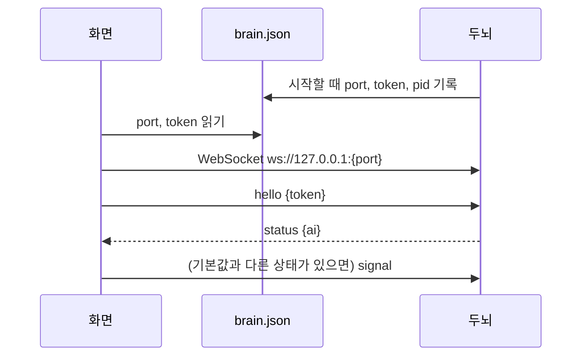

# 두뇌(서브 프로젝트 2) 구현 계획

> **For agentic workers:** REQUIRED SUB-SKILL: Use superpowers:subagent-driven-development (recommended) or superpowers:executing-plans to implement this plan task-by-task. Steps use checkbox (`- [ ]`) syntax for tracking.

**Goal:** Jev 판단·Gemini 대사·대화 기록을 맡는 파이썬 두뇌 서비스를 만들고, Windows 화면(Tauri)이 WebSocket으로 붙게 한다.

**Architecture:** `brain/`은 화면을 모르는 독립 파이썬 서비스다. 두뇌 핵심(`core.Brain`)은 Signal을 받아 Reaction을 내고, 전송 계층(`server.Link`)이 localhost WebSocket으로 화면 하나와 잇는다. Tauri는 `brain.json`으로 접속 정보를 읽고, 두뇌가 없으면 띄운다.

**Tech Stack:** Python 3.11, uv, `typesafe-sdk`(Jev), `google-genai`(Gemini), `websockets`, `keyring`, pytest + pytest-asyncio / Tauri 2(Rust), TypeScript, Vitest.

**Spec:** [`docs/superpowers/specs/2026-10-15-brain-design.md`](../specs/2026-10-15-brain-design.md), 결정 [0012](../../decisions/0012-brain-as-frontend-independent-service.md)

## Global Constraints

- 파이썬 3.11 이상(`requires-python = ">=3.11"`), 의존성은 `uv`로 관리한다. 두뇌 테스트: `brain/`에서 `uv run pytest`.
- 대사 모델: `gemini-3.1-flash-lite`. Jev 모델은 SDK 기본값(`jev-latest`).
- 두뇌 데이터 폴더: `%APPDATA%\TamagotchiChatBot\brain`. 안의 파일: `brain.json`(접속 정보), `history.db`(대화 기록), `logs/brain.log`.
- 환경 변수와 키는 `brain/brain/config.py`에서만 읽는다 (CLAUDE.md 3절).
- 키와 대화 내용은 로그에 쓰지 않는다.
- 프로토콜 버전 `v: 1`. `127.0.0.1`에서만 받는다. 첫 메시지는 토큰을 담은 `hello`.
- 감정 어휘: `excited` `angry` `curious` `surprised` `sad` `sleepy` `calm`. 행동 어휘: `stand` `sit` `lie_down` `sleep` `beg` `bark` `none`.
- 잠정값은 `brain/brain/tuning.py` 한곳에 근거 주석과 함께 둔다 (스펙 4.4절 값 그대로).
- 질문 정의는 `questions.py`, 성격·프롬프트는 `persona.py` 한곳에 둔다.
- 주석·문서는 한국어. 주변 코드의 밀도와 말투를 따른다.
- 개발용 앱(`npm run tauri dev`)은 확인이 끝나면 바로 닫는다 (CLAUDE.md).

## Review Focus

1. **타이핑한 글을 모두 지움** → 멈춤 시간이 지나도 빈 글로 "타이핑 중" 판단을 하지 않는다. (Task 6 `test_cleared_typing_does_not_fire`)
2. **키 오류 뒤 설정에서 키를 다시 넣음** → `status: ok`로 돌아오고 판단이 다시 된다. (Task 5 `test_auth_error_then_new_keys_recover`)
3. **강아지가 집에 있는 동안 화면이 다시 접속함** → 두뇌는 집 안 상태를 잊지 않아 말을 걸지 않는다. 화면도 접속 직후 집 안 상태를 다시 알린다. (Task 5 `test_reconnect_keeps_house_state`, Task 10 접속 콜백)
4. **Gemini가 빈 글이나 긴 여러 문단을 돌려줌** → 빈 대사는 보내지 않고, 긴 대사는 두 문장으로 자른다. (Task 2 `test_trim_line_*`, Task 5 `test_blank_line_not_sent`)
5. **깨진 JSON·모르는 메시지 종류가 옴** → 그 메시지만 버리고 연결은 유지한다. (Task 7 `test_garbage_is_ignored`)

---

## 파일 구조

| 파일 | 책임 |
|---|---|
| `brain/pyproject.toml` | 파이썬 프로젝트, 의존성, pytest 설정 |
| `brain/brain/config.py` | 데이터 폴더 경로, 키 읽기·쓰기(OS 자격 저장소) |
| `brain/brain/tuning.py` | 잠정값 (`Tuning` 데이터클래스) |
| `brain/brain/questions.py` | 감정·행동·상황 어휘, Jev 질문 정의, Jev state 만들기 |
| `brain/brain/persona.py` | 성격·말투, 대사 프롬프트, 대사 다듬기 |
| `brain/brain/memory.py` | 대화 기록(SQLite + 메모리 대체) |
| `brain/brain/clients.py` | Jev·Gemini 클라이언트 계층, 오류 정규화 |
| `brain/brain/core.py` | 두뇌 핵심: 신호 처리, 스케줄러, 판단 흐름 |
| `brain/brain/server.py` | 전송 계층: WebSocket 연결 하나, 메시지 해석·전달 |
| `brain/brain/__main__.py` | 실행 진입점: 로그, 접속 정보 파일, 서버, 스케줄러 |
| `docs/brain-protocol.md` | 화면 ↔ 두뇌 프로토콜 (화면 개발자가 이것만 보고 만들 수 있게) |
| `app/src-tauri/src/brain.rs` | 접속 정보 읽기, 두뇌 실행·종료 |
| `app/src/shared/brain-protocol.ts` | 프로토콜 타입, 메시지 해석, 어휘 → 몸체 동작 대응 |
| `app/src/brain-link.ts` | WebSocket 접속·재접속 |

없애는 파일: `app/src-tauri/src/keys.rs`, `app/src/body/stub-brain.ts`, `app/tests/stub-brain.test.ts`, `app/src/shared/types.ts`.

---

### Task 1: 두뇌 프로젝트 뼈대, 설정, 잠정값

**Files:**
- Create: `brain/pyproject.toml`(uv로 생성), `brain/.gitignore`, `brain/brain/__init__.py`, `brain/brain/config.py`, `brain/brain/tuning.py`, `brain/tests/__init__.py`
- Test: `brain/tests/test_config.py`

**Interfaces:**
- Produces: `config.KEY_NAMES: tuple[str, ...] = ("typesafe", "gemini")`, `config.data_dir() -> Path`, `config.read_keys() -> dict[str, str | None]`, `config.write_key(name: str, value: str) -> None`(이름이 틀리거나 빈 값이면 `ValueError`), `tuning.Tuning`(frozen dataclass, 필드는 아래 코드).

- [ ] **Step 1: uv 프로젝트를 만든다**

저장소 루트에서:

```bash
uv init --bare --python 3.11 brain
cd brain
uv add typesafe-sdk google-genai websockets keyring
uv add --dev pytest pytest-asyncio
```

`brain/pyproject.toml` 끝에 덧붙인다(설치 가능한 패키지로 만들지 않고 `brain/` 폴더에서 바로 실행한다):

```toml
[tool.uv]
package = false

[tool.pytest.ini_options]
asyncio_mode = "auto"
asyncio_default_fixture_loop_scope = "function"
pythonpath = ["."]
testpaths = ["tests"]
```

`brain/.gitignore`:

```
.venv/
__pycache__/
.pytest_cache/
```

빈 파일 `brain/brain/__init__.py`, `brain/tests/__init__.py`를 만든다.

- [ ] **Step 2: 실패하는 테스트를 쓴다**

`brain/tests/test_config.py`:

```python
import keyring.errors
import pytest

from brain import config


def test_data_dir_under_appdata(tmp_path, monkeypatch):
    monkeypatch.setenv("APPDATA", str(tmp_path))
    d = config.data_dir()
    assert d == tmp_path / "TamagotchiChatBot" / "brain"
    assert d.is_dir()


@pytest.fixture
def fake_keyring(monkeypatch):
    store = {}
    monkeypatch.setattr(config.keyring, "set_password", lambda s, n, v: store.__setitem__((s, n), v))
    monkeypatch.setattr(config.keyring, "get_password", lambda s, n: store.get((s, n)))
    return store


def test_write_then_read_keys(fake_keyring):
    config.write_key("gemini", "  abc  ")
    assert config.read_keys() == {"typesafe": None, "gemini": "abc"}


def test_write_key_rejects_unknown_name(fake_keyring):
    with pytest.raises(ValueError):
        config.write_key("openai", "x")


def test_write_key_rejects_blank(fake_keyring):
    with pytest.raises(ValueError):
        config.write_key("gemini", "   ")
    assert fake_keyring == {}


def test_keyring_error_reads_as_missing(monkeypatch):
    def boom(service, name):
        raise keyring.errors.KeyringError("backend down")
    monkeypatch.setattr(config.keyring, "get_password", boom)
    assert config.read_keys() == {"typesafe": None, "gemini": None}
```

- [ ] **Step 3: 실패를 확인한다**

Run: `cd brain && uv run pytest tests/test_config.py -v`
Expected: FAIL — `ImportError: cannot import name 'config'`

- [ ] **Step 4: 구현한다**

`brain/brain/config.py`:

```python
"""두뇌의 환경 값과 키를 읽는 유일한 곳 (CLAUDE.md 3절). 다른 모듈은 환경 변수를 직접 읽지 않는다."""
import logging
import os
from pathlib import Path

import keyring
import keyring.errors

log = logging.getLogger(__name__)

KEY_NAMES = ("typesafe", "gemini")
# OS 자격 저장소(Windows 자격 증명 관리자)에 저장할 때 쓰는 서비스 이름
KEYRING_SERVICE = "TamagotchiChatBot.brain"


def data_dir() -> Path:
    """두뇌 데이터 폴더. 화면(Tauri)도 이 경로의 brain.json을 읽는다 (docs/brain-protocol.md)."""
    base = os.environ.get("APPDATA") or str(Path.home())
    d = Path(base) / "TamagotchiChatBot" / "brain"
    d.mkdir(parents=True, exist_ok=True)
    return d


def read_keys() -> dict[str, str | None]:
    keys: dict[str, str | None] = {}
    for name in KEY_NAMES:
        try:
            keys[name] = keyring.get_password(KEYRING_SERVICE, name)
        except keyring.errors.KeyringError:
            log.exception("자격 저장소에서 키를 읽지 못해 없는 것으로 본다: %s", name)
            keys[name] = None
    return keys


def write_key(name: str, value: str) -> None:
    if name not in KEY_NAMES:
        raise ValueError(f"모르는 키 이름: {name}")
    value = value.strip()
    if not value:
        raise ValueError("빈 키는 저장하지 않는다")
    keyring.set_password(KEYRING_SERVICE, name, value)
```

`brain/brain/tuning.py`:

```python
"""잠정값. 근거는 두뇌 스펙 4.4절. 서브 프로젝트 3과 실제 사용으로 다시 정한다."""
from dataclasses import dataclass


@dataclass(frozen=True)
class Tuning:
    typing_chars: int = 10              # K: 한국어 두세 어절. 의미가 바뀔 만큼 입력됨
    typing_pause_s: float = 0.6         # T: 연속 타이핑 키 간격은 대개 0.5초 안쪽
    quiet_active_s: float = 60.0        # P_active: 하루 약 $0.09 (state 1,500토큰, 업체 발표 단가)
    quiet_away_s: float = 600.0         # P_away: 자리를 비운 동안 호출을 줄인다
    speak_threshold: float = 0.5        # speak_now 임계값: 데이터가 없어 중간값에서 시작
    recent_n: int = 20                  # 최근 대화 N: 말풍선 대사가 짧아 20개면 충분
    max_consecutive: int = 3            # 사용자 입력 없이 연달아 말하는 상한: 비용 폭주 방지
    jev_timeout_s: float = 3.0          # SDK 기본 10초는 실시간 반응에 너무 길다
    gemini_timeout_s: float = 5.0       # 늦은 대사는 상황이 바뀌어 버려질 가능성이 크다
    interaction_min_gap_s: float = 2.0  # 쓰다듬기 반복 시 호출 폭주 방지
    backoff_max_s: float = 300.0        # 연속 실패 시 조용함 주기를 늘리는 상한 (5분)
    tick_s: float = 0.1                 # 스케줄러 확인 간격. 멈춤 판정 T에 최대 0.1초가 더해진다
```

- [ ] **Step 5: 통과를 확인한다**

Run: `cd brain && uv run pytest tests/test_config.py -v`
Expected: 5 passed

- [ ] **Step 6: 커밋한다**

```bash
git add brain/
git commit -m "feat(brain): 파이썬 두뇌 뼈대, 설정, 잠정값"
```

---

### Task 2: 질문 정의와 성격·프롬프트

**Files:**
- Create: `brain/brain/questions.py`, `brain/brain/persona.py`
- Test: `brain/tests/test_questions_persona.py`

**Interfaces:**
- Consumes: 없음.
- Produces:
  - `questions.EMOTIONS: dict[str, str]`, `questions.ACTIONS: dict[str, str]`, `questions.SITUATIONS: dict[str, str]`(키: `typing` `sent` `quiet` `just_spoke` `interaction:poke` `interaction:pet` `interaction:throw` `user_return` `house_out`), `questions.QUESTIONS: dict`(SDK 질문 객체 3개)
  - `questions.jev_state(*, situation: str, now: datetime, typing: str, recent: list[tuple[float, str, str]], since_last_s: float | None, unread: bool, emotion: str, consecutive: int, house_away_s: float | None) -> dict[str, object]`
  - `questions.format_recent(recent) -> str`, `questions.human_duration(seconds: float) -> str`
  - `persona.PERSONA: str`, `persona.system_instruction() -> str`, `persona.dialogue_prompt(*, situation: str, emotion: str, action: str, recent: list[tuple[float, str, str]], typing: str) -> str`, `persona.trim_line(text: str, max_sentences: int = 2) -> str`
  - `recent`의 원소는 `(시각, 화자, 글)`이고 화자는 `"user"` 또는 `"dog"`.

- [ ] **Step 1: SDK 질문 클래스 모양을 확인한다**

Run: `cd brain && uv run python -c "import inspect, typesafe_sdk as t; print(t.Choice.__struct_fields__ if hasattr(t.Choice,'__struct_fields__') else inspect.signature(t.Choice)); print(t.Noul.__struct_fields__ if hasattr(t.Noul,'__struct_fields__') else inspect.signature(t.Noul)); print(t.RetryPolicy, t.AsyncTypeSafeClient)"`
Expected: `Choice`에 `instructions`, `criteria`가, `Noul`에 `instructions`가 있다. 이름이 다르면 아래 `QUESTIONS` 정의를 실제 이름에 맞춘다(Context7 `/typesafe-ai/typesafe-sdk-python` 기준: `Choice(instructions=..., criteria={라벨: 설명})`).

- [ ] **Step 2: 실패하는 테스트를 쓴다**

`brain/tests/test_questions_persona.py`:

```python
from datetime import datetime

from brain import persona, questions


def test_vocabulary_matches_spec():
    assert list(questions.EMOTIONS) == ["excited", "angry", "curious", "surprised", "sad", "sleepy", "calm"]
    assert list(questions.ACTIONS) == ["stand", "sit", "lie_down", "sleep", "beg", "bark", "none"]
    assert set(questions.QUESTIONS) == {"emotion", "action", "speak_now"}
    assert set(questions.QUESTIONS["emotion"].criteria) == set(questions.EMOTIONS)
    assert set(questions.QUESTIONS["action"].criteria) == set(questions.ACTIONS)


def test_human_duration():
    assert questions.human_duration(42) == "42초"
    assert questions.human_duration(150) == "2분"
    assert questions.human_duration(3 * 3600 + 5 * 60) == "3시간 5분"


def test_format_recent():
    recent = [(1.0, "user", "안녕"), (2.0, "dog", "멍! 반가워")]
    assert questions.format_recent(recent) == "사용자: 안녕\n강아지: 멍! 반가워"


def base_state(**kw):
    args = dict(situation="quiet", now=datetime(2026, 10, 15, 9, 30), typing="", recent=[],
                since_last_s=None, unread=False, emotion="calm", consecutive=0, house_away_s=None)
    args.update(kw)
    return questions.jev_state(**args)


def test_state_basics():
    s = base_state()
    assert s["상황"] == questions.SITUATIONS["quiet"]
    assert s["지금 시각"].startswith("2026-10-15 09:30")
    assert s["최근 대화"] == "(없음)"
    assert s["마지막 대화 이후"] == "대화한 적 없음"
    assert s["강아지의 안 읽힌 말풍선"] == "없음"
    assert s["강아지의 지금 감정"] == questions.EMOTIONS["calm"]
    assert "사용자가 타이핑 중인 글" not in s
    assert "집에 있던 시간" not in s
    assert s["강아지 성격"] == persona.PERSONA


def test_state_optional_fields():
    s = base_state(situation="house_out", typing="뭐 해", since_last_s=90, unread=True, house_away_s=7200)
    assert s["사용자가 타이핑 중인 글"] == "뭐 해"
    assert s["마지막 대화 이후"] == "1분"
    assert s["강아지의 안 읽힌 말풍선"] == "있음"
    assert s["집에 있던 시간"] == "2시간 0분"


def test_dialogue_prompt_includes_context():
    p = persona.dialogue_prompt(situation="사용자가 방금 말을 보냈다", emotion="신남", action="짖는다",
                                recent=[(1.0, "user", "산책 갈래?")], typing="")
    assert "산책 갈래?" in p and "신남" in p and "짖는다" in p
    assert "타이핑 중" not in p
    p2 = persona.dialogue_prompt(situation="x", emotion="y", action="z", recent=[], typing="오늘 회의가")
    assert "오늘 회의가" in p2


def test_system_instruction_has_persona_and_style():
    s = persona.system_instruction()
    assert persona.PERSONA in s and "반말" in s


def test_trim_line_keeps_two_sentences():
    assert persona.trim_line("멍! 뭐 해? 나도 볼래 멍멍.") == "멍! 뭐 해?"


def test_trim_line_strips_label_quotes_and_newlines():
    assert persona.trim_line('강아지: "산책 가자 멍!"') == "산책 가자 멍!"
    assert persona.trim_line("첫 줄이야 멍\n\n둘째 줄") == "첫 줄이야 멍 둘째 줄"


def test_trim_line_blank():
    assert persona.trim_line("") == ""
    assert persona.trim_line("  \n ") == ""
```

- [ ] **Step 3: 실패를 확인한다**

Run: `cd brain && uv run pytest tests/test_questions_persona.py -v`
Expected: FAIL — `ImportError`

- [ ] **Step 4: 구현한다**

`brain/brain/persona.py`:

```python
"""강아지 성격·말투와 대사 프롬프트를 두는 한곳 (vision 캐릭터 절). Jev state와 Gemini 프롬프트가 함께 쓴다."""
import re

PERSONA = "호기심 많고 수다스러운 강아지. 사용자를 좋아해서 말을 자주 걸고, 사용자가 타이핑하는 중에도 잘 끼어든다."
STYLE = "사람 말(반말)에 강아지 의성어(멍, 멍멍, 왈 등)를 섞는다. 말풍선이 작으니 한 번에 한두 문장으로 짧게 말한다."

SPEAKER_NAMES = {"user": "사용자", "dog": "강아지"}


def system_instruction() -> str:
    return f"너는 사용자의 컴퓨터 화면 위에 사는 강아지다.\n성격: {PERSONA}\n말투: {STYLE}"


def dialogue_prompt(*, situation: str, emotion: str, action: str,
                    recent: list[tuple[float, str, str]], typing: str) -> str:
    history = "\n".join(f"{SPEAKER_NAMES.get(who, who)}: {text}" for _, who, text in recent) or "(없음)"
    lines = [
        f"상황: {situation}",
        f"강아지의 지금 감정: {emotion}",
        f"강아지의 지금 동작: {action}",
        f"최근 대화:\n{history}",
    ]
    if typing:
        lines.append(f"사용자가 아직 보내지 않고 타이핑 중인 글: {typing}")
    lines.append("강아지가 지금 할 말 한마디만 써라. 따옴표나 이름표 없이 대사만 쓴다.")
    return "\n".join(lines)


_SENTENCE = re.compile(r"[^.!?~…]*[.!?~…]+|[^.!?~…]+$")
_LABEL = re.compile(r"^강아지\s*[:：]\s*")


def trim_line(text: str, max_sentences: int = 2) -> str:
    """LLM 출력을 말풍선 대사로 다듬는다: 줄바꿈·이름표·따옴표를 없애고 앞의 몇 문장만 남긴다."""
    t = " ".join(line.strip() for line in text.splitlines() if line.strip())
    t = _LABEL.sub("", t).strip().strip("\"'“”‘’").strip()
    parts = [p.strip() for p in _SENTENCE.findall(t) if p.strip()]
    return " ".join(parts[:max_sentences])
```

`brain/brain/questions.py`:

```python
"""Jev 질문 정의와 state를 두는 한곳 (CLAUDE.md 4절, 두뇌 스펙 4.1·4.2절).
질문 문구나 Jev 모델을 바꾸면 점수가 달라지므로 임계값(tuning.speak_threshold)을 다시 산출한다."""
from datetime import datetime

from typesafe_sdk import Choice, Noul

from .persona import PERSONA, SPEAKER_NAMES

# 감정 7개 (vision, 2026-10-15 사용자 결정). 키는 프로토콜 어휘다
EMOTIONS = {
    "excited": "신남: 즐겁고 들떠 있다",
    "angry": "분노: 화가 나거나 짜증이 났다",
    "curious": "궁금함: 무언가가 궁금하고 알고 싶다",
    "surprised": "놀람: 예상 못 한 일에 깜짝 놀랐다",
    "sad": "슬픔: 서운하거나 슬프다",
    "sleepy": "졸림: 졸리고 나른하다",
    "calm": "평온: 특별한 감정 없이 편안하다",
}

# 제자리 동작만 (vision, 2026-10-15 사용자 결정). 이동은 화면의 평소 움직임 규칙이 고른다
ACTIONS = {
    "stand": "서서 바라본다",
    "sit": "앉는다",
    "lie_down": "엎드린다",
    "sleep": "잠든다",
    "beg": "두 발로 서서 조른다",
    "bark": "짖는다",
    "none": "특별한 동작 없이 하던 대로 한다",
}

SITUATIONS = {
    "typing": "사용자가 강아지에게 할 말을 타이핑하는 중이다(아직 보내지 않았다)",
    "sent": "사용자가 방금 강아지에게 말을 보냈다",
    "quiet": "한동안 별일이 없다",
    "just_spoke": "강아지가 방금 말했다",
    "interaction:poke": "사용자가 방금 강아지를 콕 찔렀다",
    "interaction:pet": "사용자가 방금 강아지를 쓰다듬었다",
    "interaction:throw": "사용자가 방금 강아지를 들어서 던졌다",
    "user_return": "자리를 비웠던 사용자가 방금 돌아왔다",
    "house_out": "강아지가 방금 자기 집에서 나왔다",
}

QUESTIONS = {
    "emotion": Choice(instructions="이 강아지의 지금 감정은 무엇인가?", criteria=EMOTIONS),
    "action": Choice(instructions="이 강아지가 지금 할 동작은 무엇인가?", criteria=ACTIONS),
    # 끼어들기·선발화·답할지·한 마디 더 할지를 모두 이 질문 하나로 묻는다. 상황은 state로만 구분한다
    "speak_now": Noul(instructions="이 강아지가 지금 말을 하는 것이 자연스럽다"),
}


def human_duration(seconds: float) -> str:
    s = int(seconds)
    if s < 60:
        return f"{s}초"
    if s < 3600:
        return f"{s // 60}분"
    return f"{s // 3600}시간 {s % 3600 // 60}분"


def format_recent(recent: list[tuple[float, str, str]]) -> str:
    return "\n".join(f"{SPEAKER_NAMES.get(who, who)}: {text}" for _, who, text in recent)


def jev_state(*, situation: str, now: datetime, typing: str, recent: list[tuple[float, str, str]],
              since_last_s: float | None, unread: bool, emotion: str, consecutive: int,
              house_away_s: float | None) -> dict[str, object]:
    # 자리 비움 여부는 넣지 않는다. 호출 주기에만 쓴다 (첫 버전 스펙 4.2절)
    state: dict[str, object] = {
        "강아지 성격": PERSONA,
        "지금 시각": now.strftime("%Y-%m-%d %H:%M (%a)"),
        "상황": SITUATIONS[situation],
        "최근 대화": format_recent(recent) or "(없음)",
        "마지막 대화 이후": "대화한 적 없음" if since_last_s is None else human_duration(since_last_s),
        "강아지의 안 읽힌 말풍선": "있음" if unread else "없음",
        "강아지의 지금 감정": EMOTIONS[emotion],
        "사용자 입력 없이 강아지가 연달아 말한 횟수": consecutive,
    }
    if typing:
        state["사용자가 타이핑 중인 글"] = typing
    if house_away_s is not None:
        state["집에 있던 시간"] = human_duration(house_away_s)
    return state
```

- [ ] **Step 5: 통과를 확인한다**

Run: `cd brain && uv run pytest tests/test_questions_persona.py -v`
Expected: all passed

- [ ] **Step 6: 커밋한다**

```bash
git add brain/brain/questions.py brain/brain/persona.py brain/tests/test_questions_persona.py
git commit -m "feat(brain): Jev 질문 정의와 강아지 성격·대사 프롬프트"
```

---

### Task 3: 대화 기록

**Files:**
- Create: `brain/brain/memory.py`
- Test: `brain/tests/test_memory.py`

**Interfaces:**
- Produces: `memory.History(path: Path | None)` — `None`이면 메모리만 쓴다(테스트·저장 실패 시). 메서드: `add(speaker: str, text: str, ts: float) -> None`, `recent(n: int) -> list[tuple[float, str, str]]`(오래된 것부터), `last_ts() -> float | None`, `clear() -> None`.

- [ ] **Step 1: 실패하는 테스트를 쓴다**

`brain/tests/test_memory.py`:

```python
import sqlite3

from brain.memory import History


def test_memory_only_history():
    h = History(None)
    assert h.recent(5) == [] and h.last_ts() is None
    h.add("user", "안녕", 1.0)
    h.add("dog", "멍!", 2.0)
    assert h.recent(5) == [(1.0, "user", "안녕"), (2.0, "dog", "멍!")]
    assert h.recent(1) == [(2.0, "dog", "멍!")]
    assert h.last_ts() == 2.0


def test_persists_across_instances(tmp_path):
    db = tmp_path / "history.db"
    h = History(db)
    h.add("user", "산책 가자", 10.0)
    assert History(db).recent(5) == [(10.0, "user", "산책 가자")]


def test_clear_removes_everything(tmp_path):
    db = tmp_path / "history.db"
    h = History(db)
    h.add("user", "a", 1.0)
    h.clear()
    assert h.recent(5) == [] and h.last_ts() is None
    assert History(db).recent(5) == []


def test_unopenable_db_falls_back_to_memory(tmp_path):
    bad = tmp_path / "no-such-dir" / "history.db"
    h = History(bad)
    h.add("user", "그래도 기억해", 1.0)
    assert h.recent(1) == [(1.0, "user", "그래도 기억해")]


def test_write_failure_keeps_memory(tmp_path, monkeypatch):
    h = History(tmp_path / "history.db")
    def broken(*a, **k):
        raise sqlite3.OperationalError("disk full")
    monkeypatch.setattr(h, "_write", broken)
    h.add("user", "메모리에는 남는다", 1.0)
    assert h.recent(1) == [(1.0, "user", "메모리에는 남는다")]
```

- [ ] **Step 2: 실패를 확인한다**

Run: `cd brain && uv run pytest tests/test_memory.py -v`
Expected: FAIL — `ModuleNotFoundError: No module named 'brain.memory'`

- [ ] **Step 3: 구현한다**

`brain/brain/memory.py`:

```python
"""대화 기록 (두뇌 스펙 6절). 무기한 보관하고, 읽기·쓰기가 실패하면 메모리로 계속한다."""
import logging
import sqlite3
from pathlib import Path

log = logging.getLogger(__name__)

MEM_KEEP = 200  # 메모리에 들고 있는 최근 대화 수. tuning.recent_n보다 넉넉하게


class History:
    def __init__(self, path: Path | None):
        self._mem: list[tuple[float, str, str]] = []
        self._db: sqlite3.Connection | None = None
        if path is None:
            return
        try:
            self._db = sqlite3.connect(path)
            self._db.execute("CREATE TABLE IF NOT EXISTS messages (ts REAL NOT NULL, speaker TEXT NOT NULL, text TEXT NOT NULL)")
            self._db.commit()
            rows = self._db.execute("SELECT ts, speaker, text FROM messages ORDER BY rowid DESC LIMIT ?", (MEM_KEEP,)).fetchall()
            self._mem = [(r[0], r[1], r[2]) for r in reversed(rows)]
        except sqlite3.Error:
            log.exception("대화 기록을 열지 못해 메모리로 계속한다")
            self._db = None

    def _write(self, sql: str, args: tuple = ()) -> None:
        assert self._db is not None
        self._db.execute(sql, args)
        self._db.commit()

    def add(self, speaker: str, text: str, ts: float) -> None:
        self._mem.append((ts, speaker, text))
        del self._mem[:-MEM_KEEP]
        if self._db is None:
            return
        try:
            self._write("INSERT INTO messages (ts, speaker, text) VALUES (?, ?, ?)", (ts, speaker, text))
        except sqlite3.Error:
            log.exception("대화 기록 쓰기 실패. 메모리로 계속한다")  # 대화 내용은 로그에 쓰지 않는다

    def recent(self, n: int) -> list[tuple[float, str, str]]:
        return self._mem[-n:] if n > 0 else []

    def last_ts(self) -> float | None:
        return self._mem[-1][0] if self._mem else None

    def clear(self) -> None:
        self._mem.clear()
        if self._db is None:
            return
        try:
            self._write("DELETE FROM messages")
        except sqlite3.Error:
            log.exception("대화 기록 삭제 실패")
```

- [ ] **Step 4: 통과를 확인한다**

Run: `cd brain && uv run pytest tests/test_memory.py -v`
Expected: 5 passed

- [ ] **Step 5: 커밋한다**

```bash
git add brain/brain/memory.py brain/tests/test_memory.py
git commit -m "feat(brain): 대화 기록 (SQLite, 실패 시 메모리)"
```

---

### Task 4: 외부 AI 클라이언트 계층

**Files:**
- Create: `brain/brain/clients.py`
- Test: `brain/tests/test_clients.py`

**Interfaces:**
- Consumes: `questions.QUESTIONS`, `tuning.Tuning`.
- Produces:
  - `clients.AuthError(Exception)`, `clients.CallError(Exception)`
  - `clients.Judgement(emotion: str, action: str, speak: float)`(frozen dataclass)
  - `clients.Jev`(Protocol: `async judge(state: dict) -> Judgement`, `async aclose() -> None`), `clients.Talker`(Protocol: `async say(system: str, prompt: str) -> str`, `async aclose() -> None`)
  - `clients.TypeSafeJev(api_key: str, timeout_s: float)`, `clients.GeminiTalker(api_key: str, timeout_s: float)`
  - `clients.to_judgement(resp) -> Judgement`, `clients.is_gemini_auth_error(code: int | None, message: str | None) -> bool`
  - `clients.make_clients(keys: dict[str, str | None], tuning: Tuning) -> tuple[TypeSafeJev, GeminiTalker]`
  - `clients.GEMINI_MODEL = "gemini-3.1-flash-lite"`

- [ ] **Step 1: 실패하는 테스트를 쓴다**

`brain/tests/test_clients.py`:

```python
import asyncio
from types import SimpleNamespace

import pytest

from brain import clients


def test_to_judgement_reads_answers():
    resp = SimpleNamespace(
        choices={"emotion": SimpleNamespace(choice="curious"), "action": SimpleNamespace(choice="sit")},
        nouls={"speak_now": SimpleNamespace(noul=0.73)},
    )
    assert clients.to_judgement(resp) == clients.Judgement("curious", "sit", 0.73)


@pytest.mark.parametrize("code,message,expected", [
    (401, "unauthorized", True),
    (403, "forbidden", True),
    (400, "API key not valid. Please pass a valid API key.", True),
    (400, "Invalid argument", False),
    (500, "internal", False),
    (None, None, False),
])
def test_gemini_auth_error_detection(code, message, expected):
    assert clients.is_gemini_auth_error(code, message) is expected


async def test_jev_timeout_becomes_call_error(monkeypatch):
    jev = clients.TypeSafeJev("k", timeout_s=0.01)
    async def slow(**kwargs):
        await asyncio.sleep(1)
    monkeypatch.setattr(jev._client, "system_one", slow)
    with pytest.raises(clients.CallError):
        await jev.judge({"상황": "x"})
    await jev.aclose()


async def test_jev_unexpected_error_becomes_call_error(monkeypatch):
    jev = clients.TypeSafeJev("k", timeout_s=1)
    async def boom(**kwargs):
        raise RuntimeError("network")
    monkeypatch.setattr(jev._client, "system_one", boom)
    with pytest.raises(clients.CallError):
        await jev.judge({})
    await jev.aclose()


async def test_gemini_timeout_becomes_call_error(monkeypatch):
    talker = clients.GeminiTalker("k", timeout_s=0.01)
    async def slow(**kwargs):
        await asyncio.sleep(1)
    monkeypatch.setattr(talker._client.aio.models, "generate_content", slow)
    with pytest.raises(clients.CallError):
        await talker.say("sys", "prompt")
    await talker.aclose()


async def test_gemini_returns_text(monkeypatch):
    talker = clients.GeminiTalker("k", timeout_s=1)
    seen = {}
    async def fake(**kwargs):
        seen.update(kwargs)
        return SimpleNamespace(text="멍! 안녕")
    monkeypatch.setattr(talker._client.aio.models, "generate_content", fake)
    assert await talker.say("sys", "prompt") == "멍! 안녕"
    assert seen["model"] == clients.GEMINI_MODEL and seen["contents"] == "prompt"
    await talker.aclose()
```

- [ ] **Step 2: 실패를 확인한다**

Run: `cd brain && uv run pytest tests/test_clients.py -v`
Expected: FAIL — `ImportError`

- [ ] **Step 3: 구현한다**

`brain/brain/clients.py`:

```python
"""외부 AI 호출 계층 (CLAUDE.md 3절). 실패를 AuthError(키 문제)와 CallError(일시적 실패) 두 가지로 정리해
두뇌 핵심이 SDK 예외를 몰라도 되게 한다. 사용법은 Context7로 확인했다 (2026-10-15)."""
import asyncio
from dataclasses import dataclass
from typing import Protocol

from google import genai
from google.genai import errors as genai_errors
from google.genai import types as genai_types
from typesafe_sdk import (AsyncTypeSafeClient, RetryPolicy, TypeSafeAuthenticationError,
                          TypeSafePermissionDeniedError)

from .questions import QUESTIONS
from .tuning import Tuning

GEMINI_MODEL = "gemini-3.1-flash-lite"  # 0007


class AuthError(Exception):
    """키가 틀렸다. 키를 다시 넣을 때까지 AI 호출을 멈춘다."""


class CallError(Exception):
    """일시적 실패(네트워크, 시간 초과, 서버 오류). 이번 판단만 건너뛴다."""


@dataclass(frozen=True)
class Judgement:
    emotion: str
    action: str
    speak: float


class Jev(Protocol):
    async def judge(self, state: dict) -> Judgement: ...
    async def aclose(self) -> None: ...


class Talker(Protocol):
    async def say(self, system: str, prompt: str) -> str: ...
    async def aclose(self) -> None: ...


def to_judgement(resp) -> Judgement:
    return Judgement(resp.choices["emotion"].choice, resp.choices["action"].choice, resp.nouls["speak_now"].noul)


class TypeSafeJev:
    def __init__(self, api_key: str, timeout_s: float):
        # 재시도는 하지 않는다: 늦은 판단은 쓸모가 없고, 다음 트리거가 곧 다시 부른다
        self._client = AsyncTypeSafeClient(api_key=api_key, timeout=timeout_s, retry=RetryPolicy(max_retries=0))
        self._timeout = timeout_s

    async def judge(self, state: dict) -> Judgement:
        try:
            resp = await asyncio.wait_for(self._client.system_one(state=state, questions=QUESTIONS), self._timeout)
        except (TypeSafeAuthenticationError, TypeSafePermissionDeniedError) as e:
            raise AuthError("typesafe") from e
        except Exception as e:
            raise CallError(f"jev {type(e).__name__}") from e
        return to_judgement(resp)

    async def aclose(self) -> None:
        await self._client.aclose()


def is_gemini_auth_error(code: int | None, message: str | None) -> bool:
    # Gemini는 틀린 키에 400 "API key not valid"를 돌려주기도 한다
    return code in (401, 403) or (code == 400 and "API key" in (message or ""))


class GeminiTalker:
    def __init__(self, api_key: str, timeout_s: float):
        self._client = genai.Client(api_key=api_key)
        self._timeout = timeout_s

    async def say(self, system: str, prompt: str) -> str:
        try:
            resp = await asyncio.wait_for(
                self._client.aio.models.generate_content(
                    model=GEMINI_MODEL, contents=prompt,
                    config=genai_types.GenerateContentConfig(system_instruction=system)),
                self._timeout)
        except genai_errors.APIError as e:
            if is_gemini_auth_error(e.code, e.message):
                raise AuthError("gemini") from e
            raise CallError(f"gemini {e.code}") from e
        except Exception as e:
            raise CallError(f"gemini {type(e).__name__}") from e
        return resp.text or ""

    async def aclose(self) -> None:
        await self._client.aio.aclose()


def make_clients(keys: dict[str, str | None], tuning: Tuning) -> tuple[TypeSafeJev, GeminiTalker]:
    return (TypeSafeJev(keys["typesafe"] or "", tuning.jev_timeout_s),
            GeminiTalker(keys["gemini"] or "", tuning.gemini_timeout_s))
```

- [ ] **Step 4: 통과를 확인한다**

Run: `cd brain && uv run pytest tests/test_clients.py -v`
Expected: all passed. `aclose()`가 없다는 오류가 나면 Context7(`/googleapis/python-genai/v2.30.0` "Explicitly close async client")와 SDK 소스를 확인해 실제 닫기 메서드로 바꾼다.

- [ ] **Step 5: 커밋한다**

```bash
git add brain/brain/clients.py brain/tests/test_clients.py
git commit -m "feat(brain): Jev·Gemini 클라이언트 계층과 오류 정리"
```

---

### Task 5: 두뇌 핵심 — 신호 처리와 판단 흐름

**Files:**
- Create: `brain/brain/core.py`, `brain/tests/conftest.py`
- Test: `brain/tests/test_core_flow.py`

**Interfaces:**
- Consumes: `clients.Judgement/AuthError/CallError/Jev/Talker`, `memory.History`, `persona.*`, `questions.*`, `tuning.Tuning`.
- Produces: `core.Brain(*, emit: Callable[[dict], Awaitable[None]], make_clients: Callable[[dict[str, str | None]], tuple[Jev, Talker]], history: History, clock: Callable[[], float] = time.time, tuning: Tuning = Tuning())`
  - `async connected(on: bool)`, `async set_keys(keys: dict[str, str | None])`, `async handle(signal: dict)`, `async tick()`, `async run_ticker()`, `async clear_history()`, `async drain()`, `async aclose()`
  - 내보내는 메시지(`emit` 인자, `v`는 전송 계층이 붙인다): `{"type": "reaction", "emotion"?: str, "action"?: str}`, `{"type": "reaction", "utterance": str}`, `{"type": "status", "ai": "ok" | "no_keys" | "bad_key"}`

**규칙 요약** (스펙 4·5절을 코드로 옮길 때 기준):
- 판단 시작 조건: 화면 연결됨, 집 밖, `ai == "ok"`.
- 진행 중인 판단이 있을 때: `sent`는 취소하고 새로 시작한다. `typing`은 진행 중인 것이 Jev 단계(`judging`)면 취소하고 새로 시작하고, 대사 단계(`speaking`)면 건너뛴다(끼어들 말을 버리지 않는다). 그 밖의 트리거는 건너뛴다.
- `house` 들어감: 진행 중인 판단을 취소한다(대사 폐기). 나올 때까지 판단하지 않는다.
- 대사를 보내면 기록·연속 횟수+1·안 읽힘 표시를 하고, 다음 tick에 `just_spoke` 판단을 한다.

- [ ] **Step 1: 테스트 도우미를 쓴다**

`brain/tests/conftest.py`:

```python
import asyncio
from types import SimpleNamespace

import pytest

from brain.clients import Judgement
from brain.core import Brain
from brain.memory import History
from brain.tuning import Tuning

BOTH_KEYS = {"typesafe": "t-key", "gemini": "g-key"}


class FakeClock:
    def __init__(self, t: float = 1000.0):
        self.t = t

    def __call__(self) -> float:
        return self.t


class FakeJev:
    def __init__(self):
        self.calls: list[dict] = []
        self.result = Judgement("calm", "none", 0.0)
        self.error: Exception | None = None
        self.gate: asyncio.Event | None = None  # 설정하면 열릴 때까지 응답을 미룬다

    async def judge(self, state):
        self.calls.append(state)
        if self.gate:
            await self.gate.wait()
        if self.error:
            raise self.error
        return self.result

    async def aclose(self):
        pass


class FakeTalker:
    def __init__(self):
        self.calls: list[tuple[str, str]] = []
        self.line = "멍! 안녕"
        self.error: Exception | None = None
        self.gate: asyncio.Event | None = None

    async def say(self, system, prompt):
        self.calls.append((system, prompt))
        if self.gate:
            await self.gate.wait()
        if self.error:
            raise self.error
        return self.line

    async def aclose(self):
        pass


async def settle(predicate, tries: int = 50):
    """비동기 작업이 조건을 만족할 때까지 이벤트 루프를 몇 번 돌린다."""
    for _ in range(tries):
        if predicate():
            return
        await asyncio.sleep(0)
    raise AssertionError("조건이 만족되지 않음")


@pytest.fixture
async def env():
    out: list[dict] = []

    async def emit(msg):
        out.append(msg)

    jev, talker, clock = FakeJev(), FakeTalker(), FakeClock()
    history = History(None)
    brain = Brain(emit=emit, make_clients=lambda keys: (jev, talker), history=history, clock=clock, tuning=Tuning())
    await brain.set_keys(BOTH_KEYS)
    await brain.connected(True)
    out.clear()
    yield SimpleNamespace(brain=brain, out=out, jev=jev, talker=talker, clock=clock, history=history)
    await brain.aclose()


def reactions(out):
    return [m for m in out if m["type"] == "reaction"]


def utterances(out):
    return [m["utterance"] for m in out if m["type"] == "reaction" and "utterance" in m]
```

- [ ] **Step 2: 실패하는 테스트를 쓴다**

`brain/tests/test_core_flow.py`:

```python
import asyncio

from brain.clients import AuthError, CallError, Judgement
from brain.core import Brain
from brain.memory import History

from .conftest import BOTH_KEYS, FakeJev, FakeTalker, reactions, settle, utterances


async def send(env, text="안녕"):
    await env.brain.handle({"kind": "sent", "text": text})
    await env.brain.drain()


async def test_sent_emits_emotion_action_then_utterance(env):
    env.jev.result = Judgement("excited", "bark", 0.9)
    await send(env, "산책 갈래?")
    assert env.out == [
        {"type": "reaction", "emotion": "excited", "action": "bark"},
        {"type": "reaction", "utterance": "멍! 안녕"},
    ]
    assert [(who, text) for _, who, text in env.history.recent(5)] == [("user", "산책 갈래?"), ("dog", "멍! 안녕")]
    assert env.jev.calls[0]["상황"].startswith("사용자가 방금")


async def test_below_threshold_is_silent(env):
    env.jev.result = Judgement("curious", "sit", 0.3)
    await send(env)
    assert env.out == [{"type": "reaction", "emotion": "curious", "action": "sit"}]
    assert env.talker.calls == []


async def test_unchanged_emotion_and_none_action_are_omitted(env):
    env.jev.result = Judgement("calm", "none", 0.0)  # 시작 감정이 calm
    await send(env)
    assert env.out == []
    env.jev.result = Judgement("sad", "lie_down", 0.0)
    await send(env)
    await send(env)  # 같은 감정·행동이 또 나옴
    assert reactions(env.out) == [{"type": "reaction", "emotion": "sad", "action": "lie_down"}]


async def test_unknown_vocabulary_from_jev_is_ignored(env):
    env.jev.result = Judgement("hungry", "dance", 0.0)
    await send(env)
    assert env.out == []


async def test_user_message_is_saved_even_without_keys(env):
    await env.brain.set_keys({"typesafe": None, "gemini": None})
    await send(env, "키 없어도 기록")
    assert env.history.recent(1)[0][1:] == ("user", "키 없어도 기록")
    assert env.jev.calls == []
    assert {"type": "status", "ai": "no_keys"} in env.out


async def test_blank_sent_is_ignored(env):
    await send(env, "   ")
    assert env.history.recent(5) == [] and env.jev.calls == []


async def test_sent_cancels_inflight_line(env):
    env.jev.result = Judgement("excited", "none", 0.9)
    env.talker.gate = asyncio.Event()
    await env.brain.handle({"kind": "sent", "text": "첫 번째"})
    await settle(lambda: len(env.talker.calls) == 1)
    await env.brain.handle({"kind": "sent", "text": "두 번째"})
    await settle(lambda: len(env.talker.calls) == 2)
    env.talker.gate.set()
    await env.brain.drain()
    assert utterances(env.out) == ["멍! 안녕"]  # 첫 번째 대사는 버려짐


async def test_house_inside_discards_line_and_stops_calls(env):
    env.jev.result = Judgement("excited", "none", 0.9)
    env.talker.gate = asyncio.Event()
    await env.brain.handle({"kind": "sent", "text": "a"})
    await settle(lambda: len(env.talker.calls) == 1)
    await env.brain.handle({"kind": "house", "inside": True, "awayMs": 0})
    env.talker.gate.set()
    await env.brain.drain()
    assert utterances(env.out) == []
    await send(env, "집에 있을 때")
    assert len(env.jev.calls) == 1


async def test_house_out_reports_time_away(env):
    await env.brain.handle({"kind": "house", "inside": True, "awayMs": 0})
    await env.brain.handle({"kind": "house", "inside": False, "awayMs": 3_600_000})
    await env.brain.drain()
    assert env.jev.calls[-1]["상황"].startswith("강아지가 방금 자기 집")
    assert env.jev.calls[-1]["집에 있던 시간"] == "1시간 0분"


async def test_typing_k_chars_triggers_and_cancels_judging(env):
    env.jev.gate = asyncio.Event()
    await env.brain.handle({"kind": "typing", "text": "오늘 회의가 너무 길"})   # 11자
    await settle(lambda: len(env.jev.calls) == 1)
    await env.brain.handle({"kind": "typing", "text": "오늘 회의가 너무 길어서 정말 많이 힘들었어"})  # 13자 더 → 이전 판단 취소
    await settle(lambda: len(env.jev.calls) == 2)
    env.jev.gate.set()
    await env.brain.drain()
    assert env.jev.calls[-1]["사용자가 타이핑 중인 글"] == "오늘 회의가 너무 길어서 정말 많이 힘들었어"


async def test_typing_does_not_discard_interrupting_line(env):
    env.jev.result = Judgement("curious", "none", 0.9)
    env.talker.gate = asyncio.Event()
    await env.brain.handle({"kind": "typing", "text": "오늘 회의가 너무 길"})
    await settle(lambda: len(env.talker.calls) == 1)
    await env.brain.handle({"kind": "typing", "text": "오늘 회의가 너무 길어서 정말 많이 힘들었어"})
    env.talker.gate.set()
    await env.brain.drain()
    assert utterances(env.out) == ["멍! 안녕"]
    assert len(env.jev.calls) == 1


async def test_auth_error_then_new_keys_recover(env):
    env.jev.error = AuthError("typesafe")
    await send(env)
    assert env.out[-1] == {"type": "status", "ai": "bad_key"}
    env.jev.error = None
    await send(env)
    assert len(env.jev.calls) == 1  # 키 오류 동안은 부르지 않는다
    await env.brain.set_keys(BOTH_KEYS)
    assert env.out[-1] == {"type": "status", "ai": "ok"}
    await send(env)
    assert len(env.jev.calls) == 2


async def test_talker_auth_error_sets_bad_key(env):
    env.jev.result = Judgement("excited", "none", 0.9)
    env.talker.error = AuthError("gemini")
    await send(env)
    assert {"type": "status", "ai": "bad_key"} in env.out
    assert utterances(env.out) == []


async def test_jev_call_error_skips_quietly(env):
    env.jev.error = CallError("timeout")
    await send(env)
    assert env.out == []


async def test_talker_call_error_keeps_reaction(env):
    env.jev.result = Judgement("excited", "beg", 0.9)
    env.talker.error = CallError("timeout")
    await send(env)
    assert env.out == [{"type": "reaction", "emotion": "excited", "action": "beg"}]


async def test_blank_line_not_sent(env):
    env.jev.result = Judgement("excited", "none", 0.9)
    env.talker.line = "  \n "
    await send(env)
    assert utterances(env.out) == []
    await env.brain.tick()
    await env.brain.drain()
    assert len(env.jev.calls) == 1  # 말하지 않았으니 "방금 말함" 판단도 없다


async def test_long_line_is_trimmed(env):
    env.jev.result = Judgement("excited", "none", 0.9)
    env.talker.line = "멍! 뭐 해? 나도 볼래. 같이 놀자."
    await send(env)
    assert utterances(env.out) == ["멍! 뭐 해?"]


async def test_interaction_respects_min_gap(env):
    await env.brain.handle({"kind": "interaction", "type": "poke"})
    await env.brain.drain()
    env.clock.t += 1
    await env.brain.handle({"kind": "interaction", "type": "pet"})
    await env.brain.drain()
    env.clock.t += 1.5
    await env.brain.handle({"kind": "interaction", "type": "throw"})
    await env.brain.drain()
    assert [c["상황"] for c in env.jev.calls] == ["사용자가 방금 강아지를 콕 찔렀다", "사용자가 방금 강아지를 들어서 던졌다"]


async def test_unread_bubble_tracking(env):
    env.jev.result = Judgement("excited", "none", 0.9)
    await send(env)
    env.jev.result = Judgement("excited", "none", 0.0)
    await send(env)
    assert env.jev.calls[-1]["강아지의 안 읽힌 말풍선"] == "있음"
    await env.brain.handle({"kind": "bubble_seen"})
    await send(env)
    assert env.jev.calls[-1]["강아지의 안 읽힌 말풍선"] == "없음"


async def test_disconnected_makes_no_calls(env):
    await env.brain.connected(False)
    await send(env)
    assert env.jev.calls == []


async def test_reconnect_keeps_house_state(env):
    await env.brain.handle({"kind": "house", "inside": True, "awayMs": 0})
    await env.brain.connected(False)
    await env.brain.connected(True)
    await send(env)
    assert env.jev.calls == []


async def test_connect_reports_status():
    out = []
    async def emit(m):
        out.append(m)
    b = Brain(emit=emit, make_clients=lambda k: (FakeJev(), FakeTalker()), history=History(None))
    await b.set_keys({"typesafe": "x", "gemini": None})
    assert out == []  # 연결 전에는 보내지 않는다
    await b.connected(True)
    assert out == [{"type": "status", "ai": "no_keys"}]
    await b.aclose()


async def test_clear_history(env):
    await send(env)
    await env.brain.clear_history()
    assert env.history.recent(5) == []


async def test_unknown_signal_is_ignored(env):
    await env.brain.handle({"kind": "teleport"})
    await env.brain.drain()
    assert env.jev.calls == [] and env.out == []
```

- [ ] **Step 3: 실패를 확인한다**

Run: `cd brain && uv run pytest tests/test_core_flow.py -v`
Expected: FAIL — `ModuleNotFoundError: No module named 'brain.core'`

- [ ] **Step 4: 구현한다**

`brain/brain/core.py`:

```python
"""두뇌 핵심: 화면이 보낸 Signal을 받아 Reaction을 낸다. 전송 방식과 화면을 모른다 (두뇌 스펙 2·4·5절)."""
import asyncio
import logging
import time
from datetime import datetime
from typing import Awaitable, Callable

from .clients import AuthError, CallError, Jev, Talker
from .memory import History
from .persona import dialogue_prompt, system_instruction, trim_line
from .questions import ACTIONS, EMOTIONS, SITUATIONS, jev_state
from .tuning import Tuning

log = logging.getLogger(__name__)

Emit = Callable[[dict], Awaitable[None]]
MakeClients = Callable[[dict[str, str | None]], tuple[Jev, Talker]]


class Brain:
    def __init__(self, *, emit: Emit, make_clients: MakeClients, history: History,
                 clock: Callable[[], float] = time.time, tuning: Tuning = Tuning()):
        self._emit = emit
        self._make_clients = make_clients
        self._history = history
        self._clock = clock
        self._t = tuning
        self._jev: Jev | None = None
        self._talker: Talker | None = None
        self._ai = "no_keys"                  # ok / no_keys / bad_key
        self._connected = False
        self._in_house = False                # 화면이 따로 알리기 전에는 집 밖, 사용자 있음으로 본다
        self._away = False
        self._house_away_s: float | None = None
        self._typing = ""
        self._typing_at_call = ""             # 마지막 타이핑 판단 때의 글. 새 글자 수(K)를 여기서부터 센다
        self._last_typing_at: float | None = None
        self._typing_pending = False          # 마지막 타이핑 판단 뒤로 글이 바뀌었는가
        self._emotion = "calm"
        self._action = "none"
        self._consecutive = 0                 # 사용자 입력 없이 강아지가 연달아 말한 횟수
        self._unread = False
        self._failures = 0                    # Jev 연속 실패 횟수 (조용함 주기 백오프)
        self._last_call_at = clock()
        self._last_interaction_at = float("-inf")
        self._due: str | None = None          # 다음 tick에 바로 할 판단 (강아지가 방금 말함)
        self._task: asyncio.Task | None = None
        self._phase: str | None = None        # 진행 중인 판단의 단계: judging / speaking

    # ---- 화면 연결과 설정 ----

    async def connected(self, on: bool) -> None:
        self._connected = on
        if on:
            await self._emit({"type": "status", "ai": self._ai})
        else:
            self._cancel()

    async def set_keys(self, keys: dict[str, str | None]) -> None:
        await self._close_clients()
        if all(keys.get(name) for name in ("typesafe", "gemini")):
            self._jev, self._talker = self._make_clients(keys)
            await self._set_ai("ok")
        else:
            await self._set_ai("no_keys")

    async def clear_history(self) -> None:
        self._history.clear()

    async def aclose(self) -> None:
        self._cancel()
        await self._close_clients()

    # ---- 신호 ----

    async def handle(self, signal: dict) -> None:
        kind = signal.get("kind")
        now = self._clock()
        if kind == "typing":
            self._typing = str(signal.get("text", ""))
            self._last_typing_at = now
            self._typing_pending = True
            if abs(len(self._typing) - len(self._typing_at_call)) >= self._t.typing_chars:
                self._start("typing")
        elif kind == "sent":
            text = str(signal.get("text", "")).strip()
            if not text:
                return
            self._history.add("user", text, now)
            self._typing, self._typing_at_call, self._typing_pending = "", "", False
            self._consecutive = 0
            self._due = None
            self._start("sent", cancel=True)
        elif kind == "house":
            if signal.get("inside"):
                self._in_house = True
                self._due = None
                self._cancel()  # 만들던 대사도 버린다
            else:
                self._in_house = False
                self._house_away_s = float(signal.get("awayMs", 0)) / 1000
                self._start("house_out")
        elif kind == "bubble_seen":
            self._unread = False
        elif kind == "user_away":
            self._away = True
        elif kind == "user_return":
            self._away = False
            self._start("user_return")
        elif kind == "interaction":
            situation = f"interaction:{signal.get('type')}"
            if situation not in SITUATIONS:
                log.warning("모르는 상호작용: %s", signal.get("type"))
                return
            if now - self._last_interaction_at < self._t.interaction_min_gap_s:
                return
            if self._start(situation):
                self._last_interaction_at = now
        else:
            log.warning("모르는 signal 종류: %s", kind)

    # ---- 스케줄러 ----

    async def tick(self) -> None:
        """주기적으로 불러 시간에 따른 트리거(타이핑 멈춤, 방금 말함, 조용함)를 확인한다."""
        now = self._clock()
        if (self._typing_pending and self._last_typing_at is not None
                and now - self._last_typing_at >= self._t.typing_pause_s):
            self._start("typing")  # 대사를 만드는 중이면 건너뛰고 다음 tick에 다시 본다
        if self._due and self._start(self._due):
            self._due = None
        base = self._t.quiet_away_s if self._away else self._t.quiet_active_s
        period = max(base, min(base * 2 ** min(self._failures, 10), self._t.backoff_max_s))
        if now - self._last_call_at >= period:
            self._start("quiet")

    async def run_ticker(self) -> None:
        while True:
            await self.tick()
            await asyncio.sleep(self._t.tick_s)

    async def drain(self) -> None:
        """진행 중인 판단이 끝날 때까지 기다린다 (테스트·종료용)."""
        if self._task is not None:
            await asyncio.gather(self._task, return_exceptions=True)

    # ---- 판단 ----

    def _busy(self) -> bool:
        return self._task is not None and not self._task.done()

    def _cancel(self) -> None:
        if self._busy():
            self._task.cancel()
        self._task = None
        self._phase = None

    def _start(self, situation: str, cancel: bool = False) -> bool:
        if not self._connected or self._in_house or self._ai != "ok":
            return False
        if situation == "typing" and not self._typing.strip():
            self._typing_pending = False  # 다 지웠으면 타이핑 판단을 하지 않는다
            return False
        if self._busy():
            if cancel or (situation == "typing" and self._phase == "judging"):
                self._cancel()
            else:
                return False
        if situation == "typing":
            self._typing_pending = False
            self._typing_at_call = self._typing
        self._last_call_at = self._clock()
        self._phase = "judging"
        self._task = asyncio.create_task(self._run(situation))
        return True

    async def _run(self, situation: str) -> None:
        try:
            await self._judge_and_speak(situation)
        finally:
            if asyncio.current_task() is self._task:
                self._phase = None

    async def _judge_and_speak(self, situation: str) -> None:
        assert self._jev is not None and self._talker is not None
        now = self._clock()
        last = self._history.last_ts()
        state = jev_state(
            situation=situation, now=datetime.fromtimestamp(now), typing=self._typing,
            recent=self._history.recent(self._t.recent_n),
            since_last_s=None if last is None else now - last,
            unread=self._unread, emotion=self._emotion, consecutive=self._consecutive,
            house_away_s=self._house_away_s if situation == "house_out" else None)
        try:
            j = await self._jev.judge(state)
        except AuthError:
            await self._set_ai("bad_key")
            return
        except CallError as e:
            self._failures += 1
            log.warning("Jev 실패(%s). 연속 %d번", e, self._failures)
            return
        self._failures = 0

        reaction: dict = {}
        if j.emotion in EMOTIONS and j.emotion != self._emotion:
            self._emotion = reaction["emotion"] = j.emotion
        action = j.action if j.action in ACTIONS else "none"
        if action != "none" and action != self._action:
            reaction["action"] = action
        self._action = action
        if reaction:
            await self._emit({"type": "reaction", **reaction})

        if j.speak < self._t.speak_threshold or self._consecutive >= self._t.max_consecutive:
            return  # 무응답 (감정·행동 반응은 이미 보냈다)
        self._phase = "speaking"
        prompt = dialogue_prompt(
            situation=SITUATIONS[situation], emotion=EMOTIONS[self._emotion], action=ACTIONS[action],
            recent=self._history.recent(self._t.recent_n), typing=self._typing if situation == "typing" else "")
        try:
            line = trim_line(await self._talker.say(system_instruction(), prompt))
        except AuthError:
            await self._set_ai("bad_key")
            return
        except CallError as e:
            log.warning("Gemini 실패(%s). 대사 없이 넘어간다", e)
            return
        if not line:
            return
        await self._emit({"type": "reaction", "utterance": line})
        self._history.add("dog", line, self._clock())
        self._consecutive += 1
        self._unread = True
        self._due = "just_spoke"

    async def _set_ai(self, ai: str) -> None:
        if ai == self._ai:
            return
        self._ai = ai
        # 판단 도중(Jev·Gemini 키 오류)이면 그 판단은 곧 끝나므로 자기 자신은 취소하지 않는다
        if ai != "ok" and asyncio.current_task() is not self._task:
            self._cancel()
        if self._connected:
            await self._emit({"type": "status", "ai": ai})

    async def _close_clients(self) -> None:
        for c in (self._jev, self._talker):
            if c is None:
                continue
            try:
                await c.aclose()
            except Exception:
                log.exception("클라이언트 닫기 실패")
        self._jev = self._talker = None
```

- [ ] **Step 5: 통과를 확인한다**

Run: `cd brain && uv run pytest tests/test_core_flow.py -v`
Expected: all passed

- [ ] **Step 6: 커밋한다**

```bash
git add brain/brain/core.py brain/tests/conftest.py brain/tests/test_core_flow.py
git commit -m "feat(brain): 두뇌 핵심 — 신호 처리, Jev 판단, 대사, 폐기 규칙"
```

---

### Task 6: 두뇌 핵심 — 시간 트리거(스케줄러)

**Files:**
- Modify: 없음(Task 5의 `Brain.tick`을 테스트로 고정한다. 실패하면 `core.py`의 `tick`만 고친다)
- Test: `brain/tests/test_core_schedule.py`

**Interfaces:**
- Consumes: Task 5의 `Brain`, `conftest.env`.

- [ ] **Step 1: 테스트를 쓴다**

`brain/tests/test_core_schedule.py`:

```python
from brain.clients import CallError, Judgement

from .conftest import utterances


async def tick(env, advance=0.0):
    env.clock.t += advance
    await env.brain.tick()
    await env.brain.drain()


async def test_typing_pause_triggers_after_T(env):
    await env.brain.handle({"kind": "typing", "text": "안녕"})
    await tick(env, 0.5)
    assert env.jev.calls == []
    await tick(env, 0.2)
    assert len(env.jev.calls) == 1
    assert env.jev.calls[0]["사용자가 타이핑 중인 글"] == "안녕"
    await tick(env, 1.0)
    assert len(env.jev.calls) == 1  # 같은 글로 다시 부르지 않는다


async def test_cleared_typing_does_not_fire(env):
    await env.brain.handle({"kind": "typing", "text": "abc"})
    await env.brain.handle({"kind": "typing", "text": ""})
    await tick(env, 1.0)
    assert env.jev.calls == []


async def test_quiet_period_when_present(env):
    await tick(env, 59)
    assert env.jev.calls == []
    await tick(env, 2)
    assert env.jev.calls[0]["상황"] == "한동안 별일이 없다"


async def test_quiet_period_when_away(env):
    await env.brain.handle({"kind": "user_away"})
    await tick(env, 61)
    assert env.jev.calls == []
    await tick(env, 540)
    assert len(env.jev.calls) == 1


async def test_user_return_triggers_immediately(env):
    await env.brain.handle({"kind": "user_away"})
    await env.brain.handle({"kind": "user_return"})
    await env.brain.drain()
    assert env.jev.calls[0]["상황"].startswith("자리를 비웠던")


async def test_backoff_after_failures(env):
    env.jev.error = CallError("down")
    await tick(env, 61)
    assert len(env.jev.calls) == 1
    await tick(env, 61)
    assert len(env.jev.calls) == 1  # 실패 1번 → 주기 120초
    await tick(env, 60)
    assert len(env.jev.calls) == 2


async def test_consecutive_cap(env):
    env.jev.result = Judgement("excited", "none", 0.9)
    await env.brain.handle({"kind": "sent", "text": "안녕"})
    await env.brain.drain()
    for _ in range(5):
        await tick(env, 0.1)  # "방금 말함" 판단이 이어진다
    assert len(utterances(env.out)) == 3
    assert env.jev.calls[-1]["사용자 입력 없이 강아지가 연달아 말한 횟수"] == 3
    await env.brain.handle({"kind": "sent", "text": "또 말해"})
    await env.brain.drain()
    assert len(utterances(env.out)) == 4  # 사용자가 말하면 다시 셀 수 있다


async def test_no_quiet_call_in_house(env):
    await env.brain.handle({"kind": "house", "inside": True, "awayMs": 0})
    await tick(env, 3600)
    assert env.jev.calls == []
```

- [ ] **Step 2: 실행한다**

Run: `cd brain && uv run pytest tests/test_core_schedule.py -v`
Expected: all passed. 실패하면 실패한 규칙을 스펙 4.3절과 대조해 `Brain.tick`/`_start`를 고치고 다시 돌린다. 이어서 `uv run pytest`로 전체가 통과하는지 확인한다.

- [ ] **Step 3: 커밋한다**

```bash
git add brain/tests/test_core_schedule.py brain/brain/core.py
git commit -m "test(brain): 스케줄러 시간 트리거와 연속 발화 상한"
```

---

### Task 7: 전송 계층, 실행 진입점, 프로토콜 문서

**Files:**
- Create: `brain/brain/server.py`, `brain/brain/__main__.py`, `docs/brain-protocol.md`
- Test: `brain/tests/test_server.py`

**Interfaces:**
- Consumes: `Brain`의 `connected/handle/set_keys/clear_history`, `config.write_key/read_keys/data_dir`, `clients.make_clients`.
- Produces: `server.Link(token: str)`(속성 `brain`, `token`; 메서드 `async send(msg: dict)`, `async handler(ws)`), `server.PROTOCOL_VERSION = 1`, 닫기 코드 `CLOSE_BAD_HELLO = 4001`, `CLOSE_REPLACED = 4002`, `CLOSE_VERSION = 4003`, `__main__.already_running(info: Path) -> bool`(async).

- [ ] **Step 1: 실패하는 테스트를 쓴다**

`brain/tests/test_server.py`:

```python
import asyncio
import json
import socket

import pytest
from websockets.asyncio.client import connect
from websockets.asyncio.server import serve
from websockets.exceptions import ConnectionClosed

from brain import config
from brain.__main__ import already_running
from brain.server import CLOSE_BAD_HELLO, CLOSE_REPLACED, CLOSE_VERSION, Link

TOKEN = "secret-token"


class FakeBrain:
    def __init__(self):
        self.events = []

    async def connected(self, on):
        self.events.append(("connected", on))

    async def handle(self, signal):
        self.events.append(("signal", signal))

    async def set_keys(self, keys):
        self.events.append(("keys", keys))

    async def clear_history(self):
        self.events.append(("clear",))


@pytest.fixture
async def server():
    link = Link(TOKEN)
    link.brain = FakeBrain()
    sock = socket.socket(socket.AF_INET, socket.SOCK_STREAM)
    sock.bind(("127.0.0.1", 0))
    async with serve(link.handler, sock=sock):
        yield link, f"ws://127.0.0.1:{sock.getsockname()[1]}"


def hello(token=TOKEN, v=1):
    return json.dumps({"v": v, "type": "hello", "token": token})


async def wait_for(pred, tries=100):
    for _ in range(tries):
        if pred():
            return
        await asyncio.sleep(0.01)
    raise AssertionError("시간 안에 조건이 만족되지 않음")


async def test_bad_token_is_rejected(server):
    link, url = server
    async with connect(url) as ws:
        await ws.send(hello("wrong"))
        with pytest.raises(ConnectionClosed):
            await ws.recv()
        assert ws.close_code == CLOSE_BAD_HELLO
    assert link.brain.events == []


async def test_wrong_version_is_rejected(server):
    _, url = server
    async with connect(url) as ws:
        await ws.send(hello(v=2))
        with pytest.raises(ConnectionClosed):
            await ws.recv()
        assert ws.close_code == CLOSE_VERSION


async def test_signal_reaches_brain_and_send_reaches_screen(server):
    link, url = server
    async with connect(url) as ws:
        await ws.send(hello())
        await ws.send(json.dumps({"v": 1, "type": "signal", "signal": {"kind": "sent", "text": "안녕"}}))
        await wait_for(lambda: ("signal", {"kind": "sent", "text": "안녕"}) in link.brain.events)
        await link.send({"type": "reaction", "utterance": "멍!"})
        assert json.loads(await ws.recv()) == {"v": 1, "type": "reaction", "utterance": "멍!"}
    await wait_for(lambda: link.brain.events[-1] == ("connected", False))
    assert link.brain.events[0] == ("connected", True)


async def test_new_screen_replaces_old(server):
    link, url = server
    async with connect(url) as first:
        await first.send(hello())
        await wait_for(lambda: ("connected", True) in link.brain.events)
        async with connect(url) as second:
            await second.send(hello())
            with pytest.raises(ConnectionClosed):
                await first.recv()
            assert first.close_code == CLOSE_REPLACED
            await link.send({"type": "status", "ai": "ok"})
            assert json.loads(await second.recv())["type"] == "status"
    assert ("connected", False) in link.brain.events


async def test_garbage_is_ignored(server):
    link, url = server
    async with connect(url) as ws:
        await ws.send(hello())
        await ws.send("{not json")
        await ws.send(json.dumps({"v": 1, "type": "dance"}))
        await ws.send(json.dumps({"v": 1, "type": "signal", "signal": "not-a-dict"}))
        await ws.send(json.dumps({"v": 1, "type": "signal", "signal": {"kind": "bubble_seen"}}))
        await wait_for(lambda: ("signal", {"kind": "bubble_seen"}) in link.brain.events)


async def test_set_key_and_clear_history(server, monkeypatch):
    link, url = server
    written = {}
    monkeypatch.setattr(config, "write_key", lambda n, v: written.__setitem__(n, v))
    monkeypatch.setattr(config, "read_keys", lambda: {"typesafe": None, "gemini": "g"})
    async with connect(url) as ws:
        await ws.send(hello())
        await ws.send(json.dumps({"v": 1, "type": "set_key", "name": "gemini", "value": "g"}))
        await ws.send(json.dumps({"v": 1, "type": "clear_history"}))
        await wait_for(lambda: ("clear",) in link.brain.events)
    assert written == {"gemini": "g"}
    assert ("keys", {"typesafe": None, "gemini": "g"}) in link.brain.events


async def test_already_running(tmp_path, server):
    _, url = server
    info = tmp_path / "brain.json"
    assert await already_running(info) is False
    info.write_text(json.dumps({"port": int(url.rsplit(":", 1)[1]), "token": "x"}), encoding="utf-8")
    assert await already_running(info) is True
    info.write_text(json.dumps({"port": 1, "token": "x"}), encoding="utf-8")
    assert await already_running(info) is False
```

- [ ] **Step 2: 실패를 확인한다**

Run: `cd brain && uv run pytest tests/test_server.py -v`
Expected: FAIL — `ModuleNotFoundError: No module named 'brain.server'`

- [ ] **Step 3: 전송 계층을 구현한다**

`brain/brain/server.py`:

```python
"""전송 계층: 화면 하나와 WebSocket으로 메시지를 주고받는다. 규약은 docs/brain-protocol.md가 기준이다."""
import asyncio
import hmac
import json
import logging

from websockets.exceptions import ConnectionClosed

from . import config

log = logging.getLogger(__name__)

PROTOCOL_VERSION = 1
HELLO_TIMEOUT_S = 5
CLOSE_BAD_HELLO, CLOSE_REPLACED, CLOSE_VERSION = 4001, 4002, 4003


def parse(raw) -> dict | None:
    try:
        msg = json.loads(raw)
    except (TypeError, ValueError):
        return None
    return msg if isinstance(msg, dict) and isinstance(msg.get("type"), str) else None


class Link:
    """지금 붙어 있는 화면 하나. 새 화면이 hello에 성공하면 이전 화면을 닫는다 (첫 버전은 화면이 하나)."""

    def __init__(self, token: str):
        self.token = token
        self.brain = None  # 실행할 때 붙인다. Brain이 Link.send를 쓰므로 서로를 참조한다
        self._ws = None

    async def send(self, msg: dict) -> None:
        ws = self._ws
        if ws is None:
            return
        try:
            await ws.send(json.dumps({"v": PROTOCOL_VERSION, **msg}, ensure_ascii=False))
        except ConnectionClosed:
            pass

    async def handler(self, ws) -> None:
        try:
            hello = parse(await asyncio.wait_for(ws.recv(), HELLO_TIMEOUT_S))
        except (TimeoutError, ConnectionClosed):
            return
        if (hello is None or hello["type"] != "hello"
                or not hmac.compare_digest(str(hello.get("token", "")).encode(), self.token.encode())):
            await ws.close(CLOSE_BAD_HELLO, "bad hello")
            return
        if hello.get("v") != PROTOCOL_VERSION:
            await ws.close(CLOSE_VERSION, f"protocol v{PROTOCOL_VERSION} only")
            return
        old, self._ws = self._ws, ws
        if old is not None:
            await old.close(CLOSE_REPLACED, "replaced")
        await self.brain.connected(True)
        try:
            async for raw in ws:
                msg = parse(raw)
                if msg is None:
                    log.warning("해석할 수 없는 메시지를 버림")
                    continue
                await self._dispatch(msg)
        except ConnectionClosed:
            pass
        finally:
            if self._ws is ws:
                self._ws = None
                await self.brain.connected(False)

    async def _dispatch(self, msg: dict) -> None:
        kind = msg["type"]
        if kind == "signal" and isinstance(msg.get("signal"), dict):
            await self.brain.handle(msg["signal"])
        elif kind == "set_key":
            try:
                config.write_key(str(msg.get("name")), str(msg.get("value", "")))
            except Exception:
                log.exception("키 저장 실패")  # 키 값은 로그에 쓰지 않는다
                return
            await self.brain.set_keys(config.read_keys())
        elif kind == "clear_history":
            await self.brain.clear_history()
        else:
            log.warning("모르는 메시지를 버림: %s", kind)
```

- [ ] **Step 4: 실행 진입점을 구현한다**

`brain/brain/__main__.py`:

```python
"""두뇌 실행: brain/ 에서 `uv run python -m brain`. 화면과 상관없이 혼자 실행할 수 있다 (0012)."""
import asyncio
import json
import logging
import os
import secrets
import socket
from logging.handlers import RotatingFileHandler
from pathlib import Path

from websockets.asyncio.client import connect
from websockets.asyncio.server import serve

from . import config
from .clients import make_clients
from .core import Brain
from .memory import History
from .server import Link
from .tuning import Tuning

log = logging.getLogger("brain")


def setup_logging(logs: Path) -> None:
    logs.mkdir(parents=True, exist_ok=True)
    handler = RotatingFileHandler(logs / "brain.log", maxBytes=1_000_000, backupCount=3, encoding="utf-8")
    handler.setFormatter(logging.Formatter("%(asctime)s %(levelname)s %(name)s: %(message)s"))
    logging.basicConfig(level=logging.INFO, handlers=[handler])


async def already_running(info: Path) -> bool:
    """brain.json의 포트에 다른 두뇌가 살아 있으면 True. 같은 데이터를 두 두뇌가 쓰지 않게 한다."""
    try:
        port = int(json.loads(info.read_text(encoding="utf-8"))["port"])
    except (OSError, ValueError, KeyError, TypeError):
        return False
    try:
        async with asyncio.timeout(1):
            async with connect(f"ws://127.0.0.1:{port}"):
                return True
    except Exception:
        return False


async def main() -> None:
    data = config.data_dir()
    setup_logging(data / "logs")
    info = data / "brain.json"
    if await already_running(info):
        log.info("두뇌가 이미 실행 중이라 끝낸다")
        return
    tuning = Tuning()
    link = Link(secrets.token_urlsafe(32))
    brain = Brain(emit=link.send, make_clients=lambda keys: make_clients(keys, tuning),
                  history=History(data / "history.db"), tuning=tuning)
    link.brain = brain
    await brain.set_keys(config.read_keys())
    sock = socket.socket(socket.AF_INET, socket.SOCK_STREAM)
    sock.bind(("127.0.0.1", 0))  # 이 PC 안에서만 받는다
    async with serve(link.handler, sock=sock, max_size=2**20):
        port = sock.getsockname()[1]
        info.write_text(json.dumps({"port": port, "token": link.token, "pid": os.getpid()}), encoding="utf-8")
        log.info("두뇌 시작: 포트 %d", port)
        try:
            await brain.run_ticker()
        finally:
            info.unlink(missing_ok=True)
            await brain.aclose()


if __name__ == "__main__":
    asyncio.run(main())
```

- [ ] **Step 5: 통과를 확인한다**

Run: `cd brain && uv run pytest -v`
Expected: 전체 통과

- [ ] **Step 6: 실제로 띄워 본다**

Run (PowerShell): `cd brain; $p = Start-Process -PassThru -WindowStyle Hidden .venv\Scripts\python.exe -ArgumentList '-m','brain'; Start-Sleep 3; Get-Content "$env:APPDATA\TamagotchiChatBot\brain\brain.json"; Stop-Process -Id $p.Id`
Expected: `{"port": ..., "token": "...", "pid": ...}`가 출력된다. `logs\brain.log`에 "두뇌 시작" 줄이 있다.

- [ ] **Step 7: 프로토콜 문서를 쓴다**

`docs/brain-protocol.md`:

````markdown
# 두뇌 프로토콜 (v1)

화면(프론트엔드)과 두뇌가 주고받는 규약이다. 화면은 이 문서만 보고 만들 수 있어야 한다. 두뇌는 고정이고 화면은 바뀔 수 있다 ([0012](decisions/0012-brain-as-frontend-independent-service.md)).

## 접속



- 접속 정보 파일: `%APPDATA%\TamagotchiChatBot\brain\brain.json` = `{"port": 숫자, "token": 문자열, "pid": 숫자}`. 파일이 없거나 접속이 안 되면 두뇌가 꺼진 것이다.
- 두뇌는 `127.0.0.1`에서만 받는다. 첫 메시지는 5초 안에 `hello`여야 한다.
- 화면은 하나만 붙는다. 새 화면이 `hello`에 성공하면 이전 연결은 코드 4002로 닫힌다.
- 닫기 코드: 4001 토큰·hello 오류, 4002 다른 화면으로 교체, 4003 프로토콜 버전 불일치.
- 두뇌는 처음에 "강아지는 집 밖, 사용자는 자리에 있음"으로 안다. 화면은 접속 직후 이와 다른 상태(집 안, 자리 비움)를 `signal`로 알린다. 두뇌는 연결이 끊겨도 이 상태를 기억한다.

## 메시지

모든 메시지는 JSON 객체 하나이고 `v: 1`과 `type`이 있다. 해석할 수 없는 메시지는 버리고 연결은 유지한다.

### 화면 → 두뇌

| type | 필드 | 뜻 |
|---|---|---|
| `hello` | `token` | 인증. 첫 메시지 |
| `signal` | `signal`: 아래 Signal | 무슨 일이 있었는지 알림 |
| `set_key` | `name`: `typesafe`·`gemini`, `value` | API 키 저장. 두뇌가 OS 자격 저장소에 보관한다 |
| `clear_history` | | 대화 기록 전체 삭제 |

**Signal**

| kind | 필드 | 뜻 |
|---|---|---|
| `typing` | `text` | 입력 중인 글이 바뀜 (보내기 전) |
| `sent` | `text` | 메시지를 보냄 |
| `house` | `inside`, `awayMs` | 강아지가 집에 들어감(`inside: true`) / 나옴(`false`, `awayMs`는 집에 있던 시간) |
| `bubble_seen` | | 사용자가 말풍선을 봤음 (판단 기준은 화면이 정한다) |
| `user_away` / `user_return` | | 사용자가 자리를 비움 / 돌아옴 (판단 기준은 화면이 정한다) |
| `interaction` | `type`: `poke`·`pet`·`throw` | 몸 상호작용 (찌르기·쓰다듬기·던지기) |

### 두뇌 → 화면

| type | 필드 | 뜻 |
|---|---|---|
| `reaction` | `emotion?`, `action?`, `utterance?` | 강아지 반응. 바뀐 항목만 온다. 감정·행동과 대사는 따로 올 수 있다 |
| `status` | `ai`: `ok`·`no_keys`·`bad_key` | AI 상태. `hello` 직후와 바뀔 때 온다. 보여주는 방법은 화면이 정한다 |

**어휘** — 모든 화면이 전부 표현해야 한다.

| 감정 `emotion` | 뜻 |
|---|---|
| `excited` | 신남 |
| `angry` | 분노 |
| `curious` | 궁금함 |
| `surprised` | 놀람 |
| `sad` | 슬픔 |
| `sleepy` | 졸림 |
| `calm` | 평온 |

| 행동 `action` | 뜻 |
|---|---|
| `stand` | 서서 바라보기 |
| `sit` | 앉기 |
| `lie_down` | 엎드리기 |
| `sleep` | 잠자기 |
| `beg` | 두 발로 서서 조르기 |
| `bark` | 짖기 |

(`none`은 두뇌 안에서만 쓰고 화면으로 보내지 않는다.)

## 바꿀 때

메시지 모양을 바꾸면 `v`를 올리고 이 문서와 두뇌·모든 화면을 같은 커밋에서 고친다.
````

- [ ] **Step 8: 커밋한다**

```bash
git add brain/brain/server.py brain/brain/__main__.py brain/tests/test_server.py docs/brain-protocol.md
git commit -m "feat(brain): WebSocket 전송 계층, 실행 진입점, 프로토콜 문서"
```

---

### Task 8: Tauri — 두뇌 실행과 접속 정보, 키 저장 제거

**Files:**
- Create: `app/src-tauri/src/brain.rs`
- Modify: `app/src-tauri/src/lib.rs`, `app/src-tauri/Cargo.toml`
- Delete: `app/src-tauri/src/keys.rs`

**Interfaces:**
- Produces (Tauri 명령): `brain_endpoint() -> Result<{ port: u16, token: String }, String>`, `brain_start() -> Result<(), String>`(이 앱이 띄운 두뇌가 살아 있으면 아무것도 안 함). 앱이 끝날 때 자기가 띄운 두뇌를 끈다. `key_set`/`key_has`/`key_delete` 명령은 없어진다.

- [ ] **Step 1: 실패하는 테스트와 모듈을 쓴다**

`app/src-tauri/src/brain.rs`:

```rust
//! 두뇌(파이썬 서비스) 접속 정보와 실행. 규약: docs/brain-protocol.md
use std::path::PathBuf;
use std::process::{Child, Command};
use std::sync::Mutex;

#[derive(serde::Serialize, serde::Deserialize, Debug, PartialEq)]
pub struct Endpoint {
    pub port: u16,
    pub token: String,
}

/// 이 앱이 띄운 두뇌 프로세스. 앱을 끌 때 함께 끈다 (다른 곳에서 띄운 두뇌는 건드리지 않는다)
pub struct BrainProcess(pub Mutex<Option<Child>>);

pub fn parse_endpoint(s: &str) -> Result<Endpoint, String> {
    serde_json::from_str(s).map_err(|e| e.to_string())
}

/// 두뇌가 시작할 때 쓰는 접속 정보 파일. 경로는 두뇌의 config.data_dir()와 같다
pub fn endpoint() -> Result<Endpoint, String> {
    let appdata = std::env::var_os("APPDATA").ok_or("APPDATA 환경 변수가 없습니다")?;
    let path = PathBuf::from(appdata).join("TamagotchiChatBot").join("brain").join("brain.json");
    parse_endpoint(&std::fs::read_to_string(path).map_err(|e| e.to_string())?)
}

/// 개발 환경: 저장소 brain/의 가상환경 파이썬으로 띄운다. 배포용 묶음은 범위 밖 (두뇌 스펙 1절)
pub fn ensure_running(state: &BrainProcess) -> Result<(), String> {
    let mut slot = state.0.lock().map_err(|e| e.to_string())?;
    if let Some(child) = slot.as_mut() {
        if child.try_wait().map_err(|e| e.to_string())?.is_none() {
            return Ok(());
        }
    }
    let dir = PathBuf::from(env!("CARGO_MANIFEST_DIR")).join("..").join("..").join("brain");
    let mut cmd = Command::new(dir.join(".venv").join("Scripts").join("python.exe"));
    cmd.args(["-m", "brain"]).current_dir(&dir);
    #[cfg(windows)]
    {
        use std::os::windows::process::CommandExt;
        cmd.creation_flags(0x0800_0000); // CREATE_NO_WINDOW: 콘솔 창을 띄우지 않는다
    }
    *slot = Some(cmd.spawn().map_err(|e| format!("두뇌 실행 실패: {e}"))?);
    Ok(())
}

pub fn stop(state: &BrainProcess) {
    if let Ok(mut slot) = state.0.lock() {
        if let Some(mut child) = slot.take() {
            let _ = child.kill();
        }
    }
}

#[cfg(test)]
mod tests {
    use super::*;

    #[test]
    fn parses_endpoint_and_ignores_extra_fields() {
        let e = parse_endpoint(r#"{"port": 50123, "token": "abc", "pid": 42}"#).unwrap();
        assert_eq!(e, Endpoint { port: 50123, token: "abc".into() });
    }

    #[test]
    fn rejects_missing_token() {
        assert!(parse_endpoint(r#"{"port": 1}"#).is_err());
    }
}
```

- [ ] **Step 2: lib.rs를 바꾼다**

`app/src-tauri/src/lib.rs`에서:
- `mod keys;`를 `mod brain;`으로 바꾸고, 첫 줄 `use`에 `RunEvent`를 더한다: `use tauri::{Emitter, Manager, RunEvent, menu::{Menu, MenuItem}, tray::TrayIconBuilder};`
- `key_set`/`key_has`/`key_delete` 명령 세 줄을 지우고 아래로 바꾼다:

```rust
#[tauri::command] fn brain_endpoint() -> Result<brain::Endpoint, String> { brain::endpoint() }
#[tauri::command] fn brain_start(state: tauri::State<brain::BrainProcess>) -> Result<(), String> { brain::ensure_running(&state) }
```

- `tauri::Builder::default()` 다음 줄에 `.manage(brain::BrainProcess(std::sync::Mutex::new(None)))`를 넣는다.
- `invoke_handler`를 `tauri::generate_handler![mouse_state, idle_ms, windows_snapshot, brain_endpoint, brain_start]`로 바꾼다.
- 마지막 `.run(tauri::generate_context!()).expect("error while running tauri application");`를 아래로 바꾼다:

```rust
        .build(tauri::generate_context!())
        .expect("error while building tauri application")
        .run(|app, event| {
            // 앱이 끝나면 이 앱이 띄운 두뇌도 끈다
            if let RunEvent::Exit = event { brain::stop(&app.state::<brain::BrainProcess>()); }
        });
```

`app/src-tauri/src/keys.rs`를 지우고, `Cargo.toml`에서 `keyring = "4"` 줄을 지운다.

- [ ] **Step 3: 테스트와 빌드를 확인한다**

Run: `cd app/src-tauri && cargo test`
Expected: `parses_endpoint_and_ignores_extra_fields`, `rejects_missing_token` 통과. 컴파일 경고·오류 없음.

- [ ] **Step 4: 커밋한다**

```bash
git add app/src-tauri/
git commit -m "feat(app): Tauri가 두뇌를 띄우고 접속 정보를 읽는다, 키 저장은 두뇌로"
```

---

### Task 9: 화면 쪽 프로토콜 타입과 메시지 해석

**Files:**
- Create: `app/src/shared/brain-protocol.ts`
- Modify: `app/src/character.ts:15`(import 경로만), `app/src/body/stub-brain.ts:1`(import 경로만 — Task 10에서 파일째 지운다)
- Delete: `app/src/shared/types.ts`
- Test: `app/tests/brain-protocol.test.ts`

**Interfaces:**
- Consumes: `body/sprite.ts`의 `DOG_ACTIONS`, `DogAction`.
- Produces: `PROTOCOL_VERSION`, 타입 `Emotion`, `BrainAction`, `Signal`, `Reaction`, `AiStatus`, `BrainMessage`, `Outgoing`; 함수 `parseBrainMessage(raw: unknown): BrainMessage | null`, `outgoing(msg: Outgoing): string`, `statusText(ai: AiStatus | null): string | null`; 상수 `ACTION_TO_DOG: Record<BrainAction, DogAction>`.

- [ ] **Step 1: 실패하는 테스트를 쓴다**

`app/tests/brain-protocol.test.ts`:

```ts
import { describe, expect, it } from "vitest";
import { ACTION_TO_DOG, outgoing, parseBrainMessage, statusText } from "../src/shared/brain-protocol";
import { DOG_ACTIONS } from "../src/body/sprite";

const msg = (o: object) => JSON.stringify({ v: 1, ...o });

describe("parseBrainMessage", () => {
  it("reads a full reaction", () => {
    expect(parseBrainMessage(msg({ type: "reaction", emotion: "excited", action: "bark", utterance: "멍!" })))
      .toEqual({ type: "reaction", emotion: "excited", action: "bark", utterance: "멍!" });
  });
  it("drops unknown vocabulary but keeps the rest", () => {
    expect(parseBrainMessage(msg({ type: "reaction", emotion: "hungry", action: "dance", utterance: "멍" })))
      .toEqual({ type: "reaction", utterance: "멍" });
  });
  it("drops a non-string utterance", () => {
    expect(parseBrainMessage(msg({ type: "reaction", utterance: 3 }))).toEqual({ type: "reaction" });
  });
  it("reads status", () => {
    expect(parseBrainMessage(msg({ type: "status", ai: "bad_key" }))).toEqual({ type: "status", ai: "bad_key" });
  });
  it("rejects bad input", () => {
    expect(parseBrainMessage("{oops")).toBeNull();
    expect(parseBrainMessage(JSON.stringify({ v: 2, type: "status", ai: "ok" }))).toBeNull();
    expect(parseBrainMessage(msg({ type: "dance" }))).toBeNull();
    expect(parseBrainMessage(msg({ type: "status", ai: "maybe" }))).toBeNull();
    expect(parseBrainMessage(42)).toBeNull();
  });
});

describe("outgoing", () => {
  it("adds the protocol version", () => {
    expect(JSON.parse(outgoing({ type: "clear_history" }))).toEqual({ v: 1, type: "clear_history" });
  });
});

describe("ACTION_TO_DOG", () => {
  it("maps every brain action to a body animation", () => {
    expect(Object.keys(ACTION_TO_DOG).sort()).toEqual(["bark", "beg", "lie_down", "sit", "sleep", "stand"]);
    for (const a of Object.values(ACTION_TO_DOG)) expect(DOG_ACTIONS).toContain(a);
  });
});

describe("statusText", () => {
  it("tells the user what to do", () => {
    expect(statusText("ok")).toBeNull();
    expect(statusText(null)).toBeNull();
    expect(statusText("no_keys")).toContain("키를 넣어");
    expect(statusText("bad_key")).toContain("키를 확인");
  });
});
```

- [ ] **Step 2: 실패를 확인한다**

Run: `cd app && npm test -- brain-protocol`
Expected: FAIL — 모듈을 찾을 수 없음

- [ ] **Step 3: 구현한다**

`app/src/shared/brain-protocol.ts`:

```ts
// 두뇌 프로토콜 v1 (docs/brain-protocol.md). 두뇌가 정한 어휘를 이 화면의 몸체 동작에 대응시킨다.
import type { DogAction } from "../body/sprite";

export const PROTOCOL_VERSION = 1;

const EMOTIONS = ["excited", "angry", "curious", "surprised", "sad", "sleepy", "calm"] as const;
export type Emotion = (typeof EMOTIONS)[number];

export const ACTION_TO_DOG = {
  stand: "idle_stand", sit: "idle_sit", lie_down: "idle_lay", sleep: "sleep", beg: "beg", bark: "bark",
} as const satisfies Record<string, DogAction>;
export type BrainAction = keyof typeof ACTION_TO_DOG;

const AI_STATUSES = ["ok", "no_keys", "bad_key"] as const;
export type AiStatus = (typeof AI_STATUSES)[number];

export type Signal =
  | { kind: "typing"; text: string }
  | { kind: "sent"; text: string }
  | { kind: "house"; inside: boolean; awayMs: number }
  | { kind: "bubble_seen" }
  | { kind: "user_return" }
  | { kind: "user_away" }
  | { kind: "interaction"; type: "poke" | "pet" | "throw" };

export type Reaction = { emotion?: Emotion; action?: BrainAction; utterance?: string };
export type BrainMessage = ({ type: "reaction" } & Reaction) | { type: "status"; ai: AiStatus };
export type Outgoing =
  | { type: "hello"; token: string }
  | { type: "signal"; signal: Signal }
  | { type: "set_key"; name: "typesafe" | "gemini"; value: string }
  | { type: "clear_history" };

const includes = <T extends string>(list: readonly T[], x: unknown): x is T => list.includes(x as T);

export function parseBrainMessage(raw: unknown): BrainMessage | null {
  let m: unknown;
  try { m = typeof raw === "string" ? JSON.parse(raw) : null; } catch { return null; }
  if (!m || typeof m !== "object") return null;
  const o = m as Record<string, unknown>;
  if (o.v !== PROTOCOL_VERSION) return null;
  if (o.type === "status") return includes(AI_STATUSES, o.ai) ? { type: "status", ai: o.ai } : null;
  if (o.type !== "reaction") return null;
  // 모르는 어휘는 그 항목만 버린다: 두뇌가 먼저 어휘를 늘려도 화면이 멈추지 않게
  const r: { type: "reaction" } & Reaction = { type: "reaction" };
  if (includes(EMOTIONS, o.emotion)) r.emotion = o.emotion;
  if (typeof o.action === "string" && o.action in ACTION_TO_DOG) r.action = o.action as BrainAction;
  if (typeof o.utterance === "string") r.utterance = o.utterance;
  return r;
}

export function outgoing(msg: Outgoing): string {
  return JSON.stringify({ v: PROTOCOL_VERSION, ...msg });
}

// AI 상태를 사용자에게 알릴 문구. 두뇌는 상태만 알리고 보여주는 방법은 화면이 정한다 (프로토콜)
export function statusText(ai: AiStatus | null): string | null {
  if (ai === "no_keys") return "트레이 아이콘 → 설정에서 키를 넣어 주세요";
  if (ai === "bad_key") return "키를 확인해 주세요 (트레이 아이콘 → 설정)";
  return null;
}
```

`app/src/character.ts:15`의 `import type { Reaction, Signal } from "./shared/types";`를 `import type { Reaction, Signal } from "./shared/brain-protocol";`로, `app/src/body/stub-brain.ts:1`의 import를 `from "../shared/brain-protocol"`으로 바꾸고 `app/src/shared/types.ts`를 지운다.

- [ ] **Step 4: 통과를 확인한다**

Run: `cd app && npm test && npx tsc --noEmit`
Expected: 전체 통과, 타입 오류 없음

- [ ] **Step 5: 커밋한다**

```bash
git add app/src/shared/ app/tests/brain-protocol.test.ts app/src/character.ts app/src/body/stub-brain.ts
git commit -m "feat(app): 두뇌 프로토콜 타입과 메시지 해석"
```

---

### Task 10: 화면을 두뇌에 연결하기

**Files:**
- Create: `app/src/brain-link.ts`
- Modify: `app/src/character.ts`(stub 연결·키 확인 부분), `app/src/settings-page.ts`, `app/settings.html`
- Delete: `app/src/body/stub-brain.ts`, `app/tests/stub-brain.test.ts`

**Interfaces:**
- Consumes: Task 8의 `brain_endpoint`/`brain_start` 명령, Task 9의 `parseBrainMessage`/`outgoing`/`statusText`/`ACTION_TO_DOG`.
- Produces: `connectBrain(handlers: { onMessage(m: BrainMessage): void; onOpen(): void; onClose(): void }): { send(msg: Outgoing): boolean }`. 창 사이 Tauri 이벤트: `brain-set-key`({name, value}, 설정 → 캐릭터), `brain-clear-history`(설정 → 캐릭터), `brain-status`(AiStatus | null, 캐릭터 → 설정, null은 두뇌 연결 안 됨), `brain-status-request`(설정 → 캐릭터).

- [ ] **Step 1: 접속 모듈을 쓴다**

`app/src/brain-link.ts`:

```ts
// 두뇌와의 WebSocket 연결 하나. 끊기거나 접속하지 못하면 두뇌를 띄우고(이미 떠 있으면 그대로) 다시 접속한다.
import { invoke } from "@tauri-apps/api/core";
import { outgoing, parseBrainMessage, type BrainMessage, type Outgoing } from "./shared/brain-protocol";

const RETRY_MS = 2000; // 잠정값: 다시 접속하는 간격 (두뇌 스펙 9절)

type Handlers = { onMessage(m: BrainMessage): void; onOpen(): void; onClose(): void };

export function connectBrain(h: Handlers): { send(msg: Outgoing): boolean } {
  let ws: WebSocket | null = null;

  const retry = () => {
    invoke("brain_start").catch((e) => console.warn("두뇌 실행 실패", e));
    setTimeout(attempt, RETRY_MS);
  };

  const attempt = async () => {
    let ep: { port: number; token: string };
    try { ep = await invoke("brain_endpoint"); } catch { retry(); return; }
    const sock = new WebSocket(`ws://127.0.0.1:${ep.port}`);
    sock.onopen = () => { ws = sock; sock.send(outgoing({ type: "hello", token: ep.token })); h.onOpen(); };
    sock.onmessage = (e) => { const m = parseBrainMessage(e.data); if (m) h.onMessage(m); };
    sock.onclose = () => {
      if (ws === sock) { ws = null; h.onClose(); }
      retry();
    };
  };

  attempt();
  return {
    send(msg) {
      if (!ws || ws.readyState !== WebSocket.OPEN) return false;
      ws.send(outgoing(msg));
      return true;
    },
  };
}
```

- [ ] **Step 2: 캐릭터 창을 연결한다**

`app/src/character.ts`:
- import에서 `import { stubReact } from "./body/stub-brain";`를 지우고, `import type { Reaction, Signal } from "./shared/brain-protocol";`를 아래로 바꾼다:

```ts
import { ACTION_TO_DOG, statusText, type AiStatus, type BrainMessage, type Signal } from "./shared/brain-protocol";
import { connectBrain } from "./brain-link";
```

- 기존 `listen<Reaction>("reaction", ...)`과 `listen<Signal>("signal", ...)` 두 블록을 아래로 바꾼다:

```ts
  // 두뇌 연결. 두뇌가 없거나 끊겨도 강아지는 평소대로 움직인다 (두뇌 스펙 8절)
  let aiStatus: AiStatus | null = null; // null: 두뇌에 연결되지 않음
  const setStatus = (s: AiStatus | null) => { aiStatus = s; emit("brain-status", s); };
  const say = (text: string) => { bubble = showBubble(text); bubbleEl.textContent = text; };
  const onBrain = (m: BrainMessage) => {
    const home = dog.mode === "in_house" || dog.mode === "to_house"; // 집에서는 완전히 조용 (vision)
    if (m.type === "status") {
      setStatus(m.ai);
      const t = statusText(m.ai);
      if (t && !home) say(t);
      return;
    }
    if (home) return;
    if (m.action) dog = playAction(dog, ACTION_TO_DOG[m.action], Date.now(), ACTION_MS);
    if (m.utterance) say(m.utterance);
    // m.emotion: 감정별 그림은 다음 몸체 작업에서 붙인다 (vision)
  };
  const brain = connectBrain({
    onMessage: onBrain,
    onOpen: () => {
      // 두뇌는 처음에 "집 밖, 사용자 있음"으로 안다. 다르면 바로 알린다 (docs/brain-protocol.md)
      if (dog.mode === "in_house") brain.send({ type: "signal", signal: { kind: "house", inside: true, awayMs: 0 } });
      if (!userActive) brain.send({ type: "signal", signal: { kind: "user_away" } });
    },
    onClose: () => setStatus(null),
  });
  listen<Signal>("signal", (e) => { brain.send({ type: "signal", signal: e.payload }); });
  listen<{ name: "typesafe" | "gemini"; value: string }>("brain-set-key", (e) => { brain.send({ type: "set_key", ...e.payload }); });
  listen("brain-clear-history", () => { brain.send({ type: "clear_history" }); });
  listen("brain-status-request", () => { emit("brain-status", aiStatus); });
```

- 파일 끝의 "첫 실행 안내" 블록(`const has = ...`부터 `}`까지 5줄)을 지운다. 키가 없으면 두뇌가 `status: no_keys`를 보내 같은 말풍선이 뜬다.

`app/src/body/stub-brain.ts`와 `app/tests/stub-brain.test.ts`를 지운다.

- [ ] **Step 3: 설정 화면을 바꾼다**

`app/settings.html`의 키 두 `fieldset`을 아래로 바꾼다:

```html
      <p>AI 상태: <span id="ai-state">확인 중…</span></p>
      <fieldset><legend>TypeSafe(Jev) 키</legend>
        <input id="typesafe" type="password" placeholder="새 키 입력" /></fieldset>
      <fieldset><legend>Gemini 키</legend>
        <input id="gemini" type="password" placeholder="새 키 입력" /></fieldset>
```

그리고 `<button id="save">저장</button>` 다음 줄에 `<button id="clear-history">대화 기록 전체 삭제</button>`를 넣는다.

`app/src/settings-page.ts`:
- `import { invoke } from "@tauri-apps/api/core";`를 지우고 `import type { AiStatus } from "./shared/brain-protocol";`를 더한다.
- `refreshKeyState` 함수를 아래로 바꾼다:

```ts
const AI_STATE_TEXT: Record<AiStatus, string> = { ok: "정상", no_keys: "키를 넣어 주세요", bad_key: "키를 확인해 주세요" };
let aiStatus: AiStatus | null = null;
listen<AiStatus | null>("brain-status", (e) => {
  aiStatus = e.payload;
  $("ai-state").textContent = aiStatus ? AI_STATE_TEXT[aiStatus] : "두뇌에 연결되지 않음";
});
```

- `init()`의 `await refreshKeyState();`를 `await emit("brain-status-request");`로 바꾼다.
- 저장 버튼 핸들러의 키 저장 `for` 문을 아래로 바꾸고, 핸들러 끝의 `await refreshKeyState();`를 지운다:

```ts
    const keys = KEYS.filter((k) => ($(k) as HTMLInputElement).value.trim());
    // 키는 두뇌가 보관한다. 두뇌에 연결되지 않았으면 보내지 못하므로 입력값을 그대로 둔다
    if (keys.length && aiStatus === null) throw new Error("두뇌에 연결되지 않아 키를 저장하지 못했어요");
    for (const k of keys) {
      await emit("brain-set-key", { name: k, value: ($(k) as HTMLInputElement).value.trim() });
      ($(k) as HTMLInputElement).value = "";
    }
```

- 키 삭제 버튼 핸들러(`document.querySelectorAll<HTMLButtonElement>("[data-del]")...` 블록)를 아래로 바꾼다:

```ts
$("clear-history").addEventListener("click", async () => {
  if (!confirm("대화 기록을 모두 지울까요? 되돌릴 수 없어요.")) return;
  if (aiStatus === null) { msg.textContent = "두뇌에 연결되지 않아 지우지 못했어요"; return; }
  await emit("brain-clear-history");
  msg.textContent = "대화 기록을 지웠습니다.";
});
```

- [ ] **Step 4: 테스트와 타입을 확인한다**

Run: `cd app && npm test && npx tsc --noEmit && cd src-tauri && cargo build`
Expected: 전체 통과, 타입 오류 없음, 빌드 성공

- [ ] **Step 5: 실제 앱으로 확인한다**

`brain/`에서 `uv sync`가 되어 있는지 확인한 뒤 `cd app && npm run tauri dev`를 백그라운드로 실행한다. 강아지가 뜨고, 키가 없으면 "설정에서 키를 넣어 주세요" 말풍선이 뜨는지, `%APPDATA%\TamagotchiChatBot\brain\brain.json`이 생겼는지 확인한다. **확인이 끝나면 앱을 바로 닫는다** (트레이 → 종료). 닫은 뒤 `Get-Process python -ErrorAction SilentlyContinue`로 두뇌 프로세스가 남지 않았는지 본다. 남으면 `brain.rs`의 종료 방식을 고친다(예: `taskkill /T /F /PID`로 프로세스 트리 종료).

- [ ] **Step 6: 커밋한다**

```bash
git add app/
git commit -m "feat(app): 화면을 두뇌 WebSocket에 연결, 설정의 키·기록 삭제를 두뇌로"
```

---

### Task 11: 수동 확인과 문서 동기화

**Files:**
- Create: `docs/manual-checks/brain.md`
- Modify: `README.md`, `CLAUDE.md`, `docs/superpowers/specs/2026-10-15-brain-design.md`(상태 줄), 구현 중 바뀐 내용이 있으면 스펙 본문

- [ ] **Step 1: 수동 확인 체크리스트를 쓴다**

`docs/manual-checks/brain.md`:

```markdown
# 두뇌 수동 확인 체크리스트

실제 키와 화면이 있어야 확인할 수 있는 동작이다. 실행: `brain/`에서 `uv sync` 후 `app/`에서 `npm run tauri dev`. 확인이 끝나면 앱을 바로 닫는다.
결과 표기: ✅ 통과 / ❌ 실패 / ⏸ 보류(이유). 확인 날짜를 함께 적는다.

| # | 항목 | 결과 |
|---|---|---|
| B-1 | 앱을 켜면 두뇌가 함께 뜨고 `%APPDATA%\TamagotchiChatBot\brain\brain.json`이 생긴다 | |
| B-2 | 키가 없으면 "설정에서 키를 넣어 주세요" 말풍선이 뜨고, 설정 창 AI 상태가 "키를 넣어 주세요"다 | |
| B-3 | 설정에서 두 키를 넣고 저장하면 AI 상태가 "정상"이 된다. 앱을 다시 켜도 키가 남아 있다 | |
| B-4 | 틀린 키를 넣으면 "키를 확인해 주세요" 말풍선이 뜨고 반복 호출하지 않는다(`logs/brain.log`) | |
| B-5 | 메시지를 보내면 1~2초 안에 감정·행동 반응과 대사가 나온다 (대답하지 않을 때도 있다) | |
| B-6 | 타이핑 도중에 강아지가 동작으로 반응하거나 끼어든다 | |
| B-7 | 가만히 두면 강아지가 먼저 말을 건다 (조용함 주기 60초) | |
| B-8 | 강아지가 연달아 말하되, 사용자가 말하지 않으면 3번을 넘지 않는다 | |
| B-9 | 강아지를 집에 넣으면 말을 걸지 않는다. 꺼내면 반기는 반응을 한다 | |
| B-10 | 찌르기·쓰다듬기·던지기 뒤에 그에 맞는 반응이나 말을 한다 | |
| B-11 | 두뇌 프로세스를 강제로 끄면 강아지는 계속 움직이고, 몇 초 뒤 두뇌가 다시 떠서 이어진다 | |
| B-12 | 앱을 다시 켜도 최근 대화를 기억한다 (전에 한 말을 언급할 수 있다) | |
| B-13 | 설정의 "대화 기록 전체 삭제" 뒤에는 이전 대화를 기억하지 못한다 | |
| B-14 | 앱을 트레이 → 종료로 끄면 두뇌 프로세스도 남지 않는다 | |
| B-15 | `logs/brain.log`에 키와 대화 내용이 없다 | |
```

- [ ] **Step 2: 문서를 갱신한다**

- `CLAUDE.md` 3절 명령 표에 두 줄을 더한다:

```markdown
| 두뇌 준비 (처음 한 번, 의존성 바뀔 때) | `cd ../brain && uv sync` |
| 두뇌 테스트 | `cd ../brain && uv run pytest` |
```

  그리고 "스택은 Tauri(Rust + TypeScript)다" 문장을 "화면은 Tauri(Rust + TypeScript)다 ([0008](docs/decisions/0008-tech-stack-tauri.md)). 앱은 `app/`에 있다. 두뇌는 파이썬 서비스이고 `brain/`에 있다 ([0012](docs/decisions/0012-brain-as-frontend-independent-service.md))."로 바꾼다. 단위 테스트 대상 문장에 "`brain/brain/*.py`"를 더한다.
- `README.md` 상태 줄을 "두뇌(서브 프로젝트 2) 구현 — 수동 확인은 [체크리스트](docs/manual-checks/brain.md)"로 바꾸고, 문서 지도에 `docs/brain-protocol.md`(화면 ↔ 두뇌 프로토콜) 줄을 더한다.
- 두뇌 스펙 상태 줄에 "구현: 2026-10-15 (`brain/`, 계획 [2026-10-15-brain](../plans/2026-10-15-brain.md))"를 더한다. 구현하며 달라진 점(예: 스케줄러 tick 0.1초, 종료 방식)이 있으면 해당 절에 반영한다.

- [ ] **Step 3: 전체 검증**

Run: `cd brain && uv run pytest` → 전체 통과
Run: `cd app && npm test && npx tsc --noEmit` → 전체 통과
Run: `cd app/src-tauri && cargo test` → 전체 통과

- [ ] **Step 4: 커밋한다**

```bash
git add docs/ README.md CLAUDE.md
git commit -m "docs: 두뇌 수동 확인 체크리스트와 문서 동기화"
```

수동 확인(B-3 이후)은 실제 키가 필요하므로 사용자와 함께 한다.
