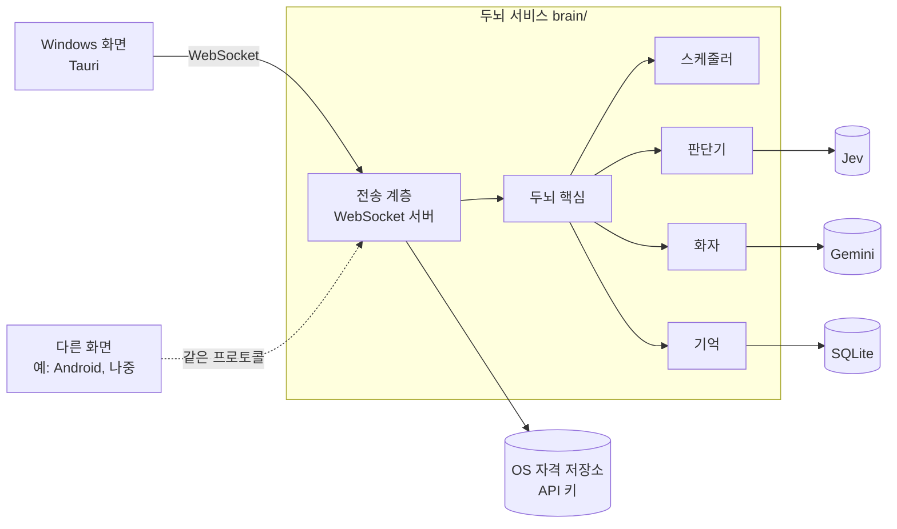
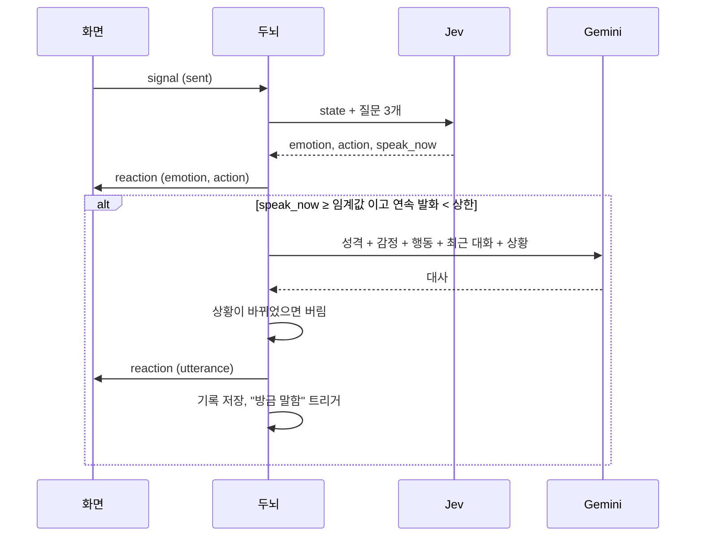

# 두뇌(서브 프로젝트 2) 설계

- 날짜: 2026-10-15
- 상태: 초안. 실제로 써 보며 고치고, 고도화 단계에서 크게 바뀔 수 있다 ([vision](../../vision.md))
- 근거 문서: [첫 버전 스펙](2026-10-14-windows-desktop-pet-design.md) 4·6절, 결정 기록 [0001](../../decisions/0001-jev-as-decision-engine.md), [0007](../../decisions/0007-dialogue-llm.md), [0011](../../decisions/0011-python-brain-local-sidecar.md), [0012](../../decisions/0012-brain-as-frontend-independent-service.md)

## 1. 목표

끼어들기, 선발화, 무응답, 연달아 말하기가 실제로 일어나게 한다. 두뇌는 Jev로 감정·행동·"지금 말할까"를 판단하고, Gemini로 대사를 만들고, 대화 기록을 저장한다.

**원칙: 두뇌는 화면을 모른다.** 두뇌는 고정이고 화면은 바뀔 수 있다(예: 나중에 Android). 화면이 두뇌의 프로토콜을 따른다. 사용자가 정했다.

### 범위 밖

감정을 화면에 그리는 일(감정별 그림은 두뇌 다음의 몸체 작업), 다른 기기에서 접속하기, 배포용 묶음, 장기 기억, 성격 변화.

## 2. 구조

- **두뇌 핵심**: Signal을 받아 Reaction을 내는 파이썬 코드. 전송 방식을 모른다. Jev·Gemini 클라이언트, 저장소, 시계는 생성할 때 주입한다. 평가(서브 프로젝트 3) 스크립트도 핵심을 직접 불러 쓴다.
  - 스케줄러: 언제 판단할지 정한다 (4.3).
  - 판단기: Jev 호출 → 감정·행동·`speak_now`.
  - 화자: Gemini 호출 → 대사.
  - 기억: 대화 기록 저장, 최근 N개 조회.
- **전송 계층**: WebSocket 서버. 여러 종류의 화면이 접속할 수 있고, 두뇌가 먼저 보내는 메시지(선발화)에 맞다. 나중에 전송 방식을 바꾸면 이 계층만 바꾼다.
- **두뇌가 갖는 것**: API 키, 대화 기록, 로그. 모두 두뇌의 데이터 폴더(`%APPDATA%\TamagotchiChatBot\brain`)와 OS 자격 저장소에 둔다. 화면의 저장소를 쓰지 않는다.

### 2.1 코드 배치

| 위치 | 내용 |
|---|---|
| `brain/` | 파이썬 3.11 프로젝트. 의존성은 `uv`로 관리 |
| `brain/brain/config.py` | 데이터 폴더 경로 등 환경 값을 읽는 유일한 곳 (CLAUDE.md 3절) |
| `brain/brain/questions.py` | Jev 질문 정의, 감정·행동 어휘 |
| `brain/brain/persona.py` | 성격 설명, 대사 프롬프트 |
| `brain/brain/tuning.py` | 잠정값과 근거 (4.4) |
| `brain/tests/` | pytest |
| `docs/brain-protocol.md` | 화면과 두뇌 사이의 프로토콜. 화면은 이 문서만 보고 만들 수 있어야 한다 |

모듈 이름은 계획 단계에서 조정할 수 있다. 질문 정의·프롬프트·잠정값을 한곳씩에 모은다는 점은 지킨다.

## 3. 프로토콜

상세는 `docs/brain-protocol.md`에 둔다. 여기에는 뼈대만 적는다.

- 메시지는 JSON 객체 하나. 모든 메시지에 프로토콜 버전 `v: 1`과 `type`이 있다.
- **접속**: 두뇌는 시작할 때 localhost의 빈 포트를 열고, 무작위 토큰과 포트를 데이터 폴더의 `brain.json`에 쓴다. 화면은 이 파일을 읽어 접속하고 처음에 `hello`로 토큰을 보낸다. 토큰이 틀리면 연결을 끊는다.
  - 이유: 브라우저에서 연 웹페이지도 localhost WebSocket에 접속할 수 있다. 토큰이 없으면 아무 웹페이지나 대화 내용을 읽을 수 있다.
- **접속 화면은 하나**: 새 화면이 `hello`에 성공하면 이전 연결을 닫는다. 첫 버전은 화면이 하나뿐이다.

| 방향 | type | 내용 |
|---|---|---|
| 화면 → 두뇌 | `hello` | `token` |
| 화면 → 두뇌 | `signal` | Signal 하나 (아래) |
| 화면 → 두뇌 | `set_key` | `name`(`typesafe`·`gemini`), `value` |
| 화면 → 두뇌 | `clear_history` | 없음 |
| 두뇌 → 화면 | `reaction` | `emotion?`, `action?`, `utterance?` |
| 두뇌 → 화면 | `status` | `ai`: `ok` / `no_keys` / `bad_key`. `hello` 직후와 상태가 바뀔 때 보낸다 |

**Signal** (몸체가 이미 보내는 것과 같다)

| kind | 필드 | 뜻 |
|---|---|---|
| `typing` | `text` | 입력창 글 변경 |
| `sent` | `text` | 메시지 보냄 |
| `house` | `inside`, `awayMs` | 강아지 집에 들어감/나옴. 나올 때 집에 있던 시간 |
| `bubble_seen` | | 사용자가 말풍선을 봤음 |
| `user_return` / `user_away` | | 사용자가 자리로 돌아옴 / 자리를 비움. 판단은 화면이 한다 |
| `interaction` | `type`: `poke`·`pet`·`throw` | 몸 상호작용 |

**어휘**: 감정 7개와 행동 7개는 두뇌가 정한다(4.1). 모든 화면이 전부 표현해야 한다. `status`를 어떻게 보여줄지(예: "키를 확인해 주세요" 말풍선)는 화면이 정한다.

## 4. 판단

### 4.1 Jev 질문 (요청 1회, 질문 3개)

| 질문 | 타입 | 후보 |
|---|---|---|
| `emotion` | choice | `excited` 신남, `angry` 분노, `curious` 궁금함, `surprised` 놀람, `sad` 슬픔, `sleepy` 졸림, `calm` 평온 |
| `action` | choice | `stand` 서기, `sit` 앉기, `lie_down` 엎드리기, `sleep` 잠, `beg` 조르기, `bark` 짖기, `none` 특별히 없음 |
| `speak_now` | noul | "이 강아지가 지금 말을 하는 것이 자연스럽다" |

- 감정 목록과 "행동은 제자리 동작만"은 사용자가 정했다 ([vision](../../vision.md) 판단 구조).
- 감정·행동이 직전과 같거나 행동이 `none`이면 그 항목은 Reaction에 넣지 않는다. 화면이 같은 동작을 다시 시작하지 않게 한다.
- 끼어들기·선발화·답할지·한 마디 더 할지를 모두 `speak_now`로 묻는다. 상황은 state로만 구분한다.

### 4.2 state

성격, 현재 시각, 상황(타이핑 중 / 방금 보냄 / 조용함 / 강아지가 방금 말함 / 몸 상호작용(종류) / 사용자 복귀 / 집에서 나옴), 타이핑 중인 글, 최근 대화 N개, 마지막 대화 이후 경과 시간, 안 읽힌 말풍선 여부, 지금 감정, 이번 사용자 입력 이후 강아지가 연속으로 말한 횟수. 집에서 막 나왔다면 집에 있던 시간을 넣는다.

지금 감정을 넣어 감정이 호출마다 널뛰지 않게 한다. 사용자 입력은 state에 들어가므로 주입된 문구가 판단을 흔들 수 있다([레퍼런스](../../references/typesafe-jev.md)). 첫 버전은 그대로 받아들이고 평가에서 살핀다.

### 4.3 스케줄러

| 트리거 | 호출 |
|---|---|
| `typing` | 새 글자 K자 이상, 또는 타이핑이 멈추고 T초 뒤. 새 호출이 나가면 진행 중인 판단은 취소 |
| `sent`, 강아지가 방금 말함, `user_return`, `house`(나옴) | 즉시 |
| `interaction` | 즉시. 단 직전 상호작용 호출 후 최소 간격을 지킨다. (스펙 4.3에 없던 트리거를 추가) |
| 조용함 | 자리에 있으면 P_active마다, 자리를 비웠으면 P_away마다 |
| `house`(들어감) ~ 나올 때까지 | 호출하지 않음. 진행 중인 판단·대사도 버린다 |

화면이 연결되어 있지 않으면 호출하지 않는다. 보여줄 곳이 없기 때문이다.

### 4.4 잠정값

모두 잠정값이다. 서브 프로젝트 3과 실제 사용으로 다시 정한다. 코드는 `tuning.py` 한곳에 근거 주석과 함께 둔다.

| 값 | 잠정값 | 근거 |
|---|---|---|
| K (새 글자 수) | 10자 | 한국어 두세 어절. 의미가 바뀔 만큼 입력됐다고 본다 |
| T (타이핑 멈춤) | 0.6초 | 연속 타이핑의 키 간격은 대개 0.5초 안쪽이다. Jev 지연(업체 발표 70~500ms)을 더해도 "입력 후 1초 안에 반응" 목표에 가깝다 |
| P_active | 60초 | 비용 추정: state 약 1,500토큰 × 하루 1,440회 × $0.042/100만 토큰 ≈ 하루 $0.09 (업체 발표 단가) |
| P_away | 10분 | 자리를 비운 동안 호출을 줄인다. 선발화는 유지한다 |
| `speak_now` 임계값 | 0.5 | 데이터가 없어 중간값에서 시작 |
| 최근 대화 N | 20개 | 말풍선 대사가 한두 문장이라 짧다. Gemini 입력 비용이 작다 |
| 연속 발화 상한 | 3회 | 사용자 입력 없이 연달아 말하는 횟수. 자리를 비운 동안 비용이 쌓이는 것을 막는다 |
| Jev 시간 제한 | 3초 | SDK 기본 10초는 실시간 반응에 너무 길다 |
| Gemini 시간 제한 | 5초 | 늦은 대사는 상황이 바뀌어 버려질 가능성이 크다 |
| 상호작용 호출 최소 간격 | 2초 | 쓰다듬기를 반복할 때 호출 폭주를 막는다 |

## 5. 판단 이후 흐름

1. Jev 응답의 감정·행동을 바로 `reaction`으로 보낸다. 대사를 기다리지 않는다.
2. `speak_now`가 임계값 이상이고 연속 발화 횟수가 상한 미만이면 Gemini로 대사를 만든다.
3. **대사 폐기**: 대사를 만드는 사이 `sent`가 오거나 강아지가 집에 들어가면 그 대사는 버린다. 타이핑이 이어지는 것은 버릴 이유가 아니다(끼어들기가 목적이다).
4. 대사를 보내면 대화 기록에 저장하고, 연속 발화 횟수를 1 올리고, "강아지가 방금 말함" 판단을 바로 한다. `sent`가 오면 연속 발화 횟수를 0으로 되돌린다.
5. 사용자가 보낸 메시지는 받는 즉시 대화 기록에 저장한다.

### 5.1 대사 (화자)

- 모델: `gemini-3.1-flash-lite` ([0007](../../decisions/0007-dialogue-llm.md)). 파이썬 SDK 사용법은 계획 전에 Context7로 확인한다.
- 입력: 성격, 말투(반말 + 강아지 의성어, 한두 문장), 지금 감정·행동, 최근 대화 N개, 상황, 타이핑 중인 글(끼어들기일 때).
- 출력이 길면 문장 두 개까지만 남긴다.
- 프롬프트는 `persona.py` 한곳에 둔다.

## 6. 대화 기록

- SQLite(파이썬 표준 `sqlite3`). 파일은 데이터 폴더의 `history.db`.
- 표 하나: 시각, 화자(`user` / `dog`), 글.
- 무기한 보관한다. `clear_history`로 전체 삭제한다. 화면에 보여주지 않는다 ([0005](../../decisions/0005-local-history-storage.md)).
- 읽기·쓰기가 실패하면 메모리 안의 최근 대화로 계속하고 로그를 남긴다.

## 7. 키

- 두뇌가 파이썬 `keyring`으로 OS 자격 저장소(Windows 자격 증명 관리자)에 저장한다. 평문 파일에 쓰지 않는다.
- 화면은 설정에서 받은 키를 `set_key`로 넘기기만 한다. 지금 Tauri의 `keys.rs`(키 저장 Rust 명령)는 없애고, 설정 화면의 "키 있음" 표시는 `status`로 대신한다.
- Rust `keyring` 크레이트와 파이썬 `keyring`은 저장 형식이 달라 기존에 저장한 키를 그대로 읽지 못할 수 있다. 첫 버전 사용자는 개발자 본인과 팀이므로 키를 한 번 다시 넣는다.

## 8. 오류 처리

원칙: 강아지는 멈추지 않는다. 두뇌가 죽어도 화면은 평소 움직임을 계속한다.

| 상황 | 동작 |
|---|---|
| 키 없음 | AI 호출 안 함. `status: no_keys` |
| 키 오류 (401/403) | 반복 호출하지 않음. `status: bad_key`. `set_key`가 올 때까지 AI 호출 중단 |
| Jev 실패·시간 초과 | 이번 판단 건너뜀. 다음 트리거에 재시도. 로그 |
| Gemini 실패·시간 초과 | 대사 없이 감정·행동만. 로그 |
| 연속 실패 (네트워크 끊김 등) | 연속 실패 n번이면 조용함 주기 호출을 2ⁿ배로 늦춘다(최대 5분). 성공하면 되돌린다. 사용자 이벤트 트리거는 그대로 시도한다 |
| 대화 기록 읽기·쓰기 실패 | 메모리로 계속. 로그 |
| 화면 연결 끊김 | 판단을 멈추고 기다린다. 다시 접속하면 이어 간다 |

로그는 데이터 폴더의 `logs/brain.log`에 남긴다(크기 제한 순환). 키와 대화 내용은 로그에 쓰지 않는다.

## 9. Windows 화면(Tauri) 변경

- **두뇌 실행**: 앱이 시작할 때 `brain.json`의 주소로 접속을 시도한다. 실패하면 두뇌를 띄운다(개발 환경: `brain/`에서 `uv run python -m brain`). 앱이 꺼질 때 자기가 띄운 두뇌는 함께 끈다.
- **연결**: 캐릭터 창이 WebSocket 연결 하나를 갖는다. 입력창·설정 창은 지금처럼 Tauri 이벤트로 캐릭터 창에 넘기고, 캐릭터 창이 두뇌로 보낸다. 끊기면 계속 다시 접속한다(간격 잠정 2초).
- **Reaction 반영**
  - 행동: 두뇌 어휘를 몸체 동작에 대응시킨다(`stand`→`idle_stand`, `sit`→`idle_sit`, `lie_down`→`idle_lay`, `sleep`, `beg`, `bark`).
  - 대사: 말풍선.
  - 감정: 지금은 받기만 한다. 감정별 그림은 다음 몸체 작업에서 붙인다.
- **status**: `no_keys`면 "설정에서 키를 넣어 주세요", `bad_key`면 "키를 확인해 주세요" 말풍선. 설정 화면의 키 표시도 `status`로 갱신한다.
- **없애는 것**: `stub-brain.ts`, `keys.rs`와 키 Rust 명령.

## 10. 테스트

- **두뇌 핵심 (pytest)**: 가짜 Jev·Gemini·시계·저장소로 검증한다.
  - 스케줄러: K자 입력, 멈춤 후 T초, 각 이벤트가 호출을 일으킨다. 새 타이핑 호출이 이전 판단을 취소한다. 집 안에서는 호출하지 않는다. 조용함 주기(자리 있음/비움).
  - 판단 흐름: 임계값 미만이면 대사 없음(무응답). 연속 발화 상한. `sent`·집 들어감 시 대사 폐기. 같은 감정·`none` 행동 생략.
  - 오류 처리: 8절 표의 각 동작.
- **전송 계층 (pytest)**: 실제 WebSocket으로 토큰 인증, 잘못된 토큰 거절, 새 연결이 이전 연결을 대체, 메시지 왕복.
- **Windows 화면 (Vitest)**: 두뇌 어휘 → 몸체 동작 대응, 메시지 해석 같은 순수 로직.
- **수동 확인**: `docs/manual-checks/brain.md`. 실제 키로 끼어들기·선발화·무응답·연달아 말하기가 일어나는지, 두뇌를 죽였을 때 강아지가 계속 움직이고 다시 붙는지.
