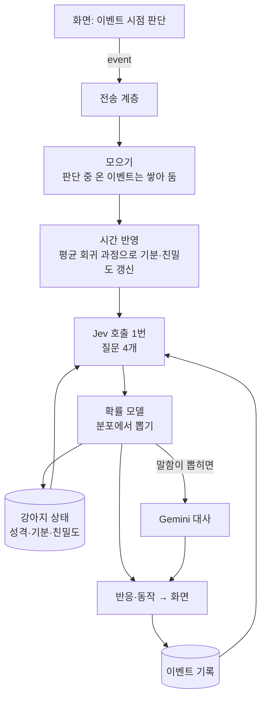
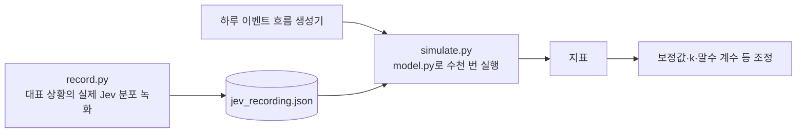

# 두뇌 v2 설계: 이벤트 단위 판단과 확률 모델

- 날짜: 2026-10-15
- 상태: 구현됨. 기분·반응·Jev 질문·프로토콜은 [기분 8개 스펙](2026-10-15-mood-reaction-design.md)으로 개정됨(기분 8개, 반응 = 가장 크게 오른 기분, 질문 3개, 프로토콜 v3). (2026-10-15, 계획 [2026-10-15-brain-v2](../plans/2026-10-15-brain-v2.md)). 초안이며 써 보며 고치고 고도화 단계에서 바뀔 수 있다 ([vision](../../vision.md)). 수동 확인: [체크리스트](../../manual-checks/brain.md)
- 대체: [두뇌 스펙 v1](2026-10-15-brain-design.md)의 판단 부분(4·5·6절). 전송 계층·키·오류 처리·Tauri 연결(2.1, 3, 7, 8, 9절)은 v1을 그대로 쓰고 여기서 바뀌는 점만 적는다
- 근거: 결정 [0012](../../decisions/0012-brain-as-frontend-independent-service.md), [0013](../../decisions/0013-event-driven-brain-with-event-log.md), [0014](../../decisions/0014-probabilistic-model-with-jev-distributions.md), 실측 [speak_now](../../spikes/2026-10-15-jev-speak-now-probe.md), [v2 가정](../../spikes/2026-10-15-brain-v2-assumptions.md)

## 1. 목표

v1의 두 증상(타이핑 중 끼어들지 않음, 늘 3번 말함)을 없애고, 강아지가 같은 상황에서도 조금씩 다르게, 겪은 일에 따라 달라지게 한다.

**원칙**
1. 이벤트가 판단의 단위다. 화면이 이벤트를 언제 낼지 정하고, 두뇌는 이벤트마다 같은 처리를 한다.
2. 이벤트 기록이 기억이다.
3. Jev는 분포를 주고, 확률 모델이 뽑아서 결정한다.

### 범위 밖

반응×동작 그림(약 36벌, 다음 몸체 작업), 사용자에 대해 아는 사실(장기 기억), 시간대에 따라 기준값이 바뀌는 것(예: 밤에 졸림 기준값 상승), Jev 질문 문구의 평가 기반 개선(서브 프로젝트 3).

## 2. 구조



| 모듈 (`brain/brain/`) | 책임 |
|---|---|
| `config.py` | 데이터 폴더, 키 (v1 그대로) |
| `tuning.py` | 잠정값과 근거 (9절) |
| `questions.py` | 어휘, Jev 질문 4개와 선택지별 정책 설명, Jev state 만들기 |
| `persona.py` | 기본 성격 설명, 대사 프롬프트, 대사 다듬기 |
| `model.py` | 확률 모델 (순수 함수): 탄생, 평균 회귀, 온도, 뽑기, 말할 확률, 변화 반영, 성격 변화 |
| `store.py` | 이벤트 기록과 강아지 상태 저장 (SQLite) |
| `clients.py` | Jev·Gemini 클라이언트 (v1 + 질문 4개 응답 해석) |
| `core.py` | 이벤트 처리: 모으기, Jev 호출, 모델 적용, 대사, 폐기 규칙 |
| `server.py`, `__main__.py` | 전송 계층, 실행 (v1 그대로, 메시지만 v2) |
| `brain/sim/` | Jev 녹화, 시뮬레이터 (10절) |

v1의 `memory.py`(대화 기록)는 `store.py`로 바뀐다. `model.py`는 움직임 경향 계산(6.5절)도 맡고, `core.py`는 기분 시계(6.5절)도 돌린다.

## 3. 이벤트 (프로토콜 v2)

모든 메시지에 `v: 2`. 접속·인증·`set_key`·`status`는 v1과 같다. `signal` 대신 `event`를 쓴다.

**화면 → 두뇌: `{"v":2, "type":"event", "kind": ..., "context": {...}}`**

| kind | 뜻 | context | Windows 화면이 내는 때 (잠정값) |
|---|---|---|---|
| `typing` | 보내기 전 쓰는 중 | `text` | 타이핑이 0.6초 멈췄을 때, 또는 지난 typing 이벤트 뒤로 10자 넘게 바뀌었을 때 |
| `message` | 사용자가 말함 | `text` | Enter |
| `dog_spoke` | 강아지 말이 화면에 뜸 | `text` | 말풍선을 표시한 직후 |
| `quiet` | 한동안 아무 일 없음 | `seconds` | 마지막 이벤트 뒤로 10분(사용자가 자리에 있음) / 30분(비움). 반복 |
| `returned` | 사용자가 돌아옴 | `away_seconds` | 입력 없이 1분 지난 뒤 다시 입력이 있을 때 |
| `house_in` | 강아지가 집에 들어감 | | 집 클릭·트레이·단축키 |
| `house_out` | 강아지가 집에서 나옴 | `away_seconds` | 같음 |
| `poke` | 찌르기 | | 짧은 클릭 |
| `pet` | 쓰다듬기 | `seconds` | 문지르기 감지 (쓰다듬은 시간) |
| `throw` | 던지기 | `impact`(0~1), `bounces`, `flight_seconds` | **착지할 때**. impact = 가장 세게 부딪힌 속도 ÷ 2000px/초, 1에서 자름 |

- 의미는 고정이고 시점·정규화는 화면이 정한다. 세기 값(`impact`)은 0~1로 정규화해서 보낸다.
- 강아지가 집에 있는 동안 화면은 `house_out` 외에는 이벤트를 내지 않는다.
- `clear_history`는 이벤트 기록을 지운다. 강아지 상태(성격·기분·친밀도)는 남는다.
- `reset`(설정 창 초기화 버튼)은 강아지를 새로 태어나게 한다: 진행 중인 판단을 버리고, 이벤트 기록·판단 로그를 지우고, 새 성격을 무작위로 뽑아 저장한다(읽지 못한 저장본도 덮어쓴다). API 키·앱 설정은 남는다(사용자 결정 2026-10-15).

**두뇌 → 화면: `{"v":2, "type":"reaction", "reaction"?, "action"?, "utterance"?}`**

| 필드 | 값 |
|---|---|
| `reaction` | `joy` 기쁨, `curious` 궁금함, `surprised` 놀람, `annoyed` 짜증, `sad` 서운함, `scared` 무서움 (없음이면 필드 생략) |
| `action` | `stand` `sit` `lie_down` `sleep` `beg` `bark` (없음이면 생략) |
| `utterance` | 대사. 반응·동작 뒤에 따로 올 수 있다 |

**두뇌 → 화면: `{"v":2, "type":"movement", "weights": {...}, "run": 0~1, "idle_scale": 양수}`** (6.5절)

| 필드 | 값 |
|---|---|
| `weights` | 범주별 가중치: `rest` 쉬기, `sleep` 잠, `roam` 돌아다니기, `approach` 사용자 곁으로, `play` 놀기, `explore` 구경하기 |
| `run` | 돌아다닐 때 달리는 비율 |
| `idle_scale` | 한 움직임에 머무는 시간 배율 |

접속 직후(`hello` 뒤 `status`와 함께)와 경향이 바뀔 때 보낸다. 화면은 받은 최신 값으로 샘플링한다.

### 3.1 조회 메시지 (2026-10-15 추가, 설정 창 상태·로그 탭)

이미 있는 메시지를 바꾸지 않는 추가라 `v: 2`를 유지한다.

| 방향 | type | 내용 |
|---|---|---|
| 화면 → 두뇌 | `get_state` | 강아지 상태 조회 |
| 두뇌 → 화면 | `state` | `dog`(성격·기분·친밀도·습관화), `talkativeness`(말수 계산값), `movement`(지금 경향) |
| 화면 → 두뇌 | `get_log` | 판단 로그 조회 |
| 두뇌 → 화면 | `log` | `judgements`(최근 판단 50개: 시각, 이벤트들, Jev 분포 상위, 보정 뒤 확률 상위, 말할 확률(Jev·최종), 뽑힌 반응·동작·말함, 기분 변화, 대사), `events`(이벤트 기록 문장 최근 50줄), `brain_log`(두뇌 로그 마지막 30줄) |

판단 로그는 메모리에만 최근 200개를 둔다(개발·확인용). 키는 어디에도 싣지 않는다.

## 4. 강아지 상태

예시:

```json
{
  "성격": {
    "기본 성격": "호기심 많고 수다스러운 강아지. 사용자를 좋아한다.",
    "기준값": {"심심함": 0.6, "졸림": 0.3, "들뜸": 0.4, "시무룩": 0.2, "분노": 0.1},
    "민감도": {"심심함": 0.5, "졸림": 0.5, "들뜸": 0.5, "시무룩": 0.5, "분노": 0.5},
    "변덕": 0.5
  },
  "기분": {"심심함": 0.3, "졸림": 0.2, "들뜸": 0.4, "시무룩": 0.1, "분노": 0.1},
  "친밀도": 0.3
}
```

모든 수치는 0~1. 이 JSON이 Jev state와 Gemini 입력에 그대로 들어간다(소수 둘째 자리).

### 4.1 탄생

두뇌가 처음 시작할 때(저장된 상태가 없을 때) 한 번 뽑는다. 정규분포에서 뽑아 범위로 자른다.

| 파라미터 | 평균 | 표준편차 | 범위 |
|---|---|---|---|
| 기준값 | 심심함 0.6, 졸림 0.3, 들뜸 0.4, 시무룩 0.2, 분노 0.1 | 0.1 | 0.05~0.95 |
| 민감도 | 0.5 | 0.1 | 0.2~0.9 |
| 변덕 | 0.5 | 0.15 | 0~1 |

평균은 vision의 "호기심 많고 수다스러운 강아지"를 숫자로 옮긴 잠정값이다(잘 심심해하고 잘 들뜨는 쪽 → 6절 말수가 높게 계산됨). **변덕과 민감도는 태어날 때 값으로 고정**이다(사용자 결정). 시작 기분은 기준값, 시작 친밀도는 0.3.

### 4.2 시간 흐름: 평균 회귀 과정

이벤트가 올 때마다 지난 갱신 뒤로 흐른 시간 Δt만큼 먼저 반영한다(두뇌에 타이머가 없다). 기분 차원 d마다:

```
m_d ← μ_d + (m_d − μ_d)·e^(−θ_d·Δt) + σ·√(1 − e^(−2θ_d·Δt))·ε,   ε ~ N(0,1)
```

- μ_d: 성격의 기준값. θ_d = ln2 / 반감기_d. σ: 오래 두었을 때의 흔들림 표준편차.
- **반감기도 기존 성격에서 끌어온다** (사용자 결정): 반감기_d = 기본 반감기_d × (0.5 + μ_d). 기준값이 높은 기분일수록 늦게 풀린다(원래 성마른 강아지는 화가 오래 감). 기준값 0.5면 기본값 그대로, 0.9면 1.4배, 0.1이면 0.6배.
- 심심함은 기준값이 높아서 혼자 두면 저절로 오르고, 이벤트가 끌어내린다. 다른 기분은 기준값이 낮아 저절로 풀린다.
- 친밀도도 같은 식으로, 기준값 0.3과 아주 긴 반감기(14일)로 오래 안 보면 서서히 식는다.

### 4.3 이벤트에 따른 변화

변화 질문(5절)의 확률로:

```
Δ_d = k · (P(d↑) − P(d↓)) · 민감도_d + N(0, 0.02)       기분  ← 2026-10-16 개정: 평가 사전값 + Jev 조정 (0015)
Δ_친밀도 = k_친밀도 · (P(친밀도↑) − P(친밀도↓))
```

결과는 0~1로 자른다. 모은 이벤트 여러 개도 한 번 판단해 한 번 반영한다.

### 4.4 성격 변화

- **기준값**: 날이 바뀐 뒤 처음 갱신할 때, μ_d ← μ_d + η·(어제 기분 평균_d − μ_d) + ζ·(기질_d − μ_d). 기분 평균은 기분 시계가 30초마다 고르게 모은 표본의 평균이다(판단 때만 모으면 이벤트가 몰린 시간대로 치우친다).
- **기질로 되돌아가는 힘 ζ** (구현 중 추가, [시뮬레이션](../../spikes/2026-10-15-simulation.md)): 기질은 태어날 때의 기준값이다. ζ = η이면 성격은 기질과 경험의 한가운데에 자리 잡는다. 이 힘이 없으면 8주 시뮬레이션에서 모든 강아지가 같은 성격으로 수렴했다.
- 기준값이 변하면 반감기(4.2)와 말수(6절)도 따라 변한다. 성격이 변하는 경로는 이것 하나다.
- 민감도·변덕은 변하지 않는다.

### 4.5 습관화: 같은 자극에 무뎌짐

사용자 결정: 같은 자극이 반복되면 무뎌지고(습관화), 성격은 무뎌지는 정도·속도에 영향을 준다. 민감도 자체는 변하지 않는다.

- 자극별 습관화 h_k (0~1): 대상 자극은 `poke`, `pet`, `throw`. 메시지·타이핑·돌아옴처럼 내용·상황이 매번 다른 이벤트에는 두지 않는다.
- 자극 k가 오면 h_k ← h_k + λ_k·(1 − h_k). λ_k = λ₀ × (1.5 − 민감도_{주 기분(k)}). 주 기분: poke→분노, pet→들뜸, throw→들뜸. 민감한 강아지일수록 천천히 무뎌진다.
- 시간이 지나면 회복: h_k는 반감기 1시간으로 0을 향해 줄어든다(평균 회귀와 같은 지수 감소, 흔들림 없음).
- 효과: 그 자극(들)로 생긴 기분·친밀도 변화에 (1 − h_k)를 곱하고(여러 자극을 모았으면 가장 큰 h), 반응 점수에서 "없음"에 + w_습관·h_k를 더한다.
- h는 강아지 상태에 함께 저장한다. Jev state에는 넣지 않는다.

## 5. 판단: Jev 질문 4개, 호출 1번

state:

```json
{
  "강아지 성격": {...4절 성격...},
  "지금 시각": "2026-10-15 (수) 14:10",
  "이번 이벤트들": [{"종류": "던지기", "맥락": {"충격": 0.9, "튕긴 횟수": 3}}],
  "최근 이벤트 기록": ["3분 전 · 사용자: 오늘 회의 길었어", "3분 전 · 강아지: 멍! 고생했어 (반응 기쁨, 동작 조르기)", "1분 전 · 사용자가 찔렀다"],
  "기분": {...}, "친밀도": 0.42
}
```

| 질문 | 타입 | 선택지 |
|---|---|---|
| `reaction` | choice | 기쁨, 궁금함, 놀람, 짜증, 서운함, 무서움, 없음 |
| `action` | choice | 서기, 앉기, 엎드리기, 잠, 조르기, 짖기, 없음 |
| `speak` | noul | "이 강아지가 지금 사용자에게 한마디 하는 것이 자연스럽다" |
| `change` | choice | 심심함·졸림·들뜸·시무룩·분노·친밀도 각각 ↑/↓, 변화 없음 (13개) |

- **질문 문구를 먼저 다듬는다** ([성격 유형 실측](../../spikes/2026-10-15-personality-types.md)): 지금 문구로는 동작이 거의 늘 조르기로 쏠리고, 말할 확률이 이벤트 종류마다 0.74~0.87로 거의 같다. 구현 첫 단계에서 동작 정책 문구와 말하기 문구(첫 실측의 "차례" 문구 포함)를 실제 Jev로 비교해 고른 뒤 녹화한다. 성격 수치는 Jev에 약하게만 반영되므로 성격 차이는 주로 확률 모델(기준값에서 계산되는 말수, 변덕, 민감도)이 만든다.
- **정책은 선택지 설명에 담는다.** 예: 짖기 "놀람·짜증·무서움 반응이 있거나 들뜸이 높을 때 자주 한다", 엎드리기 "졸림이나 시무룩이 높을 때 자주 한다". 정책 문구는 `questions.py` 한곳에서 관리한다.
- 변화 질문은 **이벤트 자체가 주는 변화**만 묻는다. 시간이 흘러 생기는 변화(혼자 있으면 심심해짐)는 평균 회귀 과정이 맡는다고 설명에 쓴다. 실측에서 "조용함 2시간"에 심심함이 거꾸로 내려갔기 때문이다.
- 최근 이벤트 기록은 30개(잠정값).

## 6. 확률 모델: Jev 분포에 우리 모형을 곱해 뽑기

**원칙 (사용자 결정): Jev에만 맡기지 않는다. Jev가 잘 못하는 것은 우리 모형이 보정한다.** 실측에서 Jev는 이벤트의 의미는 잘 읽지만, 성격·기분에 따른 차이와 대화의 흐름은 약했다([성격 유형 실측](../../spikes/2026-10-15-personality-types.md)).

뽑기 직전의 점수는 Jev 로그확률과 우리 모형의 보정을 더한 값이다(두 분포를 곱하는 것과 같다).

```
점수(i) = log P_Jev(i) / T  +  보정(i)          P(i) ∝ e^점수(i)
```

T = 0.5 + 변덕 (변덕 0이면 뾰족해 일관되고, 1이면 평평해 변덕스럽다).

1. **반응**: 보정(r) = w_기분 · Σ_d A[r][d] · (m_d − 0.5) + w_민감 · (민감도 평균 − 0.5) · [r ≠ 없음]
   - A: 기분→반응 친화도 표. 분노→짜증, 시무룩→서운함, 들뜸→기쁨, 심심함→궁금함·기쁨, 졸림→없음.
   - 민감도가 높은 성격은 반응 없음이 줄어든다.
2. **동작**: 반응을 먼저 뽑은 뒤 보정(a) = w_기분 · Σ_d B[a][d] · (m_d − 0.5) + w_반응 · C[a][뽑힌 반응]
   - B: 기분→동작 친화도. 졸림→잠·엎드리기, 들뜸→짖기, 시무룩→엎드리기, 분노→짖기, 심심함→조르기.
   - C: 반응→동작 연결. 놀람·짜증·무서움→짖기, 기쁨→조르기, 서운함→엎드리기, 궁금함→서기. Jev를 두 번 부르지 않고도 반응과 동작의 어긋남을 줄인다.
3. **말하기**: logit p = logit P_Jev + 말수 + c[이벤트 종류] − δ·연속 횟수 − ε·[답 기다림]
   - **말수는 독립 파라미터가 아니라 계산되는 값이다** (사용자 결정): 말수 = a·(친밀도 − 0.5) + Σ_d b_d·(m_d − 0.5) + Σ_d c_d·(μ_d − 0.5).
   - 방향: 친밀도 +, 기분 심심함·들뜸 +, 기분 졸림·시무룩·분노 −, 기준값 심심함·들뜸 +, 기준값 졸림·시무룩 −, 기준값 분노 −. (분노 − 는 사용자 결정)
   - 연속 횟수: 한 흐름(강아지가 말하고 말풍선이 뜨고 이어 말하기) 안에서 연달아 말한 횟수. `dog_spoke` 외의 이벤트가 오면 0으로 돌아간다. 3이면 말하지 않는다(안전장치). 처음엔 사용자 입력 때만 0으로 했으나, 수다스러운 강아지가 한 번 3번을 채우면 혼자 두어도 먼저 말을 걸지 못해 바꿨다([시뮬레이션](../../spikes/2026-10-15-simulation.md)).
   - 답 기다림: 강아지의 마지막 말이 물음표로 끝났고 그 뒤 사용자 입력이 없음.
   - 여러 이벤트를 모았으면 c는 가장 최근 이벤트 종류를 쓴다.
4. **기분·친밀도**: 4.3절.

- 친화도 표 A·B·C와 세기 w·δ·ε, 말수 계수 a·b·c, 이벤트 보정 c[종류]는 `tuning.py` 한곳에 근거와 함께 둔다. 표는 방향(+1/−1/0)만 정하고 세기는 시뮬레이션으로 맞춘다. **우리 모형이 Jev를 덮어쓰지 않도록** 세기는 Jev의 로그확률 차이보다 작게 시작한다.
- 반응이 "없음"이 아니면 화면에 보내고, 동작이 "없음"이 아니면 보낸다. 뽑힌 결과(반응·동작·대사)는 이벤트 기록에 "강아지" 줄로 남는다.

## 6.5 평소 움직임: 두뇌가 경향, 화면이 샘플링

사용자 결정: 평소 움직임은 성격과 현재 기분에 영향을 받는 확률 모형으로 정한다. 기분 감쇠는 두뇌가 계산하고, 경향이 바뀔 때마다 화면에 보낸다. 화면과 두뇌가 얼마나 자주 소통할지가 기준이다.

**두뇌: 로그-선형 경향**

```
w_c = 기본_c × exp( Σ_d M[c][d]·(m_d − 0.5) + Σ_d P[c][d]·(μ_d − 0.5) + I_c·(친밀도 − 0.5) )
run = σ( logit(기본 달리기) + Σ_d R[d]·(m_d − 0.5) )
idle_scale = exp( Σ_d D[d]·(m_d − 0.5) )
```

| 범주 | M + (기분) | M − (기분) | P + (기준값) | I (친밀도) |
|---|---|---|---|---|
| `rest` 쉬기 | 졸림, 시무룩 | 들뜸 | 졸림 | 0 |
| `sleep` 잠 | 졸림 | 들뜸, 심심함 | 졸림 | 0 |
| `roam` 돌아다니기 | 심심함, 들뜸 | 졸림, 시무룩 | 심심함 | 0 |
| `approach` 사용자 곁으로 | 심심함, 들뜸 | 분노, 시무룩 | 심심함, 들뜸 | + |
| `play` 놀기 | 들뜸 | 졸림, 시무룩, 분노 | 들뜸 | + |
| `explore` 구경하기 | 심심함 | 졸림 | 심심함 | 0 |

- R: 들뜸 +, 졸림 −. D: 졸림 +, 시무룩 +, 들뜸 −.
- 기본_c와 기본 달리기는 지금 몸체의 "보통" 프로필 값에서 시작한다. 방향표는 `tuning.py`에 두고 세기는 시뮬레이션으로 맞춘다.
- Jev는 부르지 않는다.

**두뇌: 기분 시계**

- 이벤트 처리와 별개로, 30초마다(잠정값) 4.2절 평균 회귀로 기분·친밀도·습관화를 갱신한다(무작위 흔들림 포함).
- 갱신 뒤 경향을 계산해, 지난번 보낸 경향과 비교해 **어떤 범주 가중치든 10% 넘게 바뀌었거나 run이 0.05 넘게 바뀌었거나 idle_scale이 10% 넘게 바뀌었으면** `movement`를 보낸다(잠정값). 이벤트 판단 뒤에도 같은 비교를 한다.
- 화면이 연결되어 있지 않으면 갱신만 하고 보내지 않는다. 다시 연결되면 접속 직후 보낸다.
- 효과: 이벤트 직후 기분이 빠르게 풀리는 동안은 몇 분에 한 번, 기준값 근처에서는 거의 보내지 않는다.

**화면: 반-마르코프 샘플링** (Windows: 지금 `dog.ts` 구조)

1. 한 움직임에 머무는 시간을 지금처럼 범위에서 뽑고 `idle_scale`을 곱한다.
2. 끝나면 다음 범주를 `weights`에 비례해 뽑는다.
3. 뽑을 때 화면만 아는 순간 정보를 곱한다: 커서가 멀거나 몸 위면 `approach`·`play` 0, 올라앉을 창이 없으면 `explore` 0, 근처 클릭이면 `approach`·`play` 4배. 사용자가 3분 이상 자리를 비우면 잠(지금 규칙).
4. 범주를 구체 움직임으로: `rest`→서기·앉기·엎드리기, `sleep`→잠, `roam`→걷기(`run` 비율로 달리기), `approach`→다가가기·따라가기, `play`→사냥, `explore`→창 위 앉기·창 구경.
5. 설정의 쉬기가 켜져 있으면 경향과 상관없이 그 자리에서 잔다. 차분·보통·활발 단계는 없앤다(vision).
6. `movement`를 아직 받지 못했으면(두뇌 없음) 기본_c로 움직인다.

## 7. 대사

- 말하기가 뽑히면 Gemini(`gemini-3.1-flash-lite`)를 부른다.
- 입력: 5절 state JSON(수치 그대로) + `"이번에 뽑힌 반응"`, `"이번에 뽑힌 동작"`, `"지금 말하는 상황"`(끼어들기·답하기·이어 말하기 등), `"내가 최근에 한 말"`(최근 5개).
- 시스템 지시: 화면 위 강아지, JSON의 성격·기분·친밀도를 반영, 말투 규칙(반말 + 의성어, 한두 문장, 의성어로만 시작하지 않음), **이벤트 뜻**(던지기 = 네가 던져졌다 등), **대화 규칙**(물으면 먼저 답하고 고르라면 고름, 위로를 청하면 곁에 있음, 이유 없는 사과 없음, 최근 한 말 반복 없음, 타이핑 중엔 한마디만). 2026-10-16 검수 001로 추가. Jev 상태 형식은 그대로라 녹화는 유지된다.
- 검수 003으로 더한 대화 규칙: 분·초를 세어 말하지 않음, 반기는 말은 돌아옴·집에서 나옴일 때만, 늘 반말, 이미 고른 것 유지·사용자와 내 말을 헷갈리지 않고 탓하지 않음, 몸짓은 기분에 맞을 때만. 대사 프롬프트에서는 조용함의 초(화면이 알리는 간격)를 빼고 실제 혼자 있은 시간만 준다.
- 출력은 v1처럼 다듬어 두 문장까지. 실측에서 기분이 말투에 드러남을 확인했다.

## 8. 모으기와 폐기

- 판단(Jev 또는 대사 생성) 중에 온 이벤트는 쌓아 둔다. 끝나면 쌓인 것을 "이번 이벤트들"로 묶어 한 번 판단한다.
- 대사를 만드는 중에 `message`나 `house_in`이 오면 만들던 대사를 버린다. 그 밖에는 끝까지 만든다.
- 핀잔(Jev 친밀도↓ 0.4 이상인 메시지)에 답한 뒤에는 이어 말하지 않는다. 강아지가 집에 있는 동안은 움직임 경향을 보내지 않는다(2026-10-16 검수 002).
- 대사에 물음표가 있으면("…? 멍!" 포함) 답을 기다리며 이어 말하지 않는다(2026-10-16 검수 002: 질문하고 0초 만에 "왜 대답이 없어?").
- 타이핑 중에 끼어든 대사는 한마디로 끝낸다. 그 말풍선(`dog_spoke`)에는 이어 말하지 않는다(2026-10-16 검수 001: 아직 치는 중인데 연달아 재촉함).
- `house_in`이 오면 쌓아 둔 이벤트도 버린다(집에서는 조용). `house_in` 자체는 판단하되(기분 변화·기록) 말하지 않는다. 화면이 보여 주지 않는 대사가 기록과 연속 횟수에 남지 않게 한다.
- 모든 이벤트는 받는 즉시 기록에 쌓인다(버린 이벤트도 기록에는 남는다).

## 9. 잠정값

모두 잠정값이다. 시뮬레이션(10절)으로 맞추고 평가로 다시 본다. `tuning.py`에 근거와 함께 둔다.

| 값 | 잠정값 | 근거 |
|---|---|---|
| 기본 반감기 (기준값 0.5일 때) | 들뜸 20분, 분노 30분, 시무룩 1시간, 심심함 1시간, 졸림 2시간 | 반응이 아닌 기분은 분~시간 단위(vision). 들뜸·분노는 빨리, 졸림은 천천히 풀린다고 봄 |
| 흔들림 σ | 0.05 | 오래 두었을 때 기준값 ±0.1 안에서 흔들리는 정도 |
| 변화 폭 k | 0.3 | 실측에서 강한 내용의 (P↑−P↓)가 ±0.6~0.7. 민감도 0.5면 한 이벤트에 ±0.1, 비슷한 일이 5번이면 기분이 0.5 움직임 |
| 친밀도 변화 폭 k_친밀도 | 0.05 | 강하게 좋은 일 약 20번에 +0.5. 일~주 단위 (vision) |
| 친밀도 반감기·기준값 | 14일, 0.3 | 오래 안 보면 몇 주에 걸쳐 식음 |
| 기준값 변화율 η, 기질로 되돌아가는 힘 ζ | 각 0.025/일 | 시뮬레이션: 8주 동안 기준값이 중앙 0.06·최대 0.22 움직이고 개성(강아지 사이 차이)이 유지됨. η 0.05·ζ 0에서는 모두 같은 성격으로 수렴 |
| 말수 계수 a·b·c | 모두 크기 1 (방향은 6절) | 한 요소가 0.5 벗어나면 logit ±0.5. 시뮬레이션으로 맞춘다 |
| 보정 세기 w·δ·ε | 1에서 시작 | 기분이 기준에서 0.5 벗어나면 로그 점수 ±0.5(확률 약 1.6배). Jev 로그확률 차이(실측상 1~3)보다 작게 시작해 Jev를 덮어쓰지 않게 한다 |
| 습관화 λ₀·회복 반감기·w_습관 | 0.3, 1시간, 2 | 같은 자극 5번이면 h≈0.83(민감도 0.5 기준). 1시간 쉬면 절반 회복 |
| 이벤트별 보정 c | typing −4.28, message −0.71, dog_spoke −2.13, quiet −2.61, 나머지 0 | 녹화한 Jev 분포로 시뮬레이션해 평균 성격이 10절 목표에 맞도록 맞춘 값 ([시뮬레이션](../../spikes/2026-10-15-simulation.md)) |
| 연속 발화 상한 | 3 | 안전장치 (v1) |
| 최근 이벤트 기록 | 30개 | v1 대화 20개 + 찌르기 같은 짧은 이벤트 |
| 기분 시계 주기, 경향 전송 기준 | 30초, 가중치 10%·run 0.05·idle_scale 10% | 기분 반감기가 20분 이상이라 30초 갱신이면 충분. 전송 기준은 사람이 움직임 차이를 느낄 만한 크기로 잡은 잠정값 |
| 화면 이벤트 시점 | 3절 표 | v1 스케줄러 값을 화면으로 옮김. 조용함은 10분(먼저 말 걸기 목표 30분 ÷ 말할 확률 약 1/3) |

## 10. 시뮬레이션으로 파라미터 맞추기



- **녹화**: 이벤트 종류(10) × 기분 프리셋(기본, 심심함 높음, 졸림 높음, 분노 높음, 들뜸 높음, 시무룩 높음) × 친밀도(0.2, 0.8)에서 실제 Jev 응답 4개 질문을 받아 저장한다(약 120회, 비용 미미). `dog_spoke`는 직전 강아지 말 수(0·1·2)도 바꿔 녹화한다.
- **시뮬레이터**: 사용자 행동 모델(작업 중 타이핑·메시지, 자리 비움, 가끔 찌르기·쓰다듬기)로 하루 이벤트 흐름을 만들고, 가장 가까운 녹화 분포를 써서 확률 모델을 돌린다. 몇 주도 몇 초 만에 돈다.
- **목표 지표** (잠정). **평균 성격**(4.1절 평균값) 강아지의 기준이다. 실제 강아지는 성격(기준값·민감도·변덕)에 따라 이 주변으로 퍼진다.

| 지표 | 목표 | 출처 |
|---|---|---|
| 강아지가 말한 뒤 이어서 말하는 길이 | 1번 70%, 2번 20%, 3번 10% | 사용자 수용: "보통 1번, 가끔 2~3번" |
| 사용자가 있고 아무 일 없을 때 먼저 말 걸기 | 평균 30분에 1번 | 사용자 수용 |
| 타이핑 이벤트 중 끼어드는 비율 | 15% | Claude 제안 (검토 필요) |
| 메시지에 답하는 비율 | 85% (15%는 무응답) | Claude 제안 (검토 필요) |
| 기분 고착 없음 | 각 기분이 0.9 이상이나 0.05 이하에 머무는 시간 20% 이하 | Claude 제안 |
| 성격 극단 없음 | 8주 뒤 기준값·민감도가 0.1~0.9 안 | Claude 제안 |
| Jev 존중 | 같은 상황에서 우리 모형 보정 뒤에도 Jev 1위 선택지가 대체로(60% 이상) 1위로 남음 | Claude 제안 |
| 성격에 따른 차이 | 성격을 100개 뽑아 돌렸을 때 위 지표들이 강아지마다 눈에 띄게 다르되(예: 끼어들기 평균 15%면 대략 8~25%) 극단(0%, 50% 이상)은 없음 | 사용자 지적 반영, Claude 제안 |

- **성격 유형 4개로 확인한다** (사용자 요청): 평균(호기심·수다), 과묵·차분, 예민·성마름, 활발·변덕쟁이. 수치는 [성격 유형 실측](../../spikes/2026-10-15-personality-types.md) 표와 같다(말수 열은 쓰지 않는다. 말수는 계산되는 값이다). 유형마다 위 지표를 따로 내고, 유형끼리 눈에 띄게 다른지 본다. 무작위로 뽑은 100마리 확인과 함께 한다.

맞춘 값과 시뮬레이션 결과는 `docs/spikes/`에 기록하고 `tuning.py` 근거 주석에 링크한다.

## 11. 저장

- `brain.db`(SQLite, 데이터 폴더)
  - `events`: 시각, 출처(`user`/`dog`/`screen`), 종류, 맥락(JSON). v1 `history.db`의 대화는 처음 시작할 때 `message`/강아지 말 이벤트로 옮기고, 파일 이름을 `history.v1-imported.db`로 바꿔 다시 옮기지 않는다.
  - `dog`: 강아지 상태 JSON 한 줄과 마지막 갱신 시각, 오늘의 기분 합계.
- 쓰기 실패 시 메모리로 계속하고 로그를 남긴다(v1과 같음). 키와 대화 내용은 로그에 쓰지 않는다.

## 12. Windows 화면 변경

- `signal` → `event`. 3절 표대로 이벤트를 낸다. v1 두뇌 스케줄러의 타이핑 판정(10자/0.6초)을 화면으로 옮긴다.
- 조용함 타이머: 마지막 이벤트 뒤로 10분(자리에 있음)/30분(비움)마다 `quiet`.
- 말풍선을 띄우면 `dog_spoke`.
- 던지기는 착지 때 `throw`(충격 계산은 `dog.ts`의 충돌 속도로).
- `user_away`, `bubble_seen`은 두뇌로 보내지 않는다(말풍선 "봤다" 판정과 자리 비움은 화면 안에서만 쓴다).
- 접속 직후 상태 재전송(v1의 `stateSignals`)은 없앤다. 두뇌가 집·자리 상태를 들고 있지 않기 때문이다.
- 반응은 받기만 한다(그림은 다음 몸체 작업).

## 13. 오류 처리

v1 8절 그대로. 추가:
- Jev 응답에 모르는 선택지가 있거나 분포가 비면 그 항목은 "없음"으로 본다.
- 강아지 상태를 읽지 못하거나 저장본의 모양이 어긋나면 새로 탄생시키지 않고 기본값(4절 평균)으로 계속하며, 저장본을 덮어쓰지 않는다. 저장된 성격을 잃지 않기 위해서다.

## 14. 테스트

- **확률 모델 (pytest, 시드 고정)**: 평균 회귀(Δt=0이면 그대로, 길면 기준값 근처), 온도(T<1 뾰족, T>1 평평), 친화도 보정 방향(분노 높으면 짜증↑, 졸림 높으면 잠↑, 짜증 뽑히면 짖기↑), 말할 확률 식(연속 횟수·답 기다림이 낮춤), 변화 반영과 자르기, 탄생 범위, 기준값 변화, 습관화(반복할수록 변화가 줄고 시간이 지나면 회복, 민감할수록 천천히 무뎌짐), 말수 계산 방향, 연속 상한과 typing 초기화.
- **두뇌 핵심 (pytest, 가짜 Jev)**: 이벤트 한 개 처리 흐름, 모으기(판단 중 이벤트 3개 → 다음 판단 1번에 3개), 폐기(message·house_in), 기록에 강아지 줄이 남음, 상태 저장·복원.
- **저장 (pytest)**: 이벤트 기록·상태 저장, v1 대화 옮기기, 실패 시 메모리.
- **시뮬레이터 (pytest)**: 작은 녹화로 돌아가고 지표가 나온다.
- **움직임 경향 (pytest)**: 방향표대로 움직임(졸림↑→잠·쉬기↑, 들뜸↑→놀기·run↑, 친밀도↑→사용자 곁으로↑), 기분 시계가 기분을 기준값 쪽으로 옮김, 전송 기준(작은 변화는 안 보내고 큰 변화는 보냄), 연결 안 됐을 때 안 보냄.
- **Windows 화면 (Vitest)**: 타이핑 판정, 조용함 타이머, 충격 정규화, `movement` 가중치로 범주 뽑기(순간 정보 곱하기 포함), 쉬기 켜짐 같은 순수 로직.
- **수동 확인**: `docs/manual-checks/brain.md`를 v2 동작으로 갱신.
