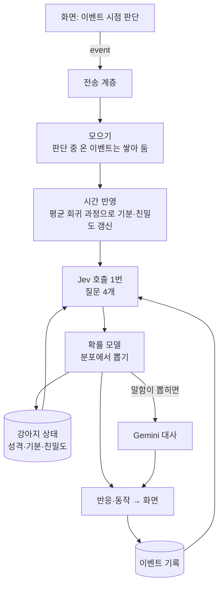
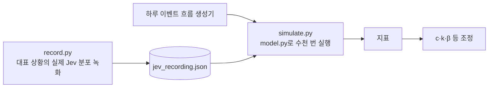

# 두뇌 v2 설계: 이벤트 단위 판단과 확률 모델

- 날짜: 2026-10-15
- 상태: 검토 중. 초안이며 써 보며 고치고 고도화 단계에서 바뀔 수 있다 ([vision](../../vision.md))
- 대체: [두뇌 스펙 v1](2026-10-15-brain-design.md)의 판단 부분(4·5·6절). 전송 계층·키·오류 처리·Tauri 연결(2.1, 3, 7, 8, 9절)은 v1을 그대로 쓰고 여기서 바뀌는 점만 적는다
- 근거: 결정 [0012](../../decisions/0012-brain-as-frontend-independent-service.md), [0013](../../decisions/0013-event-driven-brain-with-event-log.md), [0014](../../decisions/0014-probabilistic-model-with-jev-distributions.md), 실측 [speak_now](../../spikes/2026-10-15-jev-speak-now-probe.md), [v2 가정](../../spikes/2026-10-15-brain-v2-assumptions.md)

## 1. 목표

v1의 두 증상(타이핑 중 끼어들지 않음, 늘 3번 말함)을 없애고, 강아지가 같은 상황에서도 조금씩 다르게, 겪은 일에 따라 달라지게 한다.

**원칙**
1. 이벤트가 판단의 단위다. 화면이 이벤트를 언제 낼지 정하고, 두뇌는 이벤트마다 같은 처리를 한다.
2. 이벤트 기록이 기억이다.
3. Jev는 분포를 주고, 확률 모델이 뽑아서 결정한다.

### 범위 밖

반응×동작 그림(약 36벌, 다음 몸체 작업), 사용자에 대해 아는 사실(장기 기억), 시간대에 따라 기준값이 바뀌는 것(예: 밤에 졸림 기준값 상승), Jev 질문 문구의 평가 기반 개선(서브 프로젝트 3).

## 2. 구조



| 모듈 (`brain/brain/`) | 책임 |
|---|---|
| `config.py` | 데이터 폴더, 키 (v1 그대로) |
| `tuning.py` | 잠정값과 근거 (9절) |
| `questions.py` | 어휘, Jev 질문 4개와 선택지별 정책 설명, Jev state 만들기 |
| `persona.py` | 기본 성격 설명, 대사 프롬프트, 대사 다듬기 |
| `model.py` | 확률 모델 (순수 함수): 탄생, 평균 회귀, 온도, 뽑기, 말할 확률, 변화 반영, 성격 변화 |
| `store.py` | 이벤트 기록과 강아지 상태 저장 (SQLite) |
| `clients.py` | Jev·Gemini 클라이언트 (v1 + 질문 4개 응답 해석) |
| `core.py` | 이벤트 처리: 모으기, Jev 호출, 모델 적용, 대사, 폐기 규칙 |
| `server.py`, `__main__.py` | 전송 계층, 실행 (v1 그대로, 메시지만 v2) |
| `brain/sim/` | Jev 녹화, 시뮬레이터 (10절) |

v1의 `memory.py`(대화 기록)는 `store.py`로 바뀐다.

## 3. 이벤트 (프로토콜 v2)

모든 메시지에 `v: 2`. 접속·인증·`set_key`·`status`는 v1과 같다. `signal` 대신 `event`를 쓴다.

**화면 → 두뇌: `{"v":2, "type":"event", "kind": ..., "context": {...}}`**

| kind | 뜻 | context | Windows 화면이 내는 때 (잠정값) |
|---|---|---|---|
| `typing` | 보내기 전 쓰는 중 | `text` | 타이핑이 0.6초 멈췄을 때, 또는 지난 typing 이벤트 뒤로 10자 넘게 바뀌었을 때 |
| `message` | 사용자가 말함 | `text` | Enter |
| `dog_spoke` | 강아지 말이 화면에 뜸 | `text` | 말풍선을 표시한 직후 |
| `quiet` | 한동안 아무 일 없음 | `seconds` | 마지막 이벤트 뒤로 10분(사용자가 자리에 있음) / 30분(비움). 반복 |
| `returned` | 사용자가 돌아옴 | `away_seconds` | 입력 없이 1분 지난 뒤 다시 입력이 있을 때 |
| `house_in` | 강아지가 집에 들어감 | | 집 클릭·트레이·단축키 |
| `house_out` | 강아지가 집에서 나옴 | `away_seconds` | 같음 |
| `poke` | 찌르기 | | 짧은 클릭 |
| `pet` | 쓰다듬기 | `seconds` | 문지르기 감지 (쓰다듬은 시간) |
| `throw` | 던지기 | `impact`(0~1), `bounces`, `flight_seconds` | **착지할 때**. impact = 가장 세게 부딪힌 속도 ÷ 2000px/초, 1에서 자름 |

- 의미는 고정이고 시점·정규화는 화면이 정한다. 세기 값(`impact`)은 0~1로 정규화해서 보낸다.
- 강아지가 집에 있는 동안 화면은 `house_out` 외에는 이벤트를 내지 않는다.
- `clear_history`는 이벤트 기록을 지운다. 강아지 상태(성격·기분·친밀도)는 남는다.

**두뇌 → 화면: `{"v":2, "type":"reaction", "reaction"?, "action"?, "utterance"?}`**

| 필드 | 값 |
|---|---|
| `reaction` | `joy` 기쁨, `curious` 궁금함, `surprised` 놀람, `annoyed` 짜증, `sad` 서운함, `scared` 무서움 (없음이면 필드 생략) |
| `action` | `stand` `sit` `lie_down` `sleep` `beg` `bark` (없음이면 생략) |
| `utterance` | 대사. 반응·동작 뒤에 따로 올 수 있다 |

## 4. 강아지 상태

예시:

```json
{
  "성격": {
    "기본 성격": "호기심 많고 수다스러운 강아지. 사용자를 좋아한다.",
    "기준값": {"심심함": 0.6, "졸림": 0.3, "들뜸": 0.4, "시무룩": 0.2, "분노": 0.1},
    "민감도": {"심심함": 0.5, "졸림": 0.5, "들뜸": 0.5, "시무룩": 0.5, "분노": 0.5},
    "변덕": 0.5,
    "말수": 0.65
  },
  "기분": {"심심함": 0.3, "졸림": 0.2, "들뜸": 0.4, "시무룩": 0.1, "분노": 0.1},
  "친밀도": 0.3
}
```

모든 수치는 0~1. 이 JSON이 Jev state와 Gemini 입력에 그대로 들어간다(소수 둘째 자리).

### 4.1 탄생

두뇌가 처음 시작할 때(저장된 상태가 없을 때) 한 번 뽑는다. 정규분포에서 뽑아 범위로 자른다.

| 파라미터 | 평균 | 표준편차 | 범위 |
|---|---|---|---|
| 기준값 | 심심함 0.6, 졸림 0.3, 들뜸 0.4, 시무룩 0.2, 분노 0.1 | 0.1 | 0.05~0.95 |
| 민감도 | 0.5 | 0.1 | 0.2~0.9 |
| 변덕 | 0.5 | 0.15 | 0~1 |
| 말수 | 0.65 | 0.1 | 0~1 |

평균은 vision의 "호기심 많고 수다스러운 강아지"를 숫자로 옮긴 잠정값이다(심심함이 잘 생기고 말수가 많은 쪽). 시작 기분은 기준값, 시작 친밀도는 0.3.

### 4.2 시간 흐름: 평균 회귀 과정

이벤트가 올 때마다 지난 갱신 뒤로 흐른 시간 Δt만큼 먼저 반영한다(두뇌에 타이머가 없다). 기분 차원 d마다:

```
m_d ← μ_d + (m_d − μ_d)·e^(−θ_d·Δt) + σ·√(1 − e^(−2θ_d·Δt))·ε,   ε ~ N(0,1)
```

- μ_d: 성격의 기준값. θ_d = ln2 / 반감기_d. σ: 오래 두었을 때의 흔들림 표준편차.
- **반감기도 기존 성격에서 끌어온다** (사용자 결정): 반감기_d = 기본 반감기_d × (0.5 + μ_d). 기준값이 높은 기분일수록 늦게 풀린다(원래 성마른 강아지는 화가 오래 감). 기준값 0.5면 기본값 그대로, 0.9면 1.4배, 0.1이면 0.6배.
- 심심함은 기준값이 높아서 혼자 두면 저절로 오르고, 이벤트가 끌어내린다. 다른 기분은 기준값이 낮아 저절로 풀린다.
- 친밀도도 같은 식으로, 기준값 0.3과 아주 긴 반감기(14일)로 오래 안 보면 서서히 식는다.

### 4.3 이벤트에 따른 변화

변화 질문(5절)의 확률로:

```
Δ_d = k · (P(d↑) − P(d↓)) · 민감도_d + N(0, 0.02)       기분
Δ_친밀도 = k_친밀도 · (P(친밀도↑) − P(친밀도↓))
```

결과는 0~1로 자른다. 모은 이벤트 여러 개도 한 번 판단해 한 번 반영한다.

### 4.4 성격 변화

- **기준값**: 하루가 바뀐 뒤 첫 이벤트 때, μ_d ← μ_d + η·(어제 기분 평균_d − μ_d). 기분 평균은 그날 판단 때마다 본 기분의 평균이다.
- **민감도**: 이벤트로 d가 오를 때(Δ_d > 0), 민감도_d ← 민감도_d + α·(μ_d − 0.5)·Δ_d. 기준값이 높은 기분은 더 예민해지고(민감화) 낮은 기분은 무뎌진다(습관화). 0.2~0.9로 자른다 (vision: 기존 성격에서 끌어오기).
- 변덕·말수는 첫 버전에서 변하지 않는다.

## 5. 판단: Jev 질문 4개, 호출 1번

state:

```json
{
  "강아지 성격": {...4절 성격...},
  "지금 시각": "2026-10-15 (수) 14:10",
  "이번 이벤트들": [{"종류": "던지기", "맥락": {"충격": 0.9, "튕긴 횟수": 3}}],
  "최근 이벤트 기록": ["3분 전 · 사용자: 오늘 회의 길었어", "3분 전 · 강아지: 멍! 고생했어 (반응 기쁨, 동작 조르기)", "1분 전 · 사용자가 찔렀다"],
  "기분": {...}, "친밀도": 0.42
}
```

| 질문 | 타입 | 선택지 |
|---|---|---|
| `reaction` | choice | 기쁨, 궁금함, 놀람, 짜증, 서운함, 무서움, 없음 |
| `action` | choice | 서기, 앉기, 엎드리기, 잠, 조르기, 짖기, 없음 |
| `speak` | noul | "이 강아지가 지금 사용자에게 한마디 하는 것이 자연스럽다" |
| `change` | choice | 심심함·졸림·들뜸·시무룩·분노·친밀도 각각 ↑/↓, 변화 없음 (13개) |

- **질문 문구를 먼저 다듬는다** ([성격 유형 실측](../../spikes/2026-10-15-personality-types.md)): 지금 문구로는 동작이 거의 늘 조르기로 쏠리고, 말할 확률이 이벤트 종류마다 0.74~0.87로 거의 같다. 구현 첫 단계에서 동작 정책 문구와 말하기 문구(첫 실측의 "차례" 문구 포함)를 실제 Jev로 비교해 고른 뒤 녹화한다. 성격 수치는 Jev에 약하게만 반영되므로 성격 차이는 주로 확률 모델(말수·변덕·기준값·민감도)이 만든다.
- **정책은 선택지 설명에 담는다.** 예: 짖기 "놀람·짜증·무서움 반응이 있거나 들뜸이 높을 때 자주 한다", 엎드리기 "졸림이나 시무룩이 높을 때 자주 한다". 정책 문구는 `questions.py` 한곳에서 관리한다.
- 변화 질문은 **이벤트 자체가 주는 변화**만 묻는다. 시간이 흘러 생기는 변화(혼자 있으면 심심해짐)는 평균 회귀 과정이 맡는다고 설명에 쓴다. 실측에서 "조용함 2시간"에 심심함이 거꾸로 내려갔기 때문이다.
- 최근 이벤트 기록은 30개(잠정값).

## 6. 확률 모델: 뽑아서 결정

1. **온도**: 반응·동작 분포에 온도 T = 0.5 + 변덕을 적용한다. p_i ∝ p_i^(1/T). 변덕 0이면 T=0.5로 뾰족해지고(일관됨), 1이면 T=1.5로 평평해진다(변덕스러움).
2. **반응·동작**: 온도를 적용한 분포에서 각각 하나씩 뽑는다. 한 호출에서 함께 물으므로 가끔 어긋날 수 있다(vision: 허용).
3. **말하기**: p = σ(logit(P_speak) + β·(말수 − 0.5) + c[이벤트 종류]). 여러 이벤트를 모았으면 c는 가장 최근 이벤트 종류를 쓴다. 주사위가 p보다 작으면 말한다.
   - 사용자 `message` 없이 강아지가 연달아 말한 횟수가 3이면 말하지 않는다(안전장치). `typing`도 사용자 입력이므로 이 횟수를 0으로 되돌린다(v1 버그 수정).
4. **기분·친밀도**: 4.3절.

반응이 "없음"이 아니면 화면에 보내고, 동작이 "없음"이 아니면 보낸다. 뽑힌 결과(반응·동작·대사)는 이벤트 기록에 "강아지" 줄로 남는다.

## 7. 대사

- 말하기가 뽑히면 Gemini(`gemini-3.1-flash-lite`)를 부른다.
- 입력: 5절 state JSON(수치 그대로) + `"이번에 뽑힌 반응"`, `"이번에 뽑힌 동작"`.
- 시스템 지시: 화면 위 강아지, JSON의 성격·기분·친밀도를 반영, 말투 규칙(반말 + 의성어, 한두 문장).
- 출력은 v1처럼 다듬어 두 문장까지. 실측에서 기분이 말투에 드러남을 확인했다.

## 8. 모으기와 폐기

- 판단(Jev 또는 대사 생성) 중에 온 이벤트는 쌓아 둔다. 끝나면 쌓인 것을 "이번 이벤트들"로 묶어 한 번 판단한다.
- 대사를 만드는 중에 `message`나 `house_in`이 오면 만들던 대사를 버린다. 그 밖에는 끝까지 만든다.
- `house_in`이 오면 쌓아 둔 이벤트도 버린다(집에서는 조용).
- 모든 이벤트는 받는 즉시 기록에 쌓인다(버린 이벤트도 기록에는 남는다).

## 9. 잠정값

모두 잠정값이다. 시뮬레이션(10절)으로 맞추고 평가로 다시 본다. `tuning.py`에 근거와 함께 둔다.

| 값 | 잠정값 | 근거 |
|---|---|---|
| 기본 반감기 (기준값 0.5일 때) | 들뜸 20분, 분노 30분, 시무룩 1시간, 심심함 1시간, 졸림 2시간 | 반응이 아닌 기분은 분~시간 단위(vision). 들뜸·분노는 빨리, 졸림은 천천히 풀린다고 봄 |
| 흔들림 σ | 0.05 | 오래 두었을 때 기준값 ±0.1 안에서 흔들리는 정도 |
| 변화 폭 k | 0.3 | 실측에서 강한 내용의 (P↑−P↓)가 ±0.6~0.7. 민감도 0.5면 한 이벤트에 ±0.1, 비슷한 일이 5번이면 기분이 0.5 움직임 |
| 친밀도 변화 폭 k_친밀도 | 0.05 | 강하게 좋은 일 약 20번에 +0.5. 일~주 단위 (vision) |
| 친밀도 반감기·기준값 | 14일, 0.3 | 오래 안 보면 몇 주에 걸쳐 식음 |
| 기준값 변화율 η | 0.05/일 | 같은 기분이 2주쯤 이어지면 기준값 차이가 절반 줄어듦 (주~월 단위) |
| 민감도 적응률 α | 0.5 | 기준값 0.9인 기분이 +0.1씩 10번 오르면 민감도 +0.2 |
| 말수 계수 β | 2 | 말수 0→logit −1, 1→logit +1. 확률 0.5를 약 0.27~0.73 사이로 민다 |
| 이벤트별 보정 c | 모두 0으로 시작 | 시뮬레이션으로 목표에 맞춘다. 실측상 `dog_spoke`는 크게 음수가 될 것 |
| 연속 발화 상한 | 3 | 안전장치 (v1) |
| 최근 이벤트 기록 | 30개 | v1 대화 20개 + 찌르기 같은 짧은 이벤트 |
| 화면 이벤트 시점 | 3절 표 | v1 스케줄러 값을 화면으로 옮김. 조용함은 10분(먼저 말 걸기 목표 30분 ÷ 말할 확률 약 1/3) |

## 10. 시뮬레이션으로 파라미터 맞추기



- **녹화**: 이벤트 종류(10) × 기분 프리셋(기본, 심심함 높음, 졸림 높음, 분노 높음, 들뜸 높음, 시무룩 높음) × 친밀도(0.2, 0.8)에서 실제 Jev 응답 4개 질문을 받아 저장한다(약 120회, 비용 미미). `dog_spoke`는 직전 강아지 말 수(0·1·2)도 바꿔 녹화한다.
- **시뮬레이터**: 사용자 행동 모델(작업 중 타이핑·메시지, 자리 비움, 가끔 찌르기·쓰다듬기)로 하루 이벤트 흐름을 만들고, 가장 가까운 녹화 분포를 써서 확률 모델을 돌린다. 몇 주도 몇 초 만에 돈다.
- **목표 지표** (잠정). **평균 성격**(4.1절 평균값) 강아지의 기준이다. 실제 강아지는 성격(말수·기준값·변덕)에 따라 이 주변으로 퍼진다.

| 지표 | 목표 | 출처 |
|---|---|---|
| 강아지가 말한 뒤 이어서 말하는 길이 | 1번 70%, 2번 20%, 3번 10% | 사용자 수용: "보통 1번, 가끔 2~3번" |
| 사용자가 있고 아무 일 없을 때 먼저 말 걸기 | 평균 30분에 1번 | 사용자 수용 |
| 타이핑 이벤트 중 끼어드는 비율 | 15% | Claude 제안 (검토 필요) |
| 메시지에 답하는 비율 | 85% (15%는 무응답) | Claude 제안 (검토 필요) |
| 기분 고착 없음 | 각 기분이 0.9 이상이나 0.05 이하에 머무는 시간 20% 이하 | Claude 제안 |
| 성격 극단 없음 | 8주 뒤 기준값·민감도가 0.1~0.9 안 | Claude 제안 |
| 성격에 따른 차이 | 성격을 100개 뽑아 돌렸을 때 위 지표들이 강아지마다 눈에 띄게 다르되(예: 끼어들기 평균 15%면 대략 8~25%) 극단(0%, 50% 이상)은 없음 | 사용자 지적 반영, Claude 제안 |

- **성격 유형 4개로 확인한다** (사용자 요청): 평균(호기심·수다), 과묵·차분, 예민·성마름, 활발·변덕쟁이. 수치는 [성격 유형 실측](../../spikes/2026-10-15-personality-types.md) 표와 같다. 유형마다 위 지표를 따로 내고, 유형끼리 눈에 띄게 다른지 본다. 무작위로 뽑은 100마리 확인과 함께 한다.

맞춘 값과 시뮬레이션 결과는 `docs/spikes/`에 기록하고 `tuning.py` 근거 주석에 링크한다.

## 11. 저장

- `brain.db`(SQLite, 데이터 폴더)
  - `events`: 시각, 출처(`user`/`dog`/`screen`), 종류, 맥락(JSON). v1 `history.db`의 대화는 처음 시작할 때 `message`/강아지 말 이벤트로 옮긴다.
  - `dog`: 강아지 상태 JSON 한 줄과 마지막 갱신 시각, 오늘의 기분 합계.
- 쓰기 실패 시 메모리로 계속하고 로그를 남긴다(v1과 같음). 키와 대화 내용은 로그에 쓰지 않는다.

## 12. Windows 화면 변경

- `signal` → `event`. 3절 표대로 이벤트를 낸다. v1 두뇌 스케줄러의 타이핑 판정(10자/0.6초)을 화면으로 옮긴다.
- 조용함 타이머: 마지막 이벤트 뒤로 10분(자리에 있음)/30분(비움)마다 `quiet`.
- 말풍선을 띄우면 `dog_spoke`.
- 던지기는 착지 때 `throw`(충격 계산은 `dog.ts`의 충돌 속도로).
- `user_away`, `bubble_seen`은 두뇌로 보내지 않는다(말풍선 "봤다" 판정과 자리 비움은 화면 안에서만 쓴다).
- 접속 직후 상태 재전송(v1의 `stateSignals`)은 없앤다. 두뇌가 집·자리 상태를 들고 있지 않기 때문이다.
- 반응은 받기만 한다(그림은 다음 몸체 작업).

## 13. 오류 처리

v1 8절 그대로. 추가:
- Jev 응답에 모르는 선택지가 있거나 분포가 비면 그 항목은 "없음"으로 본다.
- 강아지 상태를 읽지 못하면 새로 탄생시키지 않고 기본값(4절 평균)으로 계속하며 로그를 남긴다. 저장된 성격을 잃지 않기 위해서다.

## 14. 테스트

- **확률 모델 (pytest, 시드 고정)**: 평균 회귀(Δt=0이면 그대로, 길면 기준값 근처), 온도(T<1 뾰족, T>1 평평), 말할 확률 식, 변화 반영과 자르기, 탄생 범위, 기준값 변화, 민감도 적응 방향, 연속 상한과 typing 초기화.
- **두뇌 핵심 (pytest, 가짜 Jev)**: 이벤트 한 개 처리 흐름, 모으기(판단 중 이벤트 3개 → 다음 판단 1번에 3개), 폐기(message·house_in), 기록에 강아지 줄이 남음, 상태 저장·복원.
- **저장 (pytest)**: 이벤트 기록·상태 저장, v1 대화 옮기기, 실패 시 메모리.
- **시뮬레이터 (pytest)**: 작은 녹화로 돌아가고 지표가 나온다.
- **Windows 화면 (Vitest)**: 타이핑 판정, 조용함 타이머, 충격 정규화 같은 순수 로직.
- **수동 확인**: `docs/manual-checks/brain.md`를 v2 동작으로 갱신.
