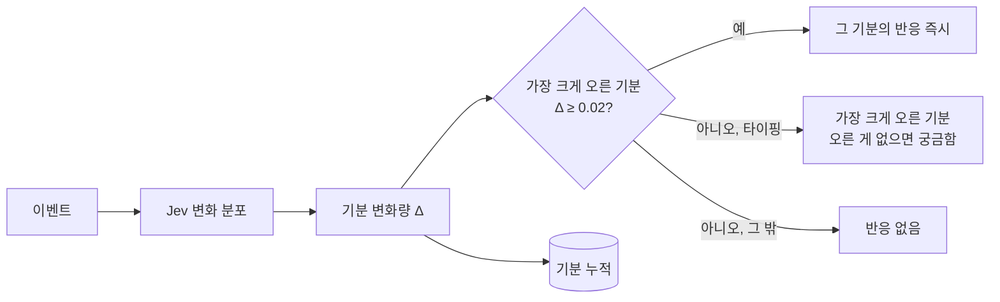

# 기분 8개와 즉각 반응, 기분별 애니메이션 설계

- 날짜: 2026-10-15
- 상태: 구현됨 (2026-10-15). 시뮬레이션 결과는 [시뮬레이션](../../spikes/2026-10-15-simulation.md) "다시 맞춤" 절
- 고치는 문서: [두뇌 v2 스펙](2026-10-15-brain-v2-design.md) 4·5·6·6.5절, [프로토콜](../../brain-protocol.md) (v2 → v3)
- 근거: [vision "반응은 기분의 즉각 표출"](../../vision.md), 사용자 실사용 보고(타이핑 중 반응이 체감되지 않음)

## 1. 목표

1. 기분은 쌓이는 상태, 반응은 그 기분의 즉각적인 표출로 맞춘다(사용자 결정).
2. 타이핑하는 동안 강아지가 눈에 띄게 반응한다(사용자 요청).
3. 평소 애니메이션이 기분 상태를 보여 준다.

실사용 기록(타이핑 판단 14번): 반응은 계산됐지만 그림이 없어 안 보였고, 동작은 14번 모두 짖기였으며, 대사는 0번이었다(최종 말할 확률 1~3%).

## 2. 기분 8차원

| 기분 | 반응 id (표출) | 탄생 기준값 평균 | 기본 반감기 | 근거 |
|---|---|---|---|---|
| 심심함 | `bored` 지루함 | 0.6 | 1시간 | v2 그대로 |
| 졸림 | `sleepy` 하품 | 0.3 | 2시간 | v2 그대로 |
| 들뜸 | `excited` 신남 | 0.4 | 20분 | v2 그대로 |
| 시무룩 | `sad` 서운함 | 0.2 | 1시간 | v2 그대로 |
| 분노 | `annoyed` 짜증 | 0.1 | 30분 | v2 그대로 |
| **궁금함** | `curious` 궁금함 | 0.5 | 15분 | 호기심 많은 강아지(기본 성격). 금방 식는다 |
| **놀람** | `surprised` 놀람 | 0.1 | 3분 | 놀람은 거의 순간적이다 |
| **무서움** | `scared` 무서움 | 0.1 | 20분 | 겁먹은 뒤 조금 남는다 |

반감기는 v2처럼 기본 × (0.5 + 기준값)이다. 새 차원도 민감도·기질·습관화·기준값 변화를 같은 방식으로 갖는다. 습관화 대상 기분: 찌르기→놀람, 쓰다듬기→들뜸, 던지기→무서움(던지기는 들뜸에서 무서움으로 바꿈: 반복해서 던지면 덜 무서워하는 것이 자연스럽다).

## 3. 반응 = 가장 크게 오른 기분

- Jev 반응 질문을 없앤다. 질문은 **동작, 말하기, 변화** 3개다(변화 선택지는 기분 8 × ↑↓ + 친밀도 ↑↓ + 변화 없음 = 19개).
- 반응 = 이번 변화량 Δ가 가장 큰 기분. 그 Δ가 0.02(잠정값) 이상이면 표출한다. 무작위 흔들림과 습관화가 Δ에 들어 있으므로, 반응도 확률적이고 익숙한 자극에는 덜 나온다.
- **타이핑 판단은 항상 반응을 하나 낸다**: 오른 기분 중 가장 큰 것, 오른 것이 없으면 궁금함(사용자 요청 "타이핑하는 동안 반응을 더 많이").
- v2의 반응 보정(기분→반응 친화도, 민감도·습관화의 "없음" 보정, 반응 온도)은 없어진다. 성격은 민감도(Δ의 크기)로 반응에 드러난다.

## 4. 그 밖의 모형 변경

| 항목 | 변경 |
|---|---|
| 말수 | 궁금함 +, 놀람 0, 무서움 − (기분·기준값 모두) |
| 동작 보정 (기분→동작) | 궁금함→서기, 놀람→짖기, 무서움→엎드리기 |
| 반응→동작 연결 | 신남→조르기, 짜증→짖기, 놀람→짖기, 무서움→엎드리기, 서운함→엎드리기, 궁금함→서기, 하품→엎드리기 |
| 움직임 경향 | 궁금함 → 구경하기·사용자 곁으로 +, 무서움 → 쉬기 +, 사용자 곁으로·놀기 −, 놀람 0 |
| 끼어들기 목표 | 15% → **30%** (사용자 요청). 시뮬레이션으로 보정값을 다시 맞춘다 |

질문 문구·기분이 바뀌므로 Jev를 다시 녹화하고(`sim.record`) 다시 맞춘다(`sim.simulate --fit`).

## 5. 프로토콜 v3

- `reaction` 메시지의 `reaction` 값이 바뀐다: `bored` `sleepy` `excited` `sad` `annoyed` `curious` `surprised` `scared`. (v2의 `joy`는 `excited`로)
- `movement` 메시지에 **`mood`**(지금 두드러진 기분)를 더한다: 기준값보다 0.15 이상 높은 기분 중 가장 높이 오른 것, 없으면 `calm`. 값은 위 반응 id와 같은 어휘다. 화면은 이것으로 평소 애니메이션을 고른다.
- `state`의 기분은 8개가 된다.
- 어휘가 바뀌므로 `v: 3`으로 올리고 두뇌·화면·문서를 같은 커밋에서 고친다.

## 6. 화면: 반응과 기분을 보여 주기

그림을 새로 그리는 대신, **지금 프레임을 그릴 때 기분·반응에 따라 변형**하는 방식으로 임시 표현을 만든다(vision: Claude가 임시로, 나중에 그림으로 교체). manifest에 기분별 시트를 지정하면 그 시트를 쓰도록 만들어, 나중에 진짜 그림으로 바꿀 수 있게 한다.

**기분 스타일 (평소 애니메이션, `movement.mood`)**

| 기분 | 표현 |
|---|---|
| 신남 | 애니메이션 1.5배 빠르게, 걸을 때 통통 튐 |
| 서운함 | 0.7배 느리게, 그림을 2px 아래로(고개 숙임), 살짝 어둡게 |
| 짜증 | 붉은빛, 가끔 몸을 부르르 |
| 하품(졸림) | 0.6배 느리게, 살짝 어둡게 |
| 지루함 | 0.8배 느리게 |
| 궁금함 | 그림을 좌우로 살짝 기울임(갸웃) |
| 놀람 | (주로 반응으로만) |
| 무서움 | 미세하게 떨림, 살짝 푸른빛 |

**반응 (즉시, 1.5초)**: 머리 위에 반응 아이콘(픽셀로 그린 작은 말풍선: 신남 ♪, 짜증 💢, 궁금함 ?, 놀람 !, 서운함 💧, 하품 Zz, 지루함 …, 무서움 떨림 선)을 띄우고, 몸이 한 번 톡 튄다(놀람·신남은 크게). 반응과 함께 온 동작이 있으면 동작을 재생한다.

**듣는 자세 (두뇌를 기다리지 않음)**: 입력창에 글자가 들어오기 시작하면, 강아지가 대기 중일 때 입력창(집) 쪽을 바라본다. 타이핑이 계속되면 가끔 집 쪽으로 몇 걸음 다가온다.

## 7. 테스트

- 두뇌 (pytest): 반응 = 최대 Δ 기분(임계값), 타이핑은 늘 반응, 오른 게 없으면 궁금함, 습관화가 반응을 줄임, 두드러진 기분 계산(`calm` 포함), 8차원 탄생·감쇠, 말수 방향(무서움 −).
- 화면 (Vitest): 프로토콜 v3 해석(`mood`, 새 반응 id), 기분 스타일 계산(속도·오프셋·색), 반응 표시 시간, 듣는 자세 판정.
- 시뮬레이션: 끼어들기 30%, 나머지 목표 유지.
- 수동: 타이핑하면 즉시 듣는 자세 → 반응 아이콘 → 가끔 끼어드는지, 기분에 따라 평소 모습이 달라지는지.
