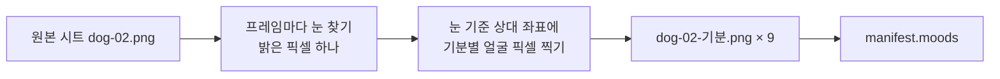

# 기분×동작별 그림 (임시) 설계

- 날짜: 2026-10-15
- 상태: 구현됨 (2026-10-15)
- 근거: [vision "감정별 그림을 새로 그린다"](../../vision.md) — 모든 동작×감정 조합, Claude가 임시로(기존 프레임 편집), 나중에 교체. 사용자 지시 "기분*동작별 그림 그려"
- 고치는 문서: [기분 8개 스펙](2026-10-15-mood-reaction-design.md) 6절 (그림 대신 변형만 하던 임시 표현에 얼굴 그림을 더한다)

## 1. 결론

기분 9개마다 **원본 시트 전체(동작 8개, 프레임 62장)를 복사해 얼굴을 덧그린 시트**를 만든다. 그래서 기분 9 × 동작 8 = 72개 조합이 모두 생긴다. 기존 변형(속도·처짐·색·떨림·갸웃·튐)과 반응 아이콘은 그대로 함께 쓴다.

## 2. 그리는 방법

- 원본 프레임에는 눈 하이라이트(흰 픽셀)가 정확히 하나 있다(잠 프레임은 없다, 실측). 이 위치를 기준으로 얼굴을 찍으니 모든 동작에 같은 표정이 맞는다.
- 생성기: `app/tools/draw_moods.py` (Pillow). 생성한 PNG를 저장소에 넣는다. 앱은 실행 중에 그림을 만들지 않는다.
- 잠 프레임은 눈을 감고 웅크려 있어 바꾸지 않는다.

| 기분 | 얼굴 |
|---|---|
| 행복 | 눈웃음(^), 분홍 볼 |
| 신남 | 크고 반짝이는 눈, 혀 |
| 서운함(시무룩) | 안쪽이 올라간 처진 눈썹, 눈물 |
| 짜증(분노) | 안쪽이 내려간 눈썹, 머리 위 핏줄 |
| 졸림 | 감은 눈 |
| 심심함 | 반쯤 감긴 눈 |
| 궁금함 | 위아래로 커진 눈, 올라간 눈썹 |
| 놀람 | 흰자에 둘러싸인 눈동자 |
| 무서움 | 흰자가 보이는 눈, 걱정 눈썹, 땀방울 |

## 3. 화면

- `manifest.json`에 `moods: { 기분 id: 시트 경로 }`를 더한다. 없는 기분은 원본 시트를 쓴다. 진짜 그림이 생기면 파일만 바꾼다.
- 그릴 얼굴: **반응을 보여 주는 1.5초 동안은 반응의 기분**, 그 밖에는 두드러진 기분(`movement.mood`). 반응이 얼굴에도 즉시 드러나게 한다.
- 시트는 시작할 때 모두 읽어 프레임을 잘라 둔다(원본과 같은 방식). 아직 못 읽은 시트는 원본 프레임으로 그린다.

## 4. 테스트

- Vitest: 시트 고르기(`moods`에 있으면 그 시트, 없으면 원본), 얼굴 기분 고르기(반응 중이면 반응, 아니면 기분).
- 생성기: 프레임마다 눈이 하나 이하인지 확인한다(둘 이상이면 멈춘다).
- 수동: V-24 (기분·반응에 따라 얼굴이 바뀐다).
