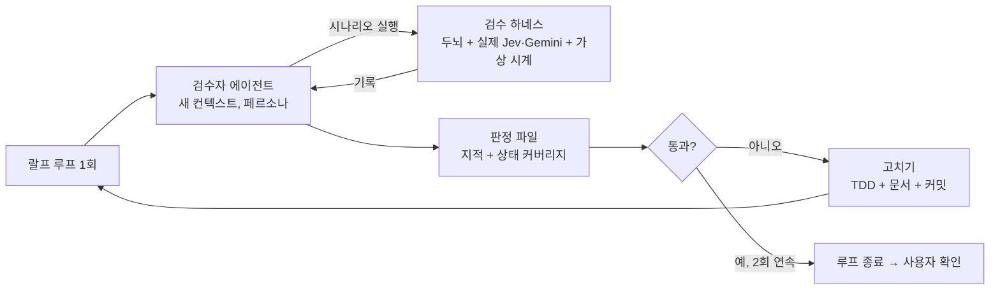

# 검수자 에이전트 + 랄프 루프 설계

- 날짜: 2026-10-15
- 상태: 초안 (사용자 검토 대기)
- 근거: [vision "검수 루프"](../../vision.md) — 사용자 결정: 두뇌만 시뮬레이션, 고치는 범위 무제한, 검수 범위는 모든 동작·과정·상태

## 1. 결론

두뇌를 실제 Jev·Gemini로 돌리는 **검수 하네스**를 만든다. 비판적인 인간 사용자 페르소나를 가진 **검수자 에이전트**가 하네스로 두뇌를 써 보고, 판정을 쓴다. **랄프 루프**가 "검수 → 고침 → 다시 검수"를 반복한다. 검수를 통과하면 끝난다.

## 2. 검수 하네스 (`brain/review/`)

- 두뇌(`Brain`)를 프로세스 안에서 실제 클라이언트로 돌린다. 키는 `config.read_keys()`(자격 저장소)에서 읽는다. 화면은 쓰지 않는다.
- **가상 시계**: 조용함·자리 비움·하루가 지나는 일은 시계를 앞당겨 몇 초에 끝낸다. Jev·Gemini 호출은 실제로 기다린다.
- **입력**: 시나리오 JSON. 단계마다 이벤트를 보내거나(`event`), 시계를 넘기거나(`wait`), 두뇌를 다시 켜거나(`restart`), 키를 빼거나(`keys`), 연결을 끊거나(`disconnect`), 초기화(`reset`)한다. 검수자가 직접 새 시나리오를 써서 돌릴 수 있다.
- **출력**: 기록 파일. 단계마다 보낸 것, 두뇌가 낸 메시지(반응·동작·대사·움직임·상태), 그 시점의 기분·친밀도·말수, 판단 로그, 경과 시간을 남긴다.
- **상태 커버리지**: 하네스가 아래 표의 칸이 실제로 일어났는지 센다. 검수자는 빈 칸을 채우는 시나리오를 더 써야 한다.
- 기본 시나리오 세트를 둔다: 첫 만남, 긴 타이핑, 대화 이어 가기, 무시하기, 질문하고 기다리기, 찌르기·쓰다듬기·던지기 반복, 자리 비움과 돌아옴, 집에 들어감·나옴, 다음 날 다시 켬(기억), 며칠 지남(성격 변화), 화난 사용자, 키 없음·잘못된 키, 초기화.

## 3. 검수 범위: 모든 동작·과정·상태 (사용자 요구)

| 축 | 덮어야 할 값 |
|---|---|
| 이벤트 | `typing` `message` `dog_spoke` `quiet` `returned` `house_in` `house_out` `poke` `pet` `throw` |
| 두뇌 단계 | 한가함, 판단 중(이벤트 묶음), 말 만드는 중(대사 버리기 포함) |
| AI 상태 | `ok`, `no_keys`, `bad_key`, 호출 실패(fallback) |
| 반응 | 기분 9개의 반응 모두, 반응 없음 |
| 동작 | 서기·앉기·엎드리기·잠·조르기·짖기·없음 |
| 대사 | 끼어들기, 답하기, 먼저 말 걸기, 연달아 말하기(상한까지), 무응답 |
| 기분 | 9개 각각 두드러짐, 시간에 따른 감쇠(기분 시계·움직임 전송) |
| 장기 | 친밀도 오르내림, 습관화, 하루 단위 성격 변화, 다시 켬(기억), 초기화 |
| 연결 | 연결 끊김·다시 연결, 상태·로그 조회 |

통과하려면 **모든 칸이 한 번 이상 실제로 일어나고**, 그 각각에 대해 검수자가 판정을 내려야 한다.

## 4. 검수자 에이전트

- **페르소나**: 이 앱을 매일 켜 두고 쓰는 개발자 팀원(vision 대상 사용자). 비판적이고 객관적이다. "살아 있는 강아지"를 기대하고, 어색함·반복·성가심·맥락 무시·기억 상실·성격 붕괴를 바로 지적한다. 코드가 아니라 **써 본 경험**으로 판정하고, 근거로 기록의 줄을 인용한다.
- 루프마다 **새 컨텍스트의 서브에이전트**로 띄운다. 고친 과정을 모르게 해 자기 채점을 막는다. 페르소나·기준표는 `docs/review/reviewer.md` 한곳에서 관리한다.
- **기준표** (각 1~5점): 살아 있음, 대사 자연스러움, 캐릭터 일관성, 반응의 즉각성·적절성, 끼어들기 타이밍(성가심), 다양성(반복 없음), 맥락·기억, 기분·성격 변화의 그럴듯함, 실패 시 행동.
- **판정 파일** `docs/review/rounds/NNN.md`: 점수, 지적(심각도 치명·중요·사소, 근거 줄, 기대 동작), 커버리지 빈 칸, 통과 여부.
- **통과 조건**: 커버리지 100%, 모든 점수 4 이상, 치명·중요 지적 0건. 판정 흔들림을 줄이려고 **새 검수자 2회 연속** 통과해야 끝난다.

## 5. 고치기 (루프 본체)

- 범위 제한이 없다(사용자 결정): 버그, 수치, 질문 문구, 페르소나·대사 프롬프트, 확률 모형, 컨셉까지 고칠 수 있다.
- 그래도 이 저장소 규칙은 지킨다: 테스트를 먼저 쓰고, 두뇌·화면 테스트와 타입 검사를 모두 통과시키고, 문서를 같은 커밋에서 고친다. 질문 문구를 바꾸면 Jev를 다시 녹화하고 보정값을 다시 맞춘다.
- 컨셉을 바꾸면 vision에 **"검수 루프 결정 (검수자 지적 NNN)"**으로 적어 사용자 결정과 구분한다. 사용자가 나중에 골라 되돌릴 수 있다.
- 프로토콜을 바꾸면 화면도 함께 고친다(화면은 보여 줄 뿐이지만 규약은 맞아야 한다).
- 루프는 새 브랜치 `ralph/review-loop`에서 돈다. 회차마다 커밋한다.

## 6. 루프 운영

- 플러그인 `ralph-loop`(Stop 훅이 같은 프롬프트를 다시 넣는다)를 쓴다. 프롬프트는 `docs/review/loop-prompt.md`에 둔다. 완료 문구는 검수 2회 연속 통과 때만 낸다.
- 회차 진행 상황은 `docs/review/progress.md`에 남긴다(컨텍스트가 줄어도 이어 갈 수 있게).
- 반복 상한: 30회 (잠정값. 지적이 줄지 않고 맴돌면 사용자에게 넘긴다).
- 비용: 회차마다 실제 Jev·Gemini를 수십~수백 번 부른다. 첫 2회의 실측으로 회차당 비용을 기록한다.

## 7. 테스트

- 하네스 자체(pytest): 시나리오 해석, 가상 시계, 다시 켬·초기화·키 빼기 단계, 커버리지 집계를 가짜 Jev·Gemini로 확인한다.
- 실제 호출은 루프 안에서만 한다.
