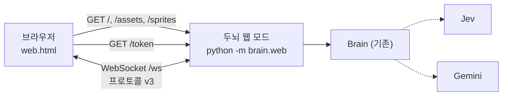

# 웹 프로토타입 설계

- 날짜: 2026-10-19
- 상태: 프로토타입 (사용자: "프로토타입일 뿐이야. 대충 니알아서 작업해")
- 결정 기록: [0017](../../decisions/0017-web-prototype-brain-serves-page.md)

## 1. 목표

브라우저만 있으면 강아지와 놀 수 있는 웹 페이지 버전을 만든다. 두뇌는 그대로 쓰고, 화면 진입점만 하나 더 만든다.

- **목표**: 브라우저 페이지 안에서 강아지가 돌아다니고, 말 걸기·찌르기·쓰다듬기·던지기·집이 PC 앱과 같은 두뇌 판단으로 동작한다. 서버 한 대(또는 내 PC)에서 명령 하나로 띄워 주소를 열면 된다.
- **목표 아님**: 여러 사용자 계정, 사용자마다 다른 강아지, 로그인, HTTPS 인증서 관리, 모바일 터치 최적화, PC 앱 코드 정리(공통 그리기 코드 뽑기).
- **실패로 볼 것**: PC 앱이 깨지는 것. 두뇌 판단 규칙이 웹과 PC에서 달라지는 것.

## 2. 구조



- **두뇌 웹 모드** (`brain/brain/web.py`, 실행 `uv run python -m brain.web`): 한 포트에서 세 가지를 낸다.
  - `/ws`: 기존 프로토콜 v3 WebSocket. 판단·상태·로그는 기존 `Brain`·`Link`를 그대로 쓴다.
  - `/token`: hello에 쓸 토큰(JSON). 같은 출처에서만 읽힌다(CORS 헤더 없음).
  - 그 밖의 경로: 빌드한 웹 화면(`app/dist-web/`)의 정적 파일. 폴더 밖 경로는 404.
- **출처 검사**: `/ws` 요청의 `Origin`이 요청 `Host`와 다르면 403. 다른 사이트가 사용자의 브라우저로 두뇌에 붙는 것(교차 사이트 WebSocket 탈취)을 막는다.
- **데이터**: PC 두뇌와 다른 폴더(`…/TamagotchiChatBot/brain/web/`)를 쓴다. 웹 강아지와 PC 강아지는 다른 강아지다. 두 두뇌가 같은 DB를 쓰지 않게 하려는 것이다.
- **키**: 설정 패널에서 넣으면 기존처럼 OS 자격 저장소에 저장한다. 자격 저장소가 없는 서버를 위해 `TYPESAFE_API_KEY`·`GEMINI_API_KEY` 환경 변수를 대신 읽는다(`config.py`에서만).
- **주소**: 기본 `127.0.0.1:8787`. `--host 0.0.0.0`으로 열면 다른 기기에서 접속할 수 있다. 그때는 키가 서버에 있으므로 주소를 아는 사람은 누구나 키를 쓴다(프로토타입의 한계, README에 적는다).

## 3. 웹 화면

PC 앱의 몸 로직(`app/src/body/*`)과 프로토콜(`app/src/shared/brain-protocol.ts`)을 그대로 쓴다. 웹 진입점은 `app/web.html` + `app/src/web/`이다. PC 앱 파일은 바꾸지 않는다.

| PC 앱 | 웹 |
|---|---|
| 투명 창이 바탕화면 전체를 덮음 | 브라우저 창 안이 강아지의 세계. 창 크기가 바뀌면 영역도 바뀐다 |
| 주변 창 위에 올라앉기·구경 | 없음(창 목록이 비어 있다) |
| 전역 단축키, 트레이 | 없음. 페이지 안 버튼만 |
| 입력창은 집 위에 따로 뜨는 창 | 페이지 안 입력창을 PC처럼 집 위에 작게 띄운다(380×56, 집 오른쪽 끝 맞춤, 2026-10-20 사용자 요청: 아래 전체를 가려 불편). 말풍선 아이콘으로 열고 닫는다 |
| 설정 창(상태·로그 탭) | 톱니바퀴 아이콘으로 여는 패널: AI 상태, 키 넣기, 쉬기, 기록 지우기, 초기화 |
| 자리 비움 = OS 입력 없음 1분 | 페이지 안 입력(마우스·키보드) 없음 1분, 또는 탭이 숨겨짐 |
| 설정 저장: Tauri store | `localStorage` (쉬기, 집에 있으면 집 숨기기) |
| 두뇌를 직접 띄움 | 띄우지 않는다. 같은 주소로 2초마다 다시 접속한다. 단 다른 탭이 연결을 가져가 4002로 끊기면 다시 접속하지 않고 "다른 탭에서 열려 있음"을 보여 준다 (새로고침하면 이 탭으로 옮겨 온다) |

- 그리기(프레임 자르기, 기분 색, 반응 아이콘, 말풍선 위치)는 `character.ts`와 같은 방식이다. 프로토타입이라 공통 코드로 뽑지 않고 웹 쪽에 따로 둔다(나중에 합칠 빚, 아래 6절).
- 이벤트 판정(타이핑·조용함·돌아옴·찌르기·쓰다듬기·던지기·집)은 `body/events.ts`, `body/petting.ts`, `body/dog.ts`의 같은 함수를 쓴다.

## 4. 순수 로직 (단위 테스트)

| 모듈 | 하는 일 |
|---|---|
| `app/src/web/endpoint.ts` | 페이지 주소에서 WebSocket 주소(`ws://host/ws`, https면 `wss://`)와 토큰 주소를 만든다 |
| `app/src/web/presence.ts` | 페이지 안 입력 시각과 탭 숨김으로 "사용자가 입력 없이 지낸 시간"을 계산한다 |
| `app/src/web/prefs.ts` | `localStorage` 설정 읽기·쓰기(깨진 값은 기본값) |
| `brain/brain/web.py`의 경로 해석·출처 검사 | 정적 파일 경로가 폴더 밖으로 나가지 않는지, Origin과 Host가 같은지 |

화면 조립(`app/src/web/main.ts`)은 [수동 확인](../../manual-checks/web.md)으로 본다.

## 5. 실행

```bash
cd app && npm run build:web          # app/dist-web/ 생성
cd ../brain && uv run python -m brain.web            # http://127.0.0.1:8787
uv run python -m brain.web --host 0.0.0.0 --port 8787   # 다른 기기에서 접속 (주의: 키 공유)
```

도커(서버 배포): 저장소 최상위의 `Dockerfile`·`compose.yaml`. `docker compose up -d --build`.

- 이미지 두 단계: node로 `app/dist-web/`을 빌드하고, python 이미지에서 `uv sync --frozen --no-dev` 뒤 `python -m brain.web --host 0.0.0.0`.
- 키는 `.env`의 `TYPESAFE_API_KEY`·`GEMINI_API_KEY`(컨테이너에는 자격 저장소가 없다).
- 데이터: `APPDATA=/data`로 두어 `config.web_data_dir()`가 `/data/TamagotchiChatBot/brain/web/`이 된다. `brain-data` 볼륨으로 보존한다.
- 포트는 전체 공개 `8787:8787`(사용자 요청, 2026-10-19). 키 공유 한계는 위와 같다.

## 6. 남기는 것 (프로토타입 빚)

- 그리기 코드가 `character.ts`와 `web/main.ts`에 두 벌 있다. 웹을 정식으로 하면 공통 모듈로 뽑는다.
- 사용자 구분이 없다. 두뇌 하나 = 강아지 하나 = 접속한 탭 하나(새 탭이 붙으면 이전 탭은 끊긴다, 기존 `Link` 동작). 처음에는 끊긴 탭도 2초 뒤 다시 접속해서, 탭 두 개가 서로를 끝없이 밀어내고 대답이 다른 탭으로 갔다(2026-10-20, 로그에 하루 4천여 번 재접속). 그래서 4002로 끊긴 탭은 다시 접속하지 않는다.
- HTTPS는 앞단 프록시가 맡는다고 본다(`wss://`는 페이지가 https면 자동으로 고른다).
