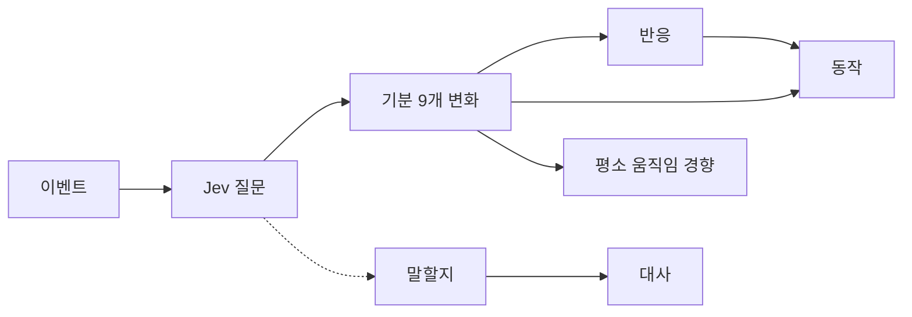
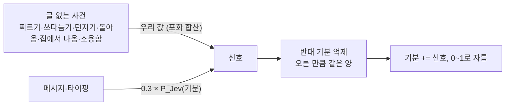

# 두뇌 단순화: 반응과 기분만 남긴다

- 날짜: 2026-10-20
- 결정 기록: [0018](../../decisions/0018-simplify-to-reaction-and-mood.md)
- 대체하는 부분: [두뇌 v2](2026-10-15-brain-v2-design.md)의 성격·관계·말수·습관화, [시간 모형](2026-10-16-time-model-design.md)의 기준값 이동, [동작 모형](2026-10-16-action-model-design.md)의 성격·친밀도 항

## 1. 왜

사용자가 써 보니 복잡한 장치가 필요 없었다 (2026-10-20 사용자). 강아지마다 다른 성격, 쌓이는 관계, 무뎌짐 같은 장치가 체감되지 않으면서 수식과 보정값만 늘렸다.

## 2. 무엇이 남고 무엇이 빠지나

| 구분 | 항목 | 근거 |
|---|---|---|
| 남김 | 기분 9개, 반응(기분의 즉각 표출) | 사용자 |
| 남김 | 동작, 대사(Gemini), 평소 움직임 경향 | 사용자 |
| 뺌 | 민감도, 변덕, 습관화, 친밀도(관계), 말수 | 사용자 |
| 뺌 | 성격: 기준값, 기질, 하루 한 번 기준값 이동, 탄생 무작위 | 사용자 |
| 남김 | 강아지 한 줄 설명 `PERSONA` (Jev 상황·대사 지시) | Claude 판단. 숫자 성격이 아니라 고정 캐릭터 설명이다 |



## 3. 강아지 상태

저장하는 것은 **기분 9개와 갱신 시각**뿐이다.

- **돌아갈 자리 `REST`**: 지금까지의 탄생 평균을 고정값으로 쓴다. 심심함 0.6, 졸림 0.3, 들뜸 0.4, 시무룩 0.2, 분노 0.1, 궁금함 0.5, 놀람 0.1, 무서움 0.1, 행복 0.4. 평균 강아지가 겪던 것과 같게 하려고 같은 값을 쓴다.
- **처음 기분, 초기화**: 기분을 `REST`로 둔다. 초기화는 기분과 이벤트 기록·판단 로그를 지운다.
- **예전 저장본**: `mood`만 읽고 나머지(성격·친밀도·습관화·하루 평균)는 버린다. 빠진 기분은 `REST`로 채운다.

## 4. 기분 변화

움직이는 방식은 그대로 두고, 성격·습관화·친밀도 자리를 평균 강아지 값으로 접는다. 평균 강아지가 겪던 것과 같은 숫자가 나온다.

| 예전 | 이제 | 이유 |
|---|---|---|
| 반감기 = 기본 × (0.5 + 기준값) | 반감기를 곱한 결과값으로 적는다 (놀람 36초, 궁금함 5분, 분노 6분, 들뜸 6.3분, 무서움 9분, 시무룩 21분, 행복 27분, 심심함 33분, 졸림 48분) | 기준값이 고정이라 곱할 이유가 없다. 평균 강아지와 같은 값 |
| 자리 = 기준값 + 하루 리듬 − 반대 기분 누름 | `REST` + 하루 리듬 − 반대 기분 누름 | |
| 평가값 × 2·민감도 × (1 − 습관화) | 평가값 그대로 | 민감도 0.5면 × 1이었다 |
| 찌르기 분노 0.06 + 0.10·습관화, 궁금함 0.03·(1 − 습관화) | 분노 0.06, 궁금함 0.03 | 습관화 0 |
| Jev 조정 0.3 × 무게 × 2·민감도 × (1 − 습관화) | 0.3 × 무게 | |
| 말로 내리는 부정 기분 상한 min(1, 0.6·(1.5 − 민감도)) | 0.6 | 민감도 0.5 |
| 반응 드러내기 쉬움 exp(4·(기준값 − 탄생 평균)) | 없음 (× 1) | 기준값 = 탄생 평균 |
| 친밀도 해석(거절 → 서운함, 다정 → 행복) | 없음. Jev가 기분↑↓로 직접 준다 | 관계를 없앤다 |

남는 장치: 포화 합산, 한 묶음 안 1/√k, 반대 기분 억제, 달램, 공감, 겁먹으면 기쁨 반응 막기, 이미 놀란 만큼 놀람 덜 드러내기, 하루 리듬.

## 5. Jev 질문

- `change` 질문의 선택지에서 `친밀도↑`, `친밀도↓`를 뺀다. 기분 9개 × ↑↓ + 변화 없음 = 19개다.
- Jev 상황(`jev_state`)은 `강아지`(한 줄 설명), `지금 시각`, `이번 이벤트들`, `최근 이벤트 기록`, `기분`이다. 기준값·민감도·변덕·친밀도는 뺀다.
- 질문과 상황이 바뀌므로 다시 녹화하고 다시 보정한다 (CLAUDE.md 4절).
- 핀잔 뒤 이어 말하지 않기(검수 002)는 `친밀도↓ ≥ 0.4` 대신 모진 말 `harsh ≥ 0.5`로 본다. 같은 뜻을 묻는 질문이 이미 있다.

## 6. 동작

```text
점수(a) = 기본(a) + 이벤트 사전값(a) + 5·Σ 친화도·(기분 − REST) + 1.5·반응 친화도(a)
          + w·log(P_Jev(a) + 0.05) + 시킨 동작(a)
P(a) ∝ exp(점수(a))
시킨 동작(a) = 4.8 × P_시킴(a) × max(0, 1 − 2·(분노·무서움이 REST보다 높은 만큼))
```

- 온도는 1이다. 예전 평균 변덕 0.5 → 0.5 + 0.5.
- 시킨 동작 계수 4.8은 예전 6 × (0.5 + 친밀도 0.3)이다. 평균 강아지가 따르던 만큼 따른다.
- 성격(기준값 − 탄생 평균) 항은 0이 되어 뺀다.

## 7. 말하기

```text
P(말함) = σ( logit P_Jev(말함) + β[이벤트 종류] − 연달아 말한 횟수 − 1·[답을 기다리는 중]
            + 3.5·[질문·부탁·사과] + 3.5·[속상한 이야기] − 0.7·[대꾸 없던 횟수] − 5·[말 걸지 마·잠자리]
            − 8·[무서움이 REST보다 높은 만큼] )
P(이어 말함) = chain_base × (겁먹거나 놀란 만큼 줄임) × 0.3^(이어 간 횟수 − 1) × 0.4^(대꾸 없던 횟수)
```

- 말수 L(친밀도·기분·기준값)을 뺀다. 기분에 따라 말수가 달라지던 것도 없어진다. 겁먹으면 입을 다무는 항은 기분이 직접 정하는 별도 규칙이라 남긴다.
- 이어 말하기의 말수 배율(`chain_talk`, `chain_cap`)을 뺀다.
- β와 `chain_base`는 다시 녹화한 분포로 같은 목표(끼어들기 30%, 소식에 답하기 85%, 먼저 말 걸기 1/3, 연달아 2번+ 10%)에 다시 맞춘다.

## 8. 평소 움직임 경향

```text
범주 가중치_c = 기본_c × exp(4·Σ 친화도·(기분 − REST))
```

- 성격 항(`MOVE_BASELINE`, `RUN_BASELINE`, `IDLE_BASELINE`)과 친밀도 항(`MOVE_INTIMACY`)을 뺀다.
- 친밀도 항은 평균 강아지(0.3)에서 곁으로·놀기를 ×0.82 했다. 빼면 그만큼 조금 늘어난다. 차이가 작아 기본값은 그대로 둔다 (Claude 판단).
- 두드러진 기분은 `REST`보다 0.15 이상 높은 기분이다.

## 9. 대사

- 성격에서 나오던 말투 지시(`voice`: 과묵·들뜸·예민·겁)를 뺀다. 문장 수 상한은 2다.
- 지시문에서 "성격(기준값·민감도·변덕), 친밀도"를 "기분"으로 바꾼다. 말투는 지금 기분(`MOOD_TONE`)이 정한다.

## 10. 프로토콜

- `state`는 `dog`(`mood`, `updated_at`), `movement`만 보낸다. `talkativeness`는 없앤다.
- 모양이 바뀌므로 프로토콜을 **v4**로 올린다. 화면과 두뇌를 같이 배포하므로 예전 버전 호환은 두지 않는다.
- 설정 창 상태 탭은 기분과 평소 움직임 경향 두 칸만 보인다.

## 11. 시뮬레이션과 검수 하네스

- 녹화: 친밀도 축이 없어져 이벤트 10종 × 기분 10가지, 강아지 말은 연달아 3가지 = 120개 상황이다.
- 시뮬레이션: 성격 유형 4개·무작위 100마리·8주 성격 변화 보고를 없앤다. 강아지 한 마리로 지표를 낸다.
- 검수 하네스: 시나리오의 `personality`를 없앤다. 성격 비교용 시나리오(`04-personality`, `probe-reset-twins`)는 지운다. 분석표에서 친밀도·말수·기준값·습관화 열을 뺀다.

## 12. 하지 않는 것

- 기분 9개의 종류, 반응 어휘, 동작 어휘, 이벤트 종류는 바꾸지 않는다.
- 달램·공감·말 걸지 마·잠자리 같은 대화 흐름 규칙은 그대로 둔다. 사용자가 빼라고 하지 않았다.

## 13. 다시 맞춘 결과 (2026-10-20)

새 질문으로 120개 상황을 다시 녹화하고 `sim.simulate --fit`으로 맞췄다.

| 값 | 예전 | 이제 |
|---|---|---|
| β 타이핑 | −2.72 | −0.51 |
| β 메시지 | −0.22 | +1.35 |
| β 조용함 | −2.11 | −0.20 |
| `chain_base` | 0.251 | 0.325 |

β가 일제히 오른 것은 평균 강아지에서 약 +1.5였던 말수 항이 빠졌기 때문이다.

| 지표 | 목표 | 시드 1 | 시드 100개 (최소 / 중앙 / 최대) |
|---|---|---|---|
| 끼어들기 | 0.30 | 0.29 | 0.28 / 0.32 / 0.38 |
| 소식에 답하기 | 0.85 | 0.87 | 0.72 / 0.82 / 0.92 |
| 먼저 말 걸기 | 0.33 | 0.33 | 0.25 / 0.31 / 0.40 |
| 연달아 2번+ | 0.10 | 0.10 | 0.05 / 0.09 / 0.12 |
| 가장 흔한 동작 비율 | ≤ 0.50 | 0.26 | |
| 기분 고착 | ≤ 0.20 | 0.13 | |

## 14. 2단계: 기분 변화 계산 (2026-10-20 사용자 결정, [0019](../../decisions/0019-message-mood-from-one-question.md))



- **글 없는 사건**: 우리 평가값만. Jev 무게는 0이다 (4절 표의 평가값 그대로).
- **메시지·타이핑**: Jev 질문 `change` 하나. 선택지는 기분 9개 + `없음`이고, 기분 d의 신호는 0.3 × P(d)다. 우리 값(궁금함 +0.02 등)은 없다. 타이핑을 메시지와 같게 보는 것은 Claude 판단이다.
- **반대 기분 억제**: 쌍(무서움↔행복·들뜸, 분노↔행복, 시무룩↔들뜸·행복, 졸림↔들뜸)에서 한쪽 신호가 x만큼 오르면 반대쪽에서 x를 뺀다 (예전 30%).
- **반영**: 기분 = clip(기분 + 신호). 잡음·여유 비례·말로 내리는 상한·달램·공감·경계는 없다.
- **없애는 Jev 질문**: `user_down`, `soothe`, `hush`, `harsh`, `command`. 남는 질문은 `action`, `speak`, `change`.
- **같이 없어지는 것**: "말 걸지 마"·잠자리 상태와 그 말하기 감점, 사과에 대답 보정, 시킨 동작 따르기, 대사의 속상함·부탁·모진 말·시킨 동작 사실, 핀잔 뒤 이어 말하지 않기, 의성어뿐인 대답의 "짖으라고 시킴" 예외.
- **그대로 두는 것**: 쓰다듬기의 경계(화나 있으면 덜 기쁨)는 우리 평가값의 일부라 둔다. 반응 고르기, 시간에 따른 회복, 말하기의 질문 보정·속상한 이야기 보정(시무룩 신호 ≥ 0.05)은 아직 검토 전이라 둔다.

## 15. 3단계: 남은 예외 규칙 걷어내기 (2026-10-20, [0020](../../decisions/0020-minimal-brain-rules.md))

사용자가 여유 비례를 되살리지 않기로 하고, Claude가 제안한 단순화를 전부 수용했다. 하루 리듬 삭제와 아래 고정값은 Claude 판단이다.

**기분**

```text
이벤트:  신호_d = 평가값_d(글 없는 사건들의 합) + 0.3·P_Jev(d)(글이 있으면)
         신호_c −= 신호_a⁺ (반대 쌍마다, 같은 양)
         기분_d = clip(기분_d + 신호_d)
시간:    기분_d ← REST_d + (기분_d − REST_d)·e^(−ln2·Δt / 반감기_d)
```

| 이벤트 | 고정 평가값 |
|---|---|
| 찌르기 | 놀람 +0.20, 분노 +0.06, 궁금함 +0.03, 졸림 −0.12 |
| 던지기 (충격 i) | 무서움 +0.35i, 놀람 +0.10 + 0.15i, 분노 +0.05i, 행복·졸림 −0.10i |
| 쓰다듬기 | 행복 +0.12, 들뜸 +0.04, 분노·시무룩·무서움 −0.03 (예전 3초 기준값) |
| 돌아옴 | 행복 +0.15, 들뜸 +0.22, 심심함 −0.10, 시무룩 −0.08, 졸림 −0.15 (예전 30분 비움 기준값) |
| 집에서 나옴 | 들뜸 +0.08, 행복 +0.06 |
| 조용함 | 심심함 +0.04 |

던지기의 충격은 사건의 세기 자체라 남긴다.

**반응**: 신호가 가장 큰 기분이 0.03 이상이면 그 반응. 타이핑이면 늘 하나(없으면 궁금함).

**동작**: 점수 = 기본 + 이벤트 사전값 + 5·Σ친화도·(기분 − REST) + 1.5·반응 친화도 + [메시지면 1.5·log(P_Jev + 0.05)]. 잠은 졸림이 REST보다 0.1 넘게 높을 때만. 자기 말 뒤에는 없음.

**말하기**: P = σ(logit P_Jev + β[종류] − 연달아 횟수). 연달아 3번이면 0. 집에 들어가는 순간, Jev 실패, 이번 메시지에 이미 끼어들었거나 친 글이 15자 미만이면 0.

**이어 말하기**: q_k = chain_base × 0.3^(k−1).

**흐름 상태**: 집 안, 끼어듦, 자리 비움만 남긴다.

**대사**: 상황 사실은 "주인이 곁에 있다 / 자리를 비웠다 / 방금 돌아왔다" 하나. 다듬기는 줄바꿈·이름표·따옴표를 정리하고 앞의 두 문장만 남긴다. 지시문(`RULES`), 대화 기록, 최근에 자주 쓴 표현, 조용할 때 꺼낼 이야기는 이번 범위에 넣지 않았다.

**다시 맞춘 결과** (녹화는 0019 그대로, `sim.simulate --fit`): β 타이핑 −0.87, 메시지 +1.70, 조용함 −0.74, `chain_base` 0.1. 메시지 목표는 질문 구분 없이 "메시지에 답하기 85%"로 바꿨다(질문 보정이 없어졌으므로).

| 지표 | 목표 | 시드 1 | 시드 100개 (최소 / 중앙 / 최대) |
|---|---|---|---|
| 끼어들기 | 0.30 | 0.29 | 0.22 / 0.27 / 0.34 |
| 메시지에 답하기 | 0.85 | 0.87 | 0.83 / 0.89 / 0.94 |
| 먼저 말 걸기 | 0.33 | 0.29 | 0.28 / 0.37 / 0.44 |
| 연달아 2번+ | 0.10 | 0.09 | 0.07 / 0.10 / 0.14 |
| 가장 흔한 동작 비율 | ≤ 0.50 | 0.35 | |
| 기분 고착 | ≤ 0.20 | 0.13 | |

기분 고착은 2단계(0.27)보다 줄었다. 조용함이 심심함 +0.04 고정이 되어 혼자 있는 동안 쌓이는 양이 줄었기 때문이다.

## 16. 기분 질문 문구 보완 (2026-10-20, 사용자 요청)

모욕("너 진짜 못생겼다") 뒤에는 분노가 잘 가라앉지 않았다. Jev가 최근 기록의 모욕을 다시 읽어, 뒤의 다정한 말에도 분노 확률을 주었기 때문이다. 질문 지시문으로 고쳤다.

| 문구 | 못생겼다 뒤 "사랑해" | 못생겼다 뒤 "미안해 농담이었어" | 모욕 자체 |
|---|---|---|---|
| 예전 "이 글이 어떤 기분을 일으키나?" | 분노 −0.18 | 분노 +0.13 | +0.26 |
| W1 "지금 기분과 최근 기록은 고려하지 말고 글만" | −0.30 | −0.06 (주로 시무룩) | +0.18 |
| **W2 (채택)** "새로 일으키는 기분. 지난 일로 남은 기분은 따로 계산되니 다시 고르지 않는다. 지금 기분과 최근 기록은 빼고 글만" | −0.28 | −0.10 (주로 행복) | +0.22 |

분노 0.5에서 시작, Jev 한 번 호출 실측. 문구가 바뀌어 다시 녹화하고 보정값을 다시 맞췄다.

다시 맞춘 결과: β 타이핑 −0.77, 메시지 +1.70, 조용함 −0.73, `chain_base` 0.1(맞춤값 0.101). 시드 1 지표는 끼어들기 0.32, 메시지에 답하기 0.84, 먼저 말 걸기 0.29, 연달아 2번+ 0.09, 가장 흔한 동작 0.29, 기분 고착 0.14로 목표 근처다.
