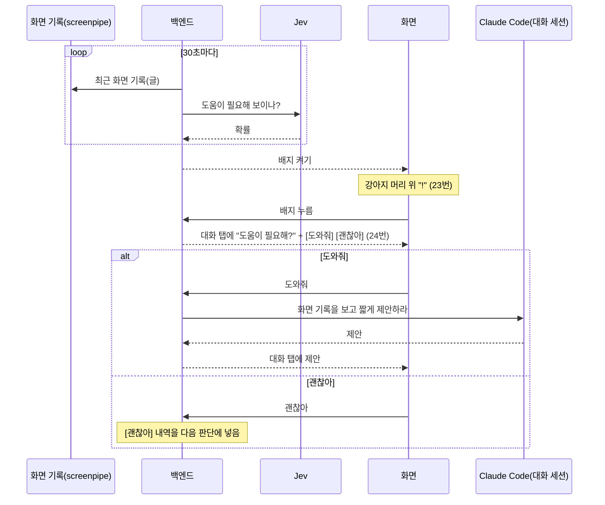

# 먼저 말 걸기 설계

- 날짜: 2026-10-22
- 화면: [디자인](../../design/2026-10-21-output-ui/README.md) 23·24번
- 결정: [0037](../../decisions/0037-jev-for-proactive-judgment.md) (판단은 Jev)

## 1. 왜

사용자가 같은 화면·내용·작업을 오래 보고 있거나 헤매고 있을 때, 강아지가 먼저 알아채고 도와줄지 묻는다 (사용자). 조수의 큰 목적(화면 히스토리로 맥락을 알아듣는다)을 사용자가 묻기 전에도 쓰는 기능이다.

## 2. 목표와 하지 않는 것

**목표**
- 헤매는 순간에 강아지가 "!" 배지로 알린다.
- 사용자가 원할 때만 의견·해결 방법을 짧게 말한다.

**하지 않는 것**
- 먼저 일을 대신 하지 않는다. 제안까지만 한다 (사용자).
- 배지만 띄운다. 말풍선·소리·창을 앞으로 가져오기 같은 끼어들기는 없다 (디자인: 말풍선 없음).

**실패로 보는 것 (사용자)**
- 말이 길다.

## 3. 흐름 (사용자)

1. 사용자가 같은 화면·내용·작업을 오래 보고 있거나 헤매는 것 같으면 강아지 머리 위에 "!" 배지가 뜬다. 한창 일하는 중이면 수시로 떠도 된다. 하루 몇 번 같은 상한은 없다.
2. 배지를 누르지 않으면 정해진 시간 동안 떠 있다가 사라진다. 다른 일로 넘어가도 바로 사라지지 않는다.
3. 배지를 누르면 패널이 대화 탭으로 열린다. 대화 맨 아래에 "강아지가 먼저 말을 걸었어요 · <시각>" 구분 글과 "도움이 필요해?" 같은 짧은 물음, 빠른 답 [도와줘] [괜찮아]가 뜬다. 이때는 아직 제안이 없다.
4. [도와줘]를 누르면 그때 Claude가 화면 기록을 보고 의견이나 해결 방법을 짧게 말한다. 이어서 평소 대화처럼 답하거나 일을 맡길 수 있다.
5. [괜찮아]를 눌러도 판단은 그대로 계속한다. 다만 언제 어느 작업에서 [괜찮아]라고 했는지를 다음 판단부터 Jev에 함께 넣어, Jev가 그 내역까지 고려해 새로 판단한다 (사용자, 2026-10-22. 처음에 정한 "한동안 다시 묻지 않는다"를 바꿨다).
6. "헤매고 있나" 판단은 Jev가 한다. Jev API 키는 설정 탭에서 입력한다.

## 4. 정한 값 (Claude 판단, 잠정값)

사용자가 위 정리를 "정확하다"고 확인했다 (2026-10-22). 수치는 써 보며 고친다.

| 항목 | 값 | 근거 |
|---|---|---|
| 판단 주기 | 30초 | 헤매는 순간을 놓치지 않을 만큼 짧고, Jev 비용이 하루 약 $0.24(아래)로 작다 |
| 판단에 넣는 기록 | 최근 5분의 화면 기록 글(앱 이름, 창 제목, 접근성·OCR 글)을 2천 토큰 안으로 줄인 것 | "오래 보고 있다"를 보려면 몇 분 치가 필요하다. Jev는 글만 받는다 |
| 배지 기준값 | Jev 확률 0.7 이상 | 잠정값. 써 보며 고친다 |
| 배지 떠 있는 시간 | 5분 | 다른 일로 넘어간 뒤에도 잠깐 돌아볼 여유 |
| Jev에 넣는 [괜찮아] 내역 | 최근 1시간의 [괜찮아] (시각, 앱 이름, 창 제목) | 판단에 넣는 기록과 같은 글 모양이라 Jev가 지금 작업과 견줄 수 있다. 오래된 거절까지 넣으면 판단이 둔해진다 |
| 판단을 쉬는 때 | 로그아웃, 화면 기록 꺼짐, Jev 키 없음, 배지가 이미 떠 있음 | 쓸 수 없거나 겹치는 때 |
| Jev 실패 | 그 판단은 건너뛰고 로그에 실패 종류만 남긴다. 배지는 뜨지 않는다 | CLAUDE.md 3절 "외부 호출 격리" |
| [도와줘] 뒤 | 대화 탭의 대화 세션에서 이어진다 | 디자인 24번이 대화 탭이다 |

비용 어림: 30초마다 2천 토큰이면 하루 2,880번 × 2천 = 약 576만 토큰. 업체 발표 단가 $0.042/100만 토큰으로 약 $0.24/일 ([Jev 레퍼런스](../../references/typesafe-jev.md), 독립 검증 안 됨).

## 5. 구조

- **백엔드에 판단 고리(`Proactive`)를 둔다.** 스케줄러처럼 백엔드 안에서 30초마다 돈다.
- **화면 기록 읽기:** screenpipe HTTP API(`localhost:3030`)로 최근 기록을 읽는다. 클라이언트 계층(`clients.py`)을 거친다.
- **Jev 호출:** 클라이언트 계층을 거친다. 질문 정의(`instructions`)는 한곳에 둔다 (CLAUDE.md 4절).
- **Jev 키:** 설정 탭 입력칸 → 백엔드 `settings` 테이블에 저장. 화면에는 키 원문을 다시 보내지 않고 "입력됨/없음"만 보낸다.
- **프로토콜:** 배지 켜고 끄기, 배지 누름, [도와줘]·[괜찮아], Jev 키 설정을 v7에 더한다. 이름과 모양은 구현 계획에서 정한다.
- **[도와줘]의 Claude 호출:** 대화 세션에 "최근 화면 기록을 찾아보고 사용자가 막힌 지점에 대해 의견이나 해결 방법을 두세 문장으로 말하라"는 지시를 보낸다. 이 지시 글은 사용자 말 줄로 보이지 않는다.

## 5.1 화면 기록을 Jev에 보내는 것

- 화면 기록 글을 걸러 내지 않고 그대로 Jev에 보낸다. 따로 끄는 스위치도 두지 않는다. 화면 기록은 이미 Claude Code에도 보내고 있다 (사용자, 2026-10-22).
- Jev 키는 다른 설정처럼 이 PC의 백엔드 DB(`settings`)에 그대로 저장한다 (Claude 판단).
- 강아지 앱 자신의 창은 판단 기록에서 뺀다 (Claude 판단).
- [도와줘]를 눌렀을 때 대화 세션이 답을 쓰는 중이면, 그 답이 끝난 뒤 이어서 처리한다 (Claude 판단).

## 6. 구현할 사람에게 맡기는 것

- screenpipe API의 어느 엔드포인트로 최근 기록을 읽을지 (Context7·문서로 확인).
- 기록을 2천 토큰 안으로 줄이는 방법.
- Jev 질문의 정확한 `instructions` 문구 (문서에 근거와 함께 적는다).
- 프로토콜 메시지 이름과 필드.
- 배지·구분 글·빠른 답 칩의 화면 값은 다이제스트 23·24번을 따른다.

## 7. 아직 정하지 않은 것

- 배지 기준값 0.7이 맞는지는 써 봐야 안다.
