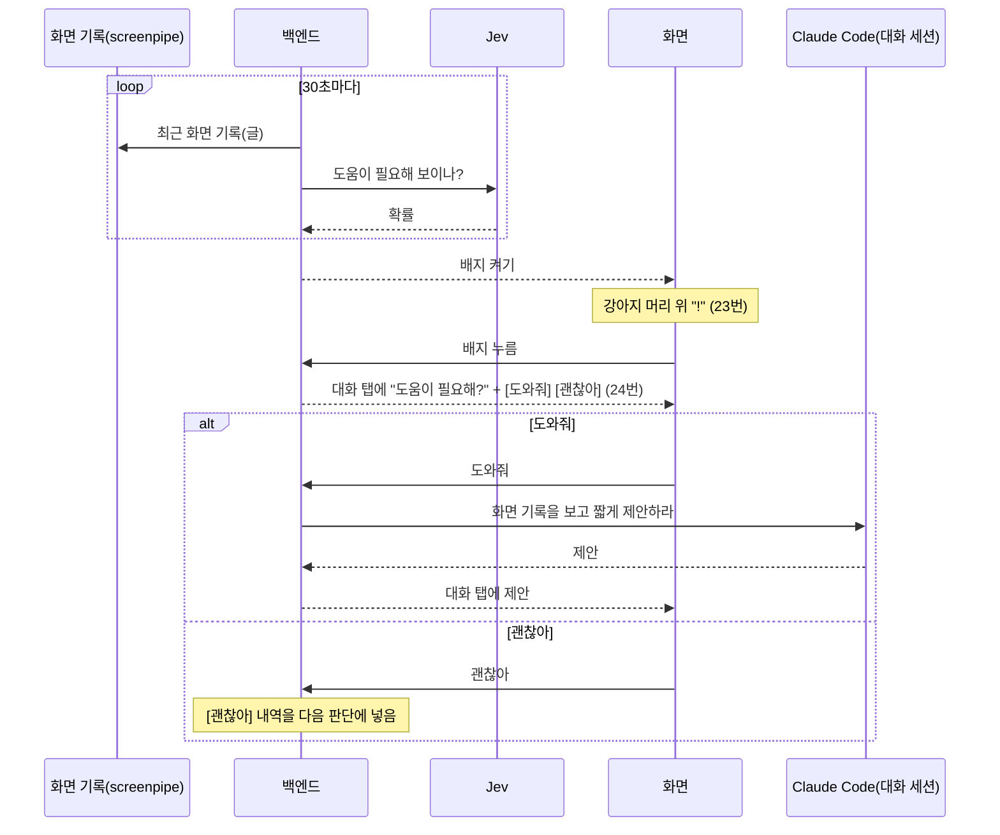

# 먼저 말 걸기 설계

- 날짜: 2026-10-22
- 화면: [디자인](../../design/2026-10-21-output-ui/README.md) 23·24번
- 결정: [0037](../../decisions/0037-jev-for-proactive-judgment.md) (판단은 Jev)

## 1. 왜

사용자가 같은 화면·내용·작업을 오래 보고 있거나 헤매고 있을 때, 강아지가 먼저 알아채고 도와줄지 묻는다 (사용자). 조수의 큰 목적(화면 히스토리로 맥락을 알아듣는다)을 사용자가 묻기 전에도 쓰는 기능이다.

## 2. 목표와 하지 않는 것

**목표**
- 헤매는 순간에 강아지가 "!" 배지로 알린다.
- 사용자가 원할 때만 의견·해결 방법을 짧게 말한다.

**하지 않는 것**
- 먼저 일을 대신 하지 않는다. 제안까지만 한다 (사용자).
- 배지만 띄운다. 말풍선·소리·창을 앞으로 가져오기 같은 끼어들기는 없다 (디자인: 말풍선 없음).

**실패로 보는 것 (사용자)**
- 말이 길다.

## 3. 흐름 (사용자)

1. 사용자가 같은 화면·내용·작업을 오래 보고 있거나 헤매는 것 같으면 강아지 머리 위에 "!" 배지가 뜬다. 한창 일하는 중이면 수시로 떠도 된다. 하루 몇 번 같은 상한은 없다.
2. 배지를 누르지 않으면 정해진 시간 동안 떠 있다가 사라진다. 다른 일로 넘어가도 바로 사라지지 않는다.
3. 배지를 누르면 패널이 대화 탭으로 열린다. 대화 맨 아래에 "강아지가 먼저 말을 걸었어요 · <시각>" 구분 글과 "도움이 필요해?" 같은 짧은 물음, 빠른 답 [도와줘] [괜찮아]가 뜬다. 이때는 아직 제안이 없다.
4. [도와줘]를 누르면 그때 Claude가 화면 기록을 보고 의견이나 해결 방법을 짧게 말한다. 이어서 평소 대화처럼 답하거나 일을 맡길 수 있다.
5. [괜찮아]를 눌러도 판단은 그대로 계속한다. 다만 언제 어느 작업에서 [괜찮아]라고 했는지를 다음 판단부터 Jev에 함께 넣어, Jev가 그 내역까지 고려해 새로 판단한다 (사용자, 2026-10-22. 처음에 정한 "한동안 다시 묻지 않는다"를 바꿨다).
6. 판단은 Jev가 한다. Jev API 키는 설정 탭에서 입력한다.
7. **작업 화면이면 배지가 뜬다** (사용자, 2026-10-22). 도움이 필요해 보이는지는 따지지 않는다. 단 같은 창에서 [괜찮아]라고 했으면 그 창에서는 띄우지 않는다(최근 1시간). 다른 창으로 옮기면 다시 뜬다 (사용자, 2026-10-22).

## 4. 정한 값 (Claude 판단, 잠정값)

사용자가 위 정리를 "정확하다"고 확인했다 (2026-10-22). 수치는 써 보며 고친다.

| 항목 | 값 | 근거 |
|---|---|---|
| 판단 주기 | 30초 | 헤매는 순간을 놓치지 않을 만큼 짧고, Jev 비용이 하루 약 $0.24(아래)로 작다 |
| 판단에 넣는 기록 | 최근 5분의 화면 기록 글(앱 이름, 창 제목, 접근성·OCR 글)을 2천 토큰 안으로 줄인 것 | "오래 보고 있다"를 보려면 몇 분 치가 필요하다. Jev는 글만 받는다 |
| 배지 기준값 | `working ≥ 0.7`이고 `declined_same < 0.5` | 잠정값. 아래 실측 |
| 배지 떠 있는 시간 | 5분 | 다른 일로 넘어간 뒤에도 잠깐 돌아볼 여유 |
| Jev에 넣는 [괜찮아] 내역 | 최근 1시간의 [괜찮아] (시각, 앱 이름, 창 제목) | 판단에 넣는 기록과 같은 글 모양이라 Jev가 지금 작업과 견줄 수 있다. 오래된 거절까지 넣으면 판단이 둔해진다 |
| 판단을 쉬는 때 | 로그아웃, 화면 기록 꺼짐, Jev 키 없음, 배지가 이미 떠 있음, 대화 중(답하지 않은 "도움이 필요해?"가 있거나 대화 세션이 답을 쓰거나 기다림, 미뤄 둔 [도와줘] 포함), 화면 기록을 비우는 중 | 쓸 수 없거나 겹치는 때. 비우는 중에 DB를 열면 Windows가 `db.sqlite`를 지우지 못한다. 대화 중에는 판단할 필요가 없다 (사용자, 2026-10-22: "대화 중에는 판단 돌릴 필요 없지"). 로그아웃은 백엔드가 화면에 마지막으로 보낸 `status`로 본다(로그인 CLI는 느려서 판단마다 부르지 않는다). 모를 때(아직 보낸 적 없음)는 판단하고, 배지를 켜기 직전에 CLI로 다시 확인한다 |
| Jev 실패 | 그 판단은 건너뛰고 로그에 실패 종류만 남긴다. 배지는 뜨지 않는다 | CLAUDE.md 3절 "외부 호출 격리" |
| [도와줘] 뒤 | 대화 탭의 대화 세션에서 이어진다 | 디자인 24번이 대화 탭이다 |

### Jev 질문과 배지 조건

질문 정의는 `backend/backend/proactive.py`의 `QUESTIONS`에 있다. 둘 다 `noul`이다.

| 이름 | `instructions` |
|---|---|
| `working` | 화면 기록을 보면 사용자가 지금 작업 화면(문서·코드·표·기획·업무 도구 등)에서 일하고 있다. 영상·음악·쇼핑·SNS·게임 화면이면 아니다 |
| `declined_same` | 마지막 줄 '최근 [괜찮아]' 목록에, 화면 기록의 가장 최근 줄과 앱 이름과 창 제목이 같은 항목이 있다. 목록이 '없음'이면 아니다 |

- 배지 조건: `working ≥ 0.7`이고 `declined_same < 0.5`. 작업 화면이면 뜨고, 같은 창에서 거절했으면 그 창에서는 뜨지 않는다(사용자). 임계값은 잠정값이다.
- 처음에는 "헤매고 있다"(`need_help`)를 물었다. 사용자가 "작업 화면이면 뜬다"로 바꿨다(2026-10-22). 작업 중이면 `working`이 늘 0.9 안팎이라, 거절 때 기준만 올리는 처음 방식으로는 거절이 반영되지 않아 "같은 창이면 띄우지 않는다"로 바꿨다(사용자 선택).
- 한 문장에 둘을 섞으면 판단이 흐려져 둘로 나눴다.
- 판단 기록: 최근 5분 중 `app.exe`·`AssistantChatBot.exe`가 아니고 앱 이름이 있는 프레임. 앱 이름이 없는 프레임은 포커스 없는 다른 모니터를 찍은 것이라 뺀다(2026-10-22 확인: 최근 1시간 306개 중 97개, 같은 화면 반복). 줄마다 `HH:MM:SS 앱 · 창 제목 글(앞 300자)`, 새 것부터 채워 2,000자 안, 끝 줄은 `최근 [괜찮아]: ...`(없으면 `없음`). 거절은 새 것 10개까지만 넣는다(잠정값. 거절이 많아도 화면 기록 줄이 밀려나지 않게). 글은 `full_text`, 없으면 `accessibility_text`.
- 읽는 곳: screenpipe HTTP API는 토큰이 필요해(2026-10-22 확인) `~/.screenpipe/db.sqlite`의 `frames`를 읽기 전용으로 직접 읽는다.

Jev 실측 (2026-10-22, `jev-1.14.0`, 응답 0.2~0.3초, 위 질문 문구):

| 상황 | working | declined_same |
|---|---|---|
| 엑셀 오류 | 0.92 | — |
| 코딩·문서 작성, 거절 없음 | 0.96 | 0.06~0.12 |
| 노션 기획 | 0.89 | — |
| 유튜브·쇼핑 | 0.07~0.11 | 0.11 |
| 같은 창에서 거절 | 0.96~0.97 | 0.65~0.83 |
| 다른 창에서 거절 | 0.93 | 0.19 |

비용 어림: 30초마다 2천 토큰이면 하루 2,880번 × 2천 = 약 576만 토큰. 업체 발표 단가 $0.042/100만 토큰으로 약 $0.24/일 ([Jev 레퍼런스](../../references/typesafe-jev.md), 독립 검증 안 됨).

## 5. 구조

- **백엔드에 판단 고리(`Proactive`)를 둔다.** 스케줄러처럼 백엔드 안에서 30초마다 돈다.
- **화면 기록 읽기:** screenpipe DB(`~/.screenpipe/db.sqlite`)를 읽기 전용으로 읽는다(HTTP API는 토큰이 필요해서). 클라이언트 계층(`clients.py`의 `ScreenHistory`)을 거친다.
- **Jev 호출:** 클라이언트 계층을 거친다. 질문 정의(`instructions`)는 한곳에 둔다 (CLAUDE.md 4절).
- **Jev 키:** 설정 탭 입력칸 → 백엔드 `settings` 테이블에 저장. 화면에는 키 원문을 다시 보내지 않고 "입력됨/없음"만 보낸다.
- **프로토콜:** 배지 켜고 끄기, 배지 누름, [도와줘]·[괜찮아], Jev 키 설정을 v7에 더한다. 이름과 모양은 [프로토콜](../../backend-protocol.md#먼저-말-걸기)에 있다.
- **[도와줘]의 Claude 호출:** 대화 세션에 "최근 화면 기록을 찾아보고 사용자가 막힌 지점에 대해 의견이나 해결 방법을 두세 문장으로 말하라"는 지시를 보낸다. 이 지시 글은 사용자 말 줄로 보이지 않는다.

## 5.1 화면 기록을 Jev에 보내는 것

- 화면 기록 글을 걸러 내지 않고 그대로 Jev에 보낸다. 따로 끄는 스위치도 두지 않는다. 화면 기록은 이미 Claude Code에도 보내고 있다 (사용자, 2026-10-22).
- Jev 키는 다른 설정처럼 이 PC의 백엔드 DB(`settings`)에 그대로 저장한다 (Claude 판단).
- 강아지 앱 자신의 창은 판단 기록에서 뺀다 (Claude 판단).
- [도와줘]를 눌렀을 때 대화 세션이 답을 쓰는 중이면, 그 답이 끝난 뒤 이어서 처리한다 (Claude 판단).
  - 답을 쓰는 중(`working`)이면 돌고 있는 세션에 덧붙인다. Claude Code가 지금 답 뒤에 받는다.
  - 질문·제안의 답을 기다리는 중(`waiting`)이면 숨은 지시를 그 답으로 쓰지 않는다. `도와줘` 줄만 남기고 지시는 미뤄 둔다(하나만, 새 것이 옛 것을 바꾼다). 그 실행이 끝나면 끝난 세션에 `say`하듯 이어 묻는다. 그사이 대화 세션을 멈추거나 지우면 버린다.

## 6. 구현할 사람에게 맡기는 것

- screenpipe API의 어느 엔드포인트로 최근 기록을 읽을지 (Context7·문서로 확인).
- 기록을 2천 토큰 안으로 줄이는 방법.
- Jev 질문의 정확한 `instructions` 문구 (문서에 근거와 함께 적는다).
- 프로토콜 메시지 이름과 필드.
- 배지·구분 글·빠른 답 칩의 화면 값은 다이제스트 23·24번을 따른다.

## 7. 아직 정하지 않은 것

- 배지 기준값 0.7이 맞는지는 써 봐야 안다.
